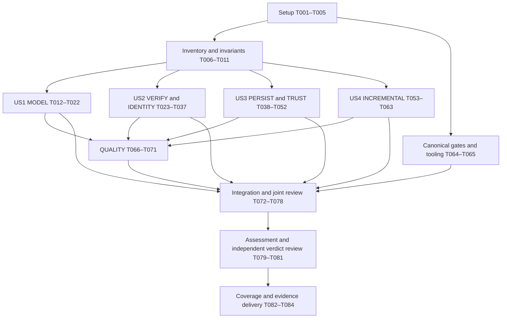

# Tasks: Core Mathematical Soundness and Code Quality Audit

**Input**: Design documents in `specs/016-core-soundness-audit/`.

**Prerequisites**: [spec.md](spec.md), [plan.md](plan.md),
[research.md](research.md), [data-model.md](data-model.md),
[audit-evidence contract](contracts/audit-evidence.md),
[parallel-work contract](contracts/parallel-work.md) and
[execution guide](quickstart.md).

**Status**: Audit complete:84/84 tasks have evidence and independent review.
The qualified verdict is NOT YET SOUND; findings remain unresolved. Completing
the audit does not authorize remediation.

**Tests**: The specification explicitly requires review of existing tests,
collection and execution, independent comparisons and defect reproductions.
Existing tests do not need to be rewritten to pretend that they were test-first.
New tests/instrumentation use exact-base isolated overlays; a newly implemented
deterministic helper requires a meaningful observed failing test before its
implementation. No helper, new dependency or production change is mandated.

**Organization**: User-story phases deliver independently reviewable audit
increments. Specialist drafting may overlap after the shared inventory barrier;
cross-component closure and the final verdict wait for all required handoffs.

## Format and path conventions

- Each task uses `- [ ] Tnnn [P?] [USn?] Description with file path`.
- `[P]` marks disjoint writes that may proceed together after their stated
  prerequisites. It never authorizes concurrent heavy test/build runs or writes
  to another lane's report. Unmarked tasks run sequentially within their owner.
- All paths are relative to the `behavior-ir-core` audit checkout. Baseline source
  inspection/execution uses the unchanged release worktree; feature reports and
  evidence are written in the audit checkout. Overlay paths are recorded explicitly.
- COORD owns canonical metadata, `findings.md`, `proof-obligations.md` and
  `audit-summary.md`. MODEL, VERIFY, IDENTITY, PERSIST, TRUST, INCREMENTAL and
  QUALITY retain the report ownership defined by the parallel-work contract.
- Reviewer paths name the reviewing lane, not the author. COORD assigns a person
  different from the author; reusing a worker for another lane does not create
  independent review of that worker's earlier work.
- At most three active workers plus COORD; rotate seven logical lanes through
  bounded waves. Queue all compilation, solver-heavy and fault runs through COORD.
  One runner executes canonical gates on the pristine baseline.
- Do not edit production source, schemas, fixtures, hashes, admission, public APIs,
  dependencies or release metadata. No correction, cleanup, publication or
  ecosystem pin change is part of these tasks.

## Phase 1: Setup — source custody and coordination

**Purpose**: Establish B0 provenance and exclusive ownership before inspection.

- [X] T001 Verify the owning remote, branch and existing dirt; create an unchanged detached worktree at `1e286ebcf1d61117320c57df155fa1ef9397e880`, assert tree `6a9f9879a9fece5a001ca30ace483a8cde1addd9`, preserve unrelated checkouts, and record release versus same-tree audit-start identities and tracked source hashes in `specs/016-core-soundness-audit/evidence/baseline.json` and `specs/016-core-soundness-audit/evidence/source-manifest.json` using `quickstart.md` section 1.
- [X] T002 Capture actual pinned Rust/Cargo/Python/Z3/Nix/platform versions, resolved solver path, non-secret configuration, workspace/consumer metadata and lock/toolchain digests; retain stdout/stderr/exit status even on tool failure in `specs/016-core-soundness-audit/evidence/runs/COORD/preparation/` and populate `specs/016-core-soundness-audit/evidence/environment.json` without copying historical results.
- [X] T003 Reserve single-writer report, fragment, run and review paths for seven logical lanes and COORD; assign different-person reviewers, bounded worker waves, one gate runner, queued heavy runs and B0–B4 dependencies in `specs/016-core-soundness-audit/evidence/assignments.json` following `contracts/parallel-work.md`.
- [X] T004 Initialize manual audit record/ID conventions and empty integration ledgers in `specs/016-core-soundness-audit/evidence/fragments/COORD/record-conventions.md`, `specs/016-core-soundness-audit/findings.md` and `specs/016-core-soundness-audit/proof-obligations.md`; enforce the exact vocabulary below, stable `C/O/E/F/B/R-<LANE>-001` IDs and retained G1–G12 IDs without inventing completed claims or a verdict.
- [X] T005 Register every prior claim in `docs/soundness-remediation.md`, related query/read-replay corrections and 014/015 evidence, including the non-local creation/post-commit validity lead, in `specs/016-core-soundness-audit/evidence/fragments/COORD/prior-leads.md`; record source revision, applicability, responsible lane and required reassessment, keeping historical evidence distinct from new 016 evidence.

T004 uses these binding constraints from the data model and evidence contract:

| Record | Required vocabulary or constraint |
| --- | --- |
| Construct presence | `present`, `absent with evidence`, `unresolved`; unresolved/uninspected meaning never counts as classified. |
| Primary obligation status | Exactly one of `proven by construction`, `established by a code invariant`, `covered empirically by tests`, `assumed but documented`, `not yet established`; split differently supported scopes and retain supplementary evidence separately. |
| Recorded run outcome | `pass`, `fail`, `inconclusive`, `skipped`, `unavailable`; compilation failure is not a runtime counterexample and skipped tests are not passes. |
| Finding classification | One category S0–S7 and severity `Critical`, `High`, `Medium`, `Low` or `Observation`, with semantic justification. |
| Lead lifecycle | `lead → investigated → finding or evidenced non-finding`, followed by independent review and integration; unresolved leads remain open. |
| Review disposition | `accepted`, `changes required`, `disputed`; disagreement is not settled by voting. |
| Assignment lifecycle | `assigned`, `in-review`, `integrated`; dependencies must be accounted for before integration. |
| Custody | Raw evidence/patches are immutable; each rerun uses a fresh path and E-ID, and each file has one current writer. |

**Checkpoint B0**: Baseline identities, environment outcomes, ownership and run
custody are recorded. Identity/cleanliness failures stop baseline execution;
unavailable tools remain explicit limitations rather than assumed success.

## Phase 2: Foundational — shared inventory and initial obligations

**Purpose**: Establish B1 before specialist conclusions. These are provisional
inventory/model drafts, not completed US1 findings or established invariants.

- [X] T006 [P] MODEL drafts the authority-based mathematical inventory in `specs/016-core-soundness-audit/semantic-model.md` and source/subform coverage in `specs/016-core-soundness-audit/evidence/fragments/MODEL/inventory.md`, enumerating every FR-002 construct and actual type/value/expression/effect/role variant from `crates/behavior-core/src/semantic/` and `facts.rs`; expand the 015 operator-family seed rather than treating its 34 families as complete coverage.
- [X] T007 [P] COORD inventories `api/engine-surface.txt`, facade/CLI entry points, `schema/`, fixtures and actual decoder/profile/record paths in `specs/016-core-soundness-audit/evidence/fragments/COORD/surface-profiles.md`; distinguish fresh admission, runtime semantic profile, document/record format, historical schema position and verifier/evidence eligibility, including decoder refusals and read-record v1/v2 differences.
- [X] T008 [P] QUALITY inventories first-party production versus external/inline test source, test targets, crate boundaries, mutable owners and potential panic/unsafe sites in `specs/016-core-soundness-audit/evidence/fragments/QUALITY/source-inventory.md`; identify `cfg(test)` boundaries and baseline source locations so raw search counts are not mistaken for reachability or dependency audit coverage.
- [X] T009 COORD reconciles T006–T008 with every FR-002 concept, public surface entry, operator subform, identity domain, path/version family and mutation boundary in `specs/016-core-soundness-audit/evidence/coverage.json`; record explicit denominators, evidenced absences, owner/report links and unresolved authority without dropping uncovered rows.
- [X] T010 MODEL drafts G1–G12 and any additional global obligations in `specs/016-core-soundness-audit/global-invariants.md`, linking existing authority, version/path applicability, premises, enforcing locations and initial qualified status; use S4 leads for unclear/conflicting meanings instead of deriving intended semantics from implementation convenience.
- [X] T011 COORD reconciles T009–T010, allocates construct/obligation/boundary IDs and review dependencies, and records the B1 inventory barrier in `specs/016-core-soundness-audit/evidence/assignments.json` and `specs/016-core-soundness-audit/evidence/coverage.json`; freeze the initial inventory with an amendment/re-review process while retaining uncertain propositions as uncertain.

**Checkpoint B1**: All stories can inspect against the same accounted-for objects,
versions and candidate obligations. Passing B1 means shared scope is reconciled,
not that the kernel is sound. New discoveries amend coverage and reopen affected
reviews through MODEL/COORD.

## Phase 3: User Story 1 — Understand the mathematical kernel (Priority: P1)

**Goal**: Deliver complete independent reference meanings and an invariant map.

**Independent test**: For every scoped construct and G1–G12 candidate, a reviewer
can follow mathematical meaning → existing authority → enforcing code → qualified
evidence, or find a concrete underspecification/open obligation. Rust containers
do not determine mathematical objects.

### Evidence collection and evaluation

- [X] T012 [US1] MODEL maps semantic unit/negative/property tests to initial obligations, requests serialized workspace/consumer collection and selected execution, and records actual names/counts/ignored cases and comparator assumptions in `specs/016-core-soundness-audit/evidence/fragments/MODEL/test-coverage.md` and `specs/016-core-soundness-audit/evidence/runs/MODEL/`; distinguish source presence, collection and execution.
- [X] T013 [US1] Define all scalar/nominal/Option/reference types, value domains, exact arithmetic, finite bounds, conversions and explicit rounding independently of Rust representations in `specs/016-core-soundness-audit/semantic-model.md`, tracing `semantic/types.rs`, `semantic/value.rs`, `exact.rs`, `decimal.rs` and admission bounds to preservation obligations and reachable numeric errors.
- [X] T014 [US1] Define expression/predicate, field access, derived composition, short-circuit, alias/binding and scope semantics in `specs/016-core-soundness-audit/semantic-model.md`; expand every actual expression variant and dependency/error path from `semantic/expr.rs`, admission and `eval.rs`, recording unsupported meaning as an S4 lead rather than omitting the operator.
- [X] T015 [US1] Model live state, typed entity identities/lifecycle, history-sensitive `ever_used`, facts/observations, semantic cells, deltas and apply in `specs/016-core-soundness-audit/semantic-model.md`; separate StateId from history position and state-derived facts from supplied historical evidence using `facts.rs`, `eval.rs` and the Backend contract.
- [X] T016 [US1] Define query memberships, projections, aggregates, derived values and pure reads with actual set/bag/sequence distinctions, empty-result behavior, explicit inputs and evidence in `specs/016-core-soundness-audit/semantic-model.md`, tracing `read.rs` and query evaluation to indexed/unindexed and enumeration-independence obligations.
- [X] T017 [US1] Document full transition, validation, migration, invocation/binding, replay and verification meanings, including guards, command-intent multisets, refusals and evidence in `specs/016-core-soundness-audit/semantic-model.md`; derive signatures from each versioned contract rather than forcing the specification's illustrative signatures.
- [X] T018 [US1] Complete the result/error algebra and precedence table in `specs/016-core-soundness-audit/semantic-model.md` for refusal, evaluation, binding/input, invalid-state, verification, backend and internal failures, including Value→Value, Value→Error, Error→Value and Error→Error and inactive/short-circuited paths; identify semantic versus operational observations.
- [X] T019 [US1] Trace each G1–G12 and additional invariant through its construct/path premises, existing authority, code and evidence in `specs/016-core-soundness-audit/global-invariants.md`; qualify every linked obligation with exactly one T004 primary status and request amendments for missing scope rather than claiming global proof from tests.
- [X] T020 [US1] Execute or explicitly account for the T012 semantic negative/property and plain-versus-store overlap comparisons in `specs/016-core-soundness-audit/evidence/runs/MODEL/` and `specs/016-core-soundness-audit/evidence/fragments/MODEL/test-coverage.md`; use direct contract-based assertions, disclose common helpers, record seeds/domains and retain missing coverage as open obligations.

### Independent review and handoff

- [X] T021 [US1] Assign a different-person VERIFY reviewer to check inventory completeness, independent mathematical objects, result/ordering domains and invariant evidence in `specs/016-core-soundness-audit/evidence/reviews/VERIFY/model-review.md`; check all T006/T007 rows and retain `changes required` or `disputed` conclusions where authority is unresolved.
- [X] T022 [US1] MODEL answers T021 through its owned fragments, completes `specs/016-core-soundness-audit/semantic-model.md` and `specs/016-core-soundness-audit/global-invariants.md`, and submits stable construct/obligation/evidence/finding IDs to COORD in `specs/016-core-soundness-audit/evidence/fragments/MODEL/handoff.md`; mark outbound specialist-dependent claims open for T076 rather than manufacturing closure.

**Checkpoint**: US1 is independently reviewable as the first audit increment.
Its model remains amendable; this increment alone does not justify a soundness verdict.

## Phase 4: User Story 2 — Detect unsound proofs and semantic identities (Priority: P1)

**Goal**: Deliver exhaustive runtime/verifier correspondence and identity/ordering
audits against legal executions and each domain's actual equivalence relation.

**Independent test**: A reviewer can enumerate every verifier assumption and hash
domain, locate the exact guarantee or missing obligation, and reproduce a reported
legal-execution mismatch or canonical ambiguity. INCONCLUSIVE is not a false proof.

### Evidence preparation

- [X] T023 [P] [US2] VERIFY maps existing soundness, arithmetic, alias, query, read, migration, invocation and command-safety tests to every modeled check/profile in `specs/016-core-soundness-audit/evidence/fragments/VERIFY/test-coverage.md`; reserve collection/execution requests and prior-lead dispositions without assuming a historical fix proves current correspondence.
- [X] T024 [P] [US2] IDENTITY maps canonicalization, identity, serialization, query-order, command-bag and record tests to domain equivalence laws in `specs/016-core-soundness-audit/evidence/fragments/IDENTITY/test-coverage.md`; enumerate canonicalization idempotence, semantic encode/decode, metadata changes and unordered permutations and request relevant collected cases.

### Drafting and challenges

- [X] T025 [P] [US2] VERIFY inventories all admission/runtime guarantees and solver assumptions in `specs/016-core-soundness-audit/runtime-verifier-correspondence.md`, giving exact enforcing/encoding sites, reliance, proposition, applicable profile/path and evidence status for every actual verification check in `crates/behavior-verify/src/`.
- [X] T026 [P] [US2] IDENTITY inventories every FR-011 identity domain in `specs/016-core-soundness-audit/identity-audit.md`, including behavior/schema/declaration/content/state/transition/read/invocation/migration/command intent and occurrence/governance evidence/cache keys, with included/excluded distinctions, canonical preimages, tags/versions and cryptographic assumptions.
- [X] T027 [US2] VERIFY challenges type/finite-bound assumptions, aliases, incoming/resulting validity, query/reference/schema models, derived closures, short-circuit and command guard/payload error activation in `specs/016-core-soundness-audit/runtime-verifier-correspondence.md`; distinguish unreachable solver models, conservative refusal and legal `PROVEN` counterexamples, recording the latter as critical S2 leads pending reproduction/review.
- [X] T028 [US2] IDENTITY audits canonical serialization, equivalent representations, metadata exclusion, omitted semantic data, ambiguous encodings, duplicate keys and unknown-field profile behavior in `specs/016-core-soundness-audit/identity-audit.md`; distinguish pre-hash ambiguity from assumed digest security and never claim finite hashes are collision-free.
- [X] T029 [US2] VERIFY separates historical document/replay semantics from fresh proof/governance eligibility in `specs/016-core-soundness-audit/runtime-verifier-correspondence.md`, checking actual admission and current authenticated evidence requirements rather than using advertised formats or archived proof envelopes as current guarantees.
- [X] T030 [US2] IDENTITY classifies every FR-012 collection and all hash dependencies in `specs/016-core-soundness-audit/identity-audit.md`, checking multiplicity, canonical versus semantic ordering, incidental source/map/backend order, StateId versus history and command occurrence derivation; document identity cycles or evidence that dependency edges are acyclic.
- [X] T031 [US2] VERIFY executes queued collected soundness/error-path cases and independently justified legal-execution challenges in `specs/016-core-soundness-audit/evidence/runs/VERIFY/`; preserve minimized reproducers, exact proof propositions, solver outcomes and scope, and report unavailable/INCONCLUSIVE cases without promoting them to proof or defect.
- [X] T032 [US2] IDENTITY executes queued collected property/metamorphic cases for canonical idempotence, semantic round trips, unordered permutations, metadata changes and equivalent live states reached through different histories in `specs/016-core-soundness-audit/evidence/runs/IDENTITY/`; compare canonical preimages and identities under domain-specific equivalence, retaining negative cases and shared assumptions.
- [X] T033 [US2] VERIFY and IDENTITY resolve their T005 prior leads and remaining decisive challenges in separately owned `specs/016-core-soundness-audit/evidence/fragments/VERIFY/prior-leads.md` and `specs/016-core-soundness-audit/evidence/fragments/IDENTITY/prior-leads.md`; use disclosed exact-base test-only overlays when existing cases cannot demonstrate the claim, or record the investigation as not yet established without implementing a fix.

### Independent review and handoff

- [X] T034 [P] [US2] A different-person MODEL reviewer checks the complete verifier table, legal input premises, encoding/runtime errors and decisive PROVEN/counterexample evidence in `specs/016-core-soundness-audit/evidence/reviews/MODEL/verifier-review.md`; leave cross-component prerequisites open for T076.
- [X] T035 [P] [US2] A different-person PERSIST reviewer checks identity domains, canonical distinctions, ordering/multiplicity, historical applicability and decisive reproduction evidence in `specs/016-core-soundness-audit/evidence/reviews/PERSIST/identity-review.md`; request MODEL/TRUST boundary input where needed without requiring those reports' final review first.
- [X] T036 [US2] VERIFY answers T034, completes `specs/016-core-soundness-audit/runtime-verifier-correspondence.md` and submits its findings/obligations/evidence, conservative limitations and QUALITY notes in `specs/016-core-soundness-audit/evidence/fragments/VERIFY/handoff.md`; unresolved challenges remain visible.
- [X] T037 [US2] IDENTITY answers T035, completes `specs/016-core-soundness-audit/identity-audit.md` and submits domain coverage, findings/obligations/evidence and QUALITY notes in `specs/016-core-soundness-audit/evidence/fragments/IDENTITY/handoff.md`; preserve outstanding joint-boundary reviews for T076.

**Checkpoint**: Both US2 tables are complete and independently inspectable, with
each mismatch or uncertainty linked to a finding or open obligation.

## Phase 5: User Story 3 — Establish trust across commit and replay (Priority: P1)

**Goal**: Account for authority, durability, failure behavior, evidence and
historical meaning at every persistence/replay/trust boundary.

**Independent test**: For each actual path and mutation boundary, a reviewer can
identify the authoritative outcome, required checks versus external assumptions,
and failure/replay evidence. Lost acknowledgment differs from failed commit.

### Evidence preparation

- [X] T038 [P] [US3] PERSIST inventories every ordinary/command-only/migration commit, read and standalone/store-backed replay form, Backend mutation boundary and existing conformance/fault/durable-consumer test in `specs/016-core-soundness-audit/evidence/fragments/PERSIST/path-test-inventory.md`; request actual collection and identify unsupported or untested failure points explicitly.
- [X] T039 [P] [US3] TRUST inventories caller/document/host/backend/adapter/evidence/cache producers, all FR-027 adversarial cases and existing rejection tests in `specs/016-core-soundness-audit/evidence/fragments/TRUST/boundary-test-inventory.md`; map exact profile, semantic obligation, trust assumption and requested execution per case.

### Drafting and challenges

- [X] T040 [P] [US3] PERSIST traces pre-state, candidate, observations, validity, governance, CAS, records, indexes, head and post-state for every commit path in `specs/016-core-soundness-audit/persistence-replay-audit.md`, citing `crates/behavior-store/src/lib.rs`, `store.rs`, `memory.rs`, command paths and migration code and naming the component responsible for each durability guarantee.
- [X] T041 [P] [US3] TRUST writes the complete trust/check/assumption/rejection table in `specs/016-core-soundness-audit/trust-boundary-audit.md`, including facade/CLI decoding and Core/internal boundaries; distinguish required conformance/integrity detection from arbitrary backend dishonesty outside the valid contract domain.
- [X] T042 [US3] PERSIST audits index/query/command materialization derivation and reconstruction from canonical state/history in `specs/016-core-soundness-audit/persistence-replay-audit.md`, accounting for stale, reordered, omitted and corrupt entries, mandatory validation and any documented internal-integrity assumptions.
- [X] T043 [US3] TRUST checks every applicable FR-027 case against code and evidence in `specs/016-core-soundness-audit/trust-boundary-audit.md`, including malformed/duplicate/unknown document fields, type/identity confusion, aliases, stale/contradictory facts, forged observations, wrong schema/behavior, replay substitution, hash domains and incorrectly state/store/policy-bound evidence.
- [X] T044 [US3] PERSIST defines what each standalone/store-backed transition, migration, read, command-producing, invocation/refusal and historical replay form proves in `specs/016-core-soundness-audit/persistence-replay-audit.md`; trace immutable evidence and exact schema/profile/history selection, legacy limits, non-mutation, absence of external dispatch and independence from current external systems/caches.
- [X] T045 [US3] PERSIST executes queued collected read-error, CAS/interleaving, every mutation-boundary, partial-write and lost-acknowledgment cases in `specs/016-core-soundness-audit/evidence/runs/PERSIST/`, using existing conformance/history injectors and applicable `consumer/tests/command_crash_recovery.rs` evidence; record authoritative state/commands and separately label backend-supplied durability assumptions and uncovered boundaries.
- [X] T046 [US3] TRUST audits governance integrity, authenticated issuers, policy authorization and exact whole-candidate/context/store/state binding in `specs/016-core-soundness-audit/trust-boundary-audit.md`; examine command guards/payloads, historical structural evidence versus current trust, authorization reuse and exposure of uncommitted command occurrences without treating hashes or names as authority.
- [X] T047 [US3] PERSIST executes queued replay/original and indexed/unindexed query comparisons, historical-schema/current-head variations, rebuilt/reordered indexes and semantically relevant record-field tampering in `specs/016-core-soundness-audit/evidence/runs/PERSIST/`; account for every field's identity/replay consequence and verify replay neither mutates state nor dispatches commands, preserving intentionally excluded metadata/legacy limits.
- [X] T048 [US3] TRUST executes queued collected negative cases for stale/forged/contradictory inputs and wrong schema/behavior/evidence/policy/store/state bindings in `specs/016-core-soundness-audit/evidence/runs/TRUST/`; use exact-base disclosed overlays for missing decisive cases or retain open coverage obligations, including adapter/dispatch responsibilities outside Core's boundary.

### Independent review and handoff

- [X] T049 [P] [US3] A different-person IDENTITY reviewer challenges atomicity assumptions, failure outcomes, every replay contract and tamper/record identity evidence in `specs/016-core-soundness-audit/evidence/reviews/IDENTITY/persistence-review.md`; distinguish implementation enforcement from backend promises and retain unresolved joint paths.
- [X] T050 [P] [US3] A different-person VERIFY reviewer challenges trust claims, legal/adversarial domains and integrity/authentication/authorization evidence in `specs/016-core-soundness-audit/evidence/reviews/VERIFY/trust-review.md`; review decisive executable cases independently and account for inability to reproduce.
- [X] T051 [US3] PERSIST answers T049, completes `specs/016-core-soundness-audit/persistence-replay-audit.md` and submits path/boundary coverage, prior-lead dispositions, findings/obligations/evidence and QUALITY notes in `specs/016-core-soundness-audit/evidence/fragments/PERSIST/handoff.md`, keeping T076 dependencies explicit.
- [X] T052 [US3] TRUST answers T050, completes `specs/016-core-soundness-audit/trust-boundary-audit.md` and submits trust obligations, prior-lead dispositions, findings/evidence and QUALITY notes in `specs/016-core-soundness-audit/evidence/fragments/TRUST/handoff.md`, without issuing an independent soundness verdict.

**Checkpoint**: Every actual path/boundary has accounted-for guarantees, evidence
and limits. External backend durability is never represented as universally proved
by a reference-backend test.

## Phase 6: User Story 4 — Verify optimization without changing meaning (Priority: P1)

**Goal**: Audit 014/015 as private optimization of full reference semantics,
including unsupported paths and potential common defects.

**Independent test**: A reviewer can identify the exact selected domain, complete
dependency premises, state/history/semantic bindings and commit lifecycle, and
compare independent resulting-state validity as well as implementation agreement.

### Evidence preparation and audit

- [X] T053 [US4] INCREMENTAL inventories 014/015 reuse, eligibility, fallback, reference-derivative and cache-lifecycle tests in `specs/016-core-soundness-audit/evidence/fragments/INCREMENTAL/test-coverage.md`; request actual collection/execution, distinguish private test machinery from production code and declare comparator/shared-helper assumptions.
- [X] T054 [US4] Identify full validation's normative inputs and the selected incremental domain in `specs/016-core-soundness-audit/incremental-validation-audit.md`, defining all components of `M` and exact committed store/state/history/schema/behavior/validation-semantic binding from `store.rs`, snapshot reuse and `store/incremental/`.
- [X] T055 [US4] Audit complete transitive dependency closure, aliases, derived/error dependencies and unknown-as-affected classification in `specs/016-core-soundness-audit/incremental-validation-audit.md`; trace complete changed/created-row validation, historical `ever_used` freshness and resulting-state references, including creates whose references target other candidate creates.
- [X] T056 [US4] Trace the actual full-validator call sites and parent/child obligations for global/query/cross-entity/unknown, removals and migration/ineligible paths in `specs/016-core-soundness-audit/incremental-validation-audit.md`; do not assume the existing fallback validates the full resulting state merely because it is called the full path.
- [X] T057 [US4] Audit candidate construction, validation materialization and post-CAS publication/eviction/reconstruction in `specs/016-core-soundness-audit/incremental-validation-audit.md`, including refused/failed/uncertain commits, equal StateId at different histories, changed schemas/behaviors, discarded/stale/corrupt caches and proof obligations for eliminated reads.
- [X] T058 [US4] Review `crates/behavior-core/src/incremental_proof/` and private delta/reference machinery in `specs/016-core-soundness-audit/incremental-validation-audit.md` for full-result-domain comparison and Value/Error transitions; verify it introduces no language/operator support requirement, Wire/public API/admission/hash/replay semantics or authoritative validation state.
- [X] T059 [US4] Execute queued collected optimized/full comparisons with independent reconstructed parent/child validation, lifecycle/freshness/reference/CAS/cache-loss cases and semantic-result/evidence/hash comparisons in `specs/016-core-soundness-audit/evidence/runs/INCREMENTAL/`; assess actual G3 validity directly, disclose circular or shared premises, and exclude backend traces/hypothetical omitted-read errors while retaining performed-call error contracts.
- [X] T060 [US4] Independently reproduce the non-local create/post-commit invalidity lead using `crates/behavior-store/tests/incremental_validation.rs::nonlocal_creation_preserves_014_refusal_boundary` and the full-child oracle in `crates/behavior-store/src/store/incremental/tests.rs`; retain exact collected/executed evidence and any independent test-only overlay in `specs/016-core-soundness-audit/evidence/runs/INCREMENTAL/` and classify it against existing authority without adding a new refusal or treating a passing characterization as G3 proof.
- [X] T061 [US4] Account for record/hash/admission/public-surface/governance/replay preservation and actual fallback/cache-rebuild coverage in `specs/016-core-soundness-audit/incremental-validation-audit.md`, cross-linking IDENTITY/PERSIST/TRUST evidence and recording missing negative/metamorphic cases rather than inferring preservation from timing measurements.

### Independent review and handoff

- [X] T062 [US4] A different-person MODEL reviewer, with PERSIST/TRUST boundary input, challenges selected-domain equivalence, dependency completeness, omitted obligations, commit-only reuse and the independently reproduced create lead in `specs/016-core-soundness-audit/evidence/reviews/MODEL/incremental-review.md`; preserve undecided common-reference defects and required T076 handoffs.
- [X] T063 [US4] INCREMENTAL answers T062, completes `specs/016-core-soundness-audit/incremental-validation-audit.md` and submits findings/obligations/evidence, full/fallback distinctions and QUALITY notes in `specs/016-core-soundness-audit/evidence/fragments/INCREMENTAL/handoff.md`, with no repair or new optimization.

**Checkpoint**: Every reuse/fallback obligation has an explicit qualified status.
Optimized/full agreement alone neither establishes validity nor closes a shared defect.

## Phase 7: User Story 5 — Decide on corrections from evidence (Priority: P2)

**Goal**: Deliver evidence-qualified maintainability/complexity review, integrated
findings and obligations, root-cause correction proposals and one qualified verdict.

**Independent test**: Every area assessment, verdict premise and proposed correction
traces to existing authority and concrete evidence. Known S0–S3 or blocking
unestablished obligations force NOT YET SOUND; a complete audit need not be positive.

### Required checks and tooling assessment

- [X] T064 [US5] COORD runs unchanged `nix develop -c scripts/gates.sh` once on the pristine release baseline, retaining exact source/environment, stdout/stderr/exit, collection and skipped checks in `specs/016-core-soundness-audit/evidence/runs/COORD/baseline-gates/`; if fail-fast stops execution, run every remaining feasible stage with its exact unchanged baseline command in separate records, retain unavailable/prerequisite-blocked gaps and never relabel the failed canonical run as passing.
- [X] T065 [US5] COORD evaluates all-feature coverage from actual package metadata and Miri/sanitizer/fuzz/property tooling against identified uncovered risks in `specs/016-core-soundness-audit/evidence/fragments/COORD/tooling-assessment.md`; execute justified available supplemental checks in queued fresh run directories, or document equivalence/non-applicability/unavailability without adding heavy dependencies or counting omissions as passes.

### Code-quality and complexity audit

- [X] T066 [US5] QUALITY reviews type-encoded versus repeated invariants, primitive identity confusion, boolean/option modes, module responsibility/conceptual cycles, naming and mathematical comments in `specs/016-core-soundness-audit/code-quality-audit.md`, using T008 and lane contributions and tying each recommendation to a concrete semantic or maintenance risk.
- [X] T067 [US5] QUALITY classifies every scoped production `unwrap`/`expect`/`panic`/`unreachable` site with exact location, established invariant or untrusted reachability argument in `specs/016-core-soundness-audit/code-quality-audit.md`; audit every unsafe block's safety/caller obligations or evidence first-party absence, separating inline tests and excluding unaudited dependency internals.
- [X] T068 [US5] QUALITY audits semantic duplication across runtime/replay/verifier/store/plain/read/action/legacy/unified/full/incremental paths and every mutable state lifetime/owner in `specs/016-core-soundness-audit/code-quality-audit.md`; distinguish required historical strata from accidental duplicate authority and examine snapshot/schema/history/behavior leakage through aliases/caches/indexes.
- [X] T069 [US5] QUALITY documents non-local operation complexity in semantic quantities `n`, `r`, `q`, `d`, `c` in `specs/016-core-soundness-audit/code-quality-audit.md`, distinguishing inherent output/materialization lower bounds, current work, transport constants and avoidable repeated passes; classify performance-only proposals S7 without creating an optimization mandate.
- [X] T070 [US5] Assign a different-person specialist reviewer to challenge QUALITY's invariant/reachability/duplication/mutation/complexity claims, consulting affected lane owners and recording notes in `specs/016-core-soundness-audit/evidence/reviews/VERIFY/quality-review.md`; do not treat style preferences or search counts as architectural/correctness evidence.
- [X] T071 [US5] QUALITY answers T070, completes `specs/016-core-soundness-audit/code-quality-audit.md` and submits its stable findings/obligations/evidence and assessed source coverage in `specs/016-core-soundness-audit/evidence/fragments/QUALITY/handoff.md`; corrections and cleanup remain proposals only.

### Synthesis, independent review and final assessment

- [X] T072 [US5] COORD reconciles every T005 prior lead with baseline relevance/reproduction/reassessment and lane dispositions in `specs/016-core-soundness-audit/evidence/fragments/COORD/prior-leads.md`; no historical correction or 014/015 scope acceptance automatically closes an obligation, and unreproduced/disputed leads remain explicitly open.
- [X] T073 [US5] COORD integrates all lane handoffs into `specs/016-core-soundness-audit/findings.md` and `specs/016-core-soundness-audit/proof-obligations.md`, preserving IDs, aliases and raw evidence; require every FR-037 finding field, semantic severity/category reason and exactly one qualified primary status with scope/premises/evidence for every important obligation.
- [X] T074 [US5] After sufficient discovery, COORD groups related symptoms without deleting original IDs and proposes minimal corrections in `specs/016-core-soundness-audit/findings.md`, stating violated invariant, implementation-versus-specification authority, observable effects, smallest change, historical preservation, versioning/public-contract consequences and required later approval; implement no fix or internal cleanup.
- [X] T075 [US5] COORD reconciles unit/negative/differential/property/metamorphic/fault collection and execution across every obligation in `specs/016-core-soundness-audit/evidence/coverage.json` and `specs/016-core-soundness-audit/proof-obligations.md`; account for all four required differential comparisons, enumeration/metadata/reordering/rebuilt-index/cache/equivalent-history laws, every fault boundary, exact gate stage outcomes and explicit gaps/independence limitations.
- [X] T076 [US5] COORD schedules six mandatory joint handoffs after producer/consumer drafts and decisive evidence exist, assigns one writer per review, and captures both sides' assumptions in `specs/016-core-soundness-audit/evidence/reviews/JOINT/`: admission→verifier, evaluation→Store→verifier, query/read→identity/replay, commands→governance→commit, schema→history and incremental→full→post-CAS, using the named lane combinations in `contracts/parallel-work.md` without requiring simultaneous staffing or final-report review cycles.
- [X] T077 [US5] COORD assigns different-person independent review of every significant confirmed finding and cross-component closure claim, including decisive execution inspection/reproduction where applicable, in separately reserved `specs/016-core-soundness-audit/evidence/reviews/FINAL/` files; reviewers check legal premises, exact provenance, comparator independence and classification and record inability/disagreement rather than settle by consensus.
- [X] T078 [US5] COORD routes T076/T077 requests to original report owners, records author answers in their owned fragments and reviewer dispositions in their reserved notes, and updates only canonical `specs/016-core-soundness-audit/findings.md`, `specs/016-core-soundness-audit/proof-obligations.md` and coverage/assignments metadata; reopen downstream claims for premise changes, retain disputed/blocking gaps and record B3 accountability without assuming they hold.
- [X] T079 [US5] COORD drafts `specs/016-core-soundness-audit/audit-summary.md` with exact baseline/scope/assumptions, semantic coherence/soundness answers, blockers, one provisional qualified verdict and explicit reasons for any gaps assessed non-blocking, plus an eleven-area matrix for Types, State/identity, Evaluation, Queries, Persistence, Replay, Verification, Governance, Invocation, Commands and Incremental validation; every Yes/No for clarity, agreement and test sufficiency cites evidence, and unresolved assessments are never Yes.
- [X] T080 [US5] A different-person reviewer independently checks all eleven reports, ledger coverage, remaining S0–S3/blocking obligations and verdict premises in `specs/016-core-soundness-audit/evidence/reviews/FINAL/verdict-review.md`; require mutual consistency and an explicit reason for each gap claimed non-blocking, rejecting soundness inferred from gate success or test counts.
- [X] T081 [US5] COORD answers T080 and finalizes `specs/016-core-soundness-audit/audit-summary.md` with exactly one qualified verdict, `SOUND`, `SOUND WITH NON-BLOCKING GAPS` or `NOT YET SOUND`, under FR-042; unresolved S0–S3, ambiguous required semantics or blocking missing evidence require NOT YET SOUND, and recommendations remain separately reviewable proposals.

**Checkpoint B4**: The audit can finish with NOT YET SOUND. Report completion,
gate outcomes, semantic soundness and merge/release eligibility remain separate.

## Phase 8: Polish and cross-cutting completion

**Purpose**: Preserve the completed audit's evidence and verify scope compliance.

- [X] T082 Check every FR-001–045 and SC-001–009 against report/obligation/evidence links in `specs/016-core-soundness-audit/evidence/coverage.json`; validate stable references, every mandatory report/area, raw artifact hashes, applicable versions and review dispositions, record unresolved substantive gaps rather than marking absent work complete, and reopen affected ledgers/reviews and T079–T081 before delivery whenever a gap changes assessment or verdict premises.
- [X] T083 Verify links, Markdown/JSON integrity and `git diff --check` for `specs/016-core-soundness-audit/`, compare baseline source/lock/schema/API/fixture manifests and disclosed overlays to T001, and confirm no silent repair, production change, dependency override, release/pin change or unrelated-work loss; preserve `checklists/requirements.md` and other review-owned checklists unchanged.
- [X] T084 Preserve exact reproduction patches, logs, inventories and review artifacts, record a final artifact manifest and delivery state in `specs/016-core-soundness-audit/evidence/fragments/COORD/delivery.md`, and update `specs/016-core-soundness-audit/tasks.md` only for actually completed/verified tasks; distinguish local files, commits and any unresolved work, remove only owned unchanged temporary worktrees after evidence retention is confirmed, and report the qualified verdict without publishing or starting remediation.

## Dependencies and execution order

Task numbering follows the template's story order; it does not force complete
story serialization. This table defines the scheduling dependencies.

| Work | Prerequisites and sequencing |
| --- | --- |
| Setup T001–T005 | Sequential source custody, environment, ownership and conventions; prior leads recorded after ownership. |
| Foundational T006–T011 | After B0: T006/T007/T008 may run together. T009 consumes all three; T010 uses the initial MODEL inventory; T011 consumes T009/T010 and establishes B1. |
| US1 T012–T022 | After B1: MODEL's semantic analysis and evidence, then T021 independent review and T022 handoff. Outbound specialist claims may stay open. |
| US2 VERIFY branch | T023/T025 can inspect after B1; T027/T029 consume T025 and the reconciled model; T031 consumes coverage/challenges; T033 precedes T034/T036. VERIFY writes its own report sequentially. |
| US2 IDENTITY branch | T024/T026 can inspect after B1; T028/T030 consume T026; T032 consumes coverage/domain laws; T033 precedes T035/T037. IDENTITY writes its own report sequentially. |
| US3 PERSIST branch | T038/T040 can inspect after B1; T042/T044 consume path/domain drafts; T045/T047 consume collected cases and path claims; T049 precedes T051. |
| US3 TRUST branch | T039/T041 can inspect after B1; T043/T046 consume the boundary map and runtime/proof/candidate drafts; T048 consumes case coverage; T050 precedes T052. |
| US4 T053–T063 | After B1: sequential INCREMENTAL inspection; T059/T060 require the recorded reference domain, source/collection provenance and queued execution slots; T061 uses available specialist drafts/evidence; T062 precedes T063. |
| Canonical checks T064–T065 | May be scheduled once T001–T003 finish; no need to await report completion. T065 uses actual metadata, identified risks and T064 coverage. One gate runner; follow-up stages remain separately recorded. |
| QUALITY T066–T071 | T066–T069 use T008 and contributions as they arrive; T070 waits for all relevant lane draft contributions and T071 answers its review. |
| Integration T072–T078 | T072/T073 require all lane handoffs and gate/tool outcomes. T074 needs sufficient findings/root-cause evidence. T075 consumes all coverage. T076/T077 wait for all relevant drafts/evidence, not mutual accepted reviews. T078 consumes the reviews and author responses. |
| Assessment T079–T081 | After B3 accountability: matrix and draft assessment, independent integration/verdict review, then COORD final verdict. |
| Completion T082–T084 | After all five story increments and the reviewed verdict; verify coverage/custody, preserve evidence and deliver. |

An independent lane report is complete when its subject coverage, evidence and
review responses are accounted for, including explicitly open outbound claims.
Whole-audit closure requires T076–T081. An unavailable run or genuine blocking
finding can be fully recorded without being called a passing check or resolved
obligation; undisclosed or unperformed assigned work cannot be marked complete.

### Parallel execution examples by story

Examples describe eligible work, not extra tasks. COORD reserves writers and
reviewers in T003 before dispatch; review uses a different person from the author.

| Story | Example concurrent work after completed prerequisites | Limits |
| --- | --- | --- |
| US1 | MODEL drafts T013–T019 while VERIFY collects T023 coverage and COORD schedules baseline checks. After MODEL drafting, a different-person reviewer performs T021 in its own review path. | MODEL's two reports have one writer; US1 tasks sharing a report remain sequential. |
| US2 | VERIFY T023/T025 runs alongside IDENTITY T024/T026; later T034 and T035 review distinct artifacts after their evidence prerequisites. | At most one additional worker; no concurrent heavy solver/property suite. |
| US3 | PERSIST T038/T040 runs alongside TRUST T039/T041; T049/T050 review distinct owned paths after decisive evidence exists. | Backend/source overlays are isolated; queued runs and one owner per report. |
| US4 | INCREMENTAL T054–T058 runs alongside PERSIST T040/T044 and TRUST T041/T046 against the shared model; T062 waits for relevant evidence. | Sequential INCREMENTAL writes; no skip of reference or trust obligations. |
| US5 | QUALITY T066–T069 consolidates received notes while COORD executes T064 and a free worker reviews completed report fragments. | T072–T081 synthesis/verdict dependencies remain sequential; review never edits shared ledgers. |

One feasible rotation is: MODEL/VERIFY/IDENTITY; then PERSIST/TRUST/INCREMENTAL;
then QUALITY and different-person report/joint reviewers. Review assignments can
rotate workers, but must preserve individual independence and exclusive paths.
If capacity is unavailable, run the same lanes serially without waiving review.

## Requirement and acceptance traceability

| Requirements | Tasks providing coverage |
| --- | --- |
| FR-001–004 | T001–T011, T076, T083–T084: exact source, complete scope, composition and no semantic changes. |
| FR-005–008 | T006–T022: complete mathematical objects, reference meanings and existing global invariants. |
| FR-009–010 | T023, T025, T027, T029, T031, T033–T034, T036: full correspondence and legal proof challenges. |
| FR-011–013 | T024, T026, T028, T030, T032–T033, T035, T037, T047: all identities, equivalence and ordering. |
| FR-014–015 | T018, T027, T044, T054–T059, T076: result/error algebra and semantic equivalence boundaries. |
| FR-016–019 | T053–T063, T076: 014/015 reference domain, dependencies, carry-forward and independently checked unsupported paths. |
| FR-020–025 | T038, T040, T042, T044–T045, T047, T049, T051, T076: all commit/mutation/replay/index/historical/tamper cases. |
| FR-026–028 | T039, T041, T043, T046, T048, T050, T052, T076: trust map, adversarial evidence and authority distinctions. |
| FR-029–033 | T008, T066–T071 plus lane handoffs: types/modules, duplication, panic/unsafe, mutation and complexity. |
| FR-034–036 | T012, T020, T023–T024, T031–T033, T038–T039, T045, T047–T048, T053, T059–T060, T064–T065, T075: evidence types, collection, execution, fault/differential independence and required gates. |
| FR-037–039 | T004, all lane handoffs, T073, T077–T078: stable classified findings and five-status obligation ledger. |
| FR-040–043 | T005, all story report/handoff tasks, T072–T073, T079–T082: eleven deliverables/areas, qualified verdict and every prior lead. |
| FR-044–045 | T074, T081, T083–T084: proposed corrections only, historical/versioning consequences and no silent repairs. |

| Success criterion | Acceptance evidence tasks |
| --- | --- |
| SC-001 | T006–T009, T013–T018, T021–T022, T082: complete classified constructs/subforms or evidenced absences. |
| SC-002 | T010, T019, T021–T022, T073, T082: every G1–G12/additional invariant has traced authority and qualified status. |
| SC-003 | T025–T037, T073, T076–T078, T082: all assumptions/domains and their gaps accounted for. |
| SC-004 | T038–T063, T073, T076–T078, T082: all commit/replay/failure/014–015 obligations accounted for. |
| SC-005 | T005, T072–T074, T077–T078, T082: complete justified findings, independent review and prior-lead dispositions. |
| SC-006 | T022, T036–T037, T051–T052, T063, T071, T073, T079–T082: all eleven consistent reports and eleven matrix areas. |
| SC-007 | All story execution tasks, T064–T065, T075, T082: exact-source collection/check outcomes and visible unavailable/skipped coverage. |
| SC-008 | T001, T003–T004, T074, T083–T084: custody/overlay evidence of zero silent or unapproved repairs. |
| SC-009 | T073, T078–T082: independently reviewed verdict from obligation premises, with blockers forcing NOT YET SOUND. |

## Implementation strategy

### First reviewable increment — US1

Complete B0/B1 and US1's model/invariant review. Deliver the inventory and
reference meanings with clear open obligations. This is the suggested MVP audit
increment, not a whole-Core soundness assessment. Do not deploy, release or repair
anything at that checkpoint.

### Incremental audit delivery

Continue US2–US4 in bounded specialist waves against the shared inventory. Each
lane returns its report, evidence-qualified claims, findings/prior-lead
dispositions and QUALITY contributions. Reopen affected claims when MODEL/COORD
amend premises; never require a circular chain of accepted reviews before a
specialist can draft. Run required gates once and only broaden checking for an
identified risk, new overlay/change, failure or unresolved concern.

After evidence collection, complete QUALITY, canonical ledgers, root-cause
proposals, joint reviews and independent finding review. Issue the final matrix
and qualified verdict only after B3 accountability. Keep blockers visible; the
audit may be complete with NOT YET SOUND.

### Evidence and delivery discipline

Do not mark tasks complete merely because a source file/test exists. Record
collection, execution, exact revision and scope; retain every unavailable or
inconclusive outcome and its consequence. A positive characterization can prove
the behavior exists while failing to discharge the intended invariant. Historical
logs cannot manufacture current evidence or past test-first compliance.

Any later semantic correction follows FR-044: identify the violated invariant,
resolve specification versus implementation authority, propose the smallest
correction, assess historical/versioning effects and obtain explicit approval for
that correction. This audit does not implement it. Keep release/merge status
distinct from local reports, tests, committed audit artifacts and semantic findings.
