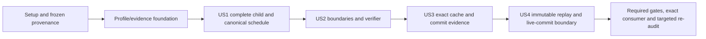

# Tasks: Complete Resulting-State Validity

**Branch**: `017-resulting-state-validity` | **Generated**: 2026-10-11
**Input**: [plan.md](plan.md), [spec.md](spec.md), [research.md](research.md),
[data-model.md](data-model.md), [decision contract](contracts/decision.md),
[profile matrix](contracts/profiles.md), [correctness.md](correctness.md) and
[quickstart.md](quickstart.md).
**Status**: Implementation in progress. Setup evidence is recorded; task markers
are updated only after actual work and verification. No release is authorized.

**Tests**: Required explicitly by the specification and Constitution III. New
behavior starts with reviewed, collected, actually executed semantic RED. Existing
controls may already pass; disclose that rather than relabeling them as RED.
016's original failure is evidence of the defect, not future 017 test-first work.

## Format and Execution Rules

Tasks use `- [ ] Tnnn [P?] [USn?] description with exact paths`. All paths are
relative to the owning Core root. New files named below are proposed implementation
outputs, not files created during task generation. Each line names explicit task
prerequisites; IDs are topologically ordered. `[P]` means the named prerequisites
are complete and the task can run with another eligible task owning different
files, not permission to cross a RED barrier or edit a shared file concurrently.

For shared source (`eval.rs`, `record.rs`, `invocation.rs`, `store.rs` and verifier
entrypoints), use one writer at a time. Test/fixture authors and verifier work may
run in parallel once their prerequisites are met. All four user stories are P1;
per-story checkpoints are targeted correctness increments, not releases or claims
that all workspace gates are already green.

The record 0.8/verifier 0.9.0 changes are the existing planning design, not another
clarification answer or work already completed. Tasks implement that design only
when implementation is requested. Any change to it must be reflected in the spec,
plan and contracts before code. Keep CHK003/CHK013/CHK015 joint-review checklist items honest.
No gate is bypassed and no existing backend/creation failure algebra is redesigned.

## Phase 1: Setup (Evidence and Shared Orientation)

**Goal**: Freeze provenance and define the evidence protocol before modifying semantic code.

**Independent Test / Checkpoint**: Confirm the specification base, immutable 016 audit and owning repository; no source changes or remediation claims are made by setup.

- [X] T001 Record branch/remote, clean or unrelated work, specification base `5949cb111cd6c5af34b0fc9083e78810df450fce`, immutable audit `b28f9af1ba2e3afc641f6be6dda9eb5c5d9688d9`, pinned toolchain and current source/test digests in `specs/017-resulting-state-validity/evidence.md`; keep original 016 unchanged. Dependencies: none.
- [X] T002 [P] Inventory and digest existing decision 0.4–0.7, invocation/read-v1/read-v2, command occurrence, migration and hash fixtures in `tests/fixtures/resulting-state-validity/archive-manifest.json`; capture the audited old ALLOW counterexample and valid controls as separately identified archived inputs/records before production changes. Dependencies: T001.
- [X] T003 [P] Create requirement/story/contract/proof-obligation and future run coverage in `specs/017-resulting-state-validity/verification.md`, including independent oracles, existing shared helpers, current versus archived results and review-owned items; do not mark the original finding resolved. Dependencies: T001.
- [X] T004 Define actual RED/GREEN capture in `specs/017-resulting-state-validity/evidence/protocol.md`: source/test digests, exact pinned-Nix commands, collection/execution/ignored counts, controls, assertion and exit status; compilation failure or zero selected tests cannot establish semantic RED. Dependencies: T002, T003.

## Phase 2: Foundational (Blocking Profile and Evidence Machinery)

**Goal**: Prepare private current/archive computation and closed new evidence using existing semantic inputs; this foundation is not a complete validity fix.

**Independent Test / Checkpoint**: New codec/current-input tests pass, historical controls retain bytes, and the deliberately seeded child-order regressions remain recorded RED until US1 implements their behavior, with root-cause RED captured before foundational code.

- [X] T005 [P] Write executable existing-API tests in `crates/behavior-core/tests/resulting_state_profiles.rs` and schema-parity cases in `crates/behavior-core/tests/resulting_state_schema.rs` for `record_version: "0.8"`, `validation_profile: "behavior.complete_resulting_state.v1"`, command/non-command pairing, unknown markers/fields, typed child descriptors, complete all-type universes, invalid/missing snapshots and reconstructible refusals; older record fixtures keep their original requirements. Dependencies: T004.
- [X] T006 [P] Write the independent audit counterexample and valid-control regressions in `crates/behavior-core/tests/resulting_state_validity.rs` and `crates/behavior-store/tests/resulting_state_validity.rs` using existing APIs, reconstructing child membership without the validator; then seed black-box canonical first-failure and typed witness regressions in `crates/behavior-core/tests/resulting_state_order.rs`: postconditions first, earlier entity constraint versus later invariant error, same-entity invariants before constraints, declaration versus synthesized Ref identity and decoded-ID bytes; use admitted rules and existing APIs so tests compile before implementation. Dependencies: T004.
- [X] T007 Collect, review and run the new root-cause/profile/schema/order targets before any production change; observe the audit assertion fail on the invalid child and preserve passing valid controls; preserve intended baseline semantic failures and positive controls in `specs/017-resulting-state-validity/evidence/runs/foundation/`; review these tests before changing the behavior they specify. Dependencies: T005, T006.
- [X] T008 Introduce private fresh-current versus archived-record execution purpose in `crates/behavior-core/src/eval.rs` and `crates/behavior-core/src/record.rs`, keeping the original action and snapshot behavior reachable only through internal archived reproduction. Do not add a Module SemanticProfile variant or caller-selectable historical mode; leave existing read profiles frozen. Dependencies: T007.
- [X] T009 Extend current snapshot capture and refusal evidence in `crates/behavior-core/src/eval.rs`: reuse `facts.universe`, "including every declared type and empty universes", canonical entity/key checks and explicit historical used facts for all fresh Wire 0.4–0.8 actions; archive failed semantic inputs and conditional refused_request when needed. Preserve current snapshot/input, required-fact and direct-backend error routes; optional entity lookup retains field fallback. Dependencies: T008.
- [X] T010 Implement version-first closed record 0.8 encoding/decoding and semantic validation in `crates/behavior-core/src/record.rs`, including complete-state evidence, result/refusal shape, typed subject/declaration descriptors and separate existing command-language profile; freeze 0.4–0.7 encoding/identity and unsupported-version refusal rather than guessing a default. Dependencies: T009.
- [X] T011 [P] Create `schema/decision-record-0.8.schema.json` and run the prewritten schema parity cases from `crates/behavior-core/tests/resulting_state_schema.rs`, covering both module branches and invalid descriptor/profile/refusal shapes; do not add new fields or permissive extensions to historical schemas. Dependencies: T007.
- [X] T012 Run the foundational codec/input/schema targets and archived controls, preserving GREEN and the still-unfixed audit and seeded child-order failures in `specs/017-resulting-state-validity/evidence/runs/foundation/`; verify no new public facade symbols, backend methods or admitted IR/hash changes. Foundation readiness does not authorize delivery. Dependencies: T010, T011.

## Phase 3: User Story 1 — Keep Every Entity Valid (P1, Correctness MVP)

**Goal**: Reject the root-cause invalid child in the shared evaluator and cover every simultaneous child entity, including unchanged survivors.

**Independent Test / Checkpoint**: The audited valid parent plus create(new) is DENY/CONSTRAINT_VIOLATED without mutation; independently computed child membership exposes the violation, while a genuinely valid creation/no-op/empty-type control succeeds.

- [X] T013 [P] [US1] Extend the prewritten audit creation and independent membership regressions with valid creation/no-op/empty-type/command-only controls in `crates/behavior-core/tests/resulting_state_validity.rs`; include updates/removals affecting surviving nonlocal exists/referenced or transitive derived rules and admitted global query/aggregate obligations, never prohibited entity-query syntax. Dependencies: T012.
- [X] T014 [P] [US1] Extend the prewritten audit/valid-control Store cases with evaluation, invocation and no-authoritative-mutation coverage in `crates/behavior-store/tests/resulting_state_validity.rs`; change only the fresh expectation of `nonlocal_creation_preserves_014_refusal_boundary` in `crates/behavior-store/tests/incremental_validation.rs` to reject the invalid child, preserving its old ALLOW as the archived fixture from setup. Dependencies: T012.
- [X] T015 [P] [US1] Write independent finite-parent/delta model properties in `crates/behavior-core/tests/resulting_state_properties.rs`, reconstructing every simultaneous child key/value and checking direct membership/arithmetic/reference predicates without the production validator, optimizer affected set or cached certificate; include valid controls and disclose any shared evaluator helpers. Dependencies: T012.
- [X] T016 [US1] Collect and observe intended audit, ordering, lifecycle and property failures before the correction, recording actual runs in `specs/017-resulting-state-validity/evidence/runs/US1/`; include the foundation order seeds and distinguish already-passing controls from new RED assertions. Dependencies: T013, T014, T015.
- [X] T017 [US1] Build the complete SPrime candidate view in `crates/behavior-core/src/eval.rs` from the exact full parent plus all simultaneous updates/creates/removals; remove deleted rows, retain unchanged survivors, check key/type coherence and resolve references to same-transition creations without inferring freshness from live absence. Dependencies: T016.
- [X] T018 [US1] Replace bound/created-only grouped checks in `crates/behavior-core/src/eval.rs` with canonical semantic entity traversal and quoted constraints "Within each entity: invariant category, then constraint category" and "Declared precedes synthesized"; compare decoded Id UTF-8 bytes, declared `(kind,name,item hash)` and semantic reference-field/entity/hash keys, never display labels, backend order or touched partitions. Dependencies: T017.
- [X] T019 [US1] Discharge all surviving child constraints/invariants and required global/reference obligations in `crates/behavior-core/src/eval.rs` using the existing SPrime evaluator; unknown affectedness requires full checking, global stability requires sound evidence, removed rows have no child rules, postconditions retain priority and unrelated command/lifecycle stages keep placement. Dependencies: T018.
- [X] T020 [US1] Emit typed `{entity,id}` subject and declared/synthesized semantic obligation descriptors for child-validity steps through `crates/behavior-core/src/eval.rs` and `crates/behavior-core/src/record.rs`; preserve first false/error category and reached operands, distinguish semantic binding names from diagnostics, and never identify an invariant witness by body hash or E#id label alone. Dependencies: T019.
- [X] T021 [US1] Run Core validity/order/property targets including foundation order seeds to GREEN and verify relevant unchanged admission/hash fixtures; preserve direct oracle results, collected counts and any shared-helper limitations in `specs/017-resulting-state-validity/evidence/runs/US1/`. Dependencies: T020.
- [X] T022 [US1] Run Store audit and valid controls plus the corrected fresh characterization; record zero invalid bundles/head/history/entity/reference/command changes and the scoped independent child-validity conclusion in `specs/017-resulting-state-validity/evidence/US1.md` without claiming all verifier/replay obligations closed. Dependencies: T021.

## Phase 4: User Story 2 — Same Guarantee at Every Boundary (P1)

**Goal**: Preserve canonical outcomes and required observations across plain/provider/action-intent/invocation/Store/public consumer, with verifier/runtime agreement at the supported scope.

**Independent Test / Checkpoint**: Equivalent canonical inputs choose the same first failure and required evidence; unbound reads/witnesses survive conversion, pre-evaluation refusals are not body execution, and current verifier prefixes agree or remain INCONCLUSIVE.

- [X] T023 [P] [US2] Write boundary/evidence regressions in `crates/behavior-core/tests/resulting_state_boundaries.rs` for plain/provider evaluation, intents and invocation, both language profiles, typed unchanged-row witnesses, unbound field/node/operand observations, incomplete/contradictory snapshots, attempted historical selector injection and actual provider-failure routes versus unreachable errors. Dependencies: T022.
- [X] T024 [P] [US2] Write Store evaluation/invocation/rederivation and forged/stale candidate regressions in `crates/behavior-store/tests/resulting_state_boundaries.rs`, covering identity-aware observations, exact parent/schema/history, consistent changes/commands and no mutation on failed checks; compare defined semantic evidence rather than backend call traces. Dependencies: T022.
- [X] T025 [P] [US2] Write canonical failure-prefix and current/archive proof-provenance regressions in `crates/behavior-verify/tests/resulting_state_order.rs` and `crates/behavior-verify/tests/resulting_state_governance.rs`; cover an earlier-entity constraint error suppressed by a later false invariant in the old schedule, witness confirmation, explicit current verifier 0.9.0 and conservative unsupported-world INCONCLUSIVE without asserting an unproven audited false PROVEN case. Dependencies: T022.
- [X] T026 [P] [US2] Write facade-only validity, typed evidence and version-reporting tests in `consumer/tests/resulting_state_validity.rs` using behavior-engine exclusively and complete snapshots; create separately named `tests/fixtures/governance-v2/policy-verifier-0.9.json` and `tests/fixtures/governance-v2/evidence-policy-verifier-0.9.json` with exact canonical policy-hash binding and current/archive proof-eligibility tests; preserve old policies; include valid/invalid controls, command bag multiplicity and no new public strategy/certificate API. Dependencies: T022.
- [X] T027 [US2] Collect and run Core/Store/verifier/consumer regressions with existing pinned commands before their implementation, recording intended observation/prefix/version failures and passing controls in `specs/017-resulting-state-validity/evidence/runs/US2/`; use the canonical consumer script, never a tracked path override. Dependencies: T023, T024, T025, T026.
- [X] T028 [US2] Implement identity/field/phase-aware unbound observation routing in `crates/behavior-core/src/eval.rs` and current action invocation integration in `crates/behavior-core/src/invocation.rs`; preserve parent facts versus derived SPrime values, nested derived frames, semantic node/operand evidence and pre-evaluation envelope priority without empty-frame read loss or fake action bindings. Dependencies: T027.
- [X] T029 [US2] Preserve unbound observations and whole-snapshot/history consistency in bundle conversion and current action rederivation in `crates/behavior-store/src/store.rs`; no current ordinary path may omit child obligations or label success provisional, and no forged/stale candidate obtains a new commit. Dependencies: T028.
- [X] T030 [P] [US2] Align ActionEncoding::build failure prefixes and supported post-state obligations with canonical entity-first invariant/constraint order in `crates/behavior-verify/src/encode.rs`; explicitly identify complete-world claims the model cannot cover and return INCONCLUSIVE for them rather than assume missing rows or error paths away. Dependencies: T027.
- [X] T031 [US2] Update current witness confirmation to the corrected computation in `crates/behavior-verify/src/confirm.rs` and current VERIFIER_VERSION to 0.9.0 in `crates/behavior-verify/src/lib.rs`; preserve encoding/cache/provenance separation from historical 0.8.0/0.7.0 archives. Dependencies: T030.
- [X] T032 [US2] Update version-first governance candidate decoding and current-verifier eligibility in `crates/behavior-verify/src/governance/trusted.rs`; non-command record 0.8 must receive strict decoding, prior 0.8.0/0.7.0 proof envelopes remain archival, and existing policy or old exact-candidate authorization must not be upgraded implicitly. Dependencies: T031, T029.
- [X] T033 [US2] Expose the newly supported decision 0.8 through existing format_versions/engine-info in `crates/behavior-core/src/lib.rs` and seed/update reporting assertions in `crates/behavior-core/tests/versions.rs` and `consumer/tests/resulting_state_validity.rs` before changing reporting; retain existing API fields/signatures and only change relevant accepted-format/verifier values, not 020 general version metadata. Dependencies: T032.
- [X] T034 [US2] Adapt fresh command workflows in `consumer/tests/command_verification.rs`, `consumer/tests/command_demo.rs`, `consumer/examples/durable_commands.rs` and `scripts/check-command-determinism.sh` to select the new verifier0.9 policies explicitly; extend `scripts/tests/test_command_determinism.sh`, review and observe the intended assertion fail before script changes; preserve archived-policy tests and never upgrade an existing store implicitly. Record targeted RED/GREEN in `specs/017-resulting-state-validity/evidence/runs/US2/`. Dependencies: T033.
- [X] T035 [US2] Run targeted boundary/verifier/governance and facade regression tests to GREEN (facade: `nix develop -c cargo test --manifest-path consumer/Cargo.toml --test resulting_state_validity`); full canonical consumer GREEN waits for integrated cache/history work and remains mandatory at T065/T066, including current-profile harness adaptation in `crates/behavior-verify/tests/{preservation,errors_and_posts,queries,soundness_regressions,lifecycle}.rs` without editing historical fixture outcome tables, and record exact supported claims, refusal categories and remaining symbolic limitations in `specs/017-resulting-state-validity/evidence/runs/US2/`. Dependencies: T033.
- [X] T036 [US2] Document each runtime guarantee versus current verifier assumption/witness and actual error routes in `specs/017-resulting-state-validity/evidence/US2.md`; keep INCONCLUSIVE distinct from unsoundness, record no legal false PROVEN unless independently reproduced, and confirm the behavior-engine surface list remains unchanged. Dependencies: T035.

## Phase 5: User Story 3 — Exact Justified Validation Reuse (P1)

**Goal**: Retain reconstructible parent reuse and post-CAS child carry-forward without changing current evidence or trusting speculative/stale state.

**Independent Test / Checkpoint**: Cold/warm/reopened/cache-missing paths agree on complete child results/evidence; warm backend-access controls hold; failed CAS/non-application publish no child, while durable lost-ack recovery follows canonical history.

- [X] T037 [P] [US3] Write complete-result/evidence, backend-access and exact binding regressions in `crates/behavior-store/tests/resulting_state_reuse.rs`, covering cold/warm/reopen/cache loss, equal StateId at another history, schema/behavior/profile substitution and mandatory freshness/trust checks; keep existing snapshot_reuse warm enumeration/version-load limits. Dependencies: T036.
- [X] T038 [P] [US3] Extend private reconstruction/reference/locality tests in `crates/behavior-store/src/store/incremental/tests.rs` and `crates/behavior-store/src/store/incremental/dependency/tests.rs` for new validation-profile binding, complete derived closure, no-removal eligibility, synthesized refs between new rows and fallback on global/cross-entity/query/unknown cases; disclose the production snapshot checker shared by full_child. Dependencies: T036.
- [X] T039 [P] [US3] Write valid-candidate refusal, failed CAS/non-application and durable lost-ack controls in `crates/behavior-store/tests/resulting_state_commit_faults.rs`, including command occurrence/cache publication and identity reuse after removal; distinguish actual durable history from response success and speculative candidate data. Dependencies: T036.
- [X] T040 [US3] Collect and execute the reuse/private/fault regressions plus existing snapshot_reuse warm controls before cache/adapter changes; preserve intended failures, passing existing controls and backend-versus-semantic-work counters in `specs/017-resulting-state-validity/evidence/runs/US3/`. Dependencies: T037, T038, T039.
- [X] T041 [US3] Route current Store action evaluate/invoke/rederive through the captured Arc snapshot and existing snapshot-backed facts adapter in `crates/behavior-store/src/store.rs`; serve current-state values/membership/references from exact canonical capture, keep used() history-backed, and avoid redundant backend full-universe loads without weakening ordinary validation/evidence. Dependencies: T040.
- [X] T042 [US3] Add exact corrected-versus-historical validation-profile binding to SnapshotIdentity and cache matching/invalidation in `crates/behavior-store/src/store.rs`; backend_mut/reopen/schema/behavior/history/profile mismatch cannot reuse evidence, and a state content hash alone is insufficient. Dependencies: T041.
- [X] T043 [US3] Bind private pending validation and incremental candidate/carry-forward in `crates/behavior-store/src/store/incremental/mod.rs` and `crates/behavior-store/src/store/incremental/candidate.rs` to the exact current parent/candidate/profile and successful atomic child; retain conservative locality/removal exclusion and discard unbound/failed/uncertain materialization. Dependencies: T042.
- [X] T044 [US3] Ensure reused/current evaluation emits the complete canonical child schedule, same typed witness/trace/derived/record evidence and required actual-failure routes in `crates/behavior-store/src/store.rs`; do not skip child computation solely because truth is cached unless full required evidence equivalence is established. Dependencies: T043.
- [X] T045 [US3] Run new reuse/fault/private tests and existing snapshot_reuse/incremental_validation/behavior_validity/concurrency/lifecycle/command publication controls to GREEN; record exact runs and verify no invalid or non-applied candidate publishes authoritative child/commands in `specs/017-resulting-state-validity/evidence/runs/US3/`. Dependencies: T044.
- [X] T046 [US3] Record the exact cache theorem/assumptions, independent child reconstruction and direct predicates, same-profile record comparisons, actual backend counts and remaining O(n) in-memory/snapshot-output work in `specs/017-resulting-state-validity/evidence/US3.md`; no latency or constant-time claim is required. Dependencies: T045.

## Phase 6: User Story 4 — Immutable History and Explicit Current Profile (P1)

**Goal**: Complete original-profile replay and live-commit separation without rewriting history or turning old ALLOW/evidence into fresh authority.

**Independent Test / Checkpoint**: Frozen old ALLOW reproduces only historically; equivalent fresh execution rejects; old uncommitted bundles cannot create new history; exact recovery writes nothing; historical schema/read/command identities and bytes remain original.

- [X] T047 [P] [US4] Extend `crates/behavior-core/tests/resulting_state_profiles.rs` with frozen 0.4–0.7 standalone and nested action replay versus fresh 0.8, unknown/wrong profile and tampered typed subject/universe cases; retain read-v1/read-v2, decode/binding refusal and migration controls under their own frozen profiles. Dependencies: T046.
- [X] T048 [P] [US4] Write per-record historical schema/position, Store-backed invocation replay, old uncommitted bundle refusal, exact already:true recovery and invalid historical-parent tests in `crates/behavior-store/tests/resulting_state_history.rs`; snapshot before/after state/history/cache/commands to prove replay/recovery is read-only. Dependencies: T046.
- [X] T049 [P] [US4] Write checked old/new command-reader, non-command record 0.8, bag multiplicity, sealed candidate substitutions and historical occurrence identity cases in `crates/behavior-store/tests/resulting_state_command_history.rs`; preserve existing outer bundle/invocation formats and all archived identity domains. Dependencies: T046.
- [X] T050 [US4] Collect and observe the missing historical dispatch/reader/recovery behavior before changes, recording fresh-negative and archived-positive controls in `specs/017-resulting-state-validity/evidence/runs/US4/`; an old matching ALLOW is reproduction evidence, not validity proof. Dependencies: T047, T048, T049.
- [X] T051 [US4] Complete validated version/profile-selected standalone action replay in `crates/behavior-core/src/record.rs` and frozen evaluator plumbing in `crates/behavior-core/src/eval.rs`: 0.4–0.7 preserve original inputs/results/bytes without new universe requirements; 0.8 uses archived complete parent/current rules and reconstructible refusal evidence. Never dispatch by optional git_revision/release or caller preference. Dependencies: T050.
- [X] T052 [US4] Complete nested decision-profile invocation replay in `crates/behavior-core/src/invocation.rs`, preserving wrapper v1/domain, original decode/binding evidence and existing read-v1/read-v2 selection; reject conflicting nested/envelope semantic claims without fabricating reached evaluation or invoking commands. Dependencies: T051.
- [X] T053 [US4] Separate current live rederivation from archived replay and exact committed-event recovery in `crates/behavior-store/src/store.rs`; bind historical schema/position, refuse obsolete uncommitted bundles, renew current exact-candidate authority, and allow exact already:true recovery without writes or current cache promotion even when the historical child is invalid. Dependencies: T052.
- [X] T054 [P] [US4] Update checked record-version dispatch in `crates/behavior-store/src/commands.rs` for record 0.8 command/non-command branches while retaining archived bag/occurrence interpretation and existing hash domains; unknown/inconsistent versions must explicitly refuse. Dependencies: T051.
- [X] T055 [US4] Separate immutable archive replay from fresh 0.8 expectations in `crates/behavior-core/tests/evaluate.rs`, `crates/behavior-core/tests/replay.rs`, `crates/behavior-core/tests/invocation_conformance.rs` and `tests/fixtures/resulting-state-validity/`; use profile-aware existing APIs/internal test access, never a public historical fresh selector or silently regenerated old golden. Dependencies: T052, T053, T054.
- [X] T056 [US4] Add independently specified current 0.8 valid/refusal/error/typed-witness and current verifier 0.9 expectations in `tests/fixtures/resulting-state-validity/` and remaining current proof/evidence examples using the separately new matching policies introduced in US2 in `tests/fixtures/governance-v2/`; preserve existing archive-manifest digests, older policies and hashes, and no implicit existing-store adoption. Dependencies: T055.
- [X] T057 [US4] Run record 0.8 JSON Schema/codec conformance, fresh/archive Core/Store/command replay and current proof eligibility tests to GREEN; record byte/identity preservation and deliberate new evidence-derived identity differences in `specs/017-resulting-state-validity/evidence/runs/US4/`. Dependencies: T056.
- [X] T058 [US4] Update `docs/versioning.md`, `docs/invocation.md`, `docs/persistence.md` and `tests/fixtures/README.md` with exact current/archive profile, complete-input/reader adaptation and policy/version consequences; describe minor release class without selecting a tag/release, and leave ecosystem pins and 018–021 scope unchanged. Dependencies: T057.
- [X] T059 [US4] Complete each row of the profile/identity matrix with actual source/run/fixture evidence in `specs/017-resulting-state-validity/evidence/US4.md`, including no-write historical replay/recovery and no automatic repair/current validity for historical invalid state. Dependencies: T058.

## Phase 7: Polish and Cross-Cutting Verification

**Goal**: Validate all four P1 stories and publish scoped remediation evidence on the exact candidate; no partial source is released.

**Independent Test / Checkpoint**: Owning gates and public consumer cover the candidate, immutable 016/old fixtures remain intact, and every acceptance/proof disposition has an explicit scope and evidence status.

- [X] T060 [P] Update the relevant existing validity/optimization explanation in `PRINCIPLES.md` and `ARCHITECTURE.md` and align `specs/017-resulting-state-validity/plan.md`, `correctness.md` and `quickstart.md` with the actual implemented schedule/evidence boundary; preserve language semantics versus optimization distinction and record deviations explicitly. Dependencies: T059.
- [X] T061 [P] Add/run meaningful typed witness and canonical result/identity metamorphic properties in `crates/behavior-core/tests/resulting_state_metamorphic.rs` and required enumeration/index comparisons in `crates/behavior-store/tests/query_order_props.rs`; vary non-semantic metadata/backend/cache/layout, preserve decoded identity ordering and use independent invalid controls. Any newly found defect needs observed RED before its fix. Dependencies: T059.
- [X] T062 [P] Produce `specs/017-resulting-state-validity/targeted-re-audit.md` mapping O-MODEL-005/O-INCREMENTAL-008/O-VERIFY-008 to complete child coverage, cache equivalence and precise verifier promises; classify construction, code invariant, empirical evidence, assumptions and remaining gaps, preserve016 and do not close other findings or claim universal SOUND. Dependencies: T059.
- [X] T063 Integrate fresh 0.8 versus archived-profile scenarios into `scripts/determinism-check.sh` and existing conformance/script harnesses with tests in `scripts/tests/test_resulting_state_determinism.sh` written/reviewed and observed RED before script changes; run all relevant identity vectors and `scripts/check-public-surface.sh`, preserving `api/engine-surface.txt` and Backend signatures. Dependencies: T060, T061, T062.
- [X] T064 Record source-tree/test/fixture provenance in `specs/017-resulting-state-validity/evidence.md`, then commit/push the explicitly listed tested implementation/fixture/document files on 017 and capture its full candidate SHA for the following checks; preserve unrelated work and keep PR16 draft, with no tag, merge, ecosystem dependency pin or release publication. Dependencies: T063.
- [X] T065 Run `nix develop -c scripts/gates.sh` from the Core root on the candidate from the preceding task; capture complete actual output and statuses in `specs/017-resulting-state-validity/evidence/runs/gates/`. Required gates must be green without skipped scenarios, protection bypasses or private overrides; failures require focused correction and refreshed affected evidence. Dependencies: T064.
- [X] T066 Run `nix develop -c scripts/check-consumer.sh --rev FULL_CANDIDATE_SHA` for the exact pushed/tested candidate and its public behavior-engine-only tests; store actual build/execution/revision evidence in `specs/017-resulting-state-validity/evidence/runs/consumer/` and distinguish candidate compatibility from a published Core Release. Dependencies: T065.
- [X] T067 Finalize `specs/017-resulting-state-validity/verification.md`, `evidence.md` and `targeted-re-audit.md` with exact source/test digests, all collection/RED/GREEN/gate/consumer results, archive checks and SC-001–006/FR-001–016 dispositions; mark tasks only after actual verification and leave independent-review/unknown obligations honest. Dependencies: T066.
- [ ] T068 Record exact tested source/candidate provenance and delivery status in `specs/017-resulting-state-validity/evidence.md`, commit/push final evidence, then verify PR16 required checks cover its actual final head; report the final SHA and local/committed/pushed/tested status without claiming merge/release or 018–021 closure. Evidence-only commits do not substitute for final-head check results. Dependencies: T067.

## Dependencies and Execution Order

The phase order is: Setup → Foundation → US1 → US2 → US3 → US4 → final verification.
The conservative cross-story order protects shared source and gives each later
story a stable current-profile/reference behavior. Each story has its own test
criteria and report; it does not depend on declaring another story universally
proven. Stable prerequisites and file ownership, rather than the P1 label alone,
determine what can run in parallel.

Within a story, test authoring/collection/semantic RED precedes changed behavior;
then implement/integrate, run GREEN and record the scoped checkpoint. Foundational
order seeds are intentionally written before US1's comparator implementation.
Schema/profile tests gate new evidence before changing formats. Archive fixtures
are captured before any fresh evaluator change.

## Parallel Execution Examples and File Ownership

Run only the examples whose common prerequisite is complete. The task descriptions
and explicit dependency IDs control narrower eligibility; these are real separate
file tasks, not concurrent writers to shared entrypoints.

- **Setup**, after T001: T002 and T003. Frozen fixture inventory versus requirement/evidence mapping.
- **Foundation**, after T004: T005 and T006. Profile/schema tests versus canonical order/witness seeds. T011 may author the schema after T007 while T008–T010 change separate Core source files.
- **US1**, after T012: T013 and T014. Core regression versus Store regression/current characterization; T015 may author independent property models alongside them.
- **US2**, after T022: T023 and T024. Core invocation/evidence tests versus Store boundary tests; T025/T026 own verifier/governance and consumer tests. After T027, T028/T029 runtime integration can proceed alongside T030 verifier encoding.
- **US3**, after T036: T037 and T039. Reuse tests versus commit/fault tests; T038 owns distinct private incremental/dependency test files.
- **US4**, after T046: T047 and T048. Standalone/nested archived tests versus Store historical tests; T049 owns command history tests. After T051, T054 command readers can proceed alongside T052/T053 replay integration.
- **Polish**, after T059: T060 and T061. Documentation versus metamorphic tests; T062 owns the scoped re-audit report.

No parallel example permits simultaneous edits to the same fixture/harness or
shared source file. Assign exact filenames to each worker; integrate shared
changes and RED/GREEN evidence in sequence. Final gate/consumer runs wait for the
integrated candidate; results from one worker's intermediate tree are not final
revision evidence.

## Requirement and Contract Coverage

| Requirement / criterion | Primary tasks and story |
| --- | --- |
| FR-001–003, complete child / audit case; SC-001/003 | T013–T022 (US1), T015 independent model oracle |
| FR-004/006, supported boundaries and lifecycle | T013–T015, T023–T029 (US1/US2) |
| FR-005/015/016, first failure and evidence; SC-002 | T006, T017–T021, T023–T036; decoded IDs, declarations/synthesized refs and typed unbound witness |
| FR-007–009, exact reuse/CAS/publication; SC-004 | T037–T046 (US3), T048/T053 historical recovery controls |
| FR-010/011, new current profile and immutable history; SC-005 | T002/T005/T008–T012, T047–T059 (US4), T032 current proof/authority |
| FR-012, independent oracle/shared-helper disclosure | T015/T016/T021/T022, T038/T046, T062 |
| FR-013, scoped verifier/runtime promise; SC-006 | T025/T030–T036, T062/T067 |
| FR-014, error provenance versus backend traces | T009/T023/T027/T036/T039/T046 |
| Decision contract | Foundation/US1/US2: complete inputs, simultaneous child, first failure, typed record/observations |
| Profile/identity contract | Foundation/US4: record 0.8, frozen 0.4–0.7/read profiles, live versus archive/recovery, unchanged outer domains |
| P1–P6 proof obligations / all SC-001–006 | T062–T068 scoped re-audit, actual gates/consumer and final evidence |

## Implementation Strategy and MVP

**Correctness MVP**: Complete Setup + Foundation + US1, then demonstrate the direct
counterexample rejection and independent valid-child controls through targeted
Core/Store tests. This is a local correctness milestone, not a releasable Core:
all four P1 stories, current verifier/governance and immutable historical behavior
must be complete before delivery. No partial change is merged or released.

Incrementally add US2 boundary/verifier evidence, US3 exact reuse/atomic lifecycle,
then US4 current/archive integration. Preserve old bytes and record deliberate new
evidence-derived identities explicitly. Current governed fixtures use separately
new matching policies; old stores/policies are never silently upgraded.

Run targeted checks as each changed area reaches GREEN, then the owning full gates
and pushed exact-revision consumer once the candidate is integrated. Rerun affected
checks if new changes/failures require it; final PR checks must cover the delivered
head. Preserve candidate/source identities when evidence-only commits follow the
code commit and do not claim an untested final revision passed.

## Generated Task Summary

Initially generated68 tasks: shared Setup/Foundation/Polish 21; US1 10; US2 14; US3 10; US4 13.

23 tasks are marked `[P]` with prerequisite-gated file ownership. All tasks carry sequential IDs and concrete paths; no completion box is checked during generation.
