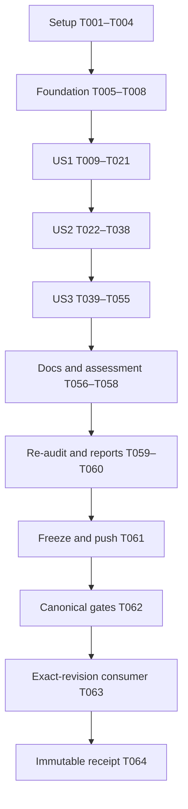

# Tasks: Initial Store Creation Contract

**Branch**: `019-store-creation-contract` | **Generated**: 2026-10-12
**Input**: [spec.md](spec.md), [plan.md](plan.md), [research.md](research.md),
[data-model.md](data-model.md), [contracts](contracts/store-creation.md) and
[validation guide](quickstart.md).

**Tests**: Required by FR-014/FR-015 and the owning constitution. Every new
deterministic behavior, including fault tooling, needs reviewed tests and an
observed behavioral RED before implementation. Existing passing controls do not
establish historical test-first compliance. This file creates tasks, not code,
test results, an integration commit or a release.

## Format and Path Conventions

Every task uses `- [ ] Tnnn [P?] [USn?] description with exact paths`.
Paths are relative to Core unless explicitly absolute. Evidence files under
`specs/019-store-creation-contract/evidence/` are future implementation artifacts.
`[P]` means disjoint files may be handled concurrently after the listed prerequisite
batch is complete; it never overrides RED or file-ownership dependencies.

Only T061–T064 use the external frozen-candidate receipt at
`/home/kalle/validation-receipts/core019/<candidate-sha>/receipt.json` (or equivalent
revision-bound CI). Their completion is recorded there after execution; their
tracked checkboxes remain unchanged after freeze. No final SHA is embedded in the
tracked commit whose identity it would change.

## Phase 1: Setup

**Purpose**: Establish the correct integration source, protected evidence and owners.

- [X] T001 Preserve the explicit 019 design files and unrelated work, integrate inspected 022 ancestor `3179b13163cd2bc9134176b78029dd39a5a90c8f` into the implementation branch without rewriting published history, verify 017/018 ancestry, and record the resulting exact source/tree and integration decisions in `specs/019-store-creation-contract/evidence/implementation-base.md`; do not record REDs against the old draft base.
- [X] T002 [P] Record agreed public contract changes, unchanged signatures, stable error codes, minor-class release assessment and ecosystem migration boundaries in `specs/019-store-creation-contract/evidence/compatibility-assessment.md`, using `contracts/store-creation.md` and `docs/versioning.md`; numerical release/tag/pin changes are outside implementation scope (after T001).
- [X] T003 [P] Capture custody/checksums of existing genesis profiles, schemas, hash vectors, `api/engine-surface.txt` and 017/018/022 historical fixtures in `specs/019-store-creation-contract/evidence/source-custody.md`; preserve original bytes and dependency receipts, and identify the actual integrated revision (after T001).
- [X] T004 Record pinned Nix/Rust tooling, canonical gate commands, current Backend inventory and exclusive writer ownership for Store, reference/conformance and durable-consumer lanes in `specs/019-store-creation-contract/evidence/execution-ledger.md`; inspect `scripts/gates.sh`, `rust-toolchain.toml` and the actual integrated Backend implementations without changing dependencies (after T002–T003).

**Checkpoint**: Actual integrated base and protected artifacts are identified;
an old 022 receipt is not represented as 019 validation.

## Phase 2: Foundational Prerequisites

**Purpose**: Provide compiling legal test instruments before semantic changes.
No user-story production implementation starts before this phase is verified.

- [X] T005 Map every FR/SC, C019-01–C019-14, host interruption window and P019-01–P019-16 to planned tests/owners in `specs/019-store-creation-contract/evidence/case-matrix.md`; fix the private candidate/publication interface and its structural versus Module-bearing authority in `specs/019-store-creation-contract/evidence/implementation-base.md`, following `data-model.md` without adding a public certificate or mode.
- [X] T006 Write and collect meaningful legal-fixture/activation/error-propagation tests in `crates/behavior-store/tests/creation_fixture_controls.rs`; use compiling delegation-only scaffolding in `crates/behavior-store/tests/support/creation_backend.rs` where needed and observe failed assertions for dormant before/after-create faults and same-target scheduling before implementing those instruments; retain commands/status/assertions in `specs/019-store-creation-contract/evidence/execution-ledger.md`.
- [X] T007 Implement private same-target handles, explicit fault arming, counters, partial-publication mutants and bounded non-reentrant schedules in `crates/behavior-store/tests/support/creation_backend.rs` after T006 RED; preserve access after by-value create errors, keep deep-cloned InMemory copies distinct from shared targets, and implement no second seed validator or public Backend capability.
- [X] T008 Run the fixture control target and its `-- --list` collection check in the pinned environment, record actual outcomes/source and retained baseline receipts in `specs/019-store-creation-contract/evidence/execution-ledger.md`, and confirm `crates/behavior-store/tests/support/creation_backend.rs` supplies legal positive controls before story tests; setup/compile/disk failures are not behavioral RED evidence.

**Checkpoint**: Test instruments demonstrably activate their intended behavior;
baseline evidence can distinguish missing new obligations from fixture defects.

## Phase 3: User Story 1 — Successful Initialization (Priority: P1, MVP Review)

**Goal**: A successful fresh create and ordinary reopen establish one coherent
complete initial product; invalid candidates never request Backend publication.

**Independent Test**: Empty/nonempty referenced seeds under each applicable genesis
profile reproduce exact original versions/head/identity. Invalid seeds make zero
create calls. A success-returning unpublished/genesis-only backend cannot yield a
complete Store. Module-free legacy open remains structurally bounded and cold.

### Tests First

- [X] T009 [P] [US1] Write fresh creation/open tests in `crates/behavior-store/tests/creation_contract.rs` for complete empty/nonempty/reference products, seed type/grid/range/schema/duplicate/reference/global validity refusals, and acknowledged missing genesis/head/seed/hash corruption; preserve legacy normalization and supported v2 canonical rules, and distinguish failed reads from positively observed incomplete data (after T008).
- [X] T010 [P] [US1] Write supported-facade fresh creation/open controls in `consumer/tests/store_creation.rs`, including typed error codes, legal v1/v2 requests, invalid-seed no-publication counters and a corrupt authoritative host snapshot that must not be overwritten as absence; use only `behavior-engine` (after T008).
- [X] T011 [P] [US1] Add private certificate/publication tests in `crates/behavior-store/src/store/creation_tests.rs`, declared only under `cfg(test)` in `crates/behavior-store/src/store.rs`; require no candidate promotion on unacknowledged/unverified publication and permit exact acknowledged position-zero evidence, without a public cache-inspection API (after T008).
- [X] T012 [P] [US1] Write shared-case registration/activation and success-product mutant assertions in `crates/behavior-store/tests/conformance.rs` for C019-01/C019-02/C019-13; missing case registration must fail explicitly, and compiling delegating mutants must be shown active before claiming semantic rejection (after T008).
- [X] T013 [US1] Collect/run T009–T012 against the recorded pre-change source, retain genuine missing-publication/open/certificate and conformance-protocol REDs plus passing legal controls in `specs/019-store-creation-contract/evidence/execution-ledger.md`; do not call all existing seed checks newly failing or infer an old partial-write bug.

### Implementation

- [X] T014 [US1] Extract one private validated initialization product in `crates/behavior-store/src/store/initialization.rs` from the existing seed validator in `crates/behavior-store/src/store.rs`, enforcing "Supported format/policy pairing; exact declaration/schema identities; existing canonical seed representation", "Unique keys, revision 1, created_at 0, normalized typed values, correct declaration-bound content hashes" and "Every required Ref target exists in V0; coherent original incoming edges"; preserve current reference-validator refusal order and use no duplicate semantic implementation (after T013).
- [X] T015 [US1] Implement a fallible private publication inspector in `crates/behavior-store/src/store/initialization.rs` that checks original incarnations/universe/lifetimes/content hashes, seed accumulator and captured head/history/schema; enforce initial "Position 0, seed accumulator/StateId, last_record = existing genesis hash, no migration at position zero", preserve v1 raw/normalized distinctions, and claim no Module-free Ref/Behavior proof or full-prefix replay (after T014).
- [X] T016 [US1] Integrate checked fresh publication and cold ordinary opening in `crates/behavior-store/src/store.rs`, retain existing signatures and absent-open mapping, use existing `StoreError::Contract` for positively observed incomplete initialization, and promote the initial cache only after exact acknowledged/verified position-zero product/profile; keep retry/error classification for US2 (after T015).
- [X] T017 [P] [US1] Implement/register C019-01/C019-02/C019-13 in `crates/behavior-store/src/conformance.rs`, with exact legal products and designated incomplete/no-publication controls; keep all existing cases and the public fresh-target factory (after T016 and the T012 protocol REDs).
- [X] T018 [P] [US1] Update normative current creation/publication obligations in `crates/behavior-store/src/lib.rs` without signature or export changes, and record fresh InMemory/durable-host construction invariants and their evidence limits in `specs/019-store-creation-contract/evidence/us1-publication-review.md`; do not claim source inspection proves durable creation (after T016).
- [X] T019 [US1] Review existing fixture fault timing affected by checked open in `crates/behavior-store/tests/support/history_backend.rs`, `crates/behavior-store/tests/strict_profile_replay.rs` and `consumer/tests/strict_profile_replay.rs`; adjust only setups that must first open legally before arming later corruption, document each reason in `specs/019-store-creation-contract/evidence/source-custody.md`, and preserve historical fixture/record bytes (after T017–T018).
- [X] T020 [US1] Run/record US1 Core/private/facade/conformance tests and affected 017/018/022 regressions using `quickstart.md` and `specs/019-store-creation-contract/evidence/execution-ledger.md`; confirm exact product/error/ordering behavior and collected required cases, with no ignored or silently skipped required scenario (after T019).
- [X] T021 [US1] Complete the independent US1 assessment in `specs/019-store-creation-contract/evidence/us1-publication-review.md`, mapping P019-01/P019-02/P019-10/P019-11/P019-12 to code invariants, actual tests and explicit host/normalization premises; identify US2/US3 obligations as remaining rather than declaring the feature releasable (after T020).

**Checkpoint**: Fresh success and checked opening are reviewable and independently
testable. This MVP review increment cannot be released as completed 019 while
mandatory failure/retry/concurrency obligations remain.

## Phase 4: User Story 2 — Failure and Lost Acknowledgment (Priority: P1)

**Goal**: Preserve operational uncertainty, isolate staging and recover exact
completed creation after lost acknowledgment without fabricating rollback.

**Independent Test**: Before-publication fault on an isolated target remains absent;
postpublication error remains operational and an explicit original-request retry
recovers the exact Store. Secondary read/sync failures prove neither absence nor
success. Fresh-process observers exercise each disclosed host construction window.

### Tests First

- [X] T022 [P] [US2] Add Core failure/basic-recovery and failure-law property tests in `crates/behavior-store/tests/creation_contract.rs` and `crates/behavior-store/tests/creation_properties.rs` for before/after-create errors, one bounded foreign-publication classification, equivalent/incomplete/unavailable evidence, original-version/current-head mismatches and every required fallible Backend read; assert original error preservation without parsing messages (after T021).
- [X] T023 [P] [US2] Write creation process-window, staging-isolation and read/recovery-sync fault tests in `consumer/tests/store_creation_crash_recovery.rs`; establish compiling test-only fault-selection scaffolding if needed, assert that each requested boundary actually executes, and make dormant/unrecognized worker modes fail instead of becoming accepted setup errors (after T021).
- [X] T024 [P] [US2] Extend facade/private tests in `consumer/tests/store_creation.rs` and `crates/behavior-store/src/store/creation_tests.rs` for exact equivalent retry, incomplete evidence, primary/secondary errors and no candidate evidence after uncertainty; include representative original Module/G retry after an update and migration, actual migrated schema preservation and a later equal-StateId cold-cache case before any history-aware recovery implementation (after T021).
- [X] T025 [P] [US2] Add registration and designated error/uncertainty mutant assertions for C019-03/C019-04/C019-11 in `crates/behavior-store/tests/conformance.rs`; include direct legal Backend equivalent retry both at zero and after a representative update/migration, asserting original/current primary material unchanged, so Store preflight cannot hide a non-idempotent or history-resetting Backend (after T021).
- [X] T026 [US2] Collect/run T022–T025 before their changes, preserve actual equivalent/advanced/migrated retry, original-material mismatch, conflict-classification and fault-activation REDs plus cache/legal controls in `specs/019-store-creation-contract/evidence/execution-ledger.md`; gate T027–T030 on these representative assertions, and record already-passing cases as controls rather than retroactive test-first evidence.

### Implementation

- [X] T027 [US2] Implement exact Module-bearing original-product verification in `crates/behavior-store/src/store/initialization.rs`, comparing canonical G, normalized V0, as-of-zero/revision-one incarnations, complete typed universes, R0/incoming sets, identity-use/removal bounds and original accumulator/history anchor while independently inspecting the captured current head; preserve historical profile rules and propagate Backend failures (after T026).
- [X] T028 [US2] Implement the bounded Store create/recovery algorithm in `crates/behavior-store/src/store.rs`: validate candidate first, preflight Some/equivalent/foreign or None, call Backend create once when absent, verify Ok publication, and on Err classify complete foreign publication once or retain the original error; add stable `STORE_CREATION_CONFLICT` through existing Contract, never convert that failed attempt to successful recovery or internally loop (after T027).
- [X] T029 [P] [US2] Implement private candidate-then-publish initialization and legal exact-identity Backend retry in `crates/behavior-store/src/memory.rs`, reusing factored original-product checks where applicable, preserving versions/removals/refs/records and never substituting current head equality for original initialization; acknowledge logical rather than physical atomicity (after T028 and T026 direct-retry RED).
- [X] T030 [P] [US2] Implement stable-lock normal read/reopen, private lock-held readers, exact existing-initialization recognition and the required recovery durability barrier in `consumer/tests/support/durable_backend.rs`; never overwrite malformed/foreign/advanced authoritative snapshots, avoid nested locks and document the durable-root/parent-sync premise (after T028 and T026 host REDs).
- [X] T031 [US2] Add private before/after-create faults and same-target retained handles to `crates/behavior-store/src/conformance.rs`, registering C019-03/C019-04/C019-11 without changing the factory or relabeling existing commit crash evidence; schedules must avoid recursive mutable borrows (after T029–T030 and T025 protocol RED).
- [X] T032 [US2] Complete/execute activated creation error mutants in `crates/behavior-store/tests/conformance.rs`, requiring their designated new cases to fail for missing publication, unknown-to-absence/success/conflict conversion or erased primary errors while legal controls pass; record semantic versus harness-protocol failures separately (after T031).
- [X] T033 [US2] Implement creation-specific private-write/file-sync/rename/directory-sync/reply fault windows and typed worker controls in `consumer/tests/support/durable_backend.rs` and `consumer/tests/store_creation_crash_recovery.rs`, after T023/T026 actual fault-tool REDs; preserve existing commit fault modes and perform no external command dispatch (after T030).
- [X] T034 [US2] Run every named durable creation window with fresh-process observers and recovery in `consumer/tests/store_creation_crash_recovery.rs`, recording exact boundaries, worker statuses, target/staging outcomes and assumptions in `specs/019-store-creation-contract/evidence/host-window-coverage.md`; process exits must not be represented as power-loss/device evidence (after T033).
- [X] T035 [US2] Verify primary/secondary failure priority and bounded classification in `crates/behavior-store/tests/creation_contract.rs` and `crates/behavior-store/tests/creation_properties.rs`, including publish-between-preflight-and-call, failed recovery reads/sync and equivalent post-error evidence; make further code changes only for retained failing assertions and record their own RED/GREEN (after T031–T034).
- [X] T036 [US2] Run/record US2 Core/private/facade/conformance/property tests in `specs/019-store-creation-contract/evidence/execution-ledger.md`, confirm collection of all required C019-03/C019-04/C019-11 and private staging cases, and verify no candidate promotion or second initialization (after T032/T034–T035).
- [X] T037 [US2] Run affected existing durable command, crash-recovery and historical replay consumer tests after host helper changes in `consumer/tests/command_crash_recovery.rs`, `consumer/tests/command_demo.rs`, `consumer/tests/strict_profile_replay.rs` and `consumer/tests/replay_evidence_authority.rs`; record results and any justified test-only fault-arming adjustments in `specs/019-store-creation-contract/evidence/execution-ledger.md` (after T036).
- [X] T038 [US2] Complete the US2 outcome/durability assessment in `specs/019-store-creation-contract/evidence/us2-outcome-review.md`, linking P019-03/P019-06/P019-07/P019-13 to code/tests/negative controls and distinguishing caller knowledge, live rename publication, acknowledged directory persistence and remaining host assumptions (after T037).

**Checkpoint**: Failure/lost-ack recovery and named private staging windows are
established within their stated scope. Advanced/concurrent retry closure follows.

## Phase 5: User Story 3 — Retry Without Replacing Lineage (Priority: P2)

**Goal**: Generalize and verify recovery across later history and competing
initializers, preserving one creation identity and one current Backend semantics.

**Independent Test**: Original Module/G retries after updates, creates, removals,
equal-StateId later positions and migration preserve actual history and remain
cold when advanced. Equal initializers recover one lineage; different ones yield
one complete winner plus established conflict, never a mixed/reset product.

### Tests First

- [X] T039 [P] [US3] Write advanced/migrated/original-material recovery tests in `crates/behavior-store/tests/creation_recovery.rs`, covering preserved revisions/removals/ever-used/refs/events, corrupted original incarnations, captured-head/schema/accumulator mismatches and original Module recovery after current schema migration (after T038).
- [X] T040 [P] [US3] Extend algebraic/metamorphic tests in `crates/behavior-store/tests/creation_properties.rs` for repeated equivalent recovery, foreign creation with equal live StateId, canonical object/Backend/edge order independence, legacy-v1 seed-sequence identity significance and v2 authoring normalization; test only historically supported profile/policy combinations (after T038).
- [X] T041 [P] [US3] Add separate-process same-target equivalent/conflicting initializer and create-versus-first-commit schedules to `consumer/tests/store_creation_crash_recovery.rs`, including recovery after later removals/migration and checks that current snapshot/history is never reset or replaced on equivalent retry (after T038).
- [X] T042 [P] [US3] Add advanced/migrated cold-cache and facade retry tests in `crates/behavior-store/src/store/creation_tests.rs` and `consumer/tests/store_creation.rs`, including a later equal-StateId position, old-schema refusal and fresh validation under the actual migrated Module; keep cache instrumentation private (after T038).
- [X] T043 [US3] Add registration/activated mutant tests for C019-05–C019-10/C019-12/C019-14 in `crates/behavior-store/tests/conformance.rs`, distinguishing whole-Store concurrency from existing entity-create cases and asserting no complete mixed lineage, reset, visible duplicated lifetime or foreign identity acceptance (after T038).
- [X] T044 [US3] Collect/run T039–T043 against the current US2 implementation, retain REDs for remaining advanced/concurrency/protocol deficiencies and passing controls in `specs/019-store-creation-contract/evidence/execution-ledger.md`; do not manufacture REDs if an obligation already holds, and precede each subsequently needed behavior change with its specific failure.

### Implementation and Closure

- [X] T045 [US3] Complete/verify original-versus-current history/schema checking in `crates/behavior-store/src/store/initialization.rs` using result-oriented captured-head helpers, not ReplayReport success; implement only deficiencies shown by T044, preserve original schema binding independently of current migrations, and record established invariants/limits in `specs/019-store-creation-contract/evidence/us3-recovery-review.md`.
- [X] T046 [US3] Complete/verify advanced recovery integration and cache lifecycle in `crates/behavior-store/src/store.rs`: actual history survives, equal-StateId later positions are not genesis, original Module is not rebound to current migrated schema, and advanced/unresolved results cannot reuse initial evidence; make changes only after corresponding T044 RED (after T045).
- [X] T047 [P] [US3] Complete/verify direct Backend retry after later commits/removals/migration in `crates/behavior-store/src/memory.rs`, preserving all original/current canonical material and refusing established incompatible initialization without mutation; use T039/T043 direct-call evidence rather than relying solely on Store preflight (after T045–T046).
- [X] T048 [P] [US3] Complete/verify same-target atomic check/publication and advanced equivalent recovery in `consumer/tests/support/durable_backend.rs`, retaining one stable lock, no current snapshot rewrite/reset and required recovery persistence; implement only retained T041/T044 deficiencies and preserve command commit behavior (after T045–T046).
- [X] T049 [US3] Implement/register C019-05–C019-10/C019-12/C019-14 and deterministic competing-publication schedules in `crates/behavior-store/src/conformance.rs`, testing direct Backend and Store paths under both applicable genesis profiles while keeping all prior named cases (after T047–T048 and T043 protocol RED).
- [X] T050 [US3] Finish activated reset/overwrite/duplicate/equal-StateId/mixed-publication/false-certificate mutants in `crates/behavior-store/tests/conformance.rs` and `crates/behavior-store/src/store/creation_tests.rs`; require designated-case failures with activation evidence and preserve reversed/unindexed positives (after T049).
- [X] T051 [US3] Run/record advanced Core/property/conformance tests and preserved 017/018/022 historical controls in `specs/019-store-creation-contract/evidence/execution-ledger.md`, checking profile-specific normalization, canonical ordering, bounded operational error channels and private authority guards (after T050).
- [X] T052 [US3] Run all real initializer/commit interleavings and advanced durable recovery cases in `consumer/tests/store_creation_crash_recovery.rs`, record same-target process receipts and OS/filesystem/root/lock assumptions in `specs/019-store-creation-contract/evidence/host-window-coverage.md`, and reject uncollected/ignored/skipped mandatory cases (after T048 and T051).
- [X] T053 [US3] Run the facade target `consumer/tests/store_creation.rs` and affected migration/resulting-validity/replay consumer regressions through pinned canonical consumer dependencies, retaining results in `specs/019-store-creation-contract/evidence/execution-ledger.md`; do not use an ecosystem local override to claim release compatibility (after T052).
- [X] T054 [US3] Complete the independent US3 recovery assessment in `specs/019-store-creation-contract/evidence/us3-recovery-review.md`, mapping P019-04/P019-05/P019-08/P019-09/P019-10/P019-11 to exact original evidence/current-history preservation, all named schedules and remaining immutable Backend premises (after T053).
- [X] T055 [US3] Close the supported scenario/profile/host matrix in `specs/019-store-creation-contract/evidence/case-matrix.md` for C019-01–C019-14 and every required host window, distinguishing shared outcome evidence, concrete process evidence, unsupported historical combinations and deliberately nonconforming adapters; no unexplained missing cell counts as pass (after T054).

**Checkpoint**: All three stories have independently runnable evidence; one
corrected Backend contract is assessed before final documentation and delivery.

## Phase 6: Polish and Cross-Cutting Delivery

- [X] T056 [P] Update normative creation/recovery/uncertainty and conformance explanations in `docs/persistence.md`, and the minor-class contract assessment in `docs/versioning.md`; preserve all existing historical formats/hash domains/verifier outcomes and separate this initial-Store law from ordinary commit/lifecycle rules (after T055).
- [X] T057 [P] Write external implementer guidance in `docs/backend-creation-migration.md`, explaining mandatory atomic publication, exact original-identity retry, stable conflicts, advanced history, known versus ambiguous errors, host-specific fault evidence and "Type compatibility is not semantic conformance"; do not edit ecosystem release pins or prescribe physical storage layout (after T055).
- [X] T058 [P] Re-inventory every actual first-party Backend and test adapter in `specs/019-store-creation-contract/evidence/backend-assessment.md`, classify production/reference/durable-test/delegating/read-only/deliberately nonconforming roles, link each applicable obligation to executed evidence, and document later PyBackend/AnyBackend/DictBackend migration scope without claiming their current pin supports 019 (after T055).
- [X] T059 Conduct independent targeted re-audit in `specs/019-store-creation-contract/evidence/targeted-re-audit.md` for all P019-01–P019-16 and relevant G3/G8/G9/G11/G12, distinguishing law, code invariants, tests and assumptions; keep O-PERSIST-012 and O-PERSIST-004 separate, preserve 016 findings, and leave final exact-revision gates explicitly pending (after T056–T058).
- [X] T060 Finalize `specs/019-store-creation-contract/implementation-report.md`, `evidence/compatibility-assessment.md`, `evidence/source-custody.md`, `evidence/execution-ledger.md` and `tasks.md` bookkeeping for completed T001–T060; verify protected bytes/facade signatures, documentation links and quickstart collection/accounting, disclose remaining premises, and record validation locations without a self-referential final commit SHA (after T059).
- [ ] T061 Commit the explicit completed source/tests/docs/evidence file list, freeze and push the actual candidate SHA for exact Git consumer resolution, and initialize `/home/kalle/validation-receipts/core019/<candidate-sha>/receipt.json` with repository/revision/toolchain/commands/evidence locations and task states; further tracked changes require a new candidate, and T061–T064 completion stays external (after T060).
- [ ] T062 Run `nix develop -c scripts/gates.sh` from the unchanged frozen checkout, retaining every canonical gate status/log/environment in `/home/kalle/validation-receipts/core019/<candidate-sha>/receipt.json`; verify required creation and process tests were collected/run, with no gate weakening, private dependency override or skipped mandatory case (after T061).
- [ ] T063 Run `nix develop -c scripts/check-consumer.sh --rev <candidate-sha>` using `scripts/check-consumer.sh` and the exact pushed revision, record status/logs in `/home/kalle/validation-receipts/core019/<candidate-sha>/receipt.json`, and treat any changed tracked source/report as a new candidate needing fresh final validation (after T062).
- [ ] T064 Verify frozen checkout/remote SHA agreement and final mandatory evidence, complete and seal external T061–T064 statuses in `/home/kalle/validation-receipts/core019/<candidate-sha>/receipt.json`, and report implemented/committed/pushed versus merged/released states accurately; do not change tracked bookkeeping after freeze or publish a tag/release (after T063).

## Dependencies and Execution Order

US2 depends on US1's product/open inspector; US3 depends on US2's basic exact
recovery and operational channels. Each story has standalone workloads/tests
after those shared prerequisites. The shared semantic boundary prevents arbitrary
concurrent story implementation; no fabricated independence is claimed.

| Batch | Prerequisites / order |
| --- | --- |
| T001 → T002/T003 → T004 | Preserve/integrate first; documentation/custody then share recorded base |
| T005 → T006 → T007 → T008 | Fixture behavior tests precede instrumentation; foundation blocks stories |
| T009–T012 → T013 → T014–T016 | Disjoint tests, actual RED collection, then sequential shared Store helpers |
| T017/T018 → T019 → T020 → T021 | Conformance/docs disjoint; affected setups and evidence reviewed before US2 |
| T022–T025 → T026 → T027 → T028 | Tests/RED before exact helper and Store algorithm |
| T029/T030 → T031 → T032 | Reference/durable files disjoint; shared conformance follows both |
| T030 → T033 → T034 | One durable-host writer owns recovery and fault instrumentation |
| T031–T034 → T035 → T036 → T037 → T038 | Error checks and prior host regressions precede US2 closure |
| T039–T043 → T044 → T045 → T046 | Disjoint history/property/process/cache tests before remaining shared changes |
| T047/T048 → T049 → T050 → T051 | Direct reference/durable recovery, shared cases, then activated mutants |
| T051 → T052 → T053 → T054 → T055 | Physical schedules and facade regressions before matrix closure |
| T056–T058 → T059 → T060 → T061 → T062 → T063 → T064 | Parallel documents then serialized review, freeze and actual final checks |

All production changes depend on their corresponding retained RED. A previously
passing scenario may need verification/reporting only. New failures or changed
implementation justify targeted reruns; final canonical gates remain mandatory.
The representative advanced/migrated/original-material/direct-Backend/cache tests
in T022/T024/T025 run before T027–T030; the broader US3 matrix does not supply
retroactive test-first evidence for behavior already implemented during US2.

### Ownership and Parallel Examples

Once each batch's prerequisites are complete, `[P]` work uses separate files:

| Story | Example parallel batch | File ownership |
| --- | --- | --- |
| US1 | T009 + T010 + T011 + T012 | Core integration tests; facade tests; private unit/cache tests; conformance protocol |
| US1 | T017 + T018 | Conformance source; normative lib documentation/review |
| US2 | T022 + T023 + T024 + T025 | Core/property tests; process tests; facade/private tests; conformance tests |
| US2 | T029 + T030 | Reference memory implementation; durable consumer implementation |
| US3 | T039 + T040 + T041 + T042 | Recovery tests; properties; process schedules; private/facade tests |
| US3 | T047 + T048 | Reference direct retry; durable direct retry |

T011/T024/T042 share a private unit file across successive stories; T010/T024/T042
share the facade target; T023/T033/T041 share the process target; source Store,
conformance and durable-helper modifications each have one writer. Cross-story
test preparation may occur only when it does not overlap an active owner or
invalidate the source-bound RED baseline. No parallel canonical delivery gates.

## Implementation Strategy

### MVP First

Complete setup/foundation and US1; review fresh complete publication, no-publish
seed refusals and checked cold opening independently. This is an internal review
milestone, not a release omitting mandatory retry/failure guarantees.

### Incremental Completion

US2 adds operational uncertainty, exact basic retry and real creation windows.
US3 establishes advanced/migrated/same-target behavior and canonical identity
controls. Complete normative documentation, first-party assessment and targeted
re-audit only after all story evidence is available.

### Delivery Discipline

Commit logical groups with explicit file lists; never reset/clean/broadly stage
unrelated work. Freeze after tracked reports/bookkeeping are finished. Run actual
canonical gates and exact-revision consumer against that SHA and record completion
externally. Numerical release selection, merging, tagging and ecosystem updates
remain separate delivery actions. No test count, skipped check or written law
is substituted for executed evidence.
