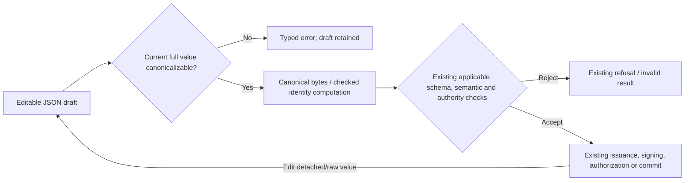

# Data Model: Explicit Canonicalization Failure Contracts

This design refines contracts of existing values; it adds no artifact schema or business semantics. Source domains and construction evidence are in [research.md](research.md). Proposed interfaces are in [contracts/public-api.md](contracts/public-api.md).

## Canonical input and output domains

Let `J` be representable `serde_json::Value` values, `D_C` the existing recursive no-floating-point canonical domain, and `B` canonical UTF-8 bytes. Null, booleans, strings, supported integer numbers, arrays and ordered-key objects are recursively admissible. Canonicalizability says nothing about whether an artifact schema permits a given value.

`C_checked: J -> Result<B, CanonicalError>` preserves the existing encoding for `D_C`. `Float(path)` identifies the existing recursive object/array path; `Serialize(message)` retains an encoder/conversion failure. The implementation reuses this error type, adding comparison/clone derives for source-preserving wrappers. It introduces no replacement bytes on failure.

Generic tagged identity first establishes `j ∈ D_C` over the complete supplied value, then applies the existing top-level self-hash exclusion and tag algorithm. A supported artifact may have additional existing identity projections, such as excluding each check's `cached` flag. Projection changes hash material, not the prerequisite that the full consumed artifact be canonicalizable. A valid canonical hash string or old signature is only data until existing boundary checks accept it.

## Existing entities and relationships

| Entity | Existing fields / domain | Mutation and validation |
| --- | --- | --- |
| `Attestation` | Public `value: Json`, `result: String`, `hash: String`, `checks: Vec<CheckResult>` | Raw value/metadata remain editable. Serialize complete current `value` with Result. Generation-time fields do not certify later edits or reconcile automatically. |
| `Authorization` | Public `value: Json`, `decision: String`, `hash: String` | Same draft/edit contract. Authorization acceptance still requires its existing hash, bindings, decision and applicable trust rules. |
| `Profile` | `checks: Vec<CheckKind>`, `rlimit: u64`, `wall_clock_guard_ms: u64` | Typed field edits remain allowed. Normalization emits enum strings and integer budgets; a private helper returns matching document/hash. Detached returned JSON is a separate raw value. |
| `CheckResult` / finding | Typed status, subject, location, cache metadata; optional raw `finding: Json` | Ordinary cache ingress preserves raw findings. Canonical assembly is fallible. Finding truth/proof status is a separate existing contract. |
| Migration generated report | Private generated `Decided`/checks; typed model-derived counterexamples | Construction excludes floats under R3's proof. Generation remains infallible; returned Attestation becomes raw/editable and later serialization is checked. |
| Legacy Store `Evidence` | Raw `authorization: Json`, optional `execution_policy: Json`, optional `attestation: Json`, `waivers: Vec<Json>` | `CommitBundle::with_evidence` attaches a draft. Action/migration evidence checks preflight every supplied component before identity projection and backend mutation. |
| Current trusted artifacts | Existing private checked content/envelope/signature/evidence types | Returned `as_json()` clones do not mutate checked types. Re-entry uses existing strict closed decoding, hash/signature/context/manifest rules. No new fields or authorities. |
| `AuthenticatedVerification.diagnostics` | Public raw JSON detached from authenticated envelope | Diagnostic edits do not change authority. CLI canonicalizes diagnostics and envelope before publishing either. |
| Diagnostic cache entry | Existing key, check JSON, optional raw finding | Lookup can miss; structurally usable hits can contain unsupported data. Best-effort writes may skip noncanonical entries, never publishing them as canonical evidence. |

Ordinary and migration attestations share the raw output entity but have different producer domains. Typed `Profile` and an arbitrary JSON value returned by `Profile::to_json()` also have different later mutation possibilities. Neither domain distinction requires a new public artifact abstraction.

## Error relationships

- Raw canonical boundaries and ordinary verification return `CanonicalError` directly, available through the supported facade.
- Legacy governance wraps that concrete cause as `GovernanceError::Canonicalization { artifact, source }`. Existing `Invalid` remains for syntax/object/schema input errors. No canonical error becomes an authorization decision.
- Store reports invalid supplied canonical evidence as existing `StoreError::EvidenceMismatch`, retaining artifact context and cause/path. Backend I/O failures retain their existing categories.
- Private complete-verification assembly maps to existing `TrustedError` with `CANONICALIZATION_FAILED` and the cause/path. This is distinct from trusted infrastructure abort and proof refusal. Fresh proof still bypasses diagnostic cache.
- CLI maps artifact errors to exit 2 with a diagnostic, before emission or output replacement. Valid negative proof/authorization remains exit 1.

## Draft and authoritative lifecycle

This diagram expresses obligations, not a new common pipeline API. Existing trusted decode may combine canonical and schema checks; existing typed constructors may establish canonicality by construction. Hash/signature/result fields retained after editing do not bypass the new current-value check. No new semantic checks are imposed on generic encoding itself.

Output text is computed completely before any canonical artifact is emitted. Canonicalization failure produces no canonical text, authoritative identity or successful canonical persistence. Raw untrusted draft storage and existing OS I/O-failure behavior remain separate.

## Preservation rules

For every previously valid canonicalizable `x` in the same profile, `C_new(x) = C_old(x)` and `H_new(x) = H_old(x)`. Preserve ordering, tags, separators, self-hash/cached-flag exclusions, signatures and historical profiles. Cold/warm diagnostic flags may differ exactly as before while their attestation identities agree.

Full-value validation intentionally refuses noncanonical metadata even if the old projection ignored it. Canonical metadata may still be excluded from identity under the existing rules. Canonicalizable-but-invalid reports, stale hashes, wrong signatures and inadequate profiles retain existing validator refusals. No document rewrite, new Wire format, verifier-version bump or persistent-state migration is required by this design.
