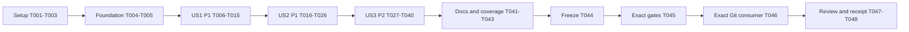

# Tasks: Explicit Canonicalization Failure Contracts

**Feature**: `021-canonicalization-errors`

**Input**: [plan.md](plan.md), [spec.md](spec.md), [research.md](research.md), [data-model.md](data-model.md), [API contract](contracts/public-api.md), [boundary contract](contracts/boundaries.md), [conformance](contracts/conformance.md), [quickstart.md](quickstart.md).

**Baseline**: `20d3fd2439e4c4b50f75d8f1e03f56aeb4502e9f`, tree `6c26917635f142cf219de8e4672ae894078d0026`.

**Tests**: Required by FR-010, the conformance contract and constitution III. Write/review tests before their production change and record runtime RED for reachable existing defects. A future Result signature failing to compile is not by itself a runtime reproduction. Keep an isolated pinned-baseline worktree available throughout the stories; run baseline-compatible probes there and typed-result regressions in the candidate. No tests or implementation are executed by generating this list.

**Organization**: Setup → shared evidence prerequisites → US1 (P1) → US2 (P1) → US3 (P2) → final delivery. US1 is the smallest reviewable increment; full feature acceptance requires all stories. No new crate, dependency, public artifact schema, hash domain, verifier version or release publication is planned.

## Format and paths

- Each task is `- [ ] Tnnn [P?] [USn?] Action with exact file paths`.
- `[P]` identifies disjoint ready tasks within the parallel groups below; prior phase/test prerequisites must already be complete. It does not authorize concurrent edits to the same file or concurrent resource-heavy builds.
- All source paths are relative to the Core feature checkout, `/home/kalle/repos/behavior-ir-core-021`, not the surrounding project repository.
- `specs/021-canonicalization-errors/evidence/` and `tests/fixtures/canonicalization/` are planned new directories. Reuse existing fixtures/tests before adding missing cases; do not rewrite frozen old vectors.
- Before candidate freeze, record probes, baseline comparisons and story results under the feature evidence directory. After T044, `${core021_receipt_dir}` means `/home/kalle/validation-receipts/core021/${core021_candidate_sha}`; these external run receipts avoid self-referential commit hashes or changes to the frozen source. Do not modify prior sealed release receipts.

## Phase 1: Setup — pin the implementation and independent baseline

**Purpose**: Establish reproducible old/new comparison inputs in the existing workspace. No project scaffolding or dependency upgrade is needed.

- [X] T001 Verify branch/feature selection, preserve existing local work, create an isolated detached baseline worktree at the pinned SHA, and record its path, source/tree identity, Rust 1.98.1, actual Nix Z3 version, lock hashes, build target and available disk/RAM space in `specs/021-canonicalization-errors/evidence/environment.json`; use `rust-toolchain.toml`, `flake.nix` and committed lockfiles without changing them or deleting source data.
- [X] T002 Capture independent valid ordinary verified/negative cold and warm reports, migration verified/counterexample reports and normalized Profile documents/hashes from that baseline into `tests/fixtures/canonicalization/baseline/`; retain the old-API capture harness in `specs/021-canonicalization-errors/evidence/baseline/capture-reports.rs` and exact commands, tool/profile/fixture/harness hashes, full bytes and embedded identities in `specs/021-canonicalization-errors/evidence/baseline-reports.json`, treating cold/warm bytes separately and excluding unstable guard/operational outcomes from deterministic goldens.
- [X] T003 Capture baseline valid legacy action/migration authorizations, policies, waivers/signatures and representative valid commit/replay identities into `tests/fixtures/canonicalization/baseline/` and `specs/021-canonicalization-errors/evidence/baseline-governance.json`; retain the old-API capture harness in `specs/021-canonicalization-errors/evidence/baseline/capture-governance.rs`, reuse `crates/behavior-verify/tests/governance.rs`, `crates/behavior-store/tests/migration_evidence.rs` and existing historical vectors, record fixed test time/seeds and harness/fixture hashes, and preserve their actual supported profiles rather than regenerating expectations after a fix.

**Checkpoint**: Old valid outputs have immutable provenance and the old API remains executable in its isolated worktree. Source-established defects are not yet recorded as runtime RED.

## Phase 2: Foundational — shared evidence and refusal premises

**Purpose**: Fix the cross-story evidence vocabulary and make genuine RED/positive controls reproducible before story changes.

- [X] T004 Create `specs/021-canonicalization-errors/evidence/coverage.md` mapping I01–I14, B01–B09 and C01–C11 to baseline provenance, existing tests, missing cases, actual input/mutation domains and selected error/invariant disposition; include ordinary cache ingress, Profile/migration construction proofs, idempotent recovery and early upgrade/history refusals, and classify unrelated Option defaults and best-effort cache writes without mechanically changing them.
- [X] T005 Document reproducible old-API probe commands and per-case inputs in `specs/021-canonicalization-errors/evidence/probes/README.md`, and baseline fixture provenance/loading rules in `tests/fixtures/canonicalization/README.md`; require per-task RED/GREEN logs, a real cache hit with a surviving finding, eligible legacy `require:none` Store fixtures, present Z3, and actual assertions of error cause/phase/output state. Reuse existing test loaders; do not introduce a new crate or public raw finding injection mechanism.

**Checkpoint**: Foundation is complete. Each story can now write its specific old-API runtime probes and new-API regressions before its production fixes; the pinned worktree prevents earlier story fixes from erasing later RED evidence.

## Phase 3: User Story 1 — distinguish malformed artifact data from successful output (P1, MVP)

**Goal**: Preserve editable drafts while making raw serialization and generic hashing return typed failure for unsupported current values, including excluded self-hash content.

**Independent test**: Generate supported artifacts, serialize/hash valid values against the frozen baseline, then insert a nested float while retaining old metadata. Receive `CanonicalError::Float(path)`, with no successful empty output/hash and no draft repair. Generic valid null, empty string, array and object keep their proper JSON encodings. The US1 CLI process regression must already demonstrate exit 2, canonical cause/path on stderr, zero stdout and unchanged pre-existing --out bytes before any serializer/CLI production change.

### Tests first

- [X] T006 [P] [US1] Extend `crates/behavior-core/tests/canonical.rs` with C01/C05 controls for nested objects/arrays, proper empty/null encodings, floats exclusively under top-level `hash`, unchanged canonical self-hash exclusion and nested-hash inclusion; write/run a baseline-compatible failing full-value hash probe and retain its source/stdout/status in `specs/021-canonicalization-errors/evidence/probes/us1-hash/` before changing `tagged_hash`.
- [X] T007 [P] [US1] Add C01/C02 raw serializer regressions in `crates/behavior-verify/tests/canonicalization.rs` for ordinary/migration attestations and action/migration authorizations, covering valid frozen bytes, nested post-generation mutation and retained old `.hash`/embedded hash/signature fields; record the old API's empty-string runtime failure with baseline-compatible probes under `specs/021-canonicalization-errors/evidence/probes/us1-serializers/` before writing the Result-based GREEN assertions.
- [X] T008 [P] [US1] Add the serializer/hash portion of `consumer/tests/canonicalization.rs`, obtaining all four artifact variants through `behavior_engine` and `serde_json` alone, requiring Z3, matching the facade-exported `CanonicalError::Float(path)`, preserving editable incomplete drafts and generation-time metadata, and distinguishing canonicalizable edits from semantic validity; preserve corresponding old-API probe evidence in `specs/021-canonicalization-errors/evidence/probes/us1-consumer/` without internal crate imports or fabricated reachability.

- [X] T009 [P] [US1] Write/review `crates/behavior-cli/tests/cli_canonicalization.rs` and observe its runtime RED on the unmodified pinned baseline before serializer/CLI production changes: seed a real matching cache entry, retain a surviving finding, insert a nested float, pre-create an --out sentinel, and assert exit 2, `behavior: canonicalization failed:` with cause/path on stderr, zero stdout and unchanged output bytes. Define reusable module/profile inputs, matching-entry selection, mutation and expected-path data in `tests/fixtures/canonicalization/poisoned-cache.json`, which each CLI/verifier/facade harness applies to its own freshly seeded cache; retain probe source and real process/file/status evidence in `specs/021-canonicalization-errors/evidence/probes/us1-cli/` for reuse in US2 and US3.

### Implementation and integration

- [X] T010 [US1] After T006–T009 tests are written/reviewed and T009's baseline CLI runtime RED is recorded, add `Clone + PartialEq + Eq` to the existing `CanonicalError` in `crates/behavior-core/src/canonical.rs`, preserving `Float(String)` and `Serialize(String)` causes, and explicitly re-export it through `crates/behavior-engine/src/lib.rs` with the matching sorted entry in `api/engine-surface.txt`; do not add a duplicate error hierarchy or unnecessary artifact type exports.
- [X] T011 [US1] After T006's runtime RED, make `tagged_hash` in `crates/behavior-core/src/canonical.rs` check the complete current value before removing top-level `hash`, sharing the existing recursive validation internally and preserving `UTF8(tag) || 0 || canonical_JSON_without_top_level_hash`, nested hash material, ordering and all valid vectors; keep its existing Result signature and produce no replacement identity.
- [X] T012 [P] [US1] After T007/T008, T009's CLI runtime RED and T010, change `Attestation::to_json_string` in `crates/behavior-verify/src/lib.rs` to `Result<String, CanonicalError>` over its complete current value, enforcing the data-model constraint "Raw value/metadata remain editable. Serialize complete current `value` with Result." Preserve public `value: Json`, `result: String`, `hash: String` and `checks: Vec<CheckResult>` without reconciliation or semantic validation in the serializer.
- [X] T013 [P] [US1] After T007/T008, T009's CLI runtime RED and T010, change `Authorization::to_json_string` in `crates/behavior-verify/src/governance.rs` to `Result<String, CanonicalError>`, retaining public `value: Json`, `decision: String` and `hash: String` and the data-model constraint "Same draft/edit contract." Encode the current full value without repairing fields or treating serializer success as authorization acceptance.
- [X] T014 [US1] After T009's baseline CLI RED and T012/T013, migrate affected serializer call sites in `crates/behavior-cli/src/lib.rs`, `crates/behavior-verify/tests/governance.rs`, `crates/behavior-verify/tests/migration.rs`, `crates/behavior-store/tests/migration_evidence.rs` and other callers found by scoped `rg` in `crates/` and `consumer/`; obtain complete text before existing writes/emits, map direct canonical errors to exit 2 with `behavior: canonicalization failed:` and cause/path under the already-written CLI regression, and keep admission/decision serializers with different contracts unchanged. Record the adapted-file list in `specs/021-canonicalization-errors/evidence/us1-callers.md` without deferring the basic CLI test to US3.
- [X] T015 [US1] Run the US1 core/verifier/facade tests, the T009 CLI process regression in `crates/behavior-cli/tests/cli_canonicalization.rs` and `scripts/check-public-surface.sh`, compare valid output with T002/T003 baselines and existing vectors, and record actual GREEN commands/statuses/bytes in `specs/021-canonicalization-errors/evidence/us1-green.json`; require exit 2, canonical cause/path on stderr, zero stdout and unchanged pre-existing --out bytes, editable unsupported drafts and no successful empty text/hash. The CLI failure contract is part of US1 completion.

**Checkpoint**: US1 is independently reviewable and testable. This MVP establishes raw serialization/hash errors and the basic CLI failure/output contract; ordinary producer closure and the remaining trust/persistence/CLI obligations are completed in US2/US3 before full feature delivery.

## Phase 4: User Story 2 — preserve valid generated reports and profiles (P1)

**Goal**: Make genuinely fallible ordinary assembly explicit, prove retained Profile/migration infallibility, preserve valid generated bytes/results and demonstrate the producer API migration.

**Independent test**: Compare each generated artifact with its pinned baseline; a matching poisoned ordinary cache entry produces a typed producer error, while typed Profile/migration construction retains its narrower API and canonical outputs. Facade consumers compile the direct Result migration and keep valid negative proof outcomes distinct.

### Tests first

- [X] T016 [P] [US2] Extend `crates/behavior-verify/tests/cache.rs` by reusing T009's `tests/fixtures/canonicalization/poisoned-cache.json` case with a freshly seeded matching cache entry and surviving nested-float finding, asserting a real hit and typed `verify` failure rather than a fabricated result; record the producer-specific old-API empty-hash/empty-artifact runtime RED under `specs/021-canonicalization-errors/evidence/probes/us2-cache/` before changing assembly. Add/reuse the private cache-write control in `crates/behavior-verify/src/cache.rs` showing unsupported entries are not materialized and best-effort writes remain separate; do not duplicate the existing CLI regression.
- [X] T017 [P] [US2] Extend `crates/behavior-verify/tests/canonicalization.rs` and reuse `crates/behavior-verify/tests/migration.rs` for C04 Profile/generated-report checks against frozen bytes/hashes: preserve `checks: Vec<CheckKind>`, `rlimit: u64`, `wall_clock_guard_ms: u64` and "Typed field edits remain allowed. Normalization emits enum strings and integer budgets; a private helper returns matching document/hash." Cover enum normalization/duplicates/order, zero/u64 extrema and detached JSON mutation, plus migration counterexamples from the actual typed model-value path; do not invent a raw migration-producer negative.
- [X] T018 [P] [US2] Write a private error-mapping unit check in `crates/behavior-verify/src/governance/semantic_proof.rs` and reuse fresh-proof isolation controls in `crates/behavior-verify/tests/trusted_verification.rs` before changing the common assembly bridge; assert `CANONICALIZATION_FAILED` preserves cause/path and is distinct from proof/infrastructure outcomes, explicitly labelling this private defensive seam as having no demonstrated public fresh-proof float input.
- [X] T019 [P] [US2] Extend `consumer/tests/canonicalization.rs` with the ordinary producer Result migration, T009's reusable poisoned-cache case through public fields/files, valid ordinary/migration report success and post-generation mutation controls; require Z3 and facade imports only, retaining producer-specific old-API runtime probes under `specs/021-canonicalization-errors/evidence/probes/us2-consumer/`. Compile/run the before API-contract example against the pinned baseline API and the after example against the candidate API, recording both revisions and harness hashes. Any old snippet checked against the candidate must explicitly expect compile failure; do not add a legacy compatibility path to make it pass.

### Implementation and integration

- [X] T020 [US2] After T016/T018/T019, propagate `Result<Attestation, CanonicalError>` through `assemble`, `verify_impl`, public `verify` and private `verify_complete` in `crates/behavior-verify/src/lib.rs`, replacing the assembly hash default with checked propagation; adapt `crates/behavior-verify/src/governance/semantic_proof.rs` to existing `TrustedError { code: "CANONICALIZATION_FAILED", message: cause.to_string() }`, preserving fresh no-cache verification, sorting/deduplication and valid semantic outcomes without dropping poisoned findings.
- [X] T021 [P] [US2] After T020, replace Profile hash/extraction defaults in `crates/behavior-verify/src/lib.rs` with a private helper producing the document and hash together; keep `to_json() -> Json` and `hash() -> String`, normalize exactly as before, and document the enum-string/u64 construction proof at any invariant assertion instead of introducing raw-domain `expect` or a new public checked type.
- [X] T022 [P] [US2] After T020, replace the empty hash default in `crates/behavior-verify/src/migration.rs` with locally documented construction enforcement, preserving `verify_migration(...) -> Attestation` and "Construction excludes floats under R3's proof. Generation remains infallible; returned Attestation becomes raw/editable and later serialization is checked." Cite the ignored cache, private generated findings and typed `model_value`/semantic encoder chain; do not alter query/migration/proof semantics or add a raw finding ingress.
- [X] T023 [US2] After T016/T019 producer tests and the already-reviewed T009 CLI regression, adapt ordinary `verify` Result consumers in `crates/behavior-cli/src/lib.rs`, `consumer/tests/capabilities.rs`, `consumer/tests/command_verification.rs`, `crates/behavior-verify/tests/cache.rs`, `crates/behavior-verify/tests/governance.rs` and remaining scoped `rg` hits in `crates/` and `consumer/`; propagate producer errors through the existing tested canonical diagnostic/output handling before serialization or output, preserve semantic result inspection only on successful artifacts, and record paths in `specs/021-canonicalization-errors/evidence/us2-callers.md` without adding unsafe legacy APIs or weakening assertions.
- [X] T024 [US2] Add tested before/after producer and serializer examples plus generation-time metadata guidance to `docs/verification.md`, covering unchanged migration generation, typed canonical failure, mutable drafts, valid `not_verified`, complete text before publication and baseline byte preservation; link the corresponding cases in `consumer/tests/canonicalization.rs`, identify before-examples as baseline-API programs and after-examples as candidate-API programs, and retain the direct minor-version transition from `specs/021-canonicalization-errors/contracts/public-api.md`.
- [X] T025 [US2] Run generated-report/cache/Profile checks and baseline comparisons using `crates/behavior-verify/tests/cache.rs`, `crates/behavior-verify/tests/migration.rs`, `crates/behavior-verify/tests/preservation.rs` and fixed vectors, then re-run T009's unchanged CLI process regression in `crates/behavior-cli/tests/cli_canonicalization.rs` after producer-call adaptation; record GREEN evidence and constructor proofs in `specs/021-canonicalization-errors/evidence/us2-green.json`, confirming failure moves to the checked producer while the CLI exit/stderr/stdout/output-file contract and best-effort cache skip behavior remain correct.
- [X] T026 [US2] Run producer/mutation migration cases in `consumer/tests/canonicalization.rs` and reused supported consumer checks, recording results in `specs/021-canonicalization-errors/evidence/us2-consumer.json`; verify both canonical error variants are nameable through the facade, before-examples compile/run against the baseline and after-examples against the candidate with matching revision provenance, solver absence fails required acceptance, and valid negative results remain distinct from canonicalization errors. Treat any old snippet intentionally tested on the candidate as compile_fail, not successful compatibility.

**Checkpoint**: US1 and US2 are independently testable with the shared API changes integrated. Ordinary raw finding ingress is checked, and Profile/migration infallibility is supported by actual construction evidence rather than successful examples alone.

## Phase 5: User Story 3 — propagate artifact failure without changing proof authority (P2)

**Goal**: Close governance, signing, supplied evidence, persistence and CLI publication boundaries while retaining independent semantic/authentication rules and normative phases.

**Independent test**: Unsupported full current values, including only excluded metadata, fail with the correct cause before authoritative output or backend mutation. CLI canonical errors are exit 2 with no stdout/replacement file. Canonicalizable invalid inputs, trusted cache isolation, manifests, context/issuer/role checks, historical interpretation and valid refusal/inconclusive outcomes retain their rules.

### Tests first

- [X] T027 [P] [US3] Extend `crates/behavior-verify/tests/governance.rs` and reuse `crates/behavior-verify/tests/hashing.rs` plus the US1 core full-input regression for C05/C06 full-value checking before waiver/policy self-hash and attestation cached-flag stripping, typed `GovernanceError::Canonicalization { artifact, source }`, both authorization producers and waiver signing; record baseline-compatible runtime RED under `specs/021-canonicalization-errors/evidence/probes/us3-governance/`, with valid signature/identity controls and canonicalizable stale hash/result/signature refusals.
- [X] T028 [P] [US3] Add `crates/behavior-store/tests/canonicalization.rs` using eligible legacy `require:none` action/migration fixtures to cover each supplied authorization, optional execution policy, optional attestation and waiver, including a float only in stripped migration attestation `checks[].cached`; assert `EvidenceMismatch` preserves component/cause/path and unchanged head/records/registry, retain idempotent recovery and earlier required-legacy/history refusals, and record real baseline failure/acceptance evidence in `specs/021-canonicalization-errors/evidence/probes/us3-store/` rather than treating an unrelated early refusal as coverage.
- [X] T029 [P] [US3] Extend the existing `crates/behavior-cli/tests/cli_canonicalization.rs` suite from T009 with remaining direct-output and trusted-adapter controls before their production changes; add private formatter/`CANONICALIZATION_FAILED` checks in `crates/behavior-cli/src/lib.rs` and retain valid status/newline/byte controls for 0/1/3/64 outcomes. Reuse the original cache fixture and no-output/no-file-replacement regression without duplicating them, record any newly reachable old-API runtime RED under `specs/021-canonicalization-errors/evidence/probes/us3-cli/`, and label private defensive cases without inventing public float ingress for generated-only commands.
- [X] T030 [P] [US3] Review/reuse `crates/behavior-verify/tests/trusted_verification.rs`, `crates/behavior-verify/tests/trusted_governance.rs`, `crates/behavior-store/tests/trusted_governance.rs` and `consumer/tests/trusted_governance.rs` for complete manifests, cache isolation, issuer/role/context/signatures, unsigned rejection, clone re-entry and historical-versus-fresh semantics; add only missing C08 cases and record the reused exact test names and any new RED premises in `specs/021-canonicalization-errors/evidence/us3-trust-controls.md` without weakening current strict decoding or claiming forgery.
- [X] T031 [P] [US3] Extend `consumer/tests/canonicalization.rs` with typed legacy governance source matching, valid action/migration authorization serialization and unsupported current-value signing/acceptance/persistence cases plus canonicalizable-invalid controls; exercise the actual public facade only, retain old hash/signature fields during mutation, require Z3 where needed, and record old-API reachable probes in `specs/021-canonicalization-errors/evidence/probes/us3-consumer/` while reusing US1/US2 helpers/cases.

### Implementation and integration

- [X] T032 [P] [US3] After T027, add the source-preserving `GovernanceError::Canonicalization { artifact: &'static str, source: CanonicalError }` variant in `crates/behavior-verify/src/governance.rs`; preflight complete parsed objects before removing self-hash/cached fields, replace canonical-to-Invalid flattening at all affected document hashes, retain syntax/object/schema `Invalid` and existing policy/replay/signature checks, and enforce "Authorization acceptance still requires its existing hash, bindings, decision and applicable trust rules." Do not convert legacy decoding into current trusted schemas.
- [X] T033 [P] [US3] After T028, preflight raw `authorization: Json`, optional `execution_policy: Json`, optional `attestation: Json` and every `waivers: Vec<Json>` component in both legacy evidence paths in `crates/behavior-store/src/store.rs`, and make `evidence::text` checked with `EvidenceMismatch` context/cause/path; enforce "Action/migration evidence checks preflight every supplied component before identity projection and backend mutation." Preserve `CommitBundle::with_evidence` draft attachment, original recovery checks, early upgrade/history/concurrency refusals, valid identity material and existing backend atomicity; add no Store error variant or schema field.
- [X] T034 [P] [US3] After T029 and the US2 producer bridge, consolidate checked `canonical_text` and canonical diagnostic formatting in `crates/behavior-cli/src/lib.rs` for verify/migration/authorize, migration admit/apply, engine-info, signed waivers and both admission-item conversion/encoding defaults; explicitly handle trusted `CANONICALIZATION_FAILED` and direct proof-output/trusted-authorization canonical errors as exit 2, preserve the cause/path and all valid newline/result rules, and enforce "Diagnostic edits do not change authority. CLI canonicalizes diagnostics and envelope before publishing either." Obtain all text before writes/emits; preserve existing I/O-failure semantics.
- [X] T035 [US3] Document legacy governance source matching, signing/authorization migration, full-value validation before exclusions, Store `EvidenceMismatch` causes/phases, fresh-versus-legacy authority and CLI 0/1/2/3/64 behavior in `docs/governance.md`; connect examples to `consumer/tests/canonicalization.rs`, explicitly state old metadata supplies no authority over edited values, and document the new refusal of noncanonical excluded fields without changing supported historical interpretation.
- [X] T036 [US3] Run C07 action/migration persistence, recovery, phase and valid historical replay controls in `crates/behavior-store/tests/canonicalization.rs`, `crates/behavior-store/tests/migration_evidence.rs`, `crates/behavior-store/tests/migration_replay.rs` and existing matching recovery tests; compare baseline valid identities and record commands, refusal cause/phase and unchanged backend state in `specs/021-canonicalization-errors/evidence/us3-store-green.json`.
- [X] T037 [US3] Run the C08 reused/new authenticated controls from T030 plus T018's private bridge check, confirming no cache-to-trust promotion or changed manifest/context/signature/profile interpretation; record the concrete tests and outcomes in `specs/021-canonicalization-errors/evidence/us3-trust-green.json`, distinguishing a private defensive error check from demonstrated public reachability.
- [X] T038 [US3] Run `crates/behavior-cli/tests/cli_canonicalization.rs` alongside existing `cli_verify.rs`, `cli_migration.rs`, `cli_authorize.rs`, `cli_engine_info.rs` and `cli_trusted_governance.rs` controls, mapping I11–I14 to actual valid output/newline evidence; record exit/status/stderr/stdout/file bytes and baseline comparisons in `specs/021-canonicalization-errors/evidence/us3-cli-green.json` with no skipped required solver case or partial artifact on canonical failure.
- [X] T039 [US3] Run the complete `consumer/tests/canonicalization.rs` and reused supported trust/verification consumer scenarios, checking serializers, producer errors, concrete canonical/governance source matching, editable drafts, signing/Store refusal and valid success through only facade imports; record results and example-to-test mappings in `specs/021-canonicalization-errors/evidence/us3-consumer-green.json` without duplicating existing conformance tests.
- [X] T040 [US3] Complete B04–B09/I07/I09–I14 enforcement and C05–C10 evidence links in `specs/021-canonicalization-errors/evidence/coverage.md`, including reuse of checked trusted types, recovery and pre-backend archive hashing, the migration full-evidence gap's actual RED/GREEN result, and explicit changed sub-error precedence for unsupported/multiply-invalid evidence; leave no canonical failure represented as accepted authorization or successful authoritative persistence.

**Checkpoint**: All stories are functional and independently evidenced. Canonicality, semantic validity and authenticated authority remain separate; commit/evaluation/admission and required historical refusal boundaries are preserved.

## Phase 6: Polish and cross-cutting delivery

**Purpose**: Close the inventory, supported migration/version assessment and exact-revision acceptance without creating a new release.

- [X] T041 [P] Reconcile every changed supported signature, governance variant, generic hash acceptance restriction and CLI error contract in `docs/versioning.md` and `specs/021-canonicalization-errors/contracts/public-api.md` with the compiled migration cases; classify delivery as 0.x minor (next eligible from baseline 0.14.0, subject to intervening releases), retaining valid bytes/hashes, `VERIFIER_VERSION`, Wire/record/store formats and historical profiles, and update `docs/verification.md`/`docs/governance.md` only as needed for final consistency without bumping Cargo versions, tagging or publishing.
- [X] T042 [P] Audit final source defaults/projections and close all I01–I14, B01–B09, C01–C11, FR-001–014 and SC-001–007 mappings in `specs/021-canonicalization-errors/evidence/coverage.md`; attach actual test/proof references, confirm only locally proven Profile/migration assertions remain infallible, preserve best-effort cache/Option classifications, and reject any new silent adapter, unsupported historical rewrite, unproved domain or unexecuted claimed result.
- [X] T043 Validate the focused commands and migration scenarios in `specs/021-canonicalization-errors/quickstart.md`, reusing matching GREEN evidence where unchanged rather than rerunning expensive checks gratuitously; resolve planned-target labels to actual files/commands, check documentation links and record quickstart results in `specs/021-canonicalization-errors/evidence/quickstart.json`. Leave final full gates/exact-Git execution to T045/T046.
- [X] T044 After all source/test/contract/docs fixes, freeze and push the candidate source revision for exact-Git validation, set `core021_candidate_sha` to its full SHA and `core021_receipt_dir` to `/home/kalle/validation-receipts/core021/${core021_candidate_sha}`, and record SHA/tree, clean source status, lock/tool/fixture/harness identities and intended CLI provenance in `${core021_receipt_dir}/candidate.json`; preserve existing user changes, PR/merge state and all release tags, and keep subsequent execution receipts outside the frozen source tree.
- [X] T045 Run the repository's unchanged `scripts/gates.sh` in the pinned Nix/Rust/Z3 environment against T044's candidate, retaining full output, exact command/environment and exit status in `${core021_receipt_dir}/gates.log` and `${core021_receipt_dir}/gates.json`; require all formatting/clippy/workspace/build/determinism/boundary/public-surface/consumer/workflow/terms/script checks, then record the actual built CLI path/hash/SHA without substituting old release binaries or earlier test results.
- [X] T046 Run `scripts/check-consumer.sh --rev "$core021_candidate_sha"` with candidate harness/fixtures and the matching built CLI, using a receipt-scoped temporary directory and a collector started before the run to copy the actual resolved temporary `Cargo.toml` and `Cargo.lock` before cleanup; save them with library Git SHAs, fixture/harness/CLI hashes, tools/environment, command/log/status in `${core021_receipt_dir}/consumer/`. Validate the lock contains the candidate for every resolved Core library package; CLI provenance is separate. Do not edit/weaken gates or reconstruct a hypothetical lockfile after the run.
- [X] T047 Review T045/T046 receipts, independent T002/T003 byte/hash comparisons and C01–C11 evidence against `specs/021-canonicalization-errors/contracts/conformance.md`, recording the final preservation/migration/phase assessment in `${core021_receipt_dir}/review.md`; if a source/API/test/golden/contract fix is needed, return to RED/GREEN and freeze/revalidate a new candidate, and never call a skipped case, changed hash expectation or uncollected real lockfile successful acceptance.
- [X] T048 Finalize `${core021_receipt_dir}/receipt.json` with tested SHA/tree, receipt hashes, complete evidence references and remaining limitations, then mark actual completed tasks in `specs/021-canonicalization-errors/tasks.md` and report the concrete result; keep checklist/receipt metadata distinct from the tested source revision and leave no unmet requirement marked complete. This feature delivery does not itself merge a PR, select a later release number or publish a release.

## Dependencies and execution order

### Phase graph



US2 builds on US1's error export/raw serializers. US3 consumes US2's producer/private bridge and reuses US1's full-input generic hashing. These are deliberate shared-interface dependencies, not three concurrent edits to the same library/CLI files. Each story has its own independent acceptance criteria after its prerequisites.

### Within-story dependencies

| Ready stage | Dependency / ordering |
| --- | --- |
| T006/T007/T008/T009 | Foundation complete; separate core/verifier/facade/CLI test paths may be authored together; T009 also owns the shared poisoned-cache case |
| T010/T011 | All US1 tests, including T009's reviewed baseline CLI runtime RED, precede production; T011 additionally follows T006 runtime RED and T010 |
| T012/T013 | T007/T008 + T009 baseline CLI RED + T010 complete; distinct producer source files |
| T014 → T015 | Raw changes and T009 RED complete; adapt callers under the existing CLI test, then require raw/facade and CLI GREEN for US1 |
| T016/T017/T018/T019 | US1 complete; independent producer/cache, generated-report, private bridge and facade tests reuse T009's read-only cache case |
| T020 | T016/T018/T019 tests written and relevant runtime RED recorded; Result/common bridge changes together |
| T021/T022 | T017 + T020 complete; Profile and migration implementation files are distinct |
| T023 → T024 → T025 → T026 | Producer changes integrated; migrate callers under T009's existing test, compile before on baseline/after on candidate, then generation, CLI and facade GREEN |
| T027/T028/T029/T030/T031 | US2 complete; disjoint governance/Store/CLI/trust/consumer test paths; T029 extends the existing CLI suite rather than creating its basic cache test |
| T032/T033/T034 | Their own RED/test prerequisites complete; governance/Store/CLI files are distinct; all use completed shared interfaces |
| T035–T040 | Production branches integrated before final evidence runs; US3 closure follows Store/trust/CLI/consumer results |
| T041/T042 → T043 | All stories complete; separate docs and coverage review, then tested quickstart |
| T044 → T045 → T046 → T047 → T048 | Serial source freeze, acceptance and receipt; do not change source during final runs |

All bug tests must be written/reviewed and show runtime RED before the corresponding fix, using the preserved baseline worktree when necessary. In particular T009 precedes US1 serializer/CLI changes; replaying a test first written after its fix against an older worktree does not satisfy test-first. Already-correct characterization controls may pass immediately; construction-only/private defensive obligations are labelled accurately instead of manufacturing public failures. Required API-compilation tests can have compile RED in addition to, not instead of, a reachable defect's runtime reproduction.

## Parallel execution examples

These are scheduling opportunities; they do not invoke agents or require parallel builds. Each task owns separate source/probe/result files, and failed checks are resolved before a dependent stage advances.

### US1

```text
After T005: T006 core canonical tests | T007 raw verifier tests | T008 facade tests | T009 CLI regression/shared cache case
After T010 and T009 CLI RED plus relevant raw RED probes: T012 Attestation serializer | T013 Authorization serializer
Then: T014 caller integration under the existing CLI test → T015 raw/facade/CLI acceptance
```

### US2

```text
After T015: T016 producer tests reusing cache case | T017 Profile/migration tests | T018 private bridge tests | T019 facade producer/baseline-before/candidate-after tests
After T020: T021 Profile helper/invariant | T022 migration invariant
Then: T023 callers → T024 migration docs → T025 producer plus existing CLI regression / T026 facade acceptance
```

### US3

```text
After T026: T027 governance tests | T028 Store tests | T029 CLI suite extensions | T030 trust controls | T031 facade tests
After their RED prerequisites: T032 governance boundary | T033 Store boundary | T034 CLI boundary
Then: T035 docs → T036/T037/T038/T039 evidence → T040 closure
```

T041 and T042 can also proceed together after all stories; each must finish before T043. Test/build execution uses the available disk/RAM budget and isolated cache/output directories, even where authoring is parallelizable.

## Implementation strategy

### MVP first

Complete T001–T015, then demonstrate typed failure on editable raw artifacts, unchanged valid canonical output through the facade and the CLI exit/stderr/stdout/output-file contract whose test preceded implementation. This is an internal review milestone for US1, not a claim that producer/trust/persistence obligations or release readiness are complete.

### Incremental delivery

Add US2's producer Results and proven narrower invariants without losing US1 behavior, then US3's remaining boundary/CLI enforcement while preserving the existing authority model. Validate each checkpoint with its own evidence before advancing. Complete migration docs, coverage closure and final exact-revision gates/consumer before calling the feature done.

### Task/evidence summary

| Group | Tasks | Count |
| --- | --- | --- |
| Setup | T001–T003 | 3 |
| Foundation | T004–T005 | 2 |
| US1 (P1) | T006–T015 | 10 |
| US2 (P1) | T016–T026 | 11 |
| US3 (P2) | T027–T040 | 14 |
| Polish/delivery | T041–T048 | 8 |
| Total | T001–T048 | 48 |

Conformance ownership: C01/C02/C05 and the basic C09 CLI process contract start in US1; C03/C04, producer migration and re-running that existing CLI contract are in US2; C05/C06/C07/C08, remaining C09 and remaining C10 are in US3; C11 and complete FR/SC coverage close in final delivery. Twenty-two tasks are marked `[P]` within the explicit ready groups. Reuse actual existing tests, report unresolved contracts rather than weakening them, and check a box only after its concrete file/result obligation is met.
