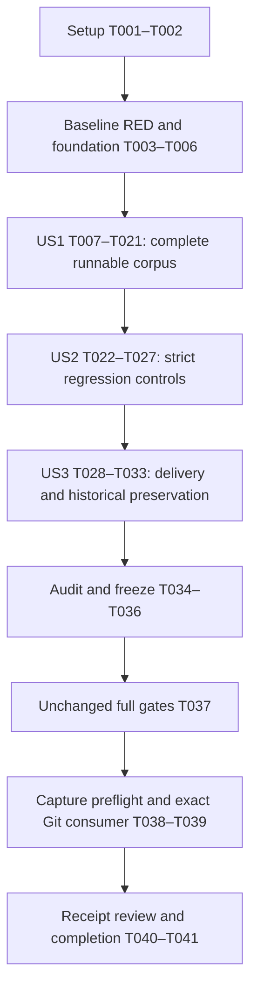

# Tasks: Complete Parent Snapshots for Binding Conformance

**Feature**: `026-binding-conformance-snapshots` — Core issue #29.

**Input**: [spec.md](spec.md), [plan.md](plan.md), [research.md](research.md), [data-model.md](data-model.md), [current corpus](contracts/current-corpus.md), [semantic results](contracts/semantic-results.md), [validation](contracts/validation.md), and [quickstart.md](quickstart.md).

**Working directory**: `/home/kalle/repos/behavior-ir-core-021`, branch `026-binding-conformance-snapshots`. All repository paths below are relative to that checkout. The reviewed semantic baseline is `a24b65d26efaf62342daf5ab0f455540dfd61ed1`, tree `ef2f503f4c3abd6d7ab5b913ff3d3bd3fcf6fb35`; source version 0.13.0 does not identify the published 0.13.0 release commit.

**Tests**: Required by FR-005/006/011/014/015 and constitution III. Write, review and execute each affected test before its implementation change; retain an observed failing behavioral assertion for missing behavior, then rerun the same assertion after the correction. Preserve the real runtime bug reproduction separately from missing-file, compilation, structural-refusal and comparator-mismatch failures. The ten expected records are independent authored test data; actual evaluation output must never generate or refresh them.

**Status**: Complete — all 43 tasks executed. Convergence F1/T042 and F2/T043 are corrected with actual RED-to-GREEN evidence. Clean implementation candidate `971c54df51fc989188ae7263dc3fa911f4d86467` passed the full unchanged gates and exact-Git consumer with synchronous actual manifest/lock capture. See the [renewed external receipt](/home/kalle/validation-receipts/core026/971c54df51fc989188ae7263dc3fa911f4d86467/receipt.json). This tasks/coverage-only completion commit is separate from the tested implementation. Earlier receipts retain their original scope. No PR, release or issue closure is performed by this delivery.

## Format and execution rules

- Each task uses `- [ ] Tnnn [P?] [USn?] Description with exact file paths`.
- `[P]` identifies disjoint file work within the dependency barriers below. It does not authorize starting a dependent task early or imply parallel resource-heavy builds.
- `[US1]`, `[US2]` and `[US3]` match the specification. Setup, foundational and final tasks have no story label.
- Intermediate evidence belongs under `specs/026-binding-conformance-snapshots/evidence/`. Final acceptance receipts belong outside frozen source at `/home/kalle/validation-receipts/core026/<candidate-sha>/`.
- Preserve production crate sources, public exports, dependencies/lockfiles, module bytes/identities, historical inputs/records/generator/archives, `tests/fixtures/README.md`, release-build, release asset/manifest formats, and `scripts/gates.sh`. No additional historical-byte exception is permitted.
- Reuse existing validation and command-multiplicity tests. Do not reuse request-completion helpers, subset matchers or runtime-generated expectations. Discovery must fail for missing, repeated or unclassified cases.
- **Owner RED barrier**: T015, T016 and T018 start by executing their previously written/reviewed focused contract tests and saving the exact command, test/assertion, input/source hashes, real status, log and intended failure cause before implementing the missing behavior. Minimal fail-closed interface scaffolding may make new targets executable; it must not implement the planned validation, comparison, generation or runner behavior. Missing files, compilation errors or unrelated dependency failures are setup failures to resolve before claiming behavioral RED. Rust helper contract assertions may use the reviewed worlds/oracles directly, without corrected-request evaluation or generated request files. T018's runner/determinism RED waits for T017's generated requests. Record the same focused assertions GREEN after the owner change; the full ten-case GREEN remains T020. Existing correct behavior is characterized GREEN and reused without a needless implementation change.
- **Correction RED barrier**: T022–T024 execute their controls before T025. Record already-correct refusals as GREEN characterization; any missing checker behavior requiring a T025 change must have an observed relevant assertion failure first. T003 remains the original Core defect reproduction and T028 remains the production step-5 integration reproduction; neither substitutes for a different owner's RED evidence.

## Phase 1: Setup

**Purpose**: Establish source, tool and custody provenance before any conformance input changes.

- [X] T001 Verify the Core branch and baseline without discarding existing work; record full source SHA/tree/status, pinned Nix/Rust/Python/Z3 versions, Cargo lock hashes, build settings, free disk capacity and the actual baseline CLI path/digest/build source in `specs/026-binding-conformance-snapshots/evidence/environment.json`. Use Rust 1.98.1/Python 3.13/Z3 4.16.0 as planned, bounded build resources and a task-owned target/output directory; build an exact-source baseline CLI if provenance of an existing binary cannot be established.
- [X] T002 Inventory sources feeding the ten cases in `specs/026-binding-conformance-snapshots/evidence/source-inventory.md` and fingerprint protected baseline bytes in `specs/026-binding-conformance-snapshots/evidence/protected-inputs.json`: classify each use as historical, current-adapted or intentional negative; include feature 017's 546 archive entries, five module identities, old paired/source requests, expectation tables, archived manifests, the frozen `tests/fixtures/wire/build_fixtures.py` and the current baseline bytes of `tests/fixtures/README.md`. Honor only the pre-existing 017 documentation exception; grant no 026 exception (C026-01).

## Phase 2: Foundational prerequisites

**Purpose**: Record the actual defect, then establish the explicit inventory/world inputs shared by all stories.

**Barrier**: Complete T001–T003 before the parallel T004–T006 group; complete this phase before US1. No corrected request may be evaluated until all ten full expectations in T007–T011 have been authored and reviewed.

- [X] T003 Write and review `specs/026-binding-conformance-snapshots/evidence/probes/original-bindings.py`, a baseline-compatible probe of both untouched historical payloads for each of the five modules; assert their intended five ALLOW/five DENY/PRECONDITION_FAILED outcomes, then execute with the proven baseline CLI. Retain exact input hashes, commands, real subprocess statuses/stdout/stderr and the failing assertions in `specs/026-binding-conformance-snapshots/evidence/baseline-red.json` and its log; establish ten actual INVALID_INPUT/INVALID_STATE_SNAPSHOT results before adding the correction. Missing new files or build failures do not establish this runtime RED.
- [X] T004 [P] Create `specs/026-binding-conformance-snapshots/evidence/coverage.md` with a pending evidence row for C026-01 through C026-14 and the complete FR/SC/PO/AC/story-scenario crosswalk from `contracts/validation.md`; assign concrete task/test owners, distinguish structural/consistency/state-validity/business/comparison/package refusals, and identify historical tests to reuse. Leave unexecuted checks pending and include exact commands/results only after execution.
- [X] T005 [P] Author and review `tests/fixtures/bindings/current/cases.json` and static admission evidence in `specs/026-binding-conformance-snapshots/evidence/module-identities.json`, without action evaluation. Use fixture format `behavior.binding_conformance.v1`; apply the `semantic_reference` constraint “Fixed reference Core commit `a24b65d26efaf62342daf5ab0f455540dfd61ed1`, reference source engine version 0.13.0, record version 0.8 and complete-resulting-state profile”. Enforce the module/case constraints verbatim: “Exactly invoice, project_margin, accounts, ledger, orders, with archive-root-relative module path, raw module SHA256, admitted behavior_version, exact complete item-hash map and schema hash” and “Exactly ten unique entries, five domains × allowed/refused”. Each case has `id` (`domain/scenario`), `module` (one module key), `scenario`, archive-root-relative `request` and `expected` paths, `world` key and expected CLI `exit_code` (0 allowed, 1 refused). “No path may escape the explicit package root.” “Reject unknown case/module references, duplicate IDs, duplicate request paths, missing files, unclassified extra request/expectation files and inconsistent labels/statuses.” Distinguish this fixed reference from final executing-source provenance.
- [X] T006 [P] Author and review W01–W10 in `tests/fixtures/bindings/current/worlds.json` from the complete values and deliberate-empty justifications in `contracts/current-corpus.md`. Apply these model constraints verbatim: “Exactly one entry per case ID, containing `parent` and `child`, each a map from **every declared entity type** to its explicitly authored finite list of full entity values.” “Type domain equals the admitted module's entity domain, including deliberate empty lists.” “Each row has exactly one typed identity; duplicate/conflicting identity rows are invalid.” “Parent membership is authored independently of request state bindings. It is not inferred by a helper.” “All original bound state rows agree with the parent under existing canonical typed equality.” “Parent constraints/invariants/reference/global obligations hold independently of action result.” “Allowed child equals the simultaneous application of independently expected effects to the parent; preserve every unaffected row/type.” “Refused child equals the parent. No committed transition or command delivery is inferred from evaluating these files.” “Child rows are independently specified, not copied from an actual evaluation.” Expand all shorthand into full rows, including Account#a1.owner and the surviving unrelated order/customer rows (C026-02/03/04).

**Checkpoint**: The source defect is reproduced with real statuses; complete worlds and closed inventory are reviewed inputs, not claimed successful evaluations.

## Phase 3: User Story 1 — Run the supplied binding examples unchanged (P1, MVP)

**Goal**: Deliver ten self-contained valid behavioral cases with independent full semantic expectations and unchanged facade/CLI consumption, including a real extracted-package happy path.

**Independent test**: For all ten cases, establish complete/consistent/valid parents separately; evaluate delivered requests unchanged, compare full records and exact identities, prove expected children/effects, require five ALLOW/five intended DENY, empty command intents, twice-run equality and same-CLI replay. Repeat using only extracted package data outside the checkout. No private world completion is allowed.

### Independent expected records and tests — before implementation

The five oracle tasks may run in parallel after T005/T006. All must be reviewed before corrected-request execution. Derive complete records from module rules, authored worlds, evaluation order and static admission identities; include full current facts/trace/derived/changes/reasons and optional presence as specified in `contracts/semantic-results.md`, with record_version 0.8 and validation_profile `behavior.complete_resulting_state.v1`. Never capture actual corrected-request output as an oracle.

- [X] T007 [P] [US1] Author and review `tests/fixtures/bindings/current/expectations/invoice.allowed.json` and `tests/fixtures/bindings/current/expectations/invoice.refused.json`: W01 changes status to approved and approved_by to anna; W02 reaches the approval-limit PRECONDITION_FAILED with unchanged child. Enforce “One complete semantic DecisionRecord08 JSON document per case, authored/reviewed before executing the corrected request.” and “Optional-field **presence** matters.” Include the exact caller metadata/context, full Invoice/User universes and current semantic trace, preserving context actor versus persisted User membership.
- [X] T008 [P] [US1] Author and review `tests/fixtures/bindings/current/expectations/project_margin.allowed.json` and `tests/fixtures/bindings/current/expectations/project_margin.refused.json`: W03 derives margin 0.02/high_risk true and flags the project; W04 denies at the zero-revenue guard without evaluating division or changing state. Enforce “One complete semantic DecisionRecord08 JSON document per case, authored/reviewed before executing the corrected request.” Include the full current trace, guarded skips, derived hashes/values, facts and exact reason identity rather than historical trace templates.
- [X] T009 [P] [US1] Author and review `tests/fixtures/bindings/current/expectations/accounts.allowed.json` and `tests/fixtures/bindings/current/expectations/accounts.refused.json`: W05 removes Customer#c2 with its entire last value; W06 denies at the incoming-reference guard with the actual Account#a1.owner edge. Enforce “One complete semantic DecisionRecord08 JSON document per case, authored/reviewed before executing the corrected request.” Include full Customer/Account/AuditNote universes, reference evidence, lifecycle presence/value and exact current trace/reasons.
- [X] T010 [P] [US1] Author and review `tests/fixtures/bindings/current/expectations/ledger.allowed.json` and `tests/fixtures/bindings/current/expectations/ledger.refused.json`: W07 transfers 10.00, yielding balances 90.00/15.00 simultaneously; W08's amount 500.00 reaches the intended precondition denial and preserves both accounts. Enforce “One complete semantic DecisionRecord08 JSON document per case, authored/reviewed before executing the corrected request.” Include canonical decimals, both old/new field values, exact role/parameter trace and complete world/metadata.
- [X] T011 [P] [US1] Author and review `tests/fixtures/bindings/current/expectations/orders.allowed.json` and `tests/fixtures/bindings/current/expectations/orders.refused.json`: W09 has open_order_count(c1)=0 and removes Customer#c1 while preserving both orders and c2; W10 has count 1 and denies with unchanged child. Enforce “One complete semantic DecisionRecord08 JSON document per case, authored/reviewed before executing the corrected request.” Include full Customer/Order/Employee universes, exact query instance/definition/capture/membership evidence, lifecycle and current trace; apply the model's absent-command/empty-intent requirement to this pair.
- [X] T012 [P] [US1] Write and review `crates/behavior-engine/tests/binding_conformance.rs` before the shared helper implementation: reference `../../../consumer/tests/support/binding_conformance.rs`, supply an explicit fixture root, discover exactly ten cases and require C026-02/03/04/05/11. Specify separate completeness, all-row observation consistency, Store parent/child validity, mechanical delta-to-child equality, exact full semantic JSON/canonical-byte comparison and command absence. Include focused world/oracle contract assertions runnable before generated requests exist, including equal-record acceptance and changed-semantic-record refusal. T015 must execute and record the relevant RED before implementing the helper; initial target/setup failures do not satisfy that barrier, and the runtime bug RED remains T003.
- [X] T013 [P] [US1] Write and review `consumer/tests/binding_conformance.rs` against the same future `support/binding_conformance.rs` helper, using only the `behavior-engine` facade and explicitly supplied copied-fixture root. Require all ten full oracles, parent/child proofs and exact module/action identities; ensure copied path/Git consumers need neither workspace-internal imports nor source-only helpers. Include the focused pre-generation contract assertions used for T015's observed RED and subsequent focused GREEN; the complete copied-fixture run remains T020 (C026-11).
- [X] T014 [P] [US1] Write and review the initial `scripts/tests/test_binding_conformance.sh` before generator/runner changes: require the closed inventory, safe paths/strict data loading, independent expectation custody, generator default/--check/--output-dir behavior, two identical temporary regenerations, protected-byte checks, CLI twice-evaluation/replay and the new determinism target. Expose focused contract-test selections so T016 can execute generator RED before generation and T018 can execute runner/determinism RED after T017 but before runner integration; require meaningful assertion failures rather than missing-target errors. Include a happy path executing the actual conformance archive-production block from `scripts/release-build.sh` and the extracted packaged runner outside the checkout with one absolute CLI. Fail on extraction-marker drift, keep temporary outputs isolated, and distinguish setup failures from owner RED and T003's runtime reproduction (C026-01/02/05/10/12/13).

### Implementation and positive validation

- [X] T015 [P] [US1] First execute T012/T013's focused world/oracle assertions and retain observed relevant RED in `specs/026-binding-conformance-snapshots/evidence/us1-helper-cycle.json` with logs, resolving setup failures without implementing the missing proof/comparison behavior. Then implement `consumer/tests/support/binding_conformance.rs`, shared by both facade wrappers with an explicit root. Validate closed case/type/identity domains and unchanged bindings; decode existing `behavior.snapshot.v1` with **all** authored world rows and the delivered facts, reconciling unbound Ref sources/complete incoming-edge observations. Establish Valid_B(parent/child) via existing `Store::create`/`genesis_for`/`EvidencePolicy::none()` and validated `export_seed_at`, compare typed contents independently of new-store history identity, and mechanically apply exact expected deltas/lifecycle to retain every unaffected row. Compare the whole `DecisionRecord::as_json()` and canonical bytes with no extra normalization/subset matching; enforce optional presence, ordered evidence and defined identities. Preserve the model constraint “Commands/semantic_profile/refused_request are absent for these ten valid legacy cases; command_intents() is empty.” Rerun the same focused assertions and append GREEN evidence. Do not add a public API, inferred membership, second business evaluator or execution-request repair (C026-02/03/04/05/11).
- [X] T016 [P] [US1] First execute T014's focused generator assertions against the reviewed inputs and retain relevant RED in `specs/026-binding-conformance-snapshots/evidence/us1-generator-cycle.json` with logs before implementing generation; missing programs or malformed test setup do not satisfy this barrier. Then implement `tests/fixtures/bindings/generate_current.py`: read explicit cases/worlds and frozen request intent read-only; never invoke the historical generator writer. Verify original action/state/input/context/data_version/git_revision/observations and existing supplied universe rows before attaching the authored complete universe; reject conflicts, absent types, duplicate identities and unsafe destinations. Preserve the model constraints “The only generated authoritative files are these ten requests.” and “Serialized data is compact sorted-key UTF-8 JSON without floats, matching existing fixture encoding; no extra newline is added to canonical JSON data.” Implement default/--check/--output-dir exactly as contracted, without writing worlds, expectations, module identities or protected files; rerun the same focused assertions with temporary outputs and append GREEN evidence before T017 publishes the generated files (C026-01/02/10).
- [X] T017 [US1] Record the completed ten-file independent oracle review and input/static-identity hashes in `specs/026-binding-conformance-snapshots/evidence/oracle-review.md` before corrected-request execution, then generate the ten files under `tests/fixtures/bindings/current/requests/` exclusively through `tests/fixtures/bindings/generate_current.py`; review each `<domain>.allowed.json`/`<domain>.refused.json` against its preserved source intent and explicit W01–W10 world. Check original supplied evidence is retained, explicit empty sets are justified and every declared type is present; verify protected and independent-oracle hashes remain unchanged. Do not hand-edit generated output.
- [X] T018 [P] [US1] After T017 makes the reviewed request files available, first execute T014's focused runner/determinism assertions and retain relevant RED in `specs/026-binding-conformance-snapshots/evidence/us1-runner-cycle.json` with logs before implementing either owner; distinguish missing data/program setup from the absent contract behavior. Then implement `tests/fixtures/bindings/current/check.py` with explicit --root/--cli/--output, package-confined data paths, strict actual-file discovery and case/stage/first-difference diagnostics. Check module raw SHA/admitted behavior/full item map/schema identities; evaluate each unchanged request twice, require exact 0 ALLOW/1 DENY and full independent semantic JSON/canonical bytes, then replay each actual record with the same CLI/module and require exit 0/matches true. Emit stable per-case record digests and separate execution metadata without blessing output. Add this same corpus runner/digest flow to `scripts/determinism-check.sh`, retaining every existing case and digest label; rerun the same focused assertions and append GREEN evidence (C026-02/05/12).
- [X] T019 [P] [US1] Write `tests/fixtures/bindings/current/README.md` as a self-contained packaged entry point: identify cases/worlds/current requests/independent full expectations, all ten expected decisions, direct binding use and explicit runner arguments; explain deliberate empties, context membership, actual Ref versus plain Id, exact semantic equality, optional/ordered fields, parent/child proofs and evaluation versus commit. Distinguish fixed semantic reference, caller git_revision and actual candidate/release provenance; explain old pairs are historical without editing frozen fixture documentation.
- [X] T020 [US1] Stage the intended new fixture paths for the production `git ls-files` package selection, then run the workspace facade target, copied path consumer, actual CLI runner, generator/custody checks and T014's real extracted-package happy path from outside the checkout. Save exact commands/statuses/logs, ten actual records/replays, separate parent/child proofs, module identities and input/oracle/protected digests in `specs/026-binding-conformance-snapshots/evidence/us1-green.json` with referenced logs. Require all ten outcomes and unchanged inputs; review any oracle discrepancy against rules/worlds independently, never refresh expectations from execution. Focused debug-CLI evidence is not full static release validation.
- [X] T021 [US1] Update `specs/026-binding-conformance-snapshots/evidence/coverage.md` with actual US1 test names/receipts and reviewed oracle provenance, covering C026-02/03/04/05/10/11/12 and the extracted happy path of C026-13; check every US1 acceptance scenario independently. Leave negative controls, production release-check integration and frozen-candidate acceptance pending.

**Checkpoint**: US1 is independently demonstrable with valid worlds, complete oracles and an extracted package. Full feature acceptance still requires US2, US3 and final gates.

## Phase 4: User Story 2 — Detect incomplete or inconsistent examples before delivery (P1)

**Goal**: Make coverage loss, invalid worlds and same-decision semantic drift observable without weakening current Core refusal boundaries.

**Independent test**: Normal checks discover all ten behavioral cases; separate raw Core/CLI controls produce the exact existing refusal classes/phases. Mutating authoritative semantics while keeping the decision label fails full comparison, and missing/extra/duplicate files cannot evade coverage.

### Negative tests — before checker changes

- [X] T022 [P] [US2] Write/review and execute controls in `crates/behavior-engine/tests/binding_conformance.rs` before T025: direct raw-evaluation N01 (remove only invoice User universe → INVALID_INPUT/INVALID_STATE_SNAPSHOT), N02 (change bound Invoice amount to another valid nonnegative value while preserving universe → INVALID_INPUT/INCONSISTENT_FACTS) and N03 (amount -1 in both binding/world → complete consistent invalid parent, INVALID_INPUT/INVALID_STATE_SNAPSHOT). Assert refusal before action body/derived/effects, not business DENY; do not preempt Core with positive eligibility/Store checks. Add exact-comparator controls retaining the decision while changing effects/lifecycle/reasons, ordered trace/read/subject/obligation evidence, derived values/hashes, facts/membership, identities, metadata or optional presence. Record actual commands/statuses/assertions/logs in `specs/026-binding-conformance-snapshots/evidence/us2-workspace-before.json`, classifying existing correct behavior as GREEN characterization and any demonstrated missing checker behavior as RED before correction (C026-06/07/08/09).
- [X] T023 [P] [US2] Write/review and execute controls in `scripts/tests/test_binding_conformance.sh` before T025: actual CLI N01/N02/N03 phase/status checks plus isolated package-copy mutations for missing/extra/duplicate cases or request/expectation files, unknown references, escaping paths, wrong expected statuses, malformed strict JSON and same-decision semantic oracle changes. Require case/stage-specific failure and no input/oracle rewrite; distinguish schema refusals from well-formed semantic mismatches. Retain commands/statuses/assertions/logs in `specs/026-binding-conformance-snapshots/evidence/us2-cli-before.json`. A control already correctly rejected is GREEN characterization; require observed relevant RED for any missing behavior to be corrected, without manufacturing an unrelated failure (C026-02/06/07/08/09/10).
- [X] T024 [P] [US2] Write/review and execute the same public-facade negative/comparison contracts in `consumer/tests/binding_conformance.rs` against copied fixtures before T025, preserving the three raw-evaluation phases and empty command-intent requirement. Retain commands/statuses/assertions/logs and GREEN-characterization versus missing-behavior RED classification in `specs/026-binding-conformance-snapshots/evidence/us2-consumer-before.json`. Keep the ten behavioral entries separate; reference existing real command identity/record/evaluation multiplicity tests for nonempty duplicate preservation rather than inventing commands in these legacy modules (C026-06/07/08/09/11).

### Enforcement and regression validation

- [X] T025 [US2] Review T022–T024's executed before-change receipts; require an observed relevant failing assertion before each proposed correction, resolving any remaining setup-only failure before changing behavior. Implement only demonstrated missing strictness/diagnostics in `consumer/tests/support/binding_conformance.rs`, `tests/fixtures/bindings/current/check.py` and `tests/fixtures/bindings/generate_current.py`, then rerun the same affected assertions and retain RED-to-GREEN commands/statuses/logs in `specs/026-binding-conformance-snapshots/evidence/us2-corrections.json`. Enforce exact discovery, path confinement, full semantic/optional/ordered comparison and precise failure classification; preserve all existing correctly enforced paths and Core evaluation phases. If all relevant controls already pass, document reuse with no owner change or invented RED. Do not change production Core to make a fixture/checker assertion pass.
- [X] T026 [US2] Run the focused negative/comparator/inventory/generator checks and save actual test names, inputs, statuses, complete refusal records, stage assertions, mismatch paths and custody hashes in `specs/026-binding-conformance-snapshots/evidence/us2-green.json` with logs. Require three distinct invalid-world controls plus meaningful same-decision mutations and all ten positive cases. Record the existing command multiplicity tests that run here or will run in unchanged full gates; do not count an empty-intent check as nonempty multiplicity coverage.
- [X] T027 [US2] Document the negative classes, expected phases and faithful comparison/mutation guarantees in `tests/fixtures/bindings/current/README.md`, and update `specs/026-binding-conformance-snapshots/evidence/coverage.md` for all six US2 scenarios and C026-06/07/08/09. Identify exact executed tests/receipts and keep final normal-gate execution pending; preserve historical docs and malformed/incomplete source controls.

**Checkpoint**: Valid behavioral cases and invalid-world controls are separate, all meaningful result fields remain compared and coverage cannot disappear silently.

## Phase 5: User Story 3 — Preserve historical conformance while publishing current examples (P2)

**Goal**: Integrate reproducible current-package checking into the real delivery path while preserving historical bytes/replay and existing release behavior.

**Independent test**: Two generations equal delivered bytes; the actual produced archive contains runnable current modules/requests/oracles/docs and is evaluated/replayed outside the checkout. The exact release conformance step rejects semantic tampering after inventory/byte checks pass. Historical identities, replay and release steps 1–4 remain intact.

### Real packaging regression — before production step integration

- [X] T028 [US3] Extend `scripts/tests/test_binding_conformance.sh` to execute the exact archive-production block from `scripts/release-build.sh` and exact step 5 from `scripts/release-check.sh`, with drift-detecting markers and tracked new fixture paths; keep `scripts/tests/test_release_check.sh`'s existing real step-4 test intact. Before changing production step 5, demonstrate its missing semantic check using a disposable tracked package mirror whose working files **and** produced archive share a well-formed tampered oracle, so existing inventory/byte equality passes while the required semantic rejection fails. Retain the precise probe, commands, genuine integration RED, statuses and hashes under `specs/026-binding-conformance-snapshots/evidence/probes/package-step5/`; an archive-only byte mismatch does not prove this integration gap (C026-01/10/13).

### Delivery integration and preservation

- [X] T029 [P] [US3] Extend only conformance step 5 of `scripts/release-check.sh` after existing inventory/byte checks to execute the extracted `tests/fixtures/bindings/current/check.py` with its extracted root, explicit output directory and the same absolutely resolved candidate CLI used by earlier steps, running outside the checkout. Propagate semantic/replay failure without skipping old checks; preserve steps 1–4/order, release-build, four assets, manifest/checksum schemas, versions and tags (C026-13).
- [X] T030 [P] [US3] Add current-corpus navigation to root `README.md` and finish packaged guidance in `tests/fixtures/bindings/current/README.md`: distinguish historical pairs from runnable current files, document authored worlds/full-result comparison, generator ownership, exact source/binary provenance and future-release obligations. Do not edit `tests/fixtures/README.md` or replace any published 0.13.0 asset (C026-14).
- [X] T031 [US3] Run `scripts/tests/test_binding_conformance.sh` with the actual candidate CLI after T029/T030 and tracked package inputs: require real extracted-package success, genuine semantic step-5 rejection, all inventory controls, two temporary regenerations equal checked-in requests and no independent-oracle/protected-byte changes. Capture source/CLI/archive/file digests, exact executed production fragments, commands/statuses and outside-checkout evaluation/replay evidence in `specs/026-binding-conformance-snapshots/evidence/us3-package-green.json` and logs (C026-01/10/12/13).
- [X] T032 [US3] Verify historical/profile/replay preservation and the unchanged release step-4/order behavior using existing applicable test targets, `scripts/tests/test_release_check.sh`, baseline `specs/026-binding-conformance-snapshots/evidence/protected-inputs.json` and the archive inventory. Record actual commands/results and all protected/module hash comparisons in `specs/026-binding-conformance-snapshots/evidence/us3-preservation.json`; reuse unchanged matching checks where valid and retain the old generator, requests, records, goldens, archive digests and identities byte-for-byte (C026-01/11/13).
- [X] T033 [US3] Update `specs/026-binding-conformance-snapshots/evidence/source-inventory.md` and `specs/026-binding-conformance-snapshots/evidence/coverage.md` with final bounded source-use dispositions, actual package/regeneration/history evidence and all three US3 scenario mappings. Confirm current consumers need no source-private data or completion helper; leave C026-14's frozen-source full-gate/exact-consumer obligations explicitly pending.

**Checkpoint**: The production conformance step executes current examples, deterministic generation and historical custody are demonstrated, and debug package checks are accurately distinguished from a later full release.

## Phase 6: Polish and cross-cutting acceptance

**Purpose**: Audit the complete contract, freeze the actual source, and obtain mandatory full-gate/exact-consumer provenance without dirtying that source.

The first T037 attempt on `1ca8e9ec910a8c5979e2865373affb20eadcaaa4` passed Rust/fmt/clippy/build/determinism/boundary/API/external-consumer checks but failed script tests. `parent-protocol-red.json` reproduces the 018/022 isolated parent-hook setup failure before correction. Adapt only those two unrelated-operation mocks, preserve all existing assertions and historical bytes, and retain the complete script target GREEN in `parent-protocol-green.json`. T035 must audit the two controlled nonhistorical test changes; T036–T040 then use a new candidate, without relabelling the failed earlier receipt as acceptance.

- [X] T034 Validate the implemented commands and local links in `specs/026-binding-conformance-snapshots/quickstart.md` against actual targets and packaged docs; update planned-status wording only where implementation is complete. Record commands/results or links to unchanged matching focused evidence in `specs/026-binding-conformance-snapshots/evidence/quickstart.json`. Require the documented generator, workspace, runner and real package paths to work; preserve the distinction between completed focused checks and pending final/release validation.
- [X] T035 Audit the complete diff and all oracle/world/input identities against `specs/026-binding-conformance-snapshots/evidence/protected-inputs.json`; record results in `specs/026-binding-conformance-snapshots/evidence/source-audit.json` and update `specs/026-binding-conformance-snapshots/evidence/coverage.md` for all 15 FR, 7 SC, 8 PO, 14 AC, 13 story scenarios and C026-01–14. Verify independent oracle custody, exact full comparison, no public API/dependency/Core semantics/phase/format/hash changes, no inferred completion, no historical exception and no weakened gates. C026-14 execution remains pending until T037–T040.
- [X] T036 Freeze, commit and push the complete clean candidate branch after focused checks, retaining user changes and recording full candidate SHA/tree/status, source/corpus/oracle/harness/lock/tool hashes in `/home/kalle/validation-receipts/core026/<candidate-sha>/candidate.json`. Set task-specific candidate/receipt variables and keep all final logs outside frozen source. If completion bookkeeping dirties the live worktree, use a clean frozen validation checkout; record the actual tested source, not a merely code-clean status. Any later source/oracle/harness correction creates a new candidate and requires renewed affected checks and final validation.
- [X] T037 Run the full unchanged `scripts/gates.sh` on T036's clean candidate in the pinned Nix environment with available Z3 and documented bounded build settings, without skipping tests/solver checks or changing assertions/gate contents. Retain the complete log, real exit status, invoked environment and source status in `/home/kalle/validation-receipts/core026/<candidate-sha>/gates.json` and `gates.log`; bind the actual matching candidate CLI's build source, absolute path, executable hash and engine-info separately from library resolution. Require the new workspace/consumer/script/determinism checks and all existing gates to pass.
- [X] T038 Prepare and preflight `/home/kalle/validation-receipts/core026/<candidate-sha>/cargo-bin/cargo` outside source: resolve the real Cargo absolute path before changing PATH, delegate unchanged arguments/environment, wait, then copy the **actual** --manifest-path Cargo.toml and sibling resolved Cargo.lock before returning to consumer EXIT cleanup. Record arguments/source path, wrapper/real-Cargo hashes, true Cargo status, independent capture status and copied hashes; preserve true Cargo exit status and separately fail acceptance for missing/inconsistent capture. Validate this behavior with a disposable preflight and save `/home/kalle/validation-receipts/core026/<candidate-sha>/capture-preflight.json`; do not poll or reconstruct locks.
- [X] T039 Run `scripts/check-consumer.sh --rev <full candidate SHA>` with T038's receipt-scoped wrapper and the proven matching `BEHAVIOR_BIN`; retain `/home/kalle/validation-receipts/core026/<candidate-sha>/consumer/Cargo.toml`, `consumer/Cargo.lock`, actual invocation/capture metadata, source/harness/CLI identities and complete logs in `consumer.json`/`consumer.log` under that receipt. Require every resolved Core library package to use the full candidate SHA, exact copied fixture execution and successful synchronous capture before cleanup; a zero script status alone is insufficient.
- [X] T040 Review actual final receipts and C026-01–14 coverage in `/home/kalle/validation-receipts/core026/<candidate-sha>/review.md`: verify all ten exact behavioral outcomes/parents/children, three refusal phases, comparator/coverage mutations, independent expectations, historical bytes, reproducible generation, real archive/step integration, complete gates, actual consumer lock and matching CLI provenance. If a contract violation remains, return to a written failing test and a new frozen candidate after any source fix; never relabel old evidence or a debug package run as final/full-release acceptance.
- [X] T041 Write `/home/kalle/validation-receipts/core026/<candidate-sha>/receipt.json` with the final evidence index/hashes, exact tested source, statuses, coverage and material limits, then mark only actually completed entries in `specs/026-binding-conformance-snapshots/tasks.md` and link the external acceptance receipt from `specs/026-binding-conformance-snapshots/evidence/coverage.md`. Identify any completion-only metadata commit separately from tested source. Report delivery truthfully; this feature does not authorize a new PR/merge, release/version/tag/publication or issue-closure action by implication.

## Dependencies and execution order

The later stories reuse the US1 corpus and shared checker. They have distinct independent acceptance tests and are validated incrementally; they are not independent source branches. Keep shared-file edits between story phases serial.

| Tasks | Required predecessors / barrier |
| --- | --- |
| T001 → T002 → T003 | Pin environment/custody before the real original-request probe |
| T004, T005, T006 | T003; these write disjoint evidence/inventory/world files |
| T007–T011 | All foundational tasks; separate oracle pairs may be authored/reviewed concurrently; T017 records their combined review before corrected-request execution |
| T012, T013, T014 | Foundation and all ten reviewed oracles; disjoint test files |
| T015, T016, T019 | T007–T014 complete; T015/T016 execute and retain their own relevant RED before implementation, then the same focused assertions GREEN |
| T017 | T016's focused RED-to-GREEN complete; request generation may coexist with T015/T019 because those do not write requests |
| T018 | T014 tests and T017 generated requests ready; execute runner/determinism RED before owner changes and retain focused GREEN afterward |
| T020 → T021 | All US1 authors/test owners/generation finished; track package files before archive checks |
| T022, T023, T024 | T021; disjoint negative-test wrappers/script |
| T025 → T026 → T027 | T022–T024 controls already executed/recorded; observed relevant RED is mandatory for each T025 correction, existing GREEN behavior is reused; then full validation/documentation |
| T028 | T027; establish real step-5 integration RED before editing that production step |
| T029, T030 | T028; production step and docs are disjoint |
| T031 → T032 → T033 | T029/T030; actual package/preservation evidence before US3 coverage closure |
| T034 → T035 → T036 | All stories complete, audit before source freeze |
| T037 → T038 → T039 → T040 → T041 | Frozen source first; full gates, synchronous capture setup, exact Git consumer, actual review, then completion metadata |

### Parallel examples

These groups are file-level opportunities after their barriers, not instructions to spawn agents or run multiple large builds. There are **20 `[P]` tasks**.

- **Foundation**: T004 coverage skeleton, T005 inventory/static identities and T006 explicit worlds use different files after T003.
- **US1 oracle group**: T007 invoice, T008 project_margin, T009 accounts, T010 ledger and T011 orders expectations; join for the independent-review receipt before executing corrected requests.
- **US1 test group**: T012 workspace wrapper, T013 consumer wrapper and T014 script contracts after the reviewed oracle set.
- **US1 implementation group**: T015 shared Rust helper, T016 current generator and T019 packaged README after tests; helper/generator changes each wait for their own observed RED. T017 waits for the generator's focused GREEN; T018's runner/determinism RED-to-GREEN starts only after T017 and may overlap unfinished T015/T019 work. Join before T020 execution.
- **US2**: T022 workspace negative tests, T023 script/CLI negatives and T024 consumer negative tests use separate files and execute controls before joining for T025's evidence-gated corrections.
- **US3**: T029 release-check step and T030 navigation/docs may proceed together after T028 demonstrates the missing integration; join before package validation.

## Contract ownership and completion evidence

The full requirement-to-conformance crosswalk remains authoritative in [validation.md](contracts/validation.md). The table below assigns executable work to every conformance check; T004/T035/T040 maintain the complete FR/SC/PO/AC/story mapping without weakening it.

| Conformance | Primary task owners | Required acceptance evidence |
| --- | --- | --- |
| C026-01 custody | T002, T014, T016, T028, T031, T032 | Baseline/protected hashes, generator/package custody, historical replay |
| C026-02 closed inventory/world domains | T005, T006, T012–T018, T023 | Ten discovered cases, explicit types/identities, failed inventory mutations |
| C026-03 observation consistency | T006, T012, T013, T015, T020 | All-row Snapshot proof and complete Account incoming edge |
| C026-04 valid parent/child | T006, T012, T013, T015, T020 | Existing Store validation/export plus independent delta-to-child equality |
| C026-05 independent full semantic oracle | T007–T015, T018, T020 | Reviewed ten-file oracle provenance and exact facade/CLI equality |
| C026-06 missing universe | T022–T026 | Raw Core/CLI N01 completeness refusal before body |
| C026-07 inconsistent observation | T022–T026 | Raw Core/CLI N02 consistency refusal before body |
| C026-08 invalid complete parent | T022–T026 | Raw Core/CLI N03 parent-validity refusal before body |
| C026-09 faithful comparison/coverage | T022–T027, T037 | Same-decision semantic/inventory mutations, absent commands, reused real multiplicity tests |
| C026-10 generator/reproducibility | T014, T016, T017, T020, T028, T031 | Twice-generated identical outputs, --check, no oracle/protected writes |
| C026-11 public facade consumers | T012, T013, T015, T020, T024, T039 | Shared facade-only helper, path and exact-Git consumer with actual lock |
| C026-12 CLI/determinism/replay | T014, T018, T020, T031, T037 | Actual ten-case twice-run records/digests and same-profile replay |
| C026-13 real conformance distribution | T014, T020, T028–T032 | Actual archive fragments/extracted data/step-5 semantic rejection and retained step-4/order tests |
| C026-14 final acceptance/navigation/provenance | T019, T030, T034–T041 | Clean candidate, complete unchanged gates, actual capture/CLI hashes, external reviewed receipt |

## Implementation strategy

1. **MVP**: Complete setup/foundation and US1 through T021, including the separate helper/generator/runner owner RED-to-GREEN receipts before each implementation. Demonstrate five allowed and five intended denied actions with complete independently valid worlds, exact full oracles, unchanged public consumption and the real extracted-package happy path. This is a reviewable increment, not permission to omit later acceptance obligations.
2. **Regression increment**: Execute US2 controls before any correction, retaining existing GREEN characterizations and requiring relevant observed RED before changing missing checker behavior. Preserve all positive behavior while proving three refusal phases, exact semantic comparison and exhaustive discovery. Reuse existing nonempty command multiplicity coverage.
3. **Delivery increment**: Complete US3, including genuine test-first step-5 integration, historical custody and current navigation. Preserve existing release behavior.
4. **Acceptance**: Validate docs/audit, freeze the clean source, run unchanged full gates and the exact-revision consumer with synchronous real-lock capture, then review receipts and record completion separately. Any corrective source change restarts affected validation with a new candidate.

No implementation task is complete merely because a file exists, a decision label matches, a hash has valid syntax, or packaging contains plausible JSON. Required evidence must establish completeness, consistency, validity, semantic fidelity and delivery provenance separately.

## Phase 7: Convergence

Convergence assessed the present implementation against all 15 FR, 7 SC, 14 AC, 13 story scenarios, 8 proof obligations, 41 existing tasks, 10 buildable plan decisions and the six constitution principles plus technology/workflow constraints. Two HIGH findings were recorded: F1 contradicted generator custody; F2 partially implemented the regeneration regression. Both are now resolved by T042/T043 with renewed candidate acceptance. Current delivered requests match authoritative generation and the prior acceptance receipts remain intact. Both assessment probes used intercepted/in-memory filesystem operations; no fixture, oracle, symlink or application file was changed. Existing completion claims and receipts describe the earlier validation scope and are not rewritten here.

- [X] T042 **HIGH — F1:** Add, review and execute a failing focused regression in `scripts/tests/test_binding_conformance.sh` using a valid disposable package whose `current/requests` directory is an intra-package symlink to `current/expectations`; require rejection before any write and unchanged hashes for all ten independent oracles, worlds and protected inputs. Then correct destination validation in `tests/fixtures/bindings/generate_current.py` so resolving the default request path cannot redefine a protected destination as an allowed output, and explicit output aliases cannot bypass the same custody rule. Preserve legitimate default generation, read-only --check and separate temporary --output-dir workflows. Retain the actual RED-to-GREEN assertions and custody evidence. Assessment evidence: lines 174–189 resolve both destination/default to the same expectations directory and attempted ten oracle overwrites when writes were intercepted. Do not change Core production semantics or historical artifacts. Source: FR-007, PO-005/006, T016 and plan: generator/input custody (**contradicts**).

- [X] T043 **HIGH — F2:** Add and execute a failing drift control showing that `GeneratorContract.test_requests_owned_reproducible_and_strict` accepts an initially incorrect delivered request, then correct that test in `scripts/tests/test_binding_conformance.sh` to compare both temporary generations with the pristine copied checked-in requests and run read-only --check before any default generator invocation or input mutation. Exercise default-write behavior in a separate copy; require a deliberately changed, structurally valid delivered request (for example altered git_revision) to fail the generator regression without repairing it or refreshing expectations. Retain the focused RED-to-GREEN evidence. Assessment evidence: lines 103–106 overwrite the test copy before fidelity comparison; the actual test and generator passed with initial request drift under an in-memory filesystem. After T042 and this correction, repeat the frozen-source acceptance obligations of T036–T041 on a new clean pushed candidate: full unchanged gates, matching CLI, exact-Git consumer with synchronous actual manifest/lock capture, reviewed external receipts and updated coverage/completion metadata. Preserve all prior receipts with their original tested revision and scope. Source: FR-007, SC-005, T014/T031, T036–T041 and plan: deterministic generation/acceptance (**partial**).
