# Tasks: Portable Source Locations for Binding Construction

**Feature**: `027-source-location-portability` — Core issue #31.

**Input**: [spec.md](spec.md), [plan.md](plan.md), [research.md](research.md), [data-model.md](data-model.md), [source contract](contracts/source-locations.md), [validation contract](contracts/validation.md), and [quickstart.md](quickstart.md).

**Working directory**: `/home/kalle/repos/behavior-ir-core-027`, branch `027-source-location-portability`. Repository paths below are relative to that checkout. Reviewed baseline: `a24b65d26efaf62342daf5ab0f455540dfd61ed1`, source version 0.13.0. Feature 026 / PR #32 is independent; do not switch to its worktree or modify that PR.

**Status**: Complete — 29/29 tasks executed. Frozen implementation b0a13ebe476f937e042b26f99c94fdfeb448ac70 passed full unchanged gates and the exact-Git consumer; this completion-only commit updates tasks and coverage separately. The existing 30-row planning probe has 26 observed source-contract failures with 30 successful evaluations/replays. It is baseline research evidence, not completed implementation or final acceptance.

**Tests**: Required by FR-013, the source/profile contracts and constitution III. Every missing correction must have its own reviewed, executed behavioral RED before implementation, followed by the same assertion GREEN. Compiler failures, setup errors, zero selected tests and the recorded authoring incident are not RED/GREEN. Already-correct behavior is characterized GREEN and reused.

## Format and execution rules

- Each task uses `- [ ] Tnnn [P?] [USn?] Description with exact file paths`. Story labels appear only in story phases.
- `[P]` identifies disjoint file-authoring work after its prerequisites; it does not authorize concurrent resource-heavy Cargo builds or spawning agents. All edits to the same Rust/test/coverage file are serialized.
- Follow accepted A: only final-IR absolute filenames determine an automatic root; absence is explicit; every relative filename and virtual marker is verbatim, including `./`, `..` and repeated separators. No compatibility exception preserves old shortening for new output. Historical bytes/identities remain protected.
- Only `crates/behavior-core/src/builder.rs` is expected to change in production. Preserve raw wire/read admission, serializers, record decoding/replay, Store code, semantic/hash/version rules, public signatures/exports, `api/engine-surface.txt`, schemas, dependency/toolchain locks and `scripts/gates.sh`. No existing fixture-byte exception or new dependency is permitted.
- Keep intermediate source/input/command/status evidence under `specs/027-source-location-portability/evidence/`, using stageable `.txt` logs or JSON. Final acceptance evidence belongs outside frozen source at `/home/kalle/validation-receipts/core027/<candidate-sha>/`.
- **Shared-code RED barrier:** T006–T008 author tests before T009 executes them; T010/T011 cannot start until T009 records actual failures for each applicable missing root, verbatim and Rescale obligation. If private optional-root tests need a new representation to compile, allow only a behavior-preserving scaffold: wrap the old root calculation in `Some` and adapt call sites to retain the old policy. Do not add filtering, pass-through or traversal correction in that scaffold. Verify it still reproduces the original source defect. A scaffold is not the implementation and must not make the missing-behavior assertions pass.
- Any newly demonstrated gap discovered in US2/US3 requires its own relevant RED before a correction; record the gap and revalidate the affected common code. Do not preemptively change protected record/hash/replay paths or invent a second implementation.
- Mark an implementation task complete only after its stated evidence exists and was reviewed. Checklist markers in `checklists/requirements.md` remain read-only.

## Phase 1: Setup

**Purpose**: Establish the correct source, pinned tools, resource boundaries and evidence ownership before changing production code.

- [X] T001 Verify the worktree/branch/baseline and preserve all existing uncommitted specification work; fingerprint pinned Nix/Rust/Cargo/Python/Z3 paths and versions, source SHA/tree/status, locks, free disk/tmpfs and task-owned build/scratch settings in `specs/027-source-location-portability/evidence/environment.json`. Use bounded jobs and tmpfs as described in `quickstart.md`; do not delete unrelated caches, assume an existing CLI matches this source, or change dependencies.

- [X] T002 [P] Verify all 1,127 original hashes in `specs/027-source-location-portability/evidence/protected-baseline.json` and all 76 production-source hashes in `specs/027-source-location-portability/evidence/baseline-run.json`; record the before-state in `specs/027-source-location-portability/evidence/custody-before.json`. Classify proposed test/docs additions separately and preserve historical fixtures, schemas, API inventory, locks and the existing quality checklist without rewriting the baseline inventory.

- [X] T003 [P] Create `specs/027-source-location-portability/evidence/coverage.md` with pending owners/evidence rows for C027-01–12 and the full 15 FR / 7 SC / 6 PO / 13 story-scenario crosswalk from `contracts/validation.md`. Identify the existing hash/read/profile/Store suites to reuse; leave unexecuted corrected-code and acceptance checks pending.

**Checkpoint**: Source, tools and protected bytes are identified; coverage is an execution ledger rather than a blanket completion claim.

## Phase 2: Foundational prerequisites

**Purpose**: Establish independent source expectations and verify the existing runtime diagnosis before story implementation.

**Barrier**: Complete T001–T005 before any T006–T008 test authoring. No expectation may be refreshed from corrected execution.

- [X] T004 Author/review `specs/027-source-location-portability/evidence/cases.md` from the source contract: identify input role, supplied file/line, final-IR membership, profile, optional/explicit root and independently expected output for every required matrix row. Carry the data-model constraints verbatim: `file: String` — “Native absolute-path recognition only; all non-absolute strings remain verbatim”; `line: u64` — “Never rewritten; existing admission validity remains authoritative”; structural role — “Identifies actual provenance; literal payload keys are not metadata”. Include None/root-only `/`, four markers, all-relative/raw spellings, nested Rescale, discarded Nodes, projection sources, literals and diagnostic phases. State that relative-source anchors are outside scope; no new product schema/model is introduced.

- [X] T005 Review/reuse `specs/027-source-location-portability/evidence/baseline-run.json`, `baseline-observations.json`, captured manifest/lock and `probes/baseline.rs`; verify actual source/tool/input/output hashes, status 1, 30 rows, 26 source-contract failures, VALUE 42 and 30 matching facts-only replays. Record conclusions and scope limits in `specs/027-source-location-portability/evidence/baseline-review.json`; rerun only if source/evidence provenance is uncertain. Keep the legacy checkout-dependent record-ID observation separate from already-correct v2 invariance and from still-unexecuted Rescale/Store/diagnostic controls.

**Checkpoint**: Expected paths are authored; the actual baseline is verified and its limits are explicit. No implementation task is credited merely for the planning probe.

## Phase 3: User Story 1 — Build portable definitions from mixed source locations (P1, MVP)

**Goal**: Both public Builder workflows produce correct useful provenance from mixed sources in one caller construction pass, with complete final-IR traversal.

**Independent Test**: Through module completion and ad hoc admission, compare independently expected filenames/lines under two absolute checkout prefixes and each marker. Exercise a scalar and projection where they visit different source structures; check exact evaluation results and useful real-file/marker diagnostics. Assert construction provenance independently of v2 record canonicalization.

### Tests before correction

- [X] T006 [P] [US1] Write/review private `source_locations` unit tests in `crates/behavior-core/src/builder.rs` for absent root with empty/non-absolute collections, absolute-only root evidence, root-only `/`, order/duplicates/non-absolute additions, explicit-root non-absolute pass-through, and literal-custody traversal. Assert the data-model rules “Non-absolute additions, duplicates and order cannot change the result” and “Absolute ancestors use native lexical components; no stat, canonicalize, symlink or environment lookup”. Use only the behavior-preserving representation scaffold allowed by the shared-code barrier if needed for compilation; leave all missing policy behavior unimplemented.

- [X] T007 [P] [US1] Write/review `crates/behavior-core/tests/source_location_portability.rs` against the independent cases: both construction workflows, both profiles, absolute-only controls, all four mixed markers, basic all-relative/raw-spelling and explicit-root failures, unchanged lines, two relocated source prefixes, and post-normalization useful diagnostics with immediate-validation phases kept distinct. Add separately selectable Rescale assertions for a descendant supplying the only absolute location and one broadening the common root; cover nested operators, unary expressions, both Lambda children and projection sources. Distinguish correct baseline behavior from actual missing behavior; do not compute expected paths with the helper under repair.

- [X] T008 [P] [US1] Write/review `consumer/tests/source_location_portability.rs` using only `behavior-engine` and existing dependencies: construct a real module and ad hoc read once per case via existing Builder/opaque read constructors, then check normalized provenance, exact results and one real-file plus one marker-attributed diagnostic. Include both profiles and scalar/projection reachability without duplicating the Core matrix. If entities are needed, supply an explicitly authored complete valid world; no inferred snapshot completion, second trace, serialization-to-construction repair or private-crate import is allowed.

- [X] T009 [US1] Execute the reviewed T006–T008 tests before T010/T011 and retain focused commands, selected test/assertion names/counts, source/input hashes, actual statuses/logs and intended failure causes in `specs/027-source-location-portability/evidence/us1-red.json` and `.txt` logs. Require separate relevant failures for mixed-source inference, all-relative/raw-spelling preservation, explicit-root pass-through, and both omitted Rescale cases. Resolve compiler/setup failures first; zero selected tests is not RED. If T006 introduced representation scaffolding, rerun the retained baseline probe to prove it still exhibits the original policy defects. Preserve already-correct controls as GREEN characterization.

### Shared production correction and story validation

- [X] T010 [US1] After T009, correct shared private root selection and filename rendering in `crates/behavior-core/src/builder.rs`: use `Option<PathBuf>` with None exactly when final-IR absolute filenames are absent; reduce only absolute parents, with absolute self/root fallback for parentless `/`; return every non-absolute string unchanged before component extraction. Apply the same helpers at `finish` and `admit_read`, preserving their existing construction/admission boundaries and optional explicit-root behavior for absolute filenames only. Keep two lexical metadata walks with no environment/filesystem queries or extra public API; remove/replace any T006 scaffold with the real implementation.

- [X] T011 [US1] After the independently observed Rescale failures, complete `expr_locs` in `crates/behavior-core/src/builder.rs`: recurse through `Rescale.arg` and use explicit exhaustive leaf variants instead of a catch-all. Audit the full typed location inventory in `data-model.md` across declarations, fields, actions/lifecycle/commands, derived/invariant/constraint/global bodies, read values/projections and nested expressions. Collect only reachable final-IR metadata; never traverse Lit payload or In membership values as locations, and do not expand admission to accept draft-only literal controls.

- [X] T012 [US1] Rerun the same T009 focused assertions and retained facade probe against the corrected source; require nonzero selected test counts and actual GREEN results. Record per-owner RED-to-GREEN linkage, source/input hashes, unchanged protected bytes and the probe’s 30 passing source/evaluation/replay rows in `specs/027-source-location-portability/evidence/us1-green.json`. A changed test assertion/input requires explicit review and cannot silently replace the original failure.

- [X] T013 [US1] Complete US1 acceptance using `crates/behavior-core/tests/source_location_portability.rs` and `consumer/tests/source_location_portability.rs`: verify all four US1 scenarios, one construction pass per workflow, independent expected source text/lines, two-prefix equality, exact results/observations, scalar/projection coverage and useful diagnostics with unchanged codes/phases. Record the independently observed provenance separately from canonical v2 output and update US1 rows in `specs/027-source-location-portability/evidence/coverage.md` with actual commands/results.

**Checkpoint**: US1 is independently demonstrable. The common correction also obeys A for relative inputs; historical/record acceptance remains US2 and full environmental/documentation coverage remains US3. This checkpoint does not authorize release.

## Phase 4: User Story 2 — Keep identity and historical evidence trustworthy (P1)

**Goal**: Correct fresh provenance without changing semantic meaning, hash rules, historical evidence or replay authority.

**Independent Test**: Compare location-only and semantic mutations under each profile, validate intended fresh legacy content differences and existing v2 invariance, then run original frozen records through facts-only and exact-position Store replay without rewriting them.

- [X] T014 [P] [US2] Extend `crates/behavior-core/tests/source_location_portability.rs` with only missing construction-specific identity assertions: behavior/item/read/expression source-only hash invariance plus a meaningful semantic mutation; declared versus ad hoc and success versus failure record distinctions; intended fresh legacy content/ID differences against reviewed baseline provenance; already-correct v2 canonical byte/ID invariance. Assert construction source metadata separately so blanked v2 definitions cannot mask a traversal bug. Preserve domain values and full meaningful results; reuse existing general hash/record tests instead of duplicating them.

- [X] T015 [P] [US2] Extend `consumer/tests/source_location_portability.rs` with fresh own-profile Core and Store replay for the same one-pass admitted sources under Legacy/v1 and CommandIntents/v2, using existing facade Store/genesis APIs and an explicit valid world. Check exact read result, full profile-defined canonical record, Store position/schema prerequisites and unchanged head/history after reads/replay. Use correct profile-appropriate genesis and retain exact-module replay binding; no action commit or command delivery is claimed.

- [X] T016 [US2] Execute T014/T015 and reuse Core `hash_properties`, `read_admission`, `read_soundness`, `read_goldens`, `record_validation`, `read_replay`, `read_replay_integrity`, `strict_profile_replay`, `replay_evidence_authority` plus Store `strict_profile_replay`; retain actual commands/statuses/logs in `specs/027-source-location-portability/evidence/us2-validation.json`. Require frozen v1/v2 IDs/bytes and both replay modes to remain valid, semantic/tampered evidence differences to remain observable, and same-hash/different-module historical refusal to remain enforced. If an actual new gap appears, establish its relevant RED before any correction and keep protected decode/hash/replay paths unchanged.

- [X] T017 [US2] Document the executed profile matrix in `specs/027-source-location-portability/evidence/profile-accounting.md`: fresh Builder module/ReadItem provenance, unchanged semantic identities, v1 ad hoc definition/failure-reason effects, v1 declared-success qualification, existing v2 canonical invariance and detached diagnostics, and frozen Core/Store evidence. Attribute each intended difference to authoritative provenance content without changing a hash domain or refreshing a historical record; close all five US2 scenarios in `specs/027-source-location-portability/evidence/coverage.md` only after T016 passes.

**Checkpoint**: Semantic identity, fresh record content and historical authority have separate passing evidence. No blanket claim equates all source text with semantic identity or all record IDs with location-free content.

## Phase 5: User Story 3 — Apply one documented rule across source environments (P2)

**Goal**: Complete the required source-policy matrix and publish the exact rule, including fresh-output compatibility and the relative-anchor boundary.

**Independent Test**: Reorder/repeat the supplied source locations, vary non-absolute context and working directory, use nonexistent filenames, verify explicit roots and literal custody, then verify documentation agrees with the authored and executed expectations.

- [X] T018 [P] [US3] Extend `crates/behavior-core/tests/source_location_portability.rs` only for still-uncovered C027-01–05 cases: empty/marker-only/relative-only inputs, whole relative prefixes and raw spellings in all mixtures, root `/`, one/multiple absolute directories with equal basenames, explicit absolute/relative roots, order/duplicate/non-absolute-addition invariance, and discarded absolute Nodes excluded from a read’s root. Add supported well-typed path-like literals through public construction; reuse T006 private typed-walker draft-payload custody controls in builder.rs rather than calling private walkers from this integration target. Exercise different child-process working directories and nonexistent source filenames without changing global CWD during concurrent tests or adding filesystem inference. Reuse earlier cases instead of duplicating them.

- [X] T019 [P] [US3] Create `docs/source-locations.md` and add its navigation link in `README.md`: explain final-IR absolute-only inference, explicit None/absent-root behavior, verbatim relative/marker examples, unchanged lines, explicit-root boundary, public one-pass constructors and the separation from raw wire/historical replay. Show concrete mixed/all-relative before/after examples and profile-specific content/ID consequences, including corrected previously skipped Rescale provenance. State that defining a relative filename’s external anchor or source equivalence across different project layouts is outside this feature.

- [X] T020 [P] [US3] Update `docs/versioning.md` with the conservative 0.x minor-class assessment: intended fresh legacy canonical content/ID changes can require consumer adaptation even though public signatures, semantic hashes, IR/record/store formats, verifier versions and historical identities remain unchanged. Include explicit migration examples and make no Cargo version bump, release-number selection, tag/publication or downstream dependency-pin change.

- [X] T021 [US3] Execute the newly completed Core source-policy matrix using `quickstart.md`; reuse the already passing private/public-consumer results unless a change, failure or unresolved concern requires rerunning them. Record selected test counts, commands, source/input hashes, property/environmental outcomes and real statuses in `specs/027-source-location-portability/evidence/us3-validation.json`. Inspect implementation to establish zero filesystem/environment root inference and bounded lexical two-walk behavior; include positive raw-string and negative semantic controls. Already-correct behavior is characterization; any newly missing behavior requires relevant RED and renewed affected GREEN before closing it.

- [X] T022 [US3] Review `docs/source-locations.md`, `docs/versioning.md`, `README.md` and `specs/027-source-location-portability/quickstart.md` against the actual case/profile evidence; syntax-check documented snippets without accidentally executing future acceptance commands, and verify applicable scenarios against the real T012/T016/T021 results, rerunning only changed or unresolved checks. Close all four US3 scenarios and the C027-11 documentation checks in `specs/027-source-location-portability/evidence/coverage.md`; distinguish staged commands from completed execution and preserve checklist bytes.

**Checkpoint**: All three stories are independently verifiable against the shared correction; source policy and migration guidance agree. Full frozen-source acceptance is still pending.

## Phase 6: Polish and cross-cutting acceptance

**Purpose**: Audit scope/coverage, then validate one exact clean implementation revision and record its completion separately.

- [X] T023 Audit every C027-01–12, FR/SC/PO and story scenario in `specs/027-source-location-portability/evidence/coverage.md`; record source/fixture/schema/API/lock/checklist custody and an explicit changed-file list in `specs/027-source-location-portability/evidence/source-audit.json`. Verify all 1,127 protected hashes and that the only production-source difference from the 76-file baseline is the justified Builder correction. Confirm typed exhaustive traversal, no leftover scaffolding, no new dependency/public API/hash/replay/phase change, and no new historical exception. Resolve any demonstrated contract gap with relevant RED/GREEN before freezing; leave C027-12 pending.

- [X] T024 Review all implementation/tests/docs/evidence and update `specs/027-source-location-portability/tasks.md` plus `evidence/coverage.md` accurately with final acceptance still pending; commit the reviewed source to a clean candidate on the Core branch. Create `/home/kalle/validation-receipts/core027/<candidate-sha>/candidate.json` recording full actual SHA/tree/status, complete tracked-file hashes and symlink targets, source/input/API/schema/lock hashes, pinned tools/resource settings and intended CLI provenance procedure. Do not embed the containing commit’s unknown SHA into its own source or modify frozen source during acceptance.

- [X] T025 Run the complete unchanged `scripts/gates.sh` under pinned Nix on the T024 candidate with solver available and bounded task-owned build/scratch resources. Capture actual command/status/log and exact CLI build source/path/hash in `/home/kalle/validation-receipts/core027/<candidate-sha>/gates.json`; require all gates to pass and source status/hashes to remain clean/unchanged. Do not skip gates/tests, rely on an unrelated cached CLI, or relabel an earlier SHA’s receipt as acceptance of this candidate.

- [X] T026 After full gates pass, prepare/review a synchronous operational Cargo capture wrapper and preflight under `/home/kalle/validation-receipts/core027/<candidate-sha>/capture/`: resolve real Cargo before PATH changes, delegate actual arguments/environment, preserve its true exit status including signals, then copy the actual manifest and sibling resolved lock before parent cleanup. Exercise disposable success, failure, signal termination and missing-lock/capture-failure controls; record wrapper/tool hashes, actual results and independent capture status in `capture-preflight.json`. Do not change the frozen harness or reconstruct/substitute a lock after cleanup.

- [X] T027 Push the exact T024 candidate to the Core branch and run `scripts/check-consumer.sh --rev <full-candidate-sha>` using T026 capture and `BEHAVIOR_BIN` from the matched T025 source build. Retain `/home/kalle/validation-receipts/core027/<candidate-sha>/consumer.json`, actual temporary `Cargo.toml`/`Cargo.lock`, logs/hashes and real statuses. Verify the manifest’s exact revision, all four Core library Git sources resolving to that full SHA, actual harness/input hashes, successful capture before cleanup, matching CLI digest and unchanged clean source. `--rev` alone is not proof of CLI or fixture provenance.

- [X] T028 Review actual source, tools, inputs, RED/GREEN cycles, complete C027/requirement/scenario mapping, custody, T025 gates and T027 consumer evidence; write `/home/kalle/validation-receipts/core027/<candidate-sha>/review.md` and `receipt.json` with indexed evidence hashes and material limits. Require real gate/consumer/capture success and exact frozen-source agreement before accepting; any corrective implementation/test change creates a new candidate with renewed applicable validation. Preserve earlier failures and baseline receipts with their original scope; do not claim independent human approval or static release validation.

- [X] T029 Only after T028 acceptance, mark all executed tasks complete in `specs/027-source-location-portability/tasks.md` and close the coverage ledger in `specs/027-source-location-portability/evidence/coverage.md`. Commit/push these completion-only metadata changes separately from the tested implementation, record their exact diff/SHA in `/home/kalle/validation-receipts/core027/<candidate-sha>/completion.json`, and update the receipt index. Verify clean worktree, matching pushed branch and unchanged implementation/input hashes; check after_implement hooks when implementing. Perform no PR creation, merge, issue closure, version/tag/release/publication or downstream pin update.

## Dependencies and execution order

```mermaid
flowchart LR
  S[Setup T001–T003] --> F[Foundation T004–T005]
  F --> A[US1 tests T006–T008]
  A --> R[Observed RED T009]
  R --> I[Shared correction T010–T011]
  I --> G[US1 GREEN T012–T013]
  G --> U2[US2 T014–T017]
  U2 --> U3[US3 T018–T022]
  U3 --> AU[Audit and freeze T023–T024]
  AU --> GA[Full gates T025]
  GA --> CA[Capture T026]
  CA --> GC[Exact Git consumer T027]
  GC --> RV[Reviewed receipt T028]
  RV --> CO[Completion metadata T029]
```

Stories have distinct independent acceptance tests but share one implementation and two test files. Execute them in priority order to avoid concurrent edits; US2/US3 add missing proof/documentation rather than new production abstractions. Passing US1 is not a substitute for US2 historical authority or final acceptance.

| Task(s) | Required completed predecessors |
| --- | --- |
| T001 | None |
| T002, T003 | T001; disjoint evidence files |
| T004 | T002 and T003 |
| T005 | T004 |
| T006, T007, T008 | T005; all authoring complete before executing T009 |
| T009 | T006, T007 and T008 |
| T010 → T011 → T012 → T013 | T009; sequential same-source correction, identical-assertion GREEN, story validation |
| T014, T015 | T013; separate Core and consumer files |
| T016 → T017 | Both T014 and T015; execution then profile/coverage closure |
| T018, T019, T020 | T017; separate Core-test, source-doc/README and version-doc files |
| T021 | T018; serialize heavy test execution |
| T022 | T019, T020 and T021 |
| T023 → T024 → T025 → T026 → T027 → T028 → T029 | T022; audit/freeze/gates/capture/consumer/review/completion remain sequential |

## Parallel opportunities by story

There are **10 `[P]` tasks in four disjoint groups**. They permit file-authoring concurrency only after the listed barriers; run Cargo-heavy checks serially. No agent delegation is implied.

- Setup: T002 custody verification and T003 coverage skeleton after T001.
- US1: T006 private tests/representation scaffold in builder.rs, T007 Core integration tests and T008 facade tests after foundation. Join all three before T009 execution; both production corrections wait for actual RED.
- US2: T014 Core identity controls and T015 facade Store/replay integration after US1. Join before T016 execution and T017 profile accounting.
- US3: T018 remaining Core matrix, T019 source guide/README and T020 versioning guide after US2. T021 waits for T018; T022 joins executed tests and both documentation branches.

## Contract ownership

The complete FR/SC/PO/scenario mapping is in [contracts/validation.md](contracts/validation.md). T003/T023/T028 maintain that crosswalk; every check has concrete implementation and evidence owners below.

| Conformance | Task owners | Required completion evidence |
| --- | --- | --- |
| C027-01 absolute evidence/None | T004, T006, T007, T009–T012, T018, T021 | Private None/root-only assertions and final-IR public outcomes |
| C027-02 verbatim strings | T004, T007, T009–T010, T012, T018, T021 | Independent raw-string/marker/explicit-root assertions RED to GREEN |
| C027-03 typed traversal | T004, T006, T007, T009, T011–T012 | Both Rescale failures, exhaustive final inventory, literal/discard custody |
| C027-04 source laws | T007, T013, T018, T021 | Two-prefix, permutation/duplication/context and child-CWD outcomes |
| C027-05 data/semantics | T014, T016, T018, T021 | Literal custody, unchanged semantic hashes and actual mutation sensitivity |
| C027-06 diagnostics/phases | T007–T009, T013 | Correct file/marker/line, refusal code set and original phase |
| C027-07 fresh record profiles | T014–T017 | v1 provenance-bound differences versus existing v2 canonical invariance |
| C027-08 archive authority | T016–T017 | Original frozen IDs/bytes, full Core/Store replay and exact-module binding |
| C027-09 public one-pass | T008, T013, T015–T016 | Existing facade only, exact fresh results and own-profile replay, unchanged Store head |
| C027-10 custody/compatibility | T002, T023, T028 | 1,127 protected hashes, scoped production diff, no archive exception |
| C027-11 documentation | T019–T020, T022 | Source guide/navigation, migration examples, minor-class assessment |
| C027-12 exact acceptance | T024–T029 | Clean frozen source, full gates, actual captured Git lock/CLI and reviewed receipt |

## Implementation strategy

1. **MVP demonstration:** Setup/foundation and US1 through T013 deliver the shared correction and independently verifiable public mixed-source workflows. The private correction must already obey A for relative inputs and all final-IR locations. This is a demonstration checkpoint, not permission to omit the second P1 story or delivery gates.
2. **Identity and historical increment:** US2 uses existing authoritative profile/replay tests plus focused missing construction/consumer controls. Preserve archived bytes and error boundaries; document fresh differences without weakening record comparison.
3. **Environment and documentation increment:** US3 closes the matrix without duplicate cases, proves lexical/environmental independence and publishes useful path/migration examples with the external-relative-anchor non-goal.
4. **Delivery acceptance:** Audit the complete contract, freeze the clean implementation, run unchanged full gates and exact-Git consumer with actual capture, review the external receipt, then commit completion metadata separately. Release and GitHub issue/PR actions require a later user request.

No task is complete merely because a file exists, a command compiled, zero tests matched, an evaluation label looks right, a v2 record erased location evidence, or an earlier candidate passed. The required evidence must establish the specific source, semantic, identity, historical and public-consumer obligation.
