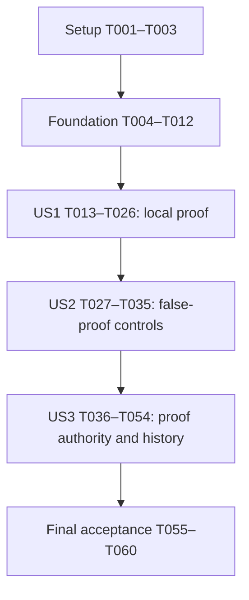

# Tasks: Query Summary Congruence in SMT Verification

**Feature**: `028-query-summary-congruence`
**Input**: [spec.md](spec.md), [plan.md](plan.md), [research.md](research.md), [data-model.md](data-model.md), [contracts/acceptance-matrix.md](contracts/acceptance-matrix.md), [contracts/query-summary-congruence.md](contracts/query-summary-congruence.md), [contracts/proof-compatibility.md](contracts/proof-compatibility.md), [quickstart.md](quickstart.md) and constitution 1.1.0.
**Status**: Implementation in progress. Completed tasks and their receipts are recorded below; unchecked tasks remain pending.
**Tests**: Required by the specification and constitution. Establish real semantic red evidence before correction. Negative controls protecting already correct behavior may pass on the baseline; retain them through the change rather than manufacturing a failure.
**Organization**: Setup → shared foundations → US1 (P1) → US2 (P1) → US3 (P2) → final acceptance.

## Format: `[ID] [P?] [Story] Description`

`[P]` permits concurrent authoring only in the explicitly listed wave, after all dependencies finish and with different files. It does not authorize simultaneous changes to shared encoders, fixture regeneration, version bumps or overlapping Cargo builds. Dependencies are explicit on each task. Story labels appear only in story phases. No new crate, public interface, query operator or domain-specific verifier rule is planned.

## Path Conventions

Paths are relative to the Core repository root. `evidence/...` abbreviations inside descriptions refer to `specs/028-query-summary-congruence/evidence/`. Capture fixtures live in `tests/fixtures/query-summary-congruence/proof09-history/`. `${CORE028_OUTPUT}` is a fresh validation directory outside the repository, as in quickstart. Baseline harness execution uses an isolated pinned 0.14.0 tree with unchanged library sources and a separate recorded harness digest; consumer examples are test tooling, not production API changes.

## Phase 1: Setup (Shared Infrastructure)

**Purpose**: Confirm workspace, immutable inputs and existing coverage without rebuilding the project structure.

- [X] T001 [P] Record the active Core branch/base, Rust 1.98.1 and Z3 4.16.0 toolchains, available disk/build location and required gate commands in `specs/028-query-summary-congruence/evidence/implementation-environment.json`; choose an adequately sized `CARGO_TARGET_DIR` or CI execution without deleting unrelated caches or adding dependencies.
- [X] T002 [P] Snapshot digests of the six frozen inputs from `specs/028-query-summary-congruence/evidence/baseline.json`, `evidence/semantic-identities.json`, historical `tests/fixtures/canonicalization/baseline/` files and existing signed governance fixtures into `specs/028-query-summary-congruence/evidence/frozen-inputs.json`; enforce "Frozen original modules, historical reports and signed archive fixtures retain bytes, hashes, signatures and recorded interpretation."
- [X] T003 Create `specs/028-query-summary-congruence/evidence/coverage.md` mapping FR-001–FR-022, PO-001–PO-008, SC-001–SC-008 and QS-01–QS-25 to new/extend/reuse test owners from the acceptance matrix; record all execution results pending and distinguish QS-22's later published-release handoff from Core implementation acceptance. **Depends on**: T001, T002.

**Checkpoint**: Environment/input snapshots and the coverage ledger are ready; implementation has not started.

---

## Phase 2: Foundational (Blocking Prerequisites)

**Purpose**: Establish soundness premises, capture genuine 0.9 history and label all new candidate proofs correctly before changing the query model.

**Blocking checkpoint**: T006–T007 must finish on genuine baseline code before T010. T008 must establish all new FR-017 behavioral negative fixtures' concrete outcomes and refusal phases before the verifier identity or encoder changes; verification-context isolation is documented separately at its owning boundary. T009–T011 establish the new verifier identity and closed archive support before any new encoding. The remaining old-history eligibility failure is expected red evidence for US3, not permission to publish a partial result. All foundation tasks must finish before story implementation.

- [X] T004 Review the source-premise table in `specs/028-query-summary-congruence/contracts/query-summary-congruence.md` against the actual encoder/evaluation boundaries and record the implementation proof ledger in `specs/028-query-summary-congruence/evidence/proof-obligations.md`: justified Gamma, total parent fragment, typed capture equality, parent coordinate, exact delta and unsupported fallback. Block encoder changes if a required premise cannot be justified. **Depends on**: T003.
- [X] T005 Add a test-only public Rust Store capture harness at `consumer/examples/capture_proof09_history.rs`, reusing the nonempty full-proof action workflow and a proof-required v2 migration workflow. Run the harness against an isolated pinned 0.14.0 source tree with unchanged library sources, assert verifier 0.9.0, and record the harness digest separately; the CLI has no Store commit command. **Depends on**: T004.
- [X] T006 Use `consumer/examples/capture_proof09_history.rs` on pinned source `855f4db4d6da3327c80117191d5719e6bc6b6397` before any encoding/version changes to capture `tests/fixtures/query-summary-congruence/proof09-history/action.json`, `migration.json` and `manifest.json`: complete genesis/backend/events/modules, nonempty full signed proofs, required migration evidence, original policies/context, binary/source digests and successful data/Behavior replay plus exact recovery. Freeze those bytes; never relabel or regenerate them under 0.10. **Depends on**: T005.
- [X] T007 Add the fixture-loading baseline assertions in `crates/behavior-store/tests/proof_version_history.rs` for the captured signed 0.9 action record-0.8 and v2 migration histories; run them successfully with the unchanged 0.9 baseline, compare exact recovered events and unchanged backend/history, and retain results in `specs/028-query-summary-congruence/evidence/proof09-baseline.json` before bumping the verifier. **Depends on**: T006.
- [X] T008 Create shared test support in `crates/behavior-verify/tests/support/query_summary.rs` for admitting the existing frozen original/minimal inputs, identifying obligations by `(kind, action hash, subject hash)`, safely deriving missing-guard variants by asserted predicate structure, and reconstructing complete evaluation requests from witnesses; preserve original input bytes. Before changing the encoder or verifier identity, establish concrete expected outcomes and applicable refusal/error phases for every new behavioral negative fixture required by FR-017. Evaluate complete requests through authoritative Core evaluation and record fixture/request identities, expected and actual outcomes, and exact baseline source in `specs/028-query-summary-congruence/evidence/negative-baseline.json`. Reuse existing evidence where sufficient, citing its fixture and source identities. Document verification-context isolation separately at its owning verification-session boundary. Share these fixtures with later US2 controls instead of duplicating or redefining their expectations after correction. **Depends on**: T007.
- [X] T009 Write current-verifier 0.10 metadata expectations in `crates/behavior-cli/tests/cli_engine_info.rs` and closed signed-0.9 decoding/unsupported-version controls in `crates/behavior-verify/tests/resulting_state_governance.rs` before changing production version checks. Observe the new-current identity expectation fail on the baseline, separately from the later semantic congruence regression. **Depends on**: T008.
- [X] T010 Advance only `VERIFIER_VERSION` in `crates/behavior-verify/src/lib.rs` from 0.9.0 to 0.10.0 after the genuine baseline capture and version tests; retain all runtime/record/schema/Store format versions. Apply "Fresh claims identify verifier 0.10.0; check keys separate diagnostic 0.9.0 entries." Run the captured-history test and record its bump-only compatibility failure in `specs/028-query-summary-congruence/evidence/proof09-version-red.json`; keep the historical-purpose dispatch unchanged at this step. **Depends on**: T007, T009.
- [X] T011 Retain explicit 0.9.0 in both closed historical verifier allowlists of `VerificationManifest::from_json` and `VerificationEnvelopeV2::from_json` in `crates/behavior-verify/src/governance/trusted.rs`, alongside 0.7.0/0.8.0/current; keep fresh `validate_for_subject` strict and unsupported versions rejected. Re-run decoding and captured-history controls, recording the remaining current-manifest eligibility refusal for committed old history before implementing its bridge. **Depends on**: T010.
- [X] T012 Record the foundation checkpoint in `specs/028-query-summary-congruence/evidence/foundation.json`: frozen capture verified, semantic oracle support ready, fresh candidate identity 0.10, closed 0.9 archive decoding preserved and known historical-eligibility regression pending US3. Require and cite T008's completed `evidence/negative-baseline.json`, covering every new FR-017 behavioral fixture and separately documenting the owning verification-context boundary; missing concrete expectations or refusal phases block encoder changes. Use new diagnostic cache directories per evolving candidate source; do not label these expected red histories or unrun gates as passed. **Depends on**: T008, T011.

**Checkpoint**: Real 0.9 histories are frozen, all new FR-017 behavioral negative fixtures have source-bound concrete expectations, candidate verification identifies 0.10, and the historical-eligibility regression is recorded. New count semantics can now be implemented.

---

## Phase 3: User Story 1 — Prove a local safety condition without changing the authored behavior (Priority: P1)

**Purpose**: Prove the original zero-plus-one property using a generic count-membership relation, preserving all runtime and semantic identities.

**Independent Test**: The frozen minimal example proves with the original Any guard; the unchanged original full module is verified and both action-qualified uniqueness obligations are proven under verifier 0.10 and the existing budget. Public CLI/engine results and original BehaviorHash/SchemaHash/item identities agree.

**Order**: Write the listed contract/behavior tests before the production changes they protect; follow the dependency edges below. Reuse existing tests identified in the matrix instead of duplicating them.

- [X] T013 [P] [US1] Add positive regression cases to `crates/behavior-verify/tests/query_summary_congruence.rs` using the shared support: unchanged original full C19, minimal original/count-guard controls, literal true, ordered Where filters, simple Narrow::Eq and compound equality, and renamed/equal captures. Assert both action-qualified uniqueness outcomes, full aggregate report semantics, original hashes and the existing default budget (QS-01–QS-05,QS-15). **Depends on**: T012.
- [X] T014 [P] [US1] Extend `crates/behavior-cli/tests/cli_verify.rs` with unchanged-original full verification through the supported CLI/engine path, retaining all required check kinds and identifying approve/reject by action plus subject rather than their shared expression hash; assert BehaviorHash/SchemaHash/item identities without rewriting the module (QS-01,QS-15). **Depends on**: T012.
- [X] T015 [US1] Run the new verifier/public positive cases on the still-unchanged count encoding and save `specs/028-query-summary-congruence/evidence/us1-red.json` showing original/minimal `inconclusive` against required proof. A version-string mismatch, compilation failure, diagnostic guard rewrite or bounded witness UNSAT is not this semantic red evidence. **Depends on**: T013, T014.
- [X] T016 [US1] Declare the private helper module in `crates/behavior-verify/src/encode.rs` and write semantic contract tests first in `crates/behavior-verify/src/encode/count_congruence.rs` for typed source templates, primitive capture ports, total-parent certification, implication antecedents, full identity and default-disabled context. Use compiling fail-closed stubs if needed, confirm the tests are discovered and positive contracts fail before recognition, and preserve the existing integration red evidence. **Depends on**: T015.
- [X] T017 [US1] Implement private source-membership templates in `crates/behavior-verify/src/encode/count_congruence.rs` with these exact constraints: "Typed admitted base/query-set structure; preserve set operators and operand order."; "Ordered outer Where predicates plus the original positive Any predicate, retained before equality narrowing; literal true may be omitted."; "Full entity type and candidate field/definition identities."; "Operator/type/literal structure with primitive non-candidate reads replaced by typed occurrence ports." Do not use shortened hashes or source locations as semantic keys. **Depends on**: T016.
- [X] T018 [US1] Implement the bounded parent-definedness certificate in `crates/behavior-verify/src/encode/count_congruence.rs`: "Structural proof that membership is total in the parent domain; absent for uncertified partial forms." Cover the supported primitive Select/Where/Set, typed total comparisons and Boolean fragment; reject checked arithmetic, partial derives, unwraps, nested aggregates and unknown forms. Count/Any success or finite witness members must not substitute for this certificate. **Depends on**: T017.
- [X] T019 [US1] Implement typed port/frame extraction and semantic equality in `crates/behavior-verify/src/encode/count_congruence.rs`: "A port identifies one primitive source read by deterministic occurrence position and full Core type."; "Preserve repeated reads rather than deduplicating by name."; "Optional equality compares presence, then payload when present." Evaluate only existing primitive captured reads in their original environment, preserve exact scalar/ID/fixed-point/option types, and keep non-candidate-derived operations outside the existing supported boundary. **Depends on**: T018.
- [X] T020 [US1] Add the ephemeral context/registry ownership to `crates/behavior-verify/src/encode.rs` and its private helper with "Disabled by default; explicitly enabled only by single-context action/rule/read construction."; "Immutable admitted Behavior/schema identity, with full authoritative identities."; "Enclosing semantic/profile/check world; no registry reuse across verification sessions."; "The underlying S for existing parent UFs, even when the caller is encoding S'." Enforce immutable interpretation while enabled and no persistent semantic cache. **Depends on**: T019.
- [X] T021 [US1] Plumb original source provenance before `narrow_of` in `crates/behavior-verify/src/encode/relational.rs`, including Eq optimization, with "Actual Count or positive Any. Other operators remain on existing paths."; "Immutable identities and supported membership certificate."; "Source-port values, independent of legacy `inst_args` arity."; "Exact existing UF application returned by `s_count`, before child delta." Preserve original Inst/UF applications, known-member bounds, witness folds, eq_counts, unique_links, All/NotPred and exact effects. **Depends on**: T020.
- [X] T022 [US1] Finalize registrations after original error wrapping in `crates/behavior-verify/src/encode/relational.rs` and emit guarded additive lemmas through `crates/behavior-verify/src/encode/count_congruence.rs` using "NoError over the original finalized obligations, including their guards." and "Deterministic local registration index for stable emission/deduplication." Match only eligible Count/Any or Count/Count parent origins; retain typed capture equality and both NoError expressions as antecedents, never assumed facts, and leave the child delta untouched. "No target property, cardinality bound or desired global invariant becomes a premise." **Depends on**: T021.
- [X] T023 [P] [US1] Opt action and rule construction into the immutable context before expression encoding in `crates/behavior-verify/src/encode.rs`; ensure the underlying parent application is available across pre/post encoding at the correct current captures, without equating final child counts or changing existing memo/dependency semantics. **Depends on**: T022.
- [X] T024 [P] [US1] Opt the existing single-context read builder into congruence in `crates/behavior-verify/src/reads.rs` before encoding, retaining existing read evaluation/error and projection contracts; do not add a public read or proof API. **Depends on**: T022.
- [X] T025 [P] [US1] Keep both Encoder constructors in `crates/behavior-verify/src/migration.rs` disabled before any source encoding and throughout source→target→source switches; exercise the construction boundary rather than clearing only the new registry later, and leave migration proof capability/semantics unchanged. **Depends on**: T022.
- [X] T026 [US1] Run the original/minimal and public positive cases under the actual 0.10 candidate, resolve only demonstrated contract violations, and save `specs/028-query-summary-congruence/evidence/us1-green.json` with both original uniqueness proofs, verified full report, generic controls, default solver budget and unchanged input/semantic identities. Update the US1 rows of `evidence/coverage.md`; preserve the known US3 history blocker and separate C19 release gate. **Depends on**: T023, T024, T025.

**Checkpoint**: The independent local proof slice works without modifying Approval. US2 soundness controls and US3 historical authority are still required for feature acceptance.

---

## Phase 4: User Story 2 — Trust that improved precision cannot hide a real violation (Priority: P1)

**Purpose**: Preserve all concrete behaviors and errors, with genuine counterexample, uncertainty and context-isolation controls.

**Independent Test**: All new negative categories retain their authoritative outcomes; minimal and original missing-guard witnesses reproduce DENY/POSTCONDITION_FAILED with complete facts. Partial/changed-context cases do not become false proofs, and code review supports the unrestricted conservativity argument.

**Order**: Write the listed contract/behavior tests before the production changes they protect; follow the dependency edges below. Reuse existing tests identified in the matrix instead of duplicating them.

- [X] T027 [P] [US2] Extend `crates/behavior-verify/tests/query_summary_congruence.rs` with authoritative false-property controls for unequal/changed captures, different filters/literals/typed domains, differing capture aliases, parent/child separation and matching/nonmatching effects; reuse T008's source-bound fixtures and expected concrete outcomes from `evidence/negative-baseline.json`. Require actual confirmed violations where a reachable counterexample is supplied, not merely absence of proof (QS-06–QS-09). **Depends on**: T026.
- [X] T028 [P] [US2] Add only missing relation-specific partial/short-circuit/error tests in `crates/behavior-verify/tests/read_soundness.rs`, reusing existing numeric/query fixtures and T008's established concrete outcomes and refusal phases; distinguish total parent membership from successful child Count and reject the removed-erroneous-parent-member inference, retaining original error/refusal phases (QS-11–QS-12). **Depends on**: T026.
- [X] T029 [US2] Add the minimal and both original missing-guard controls in `crates/behavior-verify/tests/query_summary_congruence.rs`, using `tests/support/query_summary.rs` to assert predicate structure before mutation and retaining T008's baseline expectations; re-evaluate every complete supplied witness and assert the exact `DENY / POSTCONDITION_FAILED` record, complete universes and unchanged original bytes (QS-10). **Depends on**: T027.
- [X] T030 [US2] Complete context-boundary tests in `crates/behavior-verify/src/encode/count_congruence.rs` and `crates/behavior-verify/tests/migration.rs` for distinct Behavior/schema/profile sessions, forbidden enabled-context changes, correct child capture frames and default-disabled behavior at both migration constructors; assert no new source/target links are emitted (QS-14). **Depends on**: T028, T029.
- [X] T031 [US2] Map existing matching/nonmatching Create, update/remove/alias/freshness and refusal-order cases from `crates/behavior-verify/tests/queries.rs`, `lifecycle.rs`, `invocation_bindings.rs` and `resulting_state_order.rs` into `specs/028-query-summary-congruence/evidence/coverage.md`; add only missing congruence-interaction cases to `crates/behavior-verify/tests/query_summary_congruence.rs` (QS-08–QS-09), reusing the concrete outcomes established in T008 before the correction. **Depends on**: T030.
- [X] T032 [US2] Reuse unknown/resource-exhaustion/unconfirmed-counterexample controls in `crates/behavior-verify/tests/cache.rs` and `solver.rs`, and add a focused uncertified-template non-proof case to `crates/behavior-verify/tests/query_summary_congruence.rs`; assert finite witness UNSAT cannot certify an unrestricted property and original free error flags/ranges stay intact (QS-13). **Depends on**: T031.
- [X] T033 [US2] Complete the implementation correspondence in `specs/028-query-summary-congruence/evidence/proof-obligations.md`, mapping actual helper/registration/capture/context/error code to every premise of the unbounded `C ⊆ A_new ⊆ A_old` argument; explicitly inspect error prefixes, unchanged Gamma/deltas and the separation of unrestricted proof from finite witness construction. Test success alone cannot discharge this review. **Depends on**: T032.
- [X] T034 [US2] For any demonstrated failures in the new controls, first preserve the failing semantic case, then correct only typed/context/certificate rejection or antecedent handling in `crates/behavior-verify/src/encode/count_congruence.rs` and `crates/behavior-verify/src/encode/relational.rs`; retain fail-closed behavior and original errors. If no violation exists, record that no additional production change was needed in `specs/028-query-summary-congruence/evidence/proof-obligations.md`; block on any unresolved required premise. **Depends on**: T033.
- [X] T035 [US2] Run the focused negative suite and mapped query/read/lifecycle/order/uncertainty controls, save `specs/028-query-summary-congruence/evidence/us2-green.json` with expected refusal/error/proof classifications and code-review disposition, and update `evidence/coverage.md` for QS-06–QS-14. Require genuine missing-guard failures and no false proof before accepting improved precision. **Depends on**: T034.

**Checkpoint**: The concrete false-proof controls and conservativity correspondence pass. This does not certify the whole verifier or discharge global induction.

---

## Phase 5: User Story 3 — Audit versioned proof claims and adopt a corrected release honestly (Priority: P2)

**Purpose**: Preserve proof history and fresh authority across the verifier bump, including signed committed history, and prepare an honest release handoff.

**Independent Test**: Fresh 0.10 claims use explicit policies/current context; archived 0.7/0.8/0.9 decoding grants no fresh eligibility. Genuine signed 0.9 action/migration histories replay/recover exactly, old caches/policies/frozen goldens remain distinct, and C19 stays blocked pending the pinned published release.

**Order**: Write the listed contract/behavior tests before the production changes they protect; follow the dependency edges below. Reuse existing tests identified in the matrix instead of duplicating them.

- [X] T036 [P] [US3] Extend `crates/behavior-verify/tests/resulting_state_governance.rs` and `trusted_verification.rs` with fresh 0.10 claims, authentic archived 0.7/0.8/0.9 transport decoding and refusal of fresh current-subject eligibility; preserve unknown-version rejection, poisoned-cache bypass and signed negative/inconclusive/expiry/revocation controls (QS-17,QS-20). The unsigned frozen C19 report is not a signed envelope. **Depends on**: T035.
- [X] T037 [P] [US3] Extend `crates/behavior-store/tests/proof_version_history.rs` with exact old action/migration replay and recovery under 0.10, candidate/event/signature/subject/policy/context mutations, fresh replay-of-old-evidence refusal and unchanged backend/cache-certificate assertions; retain the genuine 0.9 bytes and bump-only red evidence until the historical bridge exists (QS-23–QS-25). **Depends on**: T035.
- [X] T038 [P] [US3] Extend `crates/behavior-store/tests/trusted_governance.rs` schema cases to require fresh 0.10 provenance, authentic archived 0.9 plus retained 0.7/0.8 alternatives, and rejection of unknown values in both published wrappers; maintain strict distinction between archive authentication and new proof authority (QS-18). **Depends on**: T035.
- [X] T039 [P] [US3] Add the explicit 0.9→0.10 cache-key miss and repeated current cold/warm authoritative-hash controls in `crates/behavior-verify/tests/hashing.rs` and `cache.rs`, holding subject/dependencies/profile/solver fixed while varying verifier identity; preserve non-authoritative cached metadata and existing unknown/exhaustion behavior (QS-16). **Depends on**: T035.
- [X] T040 [P] [US3] Split fresh-versus-archived expectations in `crates/behavior-verify/tests/migration.rs` and `consumer/tests/canonicalization.rs` before producing new goldens: keep historical raw-byte checks, but compare fresh ordinary/migration reports and both dependent authorizations with explicitly new-current expectations; do not edit `tests/fixtures/canonicalization/baseline/` (QS-19). **Depends on**: T035.
- [X] T041 [P] [US3] Add deliberately selected current policy `tests/fixtures/governance-v2/policy-verifier-0.10.json` using supported policy construction/validation and test keys/profiles; preserve `policy-verifier-0.9.json` and all existing Store policies unchanged. Select the new fixture explicitly in fresh test setups instead of silently upgrading archived policy contents. **Depends on**: T036, T037, T038, T039, T040.
- [X] T042 [P] [US3] Append 0.10.0 to all four relevant closed provenance enums in each of `schema/governance-v2.schema.json` and `schema/store-v2.schema.json`, retaining 0.7.0/0.8.0/0.9.0 and unsupported-value refusal; keep every document/manifest/envelope/runtime format version unchanged. **Depends on**: T036, T037, T038, T039, T040.
- [X] T043 [US3] Route `check_reproduced_decision_evidence` in `crates/behavior-store/src/store.rs` through existing archived-purpose authentication for exact canonical committed supported records, including 0.8, only after recorded-profile reproduction and event matching; preserve unknown-profile rejection and current checks for actual fresh writes. Enforce "Read-only recovery returns the original identity and creates no current-validation certificate." **Depends on**: T041, T042.
- [X] T044 [US3] Use the same historical-only evidence purpose at committed v2 migration reproduction in `crates/behavior-store/src/replay.rs` and exact v2 migration recovery in `crates/behavior-store/src/store.rs`; retain exact event/candidate/chain/bundle/authorization/context/time checks and current-model validation for new migration commits. Authenticate historical attested coverage without claiming newly site-derived completeness or changing migration evaluation. **Depends on**: T043.
- [X] T045 [US3] Run `crates/behavior-store/tests/proof_version_history.rs` and the existing resulting-state/command/migration replay helpers to show the same genuine signed 0.9 histories now replay/recover under 0.10; compare frozen event/evidence hashes and backend snapshots, require tamper/fresh-use failures, and record the red→green bridge in `specs/028-query-summary-congruence/evidence/proof09-compatibility.json` (QS-23–QS-25). **Depends on**: T044.
- [X] T046 [US3] Update only remaining fresh-version assertions and explicit fresh-policy selections in `crates/behavior-cli/tests/cli_lifecycle.rs`, `crates/behavior-store/tests/trusted_governance.rs` and `crates/behavior-verify/tests/migration.rs`; retain historical 0.9 expectations where they describe archives and do not modify engine Cargo version or old release facts merely to make tests pass. **Depends on**: T045.
- [X] T047 [US3] Produce separately named current artifacts through checked public producers under `tests/fixtures/canonicalization/current-verifier-0.10/`: ordinary cold report, negative/verified migration reports and ordinary/migration authorizations; bind their actual current proof identities, preserve every historical baseline byte, and complete the version-aware verifier/facade tests from T040 (QS-19). **Depends on**: T046.
- [X] T048 [US3] Execute the new current cache/version separation cases and reuse fresh trusted-verification bypass controls from `crates/behavior-verify/tests/cache.rs`, `hashing.rs` and `trusted_verification.rs`; retain raw old files, show current cold/warm claim identity equality, and record results in `specs/028-query-summary-congruence/evidence/proof-cache-compatibility.json` (QS-16,QS-20). **Depends on**: T047.
- [X] T049 [US3] Verify unchanged original BehaviorHash/SchemaHash/item-query hashes against `specs/028-query-summary-congruence/evidence/semantic-identities.json`, all frozen digests against `evidence/frozen-inputs.json` and the raw canonical historical serialization tests in `crates/behavior-verify/tests/canonicalization.rs`; record exact old/new proof-context separation in `specs/028-query-summary-congruence/evidence/identity-compatibility.json` without rewriting old attestations or policies (QS-15). **Depends on**: T048.
- [X] T050 [US3] Run the remaining current/archived signed-proof, wrapper-schema, Store live-authority, CLI version, verifier migration and external facade canonicalization acceptance cases; save `specs/028-query-summary-congruence/evidence/us3-green.json` identifying claims/profile/solver/subject/obligations, preserved histories and explicit policies, and update `evidence/coverage.md` for QS-15–QS-20 and QS-23–QS-25. Retain attested archive coverage and the absence of automatic trust promotion. **Depends on**: T049.
- [X] T051 [P] [US3] Document supported membership equivalence, parent-definedness/capture/error premises, unchanged exact deltas, skipped partial forms and local-versus-global proof boundaries in `docs/verification.md`; describe fresh verifier 0.10 identity and keep original runtime semantics and existing profile/error contracts explicit. **Depends on**: T050.
- [X] T052 [P] [US3] Update `docs/governance.md` for deliberately selected 0.10 policies, preserved archive decoding and exact committed-history replay/recovery purpose; explain authenticated historical attested coverage versus fresh proof eligibility and independent Behavior replay, with unchanged data-replay trust limits, original context/time and no new commit/certificate authority. **Depends on**: T050.
- [X] T053 [P] [US3] Update the current-verifier inventory and outcome-changing minor-release classification in `docs/versioning.md`, preserving historical release 0.13/0.14 facts and all semantic/record/Store format versions; document that release numbering/publication and downstream pins are later workflows rather than selecting a Cargo release here. **Depends on**: T050.
- [X] T054 [US3] Prepare `specs/028-query-summary-congruence/evidence/handoff.md` mapping candidate proof evidence to the later pinned published-release C19 check (QS-22); retain C19 blocked, separate global induction/base/ownership/migration obligations, and verify the existing Core #35 characterization with a read-only source snapshot before proposing any correction. Do not publish a release, change an ecosystem pin, close the issue or count diagnostic rewrites as adoption. **Depends on**: T051, T052, T053.

**Checkpoint**: Current and historical claims are distinguished, genuine old histories retain replay/recovery, and the release handoff is documented. C19 adoption remains a later gate.

---

## Phase 6: Polish & Cross-Cutting Concerns

**Purpose**: Complete traceability, clean-source acceptance, required gates and reviewable delivery evidence.

- [X] T055 [P] Audit `specs/028-query-summary-congruence/evidence/coverage.md` and `evidence/proof-obligations.md` against all 22 FR, eight PO, eight SC and 25 QS entries, citing actual tests/code/receipts rather than checklist assertions; retain QS-22's external release/adoption execution pending, and resolve any missing required Core proof/negative/history control before final acceptance. **Depends on**: T054.
- [X] T056 [P] Reconcile actual command/test/fixture names in `specs/028-query-summary-congruence/quickstart.md` and validate document links; remove only the temporary Sync Impact review comment from `.specify/memory/constitution.md` before committing its already agreed 1.1.0 amendment, preserving all governance content and principles I–VI. Keep global audit, migration proof expansion and runtime changes outside the feature. **Depends on**: T054.
- [X] T057 Create a reviewed clean implementation checkpoint containing all scoped new helper/tests/capture fixtures/docs and task status in `crates/behavior-verify/src/encode/count_congruence.rs`, `crates/behavior-store/tests/proof_version_history.rs` and the feature artifacts. Include T057's own completed checkbox in this checkpoint commit; leave T058 unchecked. Require `git status --porcelain --untracked-files=all` empty only after committing all T057 status changes, and record the exact commit under `${CORE028_OUTPUT}/source-head.txt`. Keep tracked files unchanged throughout T058's acceptance attempt; if it fails, follow T058's new-checkpoint/retry procedure. Exclude unrelated user changes and preserve frozen artifacts. **Depends on**: T055, T056.
- [ ] T058 On that clean checkpoint, run `scripts/gates.sh` and the entire public CLI identity/repeat-proof sequence in `specs/028-query-summary-congruence/quickstart.md` as one acceptance task, writing `${CORE028_OUTPUT}/gates.log`, `${CORE028_OUTPUT}/original.full.json`, `${CORE028_OUTPUT}/original.repeat.json` and `${CORE028_OUTPUT}/receipt.json` with complete source/binary/solver/profile/outcome/frozen-hash provenance. Keep the tree unchanged until capture completes; on a real failure fix it, create a new clean checkpoint and rerun the required affected checks. QS-21 must pass and both original action-qualified postconditions must be proven under the full default budget. **Depends on**: T057.
- [ ] T059 Review `${CORE028_OUTPUT}/receipt.json` against `specs/028-query-summary-congruence/contracts/query-summary-congruence.md` and `contracts/proof-compatibility.md`: independently check premise-to-code correspondence, concrete false-proof controls, genuine pre-bump capture provenance, historical-only dispatch, policy/cache authority, unchanged semantic identities and exact validated source. Reject finite witness failure, tests alone or a later dirty tree as the proof argument. **Depends on**: T058.
- [ ] T060 Finalize `specs/028-query-summary-congruence/evidence/acceptance.md`, `evidence/coverage.md`, `evidence/handoff.md` and task status with the validated implementation commit and receipt digests, all actual Core results and explicit C19/QS-22 release-adoption blocker. Keep any later task-status/documentation checkpoint distinct from the source used for final binary evidence; report unresolved limitations honestly and leave publication/adoption for their authorized workflows. **Depends on**: T059.

**Checkpoint**: Core implementation acceptance is bound to an exact clean source/binary context; later administrative status edits are identified separately. Published-release adoption remains explicit.

---

## Dependencies & Execution Order

### Phase and story dependencies

The order is intentional: the stories share one encoder and proof version, so implementation is serialized across story checkpoints. Each story has its own independent test criterion and target cases. T006–T007 capture actual baseline 0.9 history before T010 changes identity. T010 records bump-only failure; T011 restores archive decoding and exposes the remaining committed-history manifest mismatch. T043–T045 fix only that historical-purpose dispatch. The next proof model is never published under the old verifier identity.

T008 establishes the concrete negative fixtures and refusal phases before any encoder correction, and T012 blocks story implementation until that baseline is complete. Within US1, T013/T014 and T016 establish test-first evidence; T017–T022 implement the private relation; T023–T025 integrate independent construction paths. Within US2, T027–T032 reuse those established concrete expectations and add verifier assertions before T033–T034 review or any necessary corrective code. Within US3, T036–T040 define the remaining contract tests, then T041–T047 implement compatibility and T048–T050 execute its acceptance. Dependencies on earlier phases apply even where a description reuses an earlier file.

### Parallel opportunities

| Wave | Tasks | Separate files / prerequisites |
|------|-------|--------------------------------|
| Setup | T001, T002 | Environment and frozen-input receipts; no code mutations. |
| US1 contract tests | T013, T014 | New verifier suite versus existing CLI suite, after T012. |
| US1 construction paths | T023, T024, T025 | encode.rs, reads.rs and migration.rs after T022. |
| US2 controls | T027, T028 | Focused verifier suite versus read_soundness.rs, after T026. |
| US3 contract tests | T036, T037, T038, T039, T040 | Disjoint verifier, history, Store schema, cache/key and facade/migration test files, after T035. |
| US3 policy/schema | T041, T042 | Explicit current policy fixture versus two wrapper schemas, after test authoring. |
| US3 documentation | T051, T052, T053 | verification.md, governance.md and versioning.md after T050. |
| Final review preparation | T055, T056 | Traceability/proof ledgers versus quickstart/temporary constitution comment, after T054. |

Parallel examples for each story: author T013 and T014 together, then run T015 once both finish; author T027 and T028 together, serialize T029 before T030 because it extends the same focused suite; author T036–T040 together, then finish both T041/T042 before touching the shared Store bridge. Serialize all changes to `count_congruence.rs`, `relational.rs`, `encode.rs`, shared fixture contents and version identity. Run compilation/gates with the available storage and ordinary Cargo locking, not as competing high-memory build jobs.

### Acceptance-case ownership

| Cases | Task owners |
|-------|-------------|
| QS-01–QS-05 | T013–T026; full original obligations stay action-qualified. |
| QS-06–QS-07 | T008, T027, T033–T035. |
| QS-08–QS-09 | T008, T021–T026, T027, T031, T035. |
| QS-10 | T008, T029, T035. |
| QS-11–QS-12 | T008, T018, T022, T028, T033–T035. |
| QS-13 | T032, T035. |
| QS-14 | T008, T020, T023–T025, T030, T035. |
| QS-15 | T002, T013–T014, T026, T049, T058. |
| QS-16 | T010, T039, T048. |
| QS-17 | T009–T011, T036, T041, T046, T050. |
| QS-18 | T038, T042, T050. |
| QS-19 | T040, T046–T047, T050. |
| QS-20 | T036, T048, T050. |
| QS-21 | T055–T059; authoritative scripts/gates.sh. |
| QS-22 | T054, T060 prepare/report the handoff; actual publication/pin adoption stays pending. |
| QS-23–QS-25 | T005–T007, T010–T011, T037, T043–T045, T050. |

### Proof-obligation ownership

| Obligation | Task owners / required evidence |
|------------|---------------------------------|
| PO-001 | T004, T016–T019, T033; supported typed relation and certificate. |
| PO-002 | T019–T025, T027, T030, T033; capture/state/context separation. |
| PO-003 | T021–T022, T026, T029, T031; exact contributions and identity/freshness. |
| PO-004 | T018, T022, T028, T031, T033–T035; errors, range and phase preservation. |
| PO-005 | T004, T016–T022, T027–T035, T059; unrestricted argument and concrete negative controls. |
| PO-006 | T003, T008, T013–T016, T027–T032, T055; complete new/extend/reuse mapping, pre-correction concrete negative expectations and semantic red. |
| PO-007 | T002, T005–T011, T036–T053, T058–T059; identities, genuine history and current authority. |
| PO-008 | T012, T025, T030, T043–T045, T054–T060; six-area boundaries and honest adoption. |

## Implementation Strategy

### MVP first

The smallest reviewable proof demonstrator is Setup + Foundation + US1, including generic typed/error/context guards and unchanged original/minimal public proof. It is a local proof slice, not release acceptance. All US2 false-proof controls, US3 version/history compatibility and final gates remain mandatory before shipping the feature. Baseline history capture is part of the MVP foundations because it cannot be reconstructed honestly after the old implementation is changed.

### Incremental delivery

1. Preserve baseline semantic/history inputs and their provenance; establish every new behavioral negative fixture's concrete outcomes and refusal phases before correction, then reserve the fresh proof identity with a recorded compatibility regression.
2. Restore only the generic parent-count congruence and prove the original unchanged module.
3. Close every negative/error/context control and inspect the conservativity argument against code.
4. Preserve archives, current policies, caches, schemas and exact committed replay/recovery without promoting historical authority.
5. Validate an exact clean implementation checkpoint through the authoritative gates and public CLI, then finalize task/evidence metadata separately.
6. Hand off the published-release C19 requirement with its blocked status intact. Global induction and a broad Core soundness audit remain separate work.

## Notes

All tasks start unchecked; generated task coverage is not implementation or proof acceptance. A missing premise blocks the relation, and failure of a mandatory proof blocks completion. Tests supporting soundness do not replace the unbounded argument. Reuse existing tests and avoid unrelated production changes; conditional T034 may complete with an explicit no-change finding when the selected implementation already satisfies its controls.

T057's completed checkbox is part of the clean checkpoint commit; T058 remains unchecked in that source snapshot. The final acceptance task T058 is one uninterrupted clean-source validation/capture operation per attempt. Update its checkbox only after successful capture, with no tracked-file edits during that acceptance attempt. A failed attempt permits fixes followed by a new clean checkpoint and the required rerun, as T058 specifies. Later task-status or receipt-summary edits must retain the validated implementation commit, not imply that another source tree produced that binary. Do not publish a release, upgrade existing Store policies, change an ecosystem pin or declare C19 unblocked from these Core task completions.
