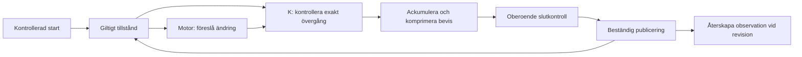

# Core: arkitekturkandidatens genomförbarhet

**Slutbedömning av kandidaten, 2026-11-05: Rework. Full G1-korrekthet och
G1-prestanda är inte etablerade. Den fullständiga implementationen är inte klar.**

Rekommendationen är **Rework för den nuvarande synkrona beviskonstruktionen**.
Den har ännu inget stöd för millisekundmålet. Det är en bedömning av denna
konstruktion och dess uppmätta delkostnader, inte ett omöjlighetsbevis för alla
sätt att bygga Core. [Kostnader och avgränsningar](../../experiments/transition-study033/COST.md).

## Arkitekturen som fortfarande är motiverad

Detta är ansvarsfördelningen i designen; hela flödet är ännu inte implementerat.

Utgångspunkten är att en redan korrekt värld inte behöver bevisas korrekt från
början vid varje ändring. Däremot måste varje återanvändning ha ett villkor som
verifieraren faktiskt kontrollerar.

1. **Etablera giltigheten vid starten.** Initialisering kontrollerar hela den
   deklarerade startvärlden, dess ursprung, identiteter, värden, räknare och
   samband mellan levande och tidigare använda identiteter. En hashrot räcker
   inte som bevis för att världen är giltig.
2. **Bevara giltigheten vid ändringen.** Motorn föreslår ett resultat och lämnar
   exakt de beroenden och ändringar som behövs. K kontrollerar övergången mot
   Core-semantiken. Oförändrade delar får återanvändas genom bevisade lagar;
   motorn får inte själv bestämma att en relevant kontroll är onödig.
3. **Spara ett litet, exakt händelseunderlag.** Händelsen binder indata,
   resultat och receptet för den fullständiga observationen. Revision återskapar
   rapporten ur bevarat stöd. Rapportens storlek behöver därför inte belasta
   varje commit. Det fullständiga innehållet, ordningen och dubbla kommandon
   måste fortfarande kunna återskapas exakt.
4. **Håll bevisproduktion som en uttrycklig skyldighet.** En ny konsument ska
   kontrollera rätt historiska prefix och rätt förväntade slutresultat.
   Bevisproduktion, komprimering, materialladdning och slutkontroll är verkligt
   arbete. Det aktuella löftet om ett färdigt svar väntar på allt detta och på
   beständig publicering.

Motorn kan därmed förbättras utan att varje sökstrategi blir en ny betrodd
implementation av språket. K och den exakta semantiken är gränsen. Denna
uppdelning motiverar en arkitektur; den ger inte i sig en billig kryptografisk
beviskedja. [Korrekthetskontraktet](contracts/semantic-and-evidence.md).

Tillståndets identitet och historiens identitet är skilda saker. Händelsens
semantiska identitet ska vara densamma oavsett cacheträffar, frågeplan eller
bevisets utformning. Exakt felordning, tomma frågor, nya medlemmar, mellanliggande
overflow och dubbla kommandon är delar av kontraktet även när arbetet delas upp.

## Vad undersökningen faktiskt har etablerat

Den matematiska grunden omfattar avgränsad Core-semantik, initial giltighet,
autentiserade kartor, exakta ändringslagar, ursprungliga kodningar och SHA-256.
Många konkreta komponenter har dessutom kontrollerad Rust-kod, fullständiga
faktiska matriser och bindning av samtliga filbytes. Det är separata
komponentresultat. [Aktuell täckning](evidence/scoped-chain/t042-primitive-coverage.json).

Ett viktigt nytt resultat gäller **ärvd giltighet**. För den positiva
startvärld som detta profilkontrakt kräver bestämmer en korrekt bunden väg
hela öppningens sammanfattningar. Då kan extra hashning av syskonens egna
poster undvikas när den fysiska anroparen verkligen upprätthåller premisserna.
Sju, tio respektive två kontrollerade bevismål etablerar lagen, kopplingen till
initialisering/giltiga gränser och reduktionen till kollisioner i de ursprungliga
SHA-meddelandena. Det tidigare motexemplet för godtyckliga falska flaggor gäller
fortfarande. [Exakt kontrakt](../../experiments/transition-study033/CONTROLLER.md#admitted-valid-state-specialization-reuse-proven-metadata).

Den mindre delade hashkomponenten har nu 304 kontrollerade källkodsmål och
bindning av samtliga 203 616 källkodsbyte. Dess separata matris har 221
kontrollerade mål, 131 450 rader och bindning av samtliga 22 468 682 filbyte.
Likvärdigheten med den ursprungliga instruktionslistan är inte godkänd inom
resursgränserna. Alla 284 mål kompilerade och axiomgranskades, men den kompletta
nya kärnkontrollen nådde gränsen på 3 600 sekunder. Detta är inget visat
semantiskt motexempel; likvärdigheten är oetablerad enligt protokollet.
[Exakt slutstatus](evidence/scoped-chain/segmented-sharing-bounded-final-assessment-001.json).
Det finns ingen uppmätt hastighetsvinst för en verifierad ersättning.

Den lokala trädkedjan har nu kontrollerad styrning över alla 256 nivåer,
omladdning av nästa nivå och slutkontroll av alla gamla rot- och räknarord.
Slutkontrollen bevarar den nya sammanfattningen. Detta fastställer inte att
hela Core-anropet, alla tidigare villkor, alla blad eller den verkliga
kryptografiska kretsens portar är korrekt sammankopplade.

De formella kvittona använder samma låsta Lean-kärna för en ny kontroll av hela
den importerade deklarationsmängden. Det är ingen annan, oberoende
kärnimplementation. Tillåtna transitiva axiom är `propext`, `Classical.choice`
och `Quot.sound`. Bindningen av slutna data till filbytes har den vanliga
kompilatorn, exekveringsmiljön och fil-I/O i sin angivna betrodda bas. Native
testvektorer och kostnadsdiagnostik har ingen matematisk acceptansauktoritet.

## Vad kostnaderna säger

| Separat diagnostik | Uppmätt enskild observation |
| --- | --- |
| Bevisbackend med oförändrat tillstånd, verkligt ackumuleringssteg | 735,844 ms |
| Samma fall, komprimering | 33,364 s |
| Samma fall, kontroll med verifieringsmaterialet i minnet | 674,824 ms |
| Samma fall, ny process som laddar och verifierar alla 43 förväntade ord | 3,234 s |
| Ursprunglig faktisk hashkomponent, komprimering | 511,060 s |
| Separat förbehandlad Spartan/IPA-variant | Ingen färdig komprimering inom 900 s |

Detta är verkliga diagnostiska körningar på den deklarerade konstruktionsvärden.
De är **inte** kompletta G1-försök, p50/p95-resultat, en universell lägsta kostnad
eller verifiering av en färdig Core-kedja. En ändrad förväntad slutpunkt avvisas
i separata nya processer. [Identitetsfallets råa bedömning](evidence/scoped-chain/identity-cost-rework-signal-001.json),
[förbehandlingens misslyckade försök](evidence/scoped-chain/numeric-cost-preprocessed-assessment-001.json).

Identitetsfallet hjälper till att lokalisera problemet: betydande kostnad finns
kvar även utan affärsreglerna och SHA-arbetet i användarkretsen. Färre
instruktioner och mindre rapporter räcker därför inte som belägg för att just
denna bevisimplementation når målet. Ett alternativ behöver mätas som en egen
identifierad konstruktion, inklusive dess säkerhetsantaganden och kalla kostnader.

## Vad som saknas

Hela fysiska K, autentiserad konsumtion av indata, initialiserings- och
slutpunktsbindning, verklig Nova-inbäddning, granskad entropihantering,
komprimerad initialiserad Core-kedja, oberoende mottagare och beständig
publicering återstår. De fullständiga observations-, återhämtnings- och
latenskampanjerna har inte körts. CLI-funktionerna för dessa steg är fortfarande
uttryckligen `Unsupported`. [Uppgiftslistan](tasks.md) behåller dem som öppna.

Det finns alltså ännu ingen färdig lösning som uppfyller de tre delarna
tillsammans och levererar certifierade, beständiga svar i millisekunder.
Fortsatt ombyggnad av hela Core kräver en beviskonstruktion som först visar
tillräckligt låg fullständig kostnad. De kontrollerade lagarna för inkrementell
exekvering och det exakta observationsformatet kan tas vidare med sina egna
avgränsningar. [Följder för nästa arkitekturförsök](../../experiments/transition-study033/REWORK.md).

## Läs den maskinella bedömningen

[Bedömningen](evidence/final/assessment.json) kommer från den redan implementerade
felvägen och är bunden till oföränderliga indata. Den ger `rework`,
`correctness: not_established`, `performance: not_established` och
`g1_pass: false`. Ett verkligt kontrollanrop med fel indataidentitet avvisas
utan publicerad bedömning. Det första anropet hade fel enumstavning och
avvisades som felaktig metadata; båda försöken är bevarade.

[Kravtäckningen](evidence/final/coverage-001/requirement-coverage.json) namnger
samtliga 21 krav. [Beroendelistan](evidence/final/coverage-001/execution-ledger.json)
anger de 48 öppna bygg-, verifierings- och insamlingsstegen T042–T089.
[Scenariolistan](evidence/final/coverage-001/campaign-not-run.json) anger alla
27 planerade föräldraceller och livscykelfallen som `NotRun`; kvantilerna är
uttryckligen okända. Inget syntetiskt prov eller separat identitetsbevis får
räknas som ett sådant Core-resultat.

Den separata kvalitetsbyggnaden tog slut på diskutrymme och även dess loggskrivare
misslyckades. Fullständig utdata och barnprocessens slutstatus finns därför
inte bevarade; kvalitetsgrinden är inte godkänd. Dess återskapbara byggcache
rensades för att skydda kvarvarande evidens. Kärnkontroller och formatkontroller
har egna kvitton. Efter återställningen verifierades hela den skyddade
Core-baslinjen: 10 582 filer, 1 851 549 753 byte, inga ändringar.
Den fullständiga andra granskarens reproduktion är fortfarande en uttrycklig
SC-005-begränsning. Förkontrollen visar dessutom cirka 208 GB logiska studiefiler,
främst upprepade kompilerade beroenden. Den lokala fildelningen följer inte med
en vanlig Git-utcheckning. Detta är ingen uppmätt överföringsstorlek eller
konsumentens verifieringspaket. En avslutad negativ bedömning innebär inte att dessa krav
eller den fullständiga implementationen har blivit klara.

## Bevarat underlag och nästa grind

[Filförseglingen](evidence/final/manifest.json) anger exakta storlekar,
kontrollsummor och var stora filer kan hämtas eller återskapas.
[Reproduktionsanvisningarna](evidence/final/reproduction.md) skiljer kontroll
av lagrade filer, körning av den negativa bedömningen, enskilda matematiska
omkontroller och de ännu saknade fullständiga experimenten.

Nästa identifierade arkitekturförsök bör först klara ett litet verkligt
beviskedjeförsök med alla kostnader synliga. Eventuella ändringar av
bevisbackend, fält, åtagandeformat eller säkerhetsantaganden behöver ett eget
uttryckligt profilkontrakt och nya kontroller. Ingen sådan ersättning är vald
eller produktionsaktiverad här. Den ursprungliga konstruktionsbudgeten har
inte återställts och behöver inte påstås vara förbrukad för denna tidiga
Rework-bedömning.
