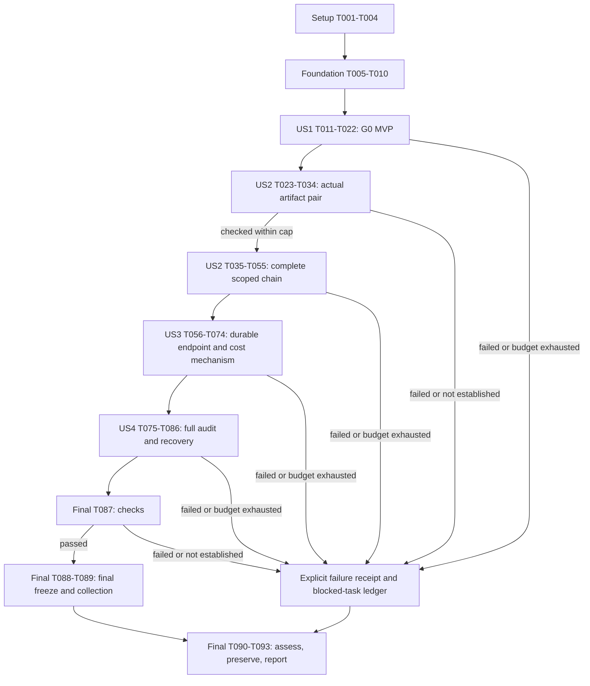

# Tasks: Core G0–G1 Proof-Chain Feasibility

**Input**: [plan.md](plan.md), [spec.md](spec.md), [research.md](research.md),
[data-model.md](data-model.md), [contracts](contracts/) and [quickstart.md](quickstart.md).
**Branch**: `033-core-proof-feasibility`. Execution status is recorded in the task markers and `evidence/work-log.jsonl`.

**Tests**: Required by the specification and constitution. Write/review each
slice's controls and record meaningful failing executions before implementing
it. A missing import or an all-rejecting stub is insufficient evidence of a
working acceptance path: include genuine positive controls. Logical proofs,
actual-source/matrix checks and runtime tests retain separate evidence labels.

## Format and path conventions

Every executable task uses `- [ ] Tnnn [P?] [USn?] description with paths`.
Paths are relative to the Core repository root. `experiments/transition-study033/`
is the new isolated implementation; `specs/033-core-proof-feasibility/` owns
protocols and evidence. New modules below refine the plan's proposed layout.

`[P]` means tasks in the explicitly identified ready wave touch different files
and can run together **after their shared prerequisites pass**. It does not
authorize work across an unmet gate. Shared registration in `lib.rs`, Cargo/Lake
manifests and CLI wiring is serialized by the following integration task.

All data-model constraints quoted in tasks are normative. Additional parser/
packet bounds must be frozen by G0 before implementation of their decoder.
Provide minimal compiling interface declarations in the scaffold before each
ready test wave; acceptance implementation remains absent until red controls
have run. Tests that require the final Nova wrapper have a staged later group
and cannot be mistaken for completed first-pair checks.
Do not change the old source, 032 vendor tree, sealed study artifacts or old
identity algorithms to make a test pass.

## Task inventory

| Scope | Tasks | Independent check |
| --- | --- | --- |
| US1, G0 MVP | 12 | Complete scope/meaning/origin/identity package, without a proof backend. |
| US2, scoped chain | 33 | Actual source/matrix bridge and fresh independent compressed-certificate acceptance. |
| US3, complete costs | 19 | Durable publication controls and truthful collector/assessment plus a labeled pilot. |
| US4, inspection/recovery | 12 | Full reference reconstruction, missing-data/crash/retry and fresh-workspace reproduction. |
| Shared setup/foundation/final | 17 | Provenance, failure path, final checks, campaign and sealed decision. |
| Total | 93 | Completion follows task markers; 20 tasks have conditional parallel-ready markers. |

## Phase 1: Setup — isolated, reproducible workspace

**Purpose**: Record the baseline and bootstrap tools without implementing K.
Start the five-engineering-day first-artifact clock at T001; count setup and G0
work too. After the artifact-pair checkpoint, at most fifteen further engineering
days apply, as defined in the campaign contract. Log work/compute separately.

- [X] T001 Record source/spec/plan identities, old-evidence hashes and the active-work/compute budget start in `specs/033-core-proof-feasibility/evidence/baseline-manifest.json` and `specs/033-core-proof-feasibility/evidence/work-log.jsonl`; exclude new outputs from the protected baseline and retain exact old artifact locations/digests.
- [X] T002 Create the independent `publish=false` Rust workspace, CLI/library skeleton and test target declarations in `experiments/transition-study033/Cargo.toml` and `experiments/transition-study033/src/lib.rs`; pin Rust 1.98.1/edition2024 and the plan's exact dependencies in its own `Cargo.lock`, forbid Core-owned unsafe, and leave production workspace membership/APIs unchanged.
- [X] T003 Create `experiments/transition-study033/proofs/lean-toolchain`, `experiments/transition-study033/proofs/lakefile.toml` and `experiments/transition-study033/proofs/lake-manifest.json` for Lean4.30.0/mathlib `c5ea00351c28e24afc9f0f84379aa41082b1188f`; declare generator/proof targets without placeholder theorems being accepted as evidence.
- [X] T004 Create `experiments/transition-study033/shell.nix` and the collector package/test entry points under `specs/033-core-proof-feasibility/benchmarks/`; reuse pinned Nix inputs, Python3.13 and required build tools, recording fetch/build work separately from runtime preparation.

## Phase 2: Foundational — truthful artifacts and failure reporting

**Purpose**: Shared typed records, proof hygiene and an assessable failure path.
Complete this phase before the story implementations. It creates no valid K
transition, successful certificate or durable business receipt.

- [X] T005 [P] Write genuine-positive and rejection controls in `experiments/transition-study033/tests/foundation_manifest.rs` for explicit versions, immutable input→receipt→release references, incompatible overwrite and future-key dependency cycles; record red evidence before T007–T008.
- [X] T006 [P] Write failing proof-hygiene/failure-report/clock controls in `experiments/transition-study033/tests/foundation_status.rs` and `specs/033-core-proof-feasibility/benchmarks/tests/test_proof_hygiene.py`; require missing targets/custom or native-evaluation axioms to fail and a completed negative assessment to have `g1_pass=false`.
- [X] T007 Implement shared types and schema validation in `experiments/transition-study033/src/profile.rs`: enforce “All records carry an explicit format version.”; distinguish exact allowed/refused/evaluation-error outcomes from `Conflict`, `InitializationConflict`, `Unavailable`, `Corrupt`, `ResourceFailure`, `Unsupported`, `IdReuse` and `UnknownCommitStatus`; represent future output slots without assuming future keys exist.
- [X] T008 Implement immutable input/stage/release artifact writing and bootstrap `freeze`/negative `assess` in `experiments/transition-study033/src/evidence.rs` and `experiments/transition-study033/src/main.rs`; link failure receipts without requiring a successful release, publish output completion manifests last, and preserve “Neither manifest is rewritten to fill in outputs that did not exist when it was frozen.”
- [X] T009 Implement `experiments/transition-study033/proofs/check_targets.py` to check named target existence, transitive axiom allowlists and fresh kernel replay against actual artifacts; reject `sorry`, custom semantic axioms and native-evaluation authority, retaining actual commands/output/tool identities rather than trusting a generator's Passed label.
- [X] T010 Implement injected monotonic clocks, stage/work ceilings and structured raw-span logging in `experiments/transition-study033/src/telemetry.rs`; exercise T006's failure/clock cases and make complete wall intervals authoritative even when phases overlap.

**Checkpoint**: A real failed stage can be recorded and assessed without K, keys
or a successful release. Proceed to US1; none of these outputs establish G0/G1.

## Phase 3: US1 — fix meaning and limits before construction (P1, MVP)

**Goal**: A reviewer can independently assess the complete scope, exact initial/
transition meaning, identity/evidence definitions and assumptions before K exists.
**Independent test**: Generate the scope inventory, recognize the actual closed
Core module, check origin/identity examples and review the frozen G0 package.

### Tests first

- [X] T011 [P] [US1] Add actual-source scope/module controls in `experiments/transition-study033/tests/scope.rs`: a genuine admitted template passes; a missing constructor/public operation, weakened predicate, extra declaration, changed cap or misbound parameter fails the appropriate coverage/recognition check.
- [X] T012 [P] [US1] Add origin/identity controls in `experiments/transition-study033/tests/origin_identity.rs`: accurate caches over invalid genesis do not establish validity; unsupported adoption is explicit; strategy/helper-root/proof-randomness changes preserve semantic EventId; equal commands retain two acyclic occurrence IDs.
- [X] T013 [P] [US1] Add typed-codec cases in `experiments/transition-study033/tests/codec.rs` for canonical versions/tags, full signed Int64 boundaries, UTF-8 identity bytes, lengths, full digest limbs and rejected malformed/noncanonical inputs; use independent expected bytes and the frozen bounds, not encoder round-trips alone.

### Meaning, entities and G0 contract

- [X] T014 [US1] Implement `specs/033-core-proof-feasibility/benchmarks/inventory.py` and generate `specs/033-core-proof-feasibility/scope-map.json` covering all actual AST/nested operator/type/value/declaration variants, public surface entries, profiles, phases and diagnostics; every entry names a formal/native/matrix/codec obligation or an explicit deferred reason.
- [X] T015 [US1] Implement the closed IR0.8/CommandIntents template generator/recognizer and actual-Core oracle binding in `experiments/transition-study033/src/reference.rs`; admit the complete E.x/padding/positive/count/create/set/emit/WorkIntent subject, bind metadata and action inventory, and reject out-of-template programs rather than accepting a producer's BehaviorHash.
- [X] T016 [US1] Define independent F, initial validity, Ω, J and the K judgment/obligation statements in `experiments/transition-study033/proofs/Core033/Reference.lean`; preserve exact phases/results/simultaneous effects and canonical command multiset meaning, and identify the later Core-to-fragment correspondence targets without assuming them proved.
- [X] T017 [US1] Freeze record tags, ordered fields, optional discriminants, signed/u64 widths, digest limb/byte order and every decoder/packet/key bound in `specs/033-core-proof-feasibility/codec-profile.json`; preserve “without Unicode normalization invented by 033.” and freeze ID≤64 bytes, entity/context/command output≤1 KiB and affected obligations≤16 before decoding implementation.
- [X] T018 [US1] Implement strict canonical binary ingress/encoding and human JSON transport in `experiments/transition-study033/src/codec.rs` against T013/T017; preserve “x as Int64 plus exact inert padding.”, full signed range, explicit field/version order and preallocation length checks, and never use JSON formatting or host `usize` as identity semantics.
- [X] T019 [US1] Implement SemanticParent→EventId→OccurrenceId and observation-recipe construction in `experiments/transition-study033/src/identity.rs`; preserve “canonical Core multiset sequence, retaining equal elements” and exclude occurrence IDs, certificate digests, helper roots, checkpoint identity, microstep count and proof randomness from the EventId preimage.
- [X] T020 [US1] Add origin records and raw-seed validation in `experiments/transition-study033/src/origin.rs` with exactly `Empty`, `NewSeed` and explicitly unsupported `Adoption`; check full-row positivity/count validity as well as sorted live/used input, expected authority/source digest and “Live keys are a subset of used keys.”, without claiming the later authenticated Init theorem or pre-genesis history.
- [X] T021 [US1] Prove logical determinism, observation-recipe uniqueness/expansion meaning and strategy-independent acyclic identity in `experiments/transition-study033/proofs/Core033/Identity.lean`; distinguish these mathematical definitions from the later actual native/codec/renderer correspondence and retain accepted axiom/fresh-replay receipts.
- [X] T022 [US1] Assemble and review `specs/033-core-proof-feasibility/g0-contract.json` and `specs/033-core-proof-feasibility/evidence/g0-review.json` from T011–T021: complete scope/meaning/version/trust/bounds mapping, explicit initial validity and all open G1 bridge obligations; record the US1 independent result without claiming a full-Core theorem or passed G1.

**Checkpoint / MVP**: US1 supplies a reviewable G0 contract. It needs no Nova
proof or SQLite backend. Continue only with an accepted scope/meaning contract
and remaining first-artifact budget. Open G1 proof obligations stay open.

## Phase 4: US2 — real initialized proof chain and independent recipient (P1)

**Goal**: Establish the exact declared Init→K→compressed-proof claim, not a model
beside an unrelated executable or a proof requiring full historical replay.
**Independent test**: A small in-process fixture supplies authoritative inputs;
an independently started recipient accepts the genuine compressed scoped claim
without repository/history access and rejects actual altered artifacts/subjects.
Durable CLI success is added in US3; this phase's candidates are not `Committed`.

### Tests first

- [X] T023 [P] [US2] Write actual-source correspondence controls in `experiments/transition-study033/tests/correspondence_source.rs`: accept one nontrivial genuine signed-comparison microstep, reject changed comparisons/constants/signed interpretation and forbidden macro/cfg/unsafe/FFI/heap/panic paths, and bind the compiled build input rather than a separate model file.
- [X] T024 [P] [US2] Write staged matrix/port controls in `experiments/transition-study033/tests/correspondence_matrix.rs`: early actual-IR-matrix cases accept the genuine relation and reject deleted checks/changed modulus/coefficient/output wires; later real-Nova cases reject truncated digest, unused K output and altered `synthesize`/`z_next`/augmented-hash connections, and run red before T044 rather than claiming they passed at T034.
- [X] T025 [P] [US2] Write exact semantic acceptance controls in `experiments/transition-study033/tests/semantics.rs` for invalid initial state despite accurate summaries, positive/negative x, 999→1000→refuse1001, repeated typed IDs, stale/wrong-root counts, omitted obligations and safe-but-wrong effects; preserve exact outcomes/phases and unchanged refused state/history/commands.
- [X] T026 [P] [US2] Write expected-claim controls in `experiments/transition-study033/tests/claim_binding.rs` covering changed origin/module/profile/request/context/position/endpoint, limb/range encodings, wrong microstep count and unfinished phases; genuine InitDone/Done/explicit AttemptDone claims must be distinguished.
- [X] T027 [P] [US2] Write real lifecycle/entropy controls in `experiments/transition-study033/tests/proof_lifecycle.rs`: constructor-first-step accounting, real compression, exact returned endpoint, stale/corrupt checkpoints, same-recorded-stream proof/checkpoint byte replay, cross-thread replay and changed entropy affecting only cryptographic artifacts.

### First actual artifact pair — hard checkpoint before the full machine

- [X] T028 [US2] Define the bounded word/Boolean/selection microstep IR and interpretation in `experiments/transition-study033/proofs/Core033/IR.lean`; specify explicit signed Int64/two's-complement and fixed-width arithmetic semantics, constant array positions and phase/control inputs independently of generated Rust.
- [X] T029 [P] [US2] After T028, define the restricted value-only loop-free Rust AST/semantics and prove IR lowering preservation in `experiments/transition-study033/proofs/Core033/Source.lean`; generated code has no unchecked host arithmetic, hidden attributes or alternate acceptance path.
- [X] T030 [P] [US2] After T028, implement/prove field-constraint lowering of the first comparison/Boolean/range primitives in `experiments/transition-study033/proofs/Core033/R1CS.lean`; bind modulus, constant-one convention, canonical coefficients and public/private input-output arity.
- [X] T031 [US2] Implement the formal actual-byte parser/AST validator in `experiments/transition-study033/proofs/Core033/SourceParser.lean`; prove accepted build-input bytes denote the certified AST, bind source/compiler/flags/executable identities and reject T023 mutations rather than treating a matching hash as a semantic theorem.
- [X] T032 [US2] Implement actual canonical matrix interpretation/validation in `experiments/transition-study033/proofs/Core033/Matrix.lean`; prove correspondence to T030's relation and validate real allocation/port indices, including field/range constraints, with T024's actual matrix mutations.
- [X] T033 [US2] Implement the first generator target in `experiments/transition-study033/proofs/Core033/Generate.lean`, emit `experiments/transition-study033/generated/checker_step.rs` plus the real matrix artifact and build that source; validate post-format actual file bytes and effective emitted relation, not merely equality of generator outputs.
- [X] T034 [US2] Freeze the actual first-pair inputs, wire `check-correspondence` through the proof driver in `experiments/transition-study033/src/main.rs`, and run the nontrivial primitive source/IR-matrix proof, fresh kernel replay and early mutations into `specs/033-core-proof-feasibility/evidence/artifact-pair/receipt.json`; enforce the cap from T001, stop on a missing pair bridge and leave full-profile/real-Nova embedding explicitly pending T042–T044.

**Hard checkpoint**: A failed/not-established T034 takes the negative-assessment
path in the dependency section. Do not implement the full K/crypto/storage stack
and leave the checked bridge for last. Do not check off blocked later tasks.

### Extend the checked relation, then actually compress

- [X] T035 [US2] Formalize canonical 256-depth sparse Merkle live/used maps, leaf/key interpretation, exact subtree counts and complete changed-path maintenance in `experiments/transition-study033/proofs/Core033/Views.lean`; enforce “leaves retain the full typed key to prevent address/key confusion.” and preserve full used identities with no truncation or silent key collision overwrite.
- [X] T036 [US2] Prove Empty/NewSeed Init validity and complete seed-to-root/J construction in `experiments/transition-study033/proofs/Core033/Init.lean`; check source digest, all rows/used IDs, duplicate/positive/count constraints and initial authorized subject, with resource limits separate from semantic invalidity.
- [ ] T037 [US2] Define/prove concrete SHA-256 block, streaming length/padding and full digest/limb interpretation in `experiments/transition-study033/proofs/Core033/SHA256.lean`; connect the actual Boolean/word constraints to that definition and use one full compression block per hash microstep, never an unconstrained hash oracle.
- [ ] T038 [US2] Implement/prove exact evaluate/maintain/reuse/finalization machine rules in `experiments/transition-study033/proofs/Core033/Machine.lean`; enforce `Boot → Initialize → InitDone`, allowed transitions to Done and refusal forks to AttemptDone, outstanding-obligation completion and separate event/attempt/microstep coordinates.
- [ ] T039 [US2] Prove the actual closed Core template/metadata/request/phase interpretation maps to the independent F/J/K and observation meaning in `experiments/transition-study033/proofs/Core033/CoreBridge.lean`; no assumption that a generated fixture, BehaviorHash or differential test already establishes this bridge.
- [ ] T040 [US2] Prove scoped history induction, exact event/output updates, refused-history preservation and no unchecked suffix in `experiments/transition-study033/proofs/Core033/History.lean`; state ordinary commitment/proof-system/authority assumptions separately from Core-specific preservation obligations.
- [ ] T041 [US2] Implement the untrusted full/incremental producers and authenticated node-reader/witness construction in `experiments/transition-study033/src/producer.rs` and `experiments/transition-study033/src/tree.rs`; apply checked count/local laws on changed paths, treat unknown coverage as affected, and never mint checked/certified authority from producer approval.
- [ ] T042 [US2] Extend `experiments/transition-study033/proofs/Core033/Generate.lean` and generated artifacts to every used machine/hash/codec primitive; kernel-check the actual Rust source, field matrices and primitive encoding proofs in `experiments/transition-study033/proofs/Core033/Codec.lean`, including “four range-checked u64 limbs” and all stream/range/finalizer constraints before marking the release relation complete.
- [ ] T043 [US2] Copy the pinned portable Nova sources into `experiments/transition-study033/vendor/nova` and implement/audit `experiments/transition-study033/vendor/nova033-rng.patch` for all selected entropy sites; inject canonical sequential random-vector sampling and domain-separated recorded synthetic streams, retain normal OS entropy, and prove/test no ambient draws on the selected path without editing 032.
- [ ] T044 [US2] Implement `experiments/transition-study033/src/proof/circuit.rs` and final embedding checks in `experiments/transition-study033/proofs/Core033/Embedding.lean`; validate actual `StepCircuit::synthesize` inputs, returned `z_next` wires, K submatrix embedding and augmented output hashing against the certified IR, retaining full augmented-shape identity and rejecting unused-output mutations.
- [ ] T045 [US2] Implement the Pallas/Vesta Pedersen/IPA standard-Spartan adapter in `experiments/transition-study033/src/proof.rs`; use real setup/new/prove_step/compress/verify APIs, account for constructor work, compare the full returned endpoint and distinguish parameters/pk/vk/recursive/checkpoint/compressed bytes and costs.
- [ ] T046 [US2] Implement and wire `prepare` and immutable ReleaseManifest/verifier-bundle publication in `experiments/transition-study033/src/release.rs` and `experiments/transition-study033/src/main.rs`; accept the input/source-IR receipt, derive candidate keys, complete backend embedding checks before authority and enforce “No certificate includes its own digest in its proved preimage.” without rewriting inputs or trusting producer-selected keys.
- [ ] T047 [US2] Implement initialized scoped-certificate production in `experiments/transition-study033/src/machine/init.rs`; consume genuine full seed/Empty machine steps, require at least one Nova step and checked InitDone, independently verify the compressed endpoint and return a private candidate with no durable `Committed` claim.
- [ ] T048 [US2] Implement scoped create/set/emit certification in `experiments/transition-study033/src/machine/execute.rs`; extend the exact canonical parent privately, finalize allowed Done outputs, fork certified refusal to AttemptDone without advancing canonical history, and bind exact effect/recipe/canonical duplicate commands.
- [ ] T049 [US2] Implement independent `verify` in `experiments/transition-study033/src/consumer.rs` and CLI wiring in `experiments/transition-study033/src/main.rs`; enforce “Envelopes and verification keys have bounded parsers.” using T017's limits and independently installed trusted material, check all expected boot/count/phase/endpoint fields, and verify without repository/history or Core replay.
- [ ] T050 [US2] Run genuine compressed initialization/creation/set/command-only/refusal and real tamper cases in `experiments/transition-study033/tests/consumer.rs`; include cap1000, equal commands and wrong-but-safe output, retaining actual Core semantic projections as oracle data rather than consumer replay support.
- [ ] T051 [US2] Check the real success-wrapper/decoder/expected-claim binding and selected generated-source entry points in `experiments/transition-study033/tests/acceptance_binding.rs`; prove or validate required codec/wrapper refinement in `experiments/transition-study033/proofs/Core033/Codec.lean` so correct unused functions cannot authorize unrelated receipts.
- [ ] T052 [US2] Extend `experiments/transition-study033/proofs/check_targets.py` and `experiments/transition-study033/proofs/targets.json` to every required module/init/J/K/source/matrix/codec/hash/identity/history target; retain transitive axioms and fresh kernel receipts for the actual release, with no full correctness label for missing targets.
- [ ] T053 [US2] Run scoped differential/property controls against authoritative Core in `experiments/transition-study033/tests/reference_equivalence.rs`, including signed input boundaries, module/cap variants, exact refusal phases, typed lifetimes and canonical command bags; finite agreement is supplementary and cannot close T039, T051 or T052.
- [ ] T054 [US2] Emit the scoped chain/correspondence/control result in `specs/033-core-proof-feasibility/evidence/scoped-chain/receipt.json`; keep missing renderer/storage/performance obligations explicit and never label this in-memory chain a full G1 or durable-publication pass.
- [ ] T055 [US2] Implement complete recursive checkpoint encoding/restoration in `experiments/transition-study033/src/proof/checkpoint.rs`; bind origin/recipe/count/committed endpoint, check actual recursive consistency and exact endpoint, reject stale/corrupt inputs and require fresh compressed final verification after every extension rather than assuming deserialization establishes J.

**Checkpoint**: US2 has independently testable scoped cryptographic evidence and
the actual bridge receipts. No durable timing or full G1 result follows yet.
The additional fifteen-day construction cap applies after T034.

## Phase 5: US3 — complete costs and a falsifiable feasibility decision (P1)

**Goal**: Deliver real synchronous durable publication and a collector/assessor
that accounts for every required cost or reports its precise blocking condition.
**Independent test**: Synthetic timing/evidence fixtures validate quantiles,
coverage and negative outcomes; a separately labeled real pilot exercises the
available certified durable endpoint. Full collection waits for US4 and Phase7.
Synthetic samples never become experimental performance evidence.

### Tests first

- [ ] T056 [P] [US3] Add genuine/negative SQLite publication tests in `experiments/transition-study033/tests/publication.rs`: create-once origin, advanced-head initialization retry, incompatible/partial origin, parent/activation CAS, same-ID equal/different digest, refusal-vs-allowed race and unknown acknowledgement, with no duplicate events/commands.
- [ ] T057 [P] [US3] Add deterministic collector/statistics/assessment fixtures in `specs/033-core-proof-feasibility/benchmarks/tests/test_campaign.py`; reject warm-only/native-only/exit0 false passes, summed unrelated medians, filtered slow samples, fewer than100 complete quantile samples and absent values disguised as zero.
- [ ] T058 [P] [US3] Add immutable bootstrap/release-DAG and first-use scope tests in `experiments/transition-study033/tests/release_dag.rs`; input freeze precedes future receipt/key outputs, failed preparation remains assessable, and actual runtime setup/loads/transfer/publication cannot disappear from the named interval.

### Durable endpoint and frozen measurement

- [ ] T059 [US3] Implement schema and real SQLite adapter in `experiments/transition-study033/src/repository/sqlite.rs`; check bundled SQLite3.54.0/source/compile options, WAL/FULL, page4096, auto-checkpoint1000, foreign keys and busy_timeout1000, with immutable objects/head/results/events/outbox/pins in one DB and “Unsigned u64 values outside SQL's signed range use canonical BLOB encoding, never casts.”
- [ ] T060 [US3] Implement create-once/CAS publication and memory-control conformance in `experiments/transition-study033/src/repository.rs` and `experiments/transition-study033/src/repository/memory.rs`; enforce “Same digest/different bytes is corruption.” and uniqueness “on `(lineage, request_id)`, even for refusal.”, original-origin retry without rewind and no memory-adapter durability claim.
- [ ] T061 [US3] Wire `init`, `execute` and `resolve` in `experiments/transition-study033/src/main.rs` through private independently verified candidates to the SQLite transaction; persist full checkpoints/new closure/pins/result/outbox before FULL COMMIT acknowledgement, resolve original IDs before new parent CAS and preserve all semantic/operational status and exit-code distinctions.
- [ ] T062 [US3] Implement frozen campaign inputs in `specs/033-core-proof-feasibility/benchmarks/profile.json`: exact27 N/H/U parent cells, cap1000 boundary, ID≤64 bytes, each payload/context/command output≤1 KiB, D≤16 and “At most 2^20 used identities”; preserve original source/seed/prefix authority and record all seed/history construction work.
- [ ] T063 [US3] Extend `freeze`/preflight in `experiments/transition-study033/src/evidence.rs` to the actual machine/affinity/filesystem/cache/thread/security/storage/sampling profile and immutable output slots; enforce one worker/CPU, RAYON_NUM_THREADS=1, 8GiB/900s attempt/1800s scenario/8h campaign/64GiB artifacts/16GiB free and the active-work limits before timed work.
- [ ] T064 [US3] Implement trusted subprocess execution, exact-parent copies and complete planned-cell tracking in `specs/033-core-proof-feasibility/benchmarks/campaign.py`; preserve stdout/stderr/status/failures/retries, fresh process conditions, constructor-first-step costs and named native-versus-complete-certified endpoints without modifying frozen inputs mid-run.
- [ ] T065 [US3] Implement complete sample/byte/resource capture in `specs/033-core-proof-feasibility/benchmarks/samples.py`; record whole monotonic intervals, overlapping phase spans, N/U/H/D/opened-node/microstep coordinates and key/proof/checkpoint/DB/WAL bytes, enforcing “Missing counters are null with reason, never zero.”
- [ ] T066 [P] [US3] After T065, implement nearest-rank p50/p95, separate failure rates and deterministic10000-resample uncertainty with analysis seed3301 in `specs/033-core-proof-feasibility/benchmarks/metrics.py`; require100 complete observations and never infer a population quantile from the three-attempt pilot.
- [ ] T067 [P] [US3] After T065, implement actual-Core/forced-full-if-available/archived-view comparator handling in `specs/033-core-proof-feasibility/benchmarks/comparators.py`; verify source/executable identities in separate checkouts, compare exact semantic projections and state unlike certification/identity guarantees instead of asserting new/old byte equality or an unqualified speedup.
- [ ] T068 [US3] Implement and wire complete `assess` classification in `experiments/transition-study033/src/assessment.rs` and `experiments/transition-study033/src/main.rs`; keep correctness/performance passed/failed/not-established separate, enforce “No overall G1 pass is allowed unless both pass.”, map all FR/SC to evidence/blockers and permit a completed negative assessment without successful keys.
- [ ] T069 [US3] Implement resource/dependency stop propagation in `specs/033-core-proof-feasibility/benchmarks/limits.py`; retain actual ceiling/failed-stage evidence and mark later planned cells NotRun with a blocking artifact, preserving unexecuted tasks as unchecked rather than relabeling skipped work complete.
- [ ] T070 [US3] Implement first-use, seed/prefix construction, cold restart/fresh-consumer and close/checkpoint lifecycle scheduling in `specs/033-core-proof-feasibility/benchmarks/lifecycle.py`; time from before actual runtime preparation through its promised endpoint, record process-cold/page-cache state and transfer, and leave audit/rebuild cells explicitly blocked until US4 exists.
- [ ] T071 [US3] Implement the separately identified sustained discriminator in `specs/033-core-proof-feasibility/benchmarks/load.py`: one producer, 5 arrivals/s for60s, queue bound128 and bounded drain; include queue wait/retry/admission failures and never hide a proof backlog behind native success.
- [ ] T072 [US3] Run a separately frozen three-attempt real pilot under `specs/033-core-proof-feasibility/evidence/pilot-001/` using complete available durable certificates and fresh recipient checks; retain all setup/source/release identities and blockers, do not reuse this pilot as100-sample p95 evidence, and do not silently retune its frozen configuration.
- [ ] T073 [US3] Run assessment/coverage regression controls in `experiments/transition-study033/tests/assessment.rs` against complete, failed-correspondence, slow-complete, resource-limited and unavailable-audit fixture sets; exit0 from `assess` must retain an explicit false `g1_pass` when any required axis/coverage is missing.
- [ ] T074 [US3] Record the independent collector/decision and real-pilot outcomes in `specs/033-core-proof-feasibility/evidence/cost-pilot/assessment.json`; separate synthetic tests from observations, retain all still-blocked lifecycle obligations and describe native/compact-observation benefits without promoting the complete architecture.

**Checkpoint**: US3 delivers an honest durable endpoint and an independently
testable decision mechanism. Final positive G1 awaits US4 and the final frozen
campaign. Workload/safety/cold/identity changes start a new identified campaign.

## Phase 6: US4 — reproducible inspection, audit and recovery (P2)

**Goal**: Reconstruct promised complete observations, retain evidence and prove
basic retry/recovery behavior without conflating prefix validity and availability.
**Independent test**: Reproduce the scoped receipt in a fresh trusted environment,
compare full reconstructed meaning with Core, remove support/checkpoints, and
exercise actual crash/lost-ack boundaries on disposable databases.

### Tests first

- [ ] T075 [P] [US4] Write genuine full-audit and missing/corrupt-support controls in `experiments/transition-study033/tests/audit.rs`; verify complete reference meaning/order/multiplicity, first mismatch, separate proof-valid/audit-unavailable results and explicit old/new profile identity annotations.
- [ ] T076 [P] [US4] Write recovery controls in `experiments/transition-study033/tests/recovery.rs` for absent/stale/corrupt recursive state, checked suffix rebuild, exact committed endpoint and first useful newly certified operation; a root-open or successful deserialize alone must not pass continuation.
- [ ] T077 [P] [US4] Write process-crash/retry and fresh-recipient controls in `experiments/transition-study033/tests/crash_replay.rs`; cover kill-before-transaction, inserts-before-COMMIT, COMMIT-before-ack, initialization races and original-result retries after head advance, plus verification with all history unavailable.

### Reconstruction and reproducibility

- [ ] T078 [US4] Implement complete observation reconstruction/rendering in `experiments/transition-study033/src/observation.rs` and its checked mapping in `experiments/transition-study033/proofs/Core033/Observation.lean`; use retained module/metadata/origin/request/context/deltas, prove/refine actual expansion/codec meaning and never reuse stale parent/time/bindings from caches.
- [ ] T079 [US4] Implement authenticated range audit in `experiments/transition-study033/src/audit.rs`; traverse promised support in canonical order, reconstruct full outputs/commands with duplicate occurrences, report actual first mismatch/unavailability and charge reconstruction/replay only to audit, never use it as a hidden `verify` bridge.
- [ ] T080 [US4] Implement restore/rebuild through a useful certified continuation in `experiments/transition-study033/src/proof/recovery.rs`; verify last retained checkpoint/subject, replay sufficient checked suffix support or return explicit unavailable, and always independently verify the new final compressed proof.
- [ ] T081 [US4] Wire `audit`/`recover` and complete flags/results in `experiments/transition-study033/src/main.rs`; preserve distinct audit availability, semantic outcomes, unknown commit and resource statuses, and make incomplete implementation/scope explicit rather than returning empty data.
- [ ] T082 [US4] Execute T077's real SQLite kill/race/lost-ack controls and write `specs/033-core-proof-feasibility/evidence/recovery-controls/receipt.json`; retain exact old-or-new outcomes, no duplicate commands, create-once origin behavior and no physical-power-loss/exhaustive-G4 claim.
- [ ] T083 [US4] Execute recorded-entropy replay with multiple thread counts in `specs/033-core-proof-feasibility/evidence/entropy-controls/receipt.json`; same inputs/recorded streams must reproduce proof/checkpoint bytes, changed streams only cryptographic identities, and normal private deployment entropy is never exposed in public logs.
- [ ] T084 [US4] Execute fresh trusted consumer/independent expected-claim checks with repository/history removed in `experiments/transition-study033/tests/consumer_isolation.rs`; verify no Core evaluation/replay dependency is invoked and distinguish independently selected material from producer self-attestation.
- [ ] T085 [US4] Verify all study retention roots and old baseline hashes in `specs/033-core-proof-feasibility/evidence/preservation/receipt.json`; enforce “retain all study support, no G1 GC.” and complete full-checkpoint write accounting, without pruning lifetime IDs or regenerating old sealed evidence.
- [ ] T086 [US4] Add and execute fresh-workspace reproduction in `specs/033-core-proof-feasibility/benchmarks/reproduce.py`; rebuild/use the pinned trusted tools, replay recorded synthetic entropy/inputs, verify full observation equality and retain instructions/results enabling a second reviewer without claiming a different Lean kernel implementation or byte-identical deployment randomness.

**Checkpoint**: US4 supplies inspectable/recoverable support. New code or proof
targets change actual build identities; final collection must freeze the final
source and regenerate its checked release rather than reuse pilot authority.

## Phase 7: Polish and cross-cutting final assessment

**Purpose**: Verify the delivered scope and publish a reproducible decision.
On an early stop, execute only applicable preservation/validation/negative-report
work below; missing dependent construction/collection stays explicitly blocked.

- [ ] T087 Run locked experiment tests/format/Clippy, formal target/fresh-replay checks and `scripts/gates.sh`, retaining commands/status in `specs/033-core-proof-feasibility/evidence/final/gates.json`; use separate build/output roots to preserve frozen executables/evidence and do not replace failed mandatory checks with scoped passes.
- [ ] T088 Freeze final implemented sources/tools/profile into `specs/033-core-proof-feasibility/evidence/campaign-001/manifest.json` and regenerate complete actual-source/matrix/codec/observation/augmented-shape receipts and immutable release/keys for that identity; never promote earlier pilot/partial receipts after code changes.
- [ ] T089 Run the frozen27-cell,100-observation and lifecycle/sustained protocol under `specs/033-core-proof-feasibility/evidence/campaign-001/`; retain every actual sample/failure/ceiling and all preparation/import/prefix/cold/transfer/publication/audit/recovery/close costs, stopping at declared limits with explicit NotRun cells.
- [ ] T090 Produce final requirement/evidence coverage and separate correctness/performance assessment in `specs/033-core-proof-feasibility/evidence/final/assessment.json`; consume stage failure receipts without a successful release on the negative path, never manufacture missing quantiles or label a completed assessment as a passed architecture.
- [ ] T091 Update `specs/033-core-proof-feasibility/quickstart.md` and `specs/033-core-proof-feasibility/evidence/final/reproduction.md` to actual delivered command behavior, artifact locations and limitations; any blocked commands/theorems remain visibly blocked and no production adoption is implied.
- [ ] T092 Seal raw artifacts, sizes/digests, protected-baseline comparison and reproducibility inputs in `specs/033-core-proof-feasibility/evidence/final/manifest.json`; disclose where large retained artifacts can actually be retrieved, keep Git publication within repository limits and mark inaccessible/unreproduced material as an explicit SC-005 limitation rather than inventing working links.
- [ ] T093 Write and publish the bounded continue/rework/stop report in `specs/033-core-proof-feasibility/report.md` on the existing feature branch; state exact supported scope/TCB/unmet obligations and independent native/observation findings, link sealed evidence/reproduction, and do not merge production code or claim full-Core/global future safety.

## Dependencies and execution order

### Story and checkpoint graph

| Phase | Required completed inputs | Independent acceptance |
| --- | --- | --- |
| Setup/foundation | Baseline/spec/plan and pinned tools. | Immutable provenance, meaningful red controls and truthful no-release failure report. |
| US1 | T001–T010. | Complete source scope, exact meaning/origin/identity and reviewed G0 package, without a proof backend. |
| US2 pair | Reviewed T022; starts within remaining first cap. | Actual native file and actual matrix checked by the kernel with mutations. |
| US2 remainder | Passed T034; further construction budget started. | Initialized real compressed chain, exact independently expected endpoint and real hostile controls; no durable claim yet. |
| US3 | US2 scoped chain/checkpoint APIs; T056–T058 precede storage/collector code. | Durable publish/retry checks and collector/assessor fixtures plus separately labeled actual pilot. |
| US4 | US2 semantics/keys and US3 repository. | Full reference reconstruction, actual crash/missing-data/recovery and fresh-workspace reproduction. |
| Positive final run | All actual required scope/correspondence/runtime controls, final frozen source. | Complete declared cells/targets and separate evidence-backed correctness/performance pass. |
| Negative final report | Existing input/failure receipts and explicit dependency ledger. | Exact reproducible failure/blockers, protected evidence and no invented successful release. |

Within a phase use task order unless an explicit ready wave below applies.
US3's assessment/statistics logic can be tested with synthetic fixtures after
shared schemas exist; actual pilot/positive timings wait for US2 and publication.
US4's durability inspection extends the basic storage controls already needed
by US3. Final collection follows US4, avoiding an audit/measurement dependency cycle.

### Failure-path semantics

An early stop is a reported negative assessment, not implementation completion.
Keep blocked task boxes unchecked and put task ID, failed prerequisite, observed
ceiling and supporting artifact in an execution ledger. Later collection cells
are NotRun with reason. Run applicable T087 and T090–T093 through the existing failure
reporting path; if a final check cannot run, record it as unmet, never Passed.
Neither resource exhaustion nor missing formal correspondence permits a business
refusal, a G1 pass or a universal impossibility claim.

## Parallel opportunities and examples

These are scheduling examples, not instructions to spawn agents automatically.
All prerequisite interfaces and test registrations must already exist.

| Story | Ready prerequisite | Parallel tasks and distinct files |
| --- | --- | --- |
| US1 | Foundation complete. | T011 scope tests, T012 origin/identity tests, T013 codec tests. |
| US2 | G0 complete. | T023 actual-source, T024 matrix, T025 semantics, T026 claim and T027 lifecycle test files. |
| US2 translation | T028 IR complete. | T029 restricted Rust semantics/lowering and T030 field-constraint lowering. T031–T034 then integrate/validate. |
| US3 | US2 complete and foundation schemas stable. | T056 publication, T057 collector and T058 release-DAG tests. |
| US3 analysis | T065 sample schema complete; red controls written. | T066 metrics and T067 comparators, then T068 assessment integration. |
| US4 | Repository/chain APIs complete. | T075 audit, T076 recovery and T077 crash/replay tests. |

Example US1: prepare/review T011–T013 together, record their genuine failures,
then serialize T014–T022 against the frozen contracts. Example US2: run T029 and
T030 after the common IR, then perform actual-file validators and the single
hard checkpoint. Example US3: develop metrics and comparator readers against
T065's stable schema without either editing the collector's profile. Example
US4: parallel test preparation ends before shared CLI/repository integration.

## Requirement and outcome traceability

| Requirement | Primary task coverage |
| --- | --- |
| FR-001 | T022, T034, T054, T074, T090, T093. |
| FR-002 | T007, T016–T022, T028, T035–T040. |
| FR-003 | T001, T011, T014–T015, T085, T092. |
| FR-004 | T015–T016, T025, T047–T050, T053. |
| FR-005 | T012, T020, T036, T047, T056, T060. |
| FR-006 | T025, T035–T042, T048, T050–T053. |
| FR-007 | T014, T025, T035, T038, T041. |
| FR-008 | T012, T019, T021, T040, T083. |
| FR-009 | T017–T019, T021, T042, T051–T052, T075, T078–T079. |
| FR-010 | T034, T044–T050, T054, T084. |
| FR-011 | T009, T016, T021, T023–T024, T028–T040, T042, T044, T051–T052, T078, T088. |
| FR-012 | T026, T046, T049–T050, T084. |
| FR-013 | T023–T027, T034, T050–T053, T056, T073. |
| FR-014 | T027, T045–T049, T058, T061, T064–T065, T070. |
| FR-015 | T055–T056, T059–T061, T077, T080–T082. |
| FR-016 | T062–T065, T069–T072, T079–T082, T086, T089. |
| FR-017 | T001–T004, T017, T022, T062–T064, T088. |
| FR-018 | T010, T027, T057, T063–T066, T069–T072, T089. |
| FR-019 | T015, T053, T067, T085, T089–T090. |
| FR-020 | T006, T008, T034, T054, T068–T069, T073–T074, T090, T093. |
| FR-021 | T001, T008–T010, T046, T052, T065, T085–T093. |
| SC-001–SC-003 | T014–T022, T023–T054, T075–T079, T088–T090. |
| SC-004 | T057, T062–T066, T069–T072, T089–T090. |
| SC-005 | T001, T083–T086, T091–T092. |
| SC-006 | T068–T069, T073–T074, T090, T093. |
| SC-007 | T059–T066, T070–T072, T088–T090: complete durable p50≤50ms/p95≤100ms. |
| SC-008 | T049, T064–T066, T070, T084, T088–T090: fresh request-to-verdict p95≤100ms, actual transfer included. |
| SC-009 | T036, T047, T055, T060–T066, T070, T076, T080–T082, T089–T090: empty first-use and cold first-useful-operation p95≤250ms; import/export/rebuild sized separately. |

## Implementation strategy

**MVP first**: T001–T022 deliver a reviewable G0 package. It is useful independently
and carries no claimed millisecond/proof success. T023–T034 are the next smallest
decisive step; stop if actual source/matrix correspondence cannot close.

**Incremental delivery**: Checked pair → complete scoped chain → actual durable
endpoint and honest cost machinery → full inspection/recovery → one final frozen
campaign and a bounded decision. Validate each story using its independent test.
Do not start a full-language compiler, production migration or broader G2–G6 work.

**Completion discipline**: Mark a task complete only for achieved deliverables
and retained checks. Preserve meaningful red-before-green records. A theorem is
not implemented because a target name or test exists. Diagnostics/synthetic data
are not measured guarantees. Publish negative evidence as carefully as positive
evidence and do not retune a failed campaign in place.
