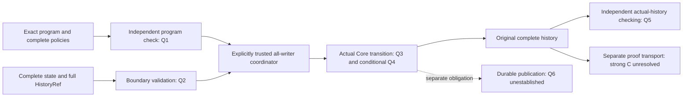

# Decision — separate the guarantees before selecting the machinery

**Retain the Core/Safety idea and the separation of semantic checking from proof transport. Do not select a new production architecture or claim millisecond feasibility from this investigation.** A and B have genuine scoped development support. The single frozen quantitative campaign failed before compilation because the supervisor lost Nix's `nix-shell` dispatch name when resolving a symlink. The candidate is **conditional**, the implementation gate is **blocked**, and product adoption is **unactivated**.

This report completes a bounded investigation with explicit missing results. It does not complete a replacement Core or turn an implementation mistake into evidence against an architecture. Start with [origins](requirement-origins.json), [six assurance arguments](assurance-arguments.md), [24 cells and every FR/SC disposition](comparison.json), [costs](cost-assessment.md) and [complexity](complexity-assessment.json).

## Where the stronger requirement came from

R01–R03 bind Safety's program preservation, valid incoming state and deployment enforcement requirements. R05 binds independent checking of an untrusted **program safety proof**. R04 concerns exact actual Core observations. R06–R09 bind the later Core032/033 contracts for a new consumer of the **actual executed prefix**, replay restrictions, synchronous final proof/durable publication and the named latency targets. R10 separately concerns complete program construction/checking usability. R11 is an architecture proposal.

These are explicit requirements within their original documents and experiments. They do not establish when or why the user originally requested them. The source archive does not justify that attribution. Independent program checking does not logically require replay-free verification of the complete executed history before every response. Correct history remains a fixed goal; who must independently establish it, under which trust assumptions and at which lifecycle boundary is an unresolved product choice.

## What the scoped evidence supports

The public pinned Core/Safety pairing completed real development certification, independent program checking, valid activation, twelve native LD8 attempts/eight commits, separate-process fresh-history checking and private resident continuation. Separate LD8C checking covered the complete nine-action variant, two equal ordered command occurrences and different history despite equal state. Actual bypass and unsafe migration controls expose the all-writer and boundary premises. Complete original result/error/refusal comparison rejects even a harmless but unrelated computation.

Nine positive abstract roots and eight explicit countermodels passed intended-type checks, transitive axiom audit and fresh kernel replay in development. The segment argument uses the imported Safety preservation result with valid start, complete coverage, guard/ordinary-condition and projection-execution premises. It does not assume its desired post-state. Native Rust/Core/extractor/encoding/backend/host and cryptographic circuit correspondence remain separate unproved bridges. Finite native agreement cannot prove them universally.

These findings support three distinct statements:

1. **A can justify a controlled segment under explicit host trust.** Check the exact complete program and policies, validate its full incoming state/history, and require every actual transition to pass the admitted Core/coordinator path. Validity can then be inherited across covered transitions. The host must really control all writers; a certificate cannot enforce that fact.
2. **B can establish actual history independently of producer acceptance by doing work.** An independently chosen origin, requests and complete endpoint govern its own public replay and rederivation. A private established basis permits checked continuation. Restart or loss requires re-establishment; a serialized success flag is insufficient. B shares the Core implementation and is not proof of a different interpreter or constant-time historical verification.
3. **C remains a stronger, unresolved contract.** Replay-free prefix checking by a wholly new recipient, finished compressed proof before certified response and authoritative durable publication require additional machinery. Existing primitive/other-subject observations do not supply a completed LD8 certificate. No new C prover was run and 033's verdict is unchanged.

The campaign contains **no new normal-operation, onboarding, cold-pair or growth observations**. Development proof checking took about 72–74 seconds per complete program role, and development B roles include several seconds of establishment/checking and controller work. Those are diagnostics with different endpoints, not percentile results, release performance or a same-guarantee speedup. Q6 is unestablished everywhere in the memory pilot.

## Architecture candidate to retain

Use existing public Core as the semantic authority. Keep exact module/policy admission and genuine proof checking at an explicit program boundary. Bind valid-start evidence and active authority to the complete history coordinate. Keep checked capabilities private; invalidate them at changed subjects, migration, restart, failure or loss. Preserve full native records, errors/refusals and ordered duplicate command identities.

Separate actual-history checking behind an interface that takes independently expected subjects. A resident consumer must own an established basis and evaluate/compare an exact-parent extension itself. A new consumer must either re-establish that basis, name an explicitly trusted checkpoint/storage authority, or use a separately justified proof mechanism. None of these options silently confers authoritative latest-head knowledge.

Keep cryptographic proof production/transport separate from semantic meaning. A later product decision may require synchronous proof finality, permit another certification boundary, or require replay by recipients. Those options have different guarantees and trust. This investigation activates none of them. Durable atomic state/history/support/result/outbox, idempotency, crash recovery and actual command delivery remain distinct construction and verification obligations.

The [reuse assessment](reuse-assessment.md) explains how existing Safety preservation/independent checking and Core032 observation/history arguments reduce custom machinery, and names each remaining bridge. The research supervisor, resource tracker, proof-audit scripts and archive validator are investigation machinery; their size is not evidence that every product request needs that machinery.

## Necessary and conditional complexity

Exact semantics, a justified valid origin, complete mutation coverage, provenance of reused validity and invalidation/recovery are necessary for the corresponding claims. Independent checking against a dishonest producer adds obligations that trusted execution alone does not meet. A fresh recipient with no replay, plus a finished cryptographic proof on every response, adds further obligations. Atomic durable publication adds storage obligations independently of cryptography.

[The complexity assessment](complexity-assessment.json) counts disclosed responsibility groups for authorities, checks, boundaries and recovery. It is not a single ranking: dropping a guarantee is not an equivalent simplification. Reusing a program-level preservation theorem can avoid repeating universal proof construction per operation, but cannot prove that the actual deployment followed the approved program.

## Next decision and smallest next test

First repair and regression-test the **launcher contract**, including Nix's multi-call invocation name, and the **legacy evidence reader**, including old diagnostic floating-point fields. The frozen source and failed receipts must remain unchanged; [the reviewable follow-up patch](follow-up-launcher.patch) describes a correction outside this failed campaign. A distinct future run needs its own immutable inputs and must not replace campaign 001. Do not build more Core or select another proof backend on the strength of missing performance data.

After those infrastructure checks, the smallest useful discriminator is the already designed complete A/fresh-B/resident-B workload with the exact same independent subjects, whole lifecycle accounting and bounded growth cells. Only actual complete observations can decide whether native semantic/history work leaves adequate latency margin. If they do, choose the product trust/onboarding/finality contract before adding the corresponding cryptographic or durable-storage machinery.

The outstanding product choices are explicit in [product-decisions.json](product-decisions.json): accountable all-writer host versus untrusted producer; which recipient needs which guarantee; whether a new recipient may replay/pay onboarding; and when proof certification becomes final. Separation of semantic assurance and proof transport remains a proposal. No production merge, release, deployment or changed meaning of previous evidence is authorized by this research result.

## Validation and release boundary

Final scoped checks passed 25 Rust tests, 52 Python tests, formatting, Clippy and two identical-input LD8 semantic replays. The read-only preservation audit checked 185 old bound inputs and 44 primary source objects. The complete repository gate stopped at its test-build stage under the unchanged cache limit after passing format and Clippy; it is not a passing integration/release gate. The separately proposed launcher/legacy-reader correction passes its two targeted regression tests and `git apply --check`, but is not applied to this frozen code or tested as a new full campaign.

Independent assessment validation checks exact archived bytes, origin contexts, dispositions, references, 24 cells, fifteen controls and every FR/SC mapping. For this negative campaign it explicitly reports the formal gate blocked; validation does not mint a missing mathematical or cryptographic certificate. Original failed/unrun records and the initial assessment remain available alongside the final report. Research publication is separate from production readiness.
