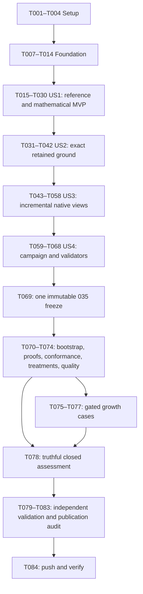

# Tasks: Reuse Verified Core Work with Exact Semantics

**Input**: [spec.md](spec.md), [plan.md](plan.md), [research.md](research.md), [data-model.md](data-model.md), [contracts/](contracts/) and [quickstart.md](quickstart.md).

**Feature**: `035-verified-work-reuse`; actual Git research branch `research/034-ab-measurement-002`. `.specify/feature.json` selects the feature independently of branch naming. Paths below are repository-relative.

**Tests**: Required by the specification’s conformance/proof obligations, the approved plan and Constitution III. Write, review and observe intended red before implementing the passing behavior. Wire minimal compilable non-accepting test seams first where necessary; collection/import/compiler/tool failures do not count as intended behavioral red. Proof-audit negative controls and genuine countermodels are distinct from unavailable tools.

**Organization**: Setup → foundation → US1 (P1, MVP) → US2 (P1) → US3 (P1) → US4 (P2) → independent validation/publication. All tasks start unchecked. This command creates only the task list; none of the implementation, checks, measurements or publication tasks below has run.

## Format and execution rules

- Every executable task is `- [ ] Tnnn [P?] [USn?] description with exact file path`.
- `[P]` permits independent authoring in the named separate files only after its explicit prerequisites and shared wiring are complete. Serialize shared owner/stub/module/Cargo/patch edits. It does not authorize spawning agents or simultaneous heavy builds/proofs/tests/measurements; the campaign has one measured worker/CPU.
- Development/TDD and final frozen evidence are separate. Completed code/profile/expected facts and exact theorem types precede final freeze. Any actual final builds/checks and time between commands consume 035’s one 7200-second clock; preserve the 600-second closing reserve. A corrected revision retains failures and inherits the exact original 035 clock/boot/limits, never old 034’s expired clock.
- Implementation tasks require actual behavior/code and their checks. Missing code is not complete because a report says unsupported. A task explicitly conditional on a gate or requiring a bounded attempt can complete with its actual negative/blocked receipt, but that never passes the missing scientific criterion.
- Do not continue dependent growth after a semantic/conformance/activation failure. Only the exact resource-only canonical-gate exception in contracts/campaign.md permits research growth with integration BLOCKED and unchanged remaining limits. Collection/validation must still truthfully close the bounded negative investigation.
- Reuse only exact established facts under named premises. Original Core/Safety documents/identities, mandatory output/provenance, historical artifacts and production checkout remain unchanged. Derived core035 grounds cannot impersonate direct original Safety validation. No product trust/finality adoption, backend change, cryptographic proof chain or Q6 claim.
- No numerical threshold, control inventory or output scope is chosen after seeing results. The authoritative numeric gates, modes and lifecycle intervals are in contracts/campaign.md and are repeated in the relevant executable tasks/profile.

## Phase 1: Setup — isolated research workspace

**Goal**: Create the planned standalone layout and source/tool boundaries without implementing an optimization.

**Independent Test**: Inspect the layout, declared pins and ignore/ownership rules; no production or sealed prior file changes.

- [X] T001 Create the standalone `reuse-study035` package layout in `experiments/reuse-study035/Cargo.toml`, `experiments/reuse-study035/src/lib.rs`, `experiments/reuse-study035/src/error.rs`, `experiments/reuse-study035/src/bin/reference.rs`, `experiments/reuse-study035/src/bin/ground.rs`, `experiments/reuse-study035/src/bin/views.rs`, `experiments/reuse-study035/src/bin/combined.rs` and `experiments/reuse-study035/oracle/Cargo.toml`; use Rust 2024, `#![forbid(unsafe_code)]`, typed errors and non-accepting stubs with no fabricated success. Reserve four explicit named worker targets and a separate upstream oracle; do not create a general execution engine.
- [X] T002 Declare Core `63a8c164523275e06ac1d7dc5330db4a899c9d99`, Safety `8c0849fb82343ddf5a4dd99b5070ee985f8ebff0` and the existing locked serde/serde_json/sha2/thiserror dependency versions in `experiments/reuse-study035/Cargo.toml` and `experiments/reuse-study035/oracle/Cargo.toml`; reserve the local research-only Core patch at the stable private export layout and leave oracle Core unpatched. Actual lock resolution follows source preparation in T009.
- [X] T003 Define pinned Rust 1.98.1/Python 3.13/Lean 4.30.0 Nix environment and tool identity checks in `experiments/reuse-study035/shell.nix`, `experiments/reuse-study035/toolchain.json` and `experiments/reuse-study035/tests/README.md`; preserve Nix launcher invocation names, one CPU/build job, offline/locked builds, `CARGO_INCREMENTAL=0`, debug-free dev/test outputs and `-C target-cpu=x86-64`; do not infer readiness from a version banner or download replacements.
- [X] T004 Document private source/build/cache/tmp ownership, development versus frozen evidence, retained executable custody and no production adoption in `experiments/reuse-study035/README.md` and `experiments/reuse-study035/.gitignore`; ignore only disposable private/target/Python outputs and preserve original Core/Safety files, every old sealed source/archive and the two unrelated 033 artifacts. All new later code follows intended red→green before acceptance.

**Checkpoint**: Only setup exists. No checked ground, fast result or measurement has been accepted.

---

## Phase 2: Foundation — reproducible source, records and supervision

**Goal**: Build the shared source/protocol/archive/recorder contracts before any user story.

**Independent Test**: Pass intended red/green parser, export, DAG and actual short-process tests; source ownership, tool identities and public pairing are inspectable.

- [X] T005 Write and observe failing recorder/clock tests in `experiments/reuse-study035/tests/test_recorder.py` using injected clocks/disk plus actual short child/grandchild/session-escape helpers; cover fixed owner roots, one affinity, inherited limits, no boot/reset continuation, 600-second reserve clipping, launch names, group/tree kill/reap, disk/cache limits and output closure. Do not import 034 hardcoded output roots.
- [X] T006 Implement `experiments/reuse-study035/recorder.py` with the fixed campaign limits: "7200 seconds" total, "1800 seconds" preparation/scenario, "900 seconds" process, "600 seconds" closing reserve, "8 GiB" per process, one CPU, "2 GiB" artifacts, "2 GiB" cache, "4 GiB" combined including temporary growth, "16 GiB" launch floor and "2 GiB" emergency floor. Clip every child to remaining outer limits; preserve actual stops, reap descendants and prohibit automatic retry, sample replacement or ceiling increase. New 035 has one new clock; any corrective revision inherits that exact start/boot/limits. Pass T005.
- [X] T007 Write and observe failing source-export tests in `experiments/reuse-study035/tests/test_sources.py`; cover exact Git objects, selected file inventory, patch/hash mismatch, missing gate inputs, wrong enclosing Git inventory, path escape and post-freeze manifest/path rewriting. Require a successful small valid export control; a missing tool/compiler is not the intended failure.
- [X] T008 Implement offline `prepare-sources` support in `experiments/reuse-study035/sources.py` and its thin dispatcher in `experiments/reuse-study035/study.py`; export declared production/manifests/scripts/fixtures/workflow/consumer/ARCHITECTURE inputs from pinned Git objects into owned `experiments/reuse-study035/private/core`, retain every adaptation as `experiments/reuse-study035/patches/`, and initialize a separate minimal nonempty Git root/index there. Preserve relative dependency layout and lock bytes; never clone the entire historical repository, write old source roots or inject the new local Git revision into normative inputs. Pass T007.
- [X] T009 Resolve and commit `experiments/reuse-study035/Cargo.lock` and `experiments/reuse-study035/oracle/Cargo.lock` using declared private offline caches; retain Cargo metadata in `specs/035-verified-work-reuse/evidence/development/dependencies.json`. Verify worker and Safety resolve one exact patched Core identity and oracle one unpatched pinned identity; record installed/copied cache conditions and source bytes. Recheck these graphs after later reviewed patches and before final freeze.
- [X] T010 Write and observe failing typed record/parser tests in `experiments/reuse-study035/tests/protocol.rs` and `experiments/reuse-study035/tests/test_protocol.py`; reject duplicate keys, trailing bytes, unknown versions/fields, non-integer semantic numbers, overbounds, wrong subjects, manufactured checked authority and missing resource values relabelled zero. Include valid original/legacy controls and separate operational, semantic, proof and cost outcomes.
- [X] T011 Implement `experiments/reuse-study035/src/protocol.rs`, `experiments/reuse-study035/protocol.py` and `experiments/reuse-study035/schemas/` with these data-model limits verbatim: "manifest/prepared/assessment 16 MiB each", "public history packet 64 MiB", "individual original Core record 8 MiB", "JSON nesting 128", "identifiers 128 UTF-8 bytes", "4096 cases and 16384 observations". Preserve modes "`timing` or `work`", treatment IDs R/G/V/GV, candidate verdicts "`supported_for_fragment`, `conditional`, `rejected`, `undetermined`", and "Unavailable values are null with a reason; zero is an actual zero." Enforce every status domain and exit 0/1/2/3 distinction from contracts/cli.md; diagnostic values never enter semantic identity. Pass T010.
- [X] T012 Write and observe failing immutable-source/DAG/archive tests in `experiments/reuse-study035/tests/test_artifacts.py`; cover invented future hashes, missing logs, replaced binary, outside paths, supplied tools/proof code, source mutation and delayed output writes after closure. A digest identifies bytes and cannot create proof authority.
- [X] T013 Implement bounded read/write-once, exact refs and close-before-hash in `experiments/reuse-study035/artifact_io.py`; refs contain "relative path, byte count, SHA and role", input manifests contain "no future-output digests", and prepared refs bind only actual built outputs and parent manifests. Preserve failed revisions/samples unchanged. Legacy diagnostic decimals are read-only after exact old-byte SHA verification, never admitted to the new semantic wire. Pass T012.
- [X] T014 Validate foundation and retain actual red/green/tool/source/graph receipts in `specs/035-verified-work-reuse/evidence/development/foundation.json`; create `specs/035-verified-work-reuse/inputs/source-catalog.json` and `specs/035-verified-work-reuse/inputs/protected-inputs.json` with exact selected 015/029/034 sources and historical bindings for later preservation. Review what existing caches/prepared evaluation/accumulator already establish and what still materializes globally. Wire shared test entry points so subsequent failures are intended behavior assertions, not collection/import/compiler failures.

**Checkpoint**: Foundation is ready. Every story depends on this checkpoint; no final campaign has started.

---

## Phase 3: US1 — trust reuse without changing a decision (P1, MVP)

**Goal**: Deliver an independent original reference, exact observation contract and general mathematical arguments, with explicit native bridge limits.

**Independent Test**: Run the unpatched reference against authored facts and negative observation controls; check all twelve restricted theorem roots with exact types, allowed axioms and fresh replay. This does not require G/V implementations or performance success.

- [X] T015 [US1] Author `experiments/reuse-study035/expected/ld8.json`, `experiments/reuse-study035/expected/ld8c.json` and `specs/035-verified-work-reuse/inputs/observation-contract.json` from pinned sources; retain original locations, all eight actions and all three policies. State expected values, refusals, ordered duplicate commands and identities separately from oracle-derived full records. Freeze the actual caller requirements for original Safety direct-check reports: if mandatory, their actual production stays inside the complete endpoint. Include safe-but-wrong finish, missing-field and stale-coordinate expected failures.
- [X] T016 [P] [US1] Write and observe failing full-reference/observation tests in `experiments/reuse-study035/tests/reference_observation.rs` for complete invocation/decision/bundle/commit fields, first errors, skips, current coordinates, command order and required direct-report provenance (C05,C12–C14,C20); require independently authored facts and an unpatched oracle. May be authored alongside T017 after T015; execute heavy tests sequentially.
- [X] T017 [P] [US1] Write and observe failing proof-audit tests in `experiments/reuse-study035/tests/test_proofs.py`; reject missing/weakened/duplicate roots, wrong expected types, custom axioms/sorry/native shortcuts, fake fresh-check flags, substituted source/tools and partial closures. Include a genuine supported kernel-check control. May be authored alongside T016 after T015; no concurrent proof/build processes.
- [X] T018 [US1] Implement `experiments/reuse-study035/src/fixtures.rs` by preserving exact original LD8 construction/locations, full phases and three-policy inventory, plus distinct LD8C; generate canonical parents through ordinary finish/activate history. Preserve the complete original module rather than removing unsupported actions to gain eligibility. Compare actual module/policy identity with pinned 034 sources.
- [X] T019 [US1] Implement the separate unpatched `experiments/reuse-study035/oracle/src/main.rs` and controller-selected oracle configuration: `prepare --input PATH --out PATH` uses a successful built-worker binding and requires no prepared manifest. Actually check original Core/Safety subject/program/state/history and emit full expected records against T015; imported certificates or producer flags confer no authority.
- [X] T020 [US1] Implement the ordinary reference route in `experiments/reuse-study035/src/run.rs` and `experiments/reuse-study035/src/bin/reference.rs`, using original public resolver/invocation/commit/property paths with the same Store<Capture> contract planned for all treatments. Compare entire normative outputs, stored arguments and identities with the unpatched oracle; never handcraft replacement invocation JSON or substitute deprecated evaluate for unified invocation. Pass T016 for the reference contract.
- [X] T021 [US1] Build the complete original field/phase/source inventory in `specs/035-verified-work-reuse/inputs/observation-fields.json` and initial `specs/035-verified-work-reuse/inputs/correspondence.json`, tracing pinned invocation.rs/record.rs/eval.rs/documents.rs/store.rs. Use bridge statuses "`proved`, `checked_conformance`, `explicit_implementation_premise` or `unestablished`" with exact sources and evidence/gaps. A shared omitted field or equal final state cannot pass full-observation equality.
- [X] T022 [US1] Define independent reference/incremental finite-map semantics, exact-result observation recipes and reconstruction in `experiments/reuse-study035/proofs/Reuse035/State.lean`, `experiments/reuse-study035/proofs/Reuse035/Reference.lean`, `experiments/reuse-study035/proofs/Reuse035/Incremental.lean` and `experiments/reuse-study035/proofs/Reuse035/ObservationModel.lean`; retain full Parent/Child phases, owner/live/ever-used facts, ordered commands and exact history coordinates. Quantify over arbitrary finite typed states, include unchanged-content finish and ordinary representability/error premises, and do not assume child validity/output equality or bound the proof to measured N/H.
- [X] T023 [US1] Bind only the necessary pinned Safety proof closure and typed exact-state→Safety projection in `experiments/reuse-study035/proofs/Reuse035/Imports.lean`, `experiments/reuse-study035/proofs/Reuse035/Projection.lean` and `experiments/reuse-study035/proofs/imports.json`; preserve Gone versus Abandoned in exact results. Record native projection/host/evaluator assumptions explicitly; 034 abstract edge composition and Core032 numeric exactness are not an LD8 native theorem.
- [X] T024 [US1] Prove `finish_frame` and `view_update_exact` in `experiments/reuse-study035/proofs/Reuse035/Views.lean`; derive actual point-update/frame and exact reconstruction including removed/new/empty index contributions, not from a supplied equality premise. Use T022 and T023; these are mathematical definitions, not yet native V implementation.
- [X] T025 [US1] Prove `unaffected_result_stable` and `observation_reconstruct_exact` in `experiments/reuse-study035/proofs/Reuse035/Observation.lean` after T024; instantiate reusable recipes in current action/phase/history/subject and ordinary memo/skipped context. Raw serialized evidence with old coordinates is never reused unchanged. Preserve the complete T021 record tree, order and first errors.
- [X] T026 [US1] Prove `finish_exact` and `fallback_exact` in `experiments/reuse-study035/proofs/Reuse035/Exact.lean` from the independent algorithms, T024 and T025; missing bindings/unsupported constructs select original reference semantics with no new refusal phase. Safety validity alone is not exact requested execution.
- [X] T027 [P] [US1] Prove `finish_preserves_safety` in `experiments/reuse-study035/proofs/Reuse035/Safety.lean` from established parent validity, actual finish and the justified projection/pinned lifecycle theorem, without assuming the target property. This file can be authored independently of T028 after T024/T023; kernel runs stay sequential.
- [X] T028 [P] [US1] Prove `ground_advance`, `refusal_no_promotion`, `stale_no_promotion` and `uncertain_no_authority` in `experiments/reuse-study035/proofs/Reuse035/Grounds.lean` for exact subjects and actual Applied/failed/unknown publication states. Child authority is never inferred from an unconfirmed acknowledgement. Author independently of T027 after T022/T024; do not claim these model laws prove the later Rust implementation.
- [X] T029 [US1] Prove `semantic_work_bound` and genuine invalid-reuse countermodels in `experiments/reuse-study035/proofs/Reuse035/Work.lean` and `experiments/reuse-study035/proofs/Reuse035/Countermodels.lean`; explicitly account for changed child/owner/index work and zero old-prefix decision visits. Charge actual map clones/history-list append/encoding/hash/output traversal separately; no hidden O(N/H) copy may satisfy a local work claim. Native checked coordinate/count overflow remains ordinary error/fallback.
- [X] T030 [US1] Implement `experiments/reuse-study035/check_proofs.py`, `experiments/reuse-study035/proofs/targets.json` and audit source for the exact twelve roots in contracts/correctness.md, permitting only "`propext`, `Classical.choice`, `Quot.sound`" and requiring expected-type checks, actual transitive dependencies and `leanchecker --fresh`. Pass T017; perform bounded real US1 reference/model checks and retain `specs/035-verified-work-reuse/evidence/development/us1.json` with actual red/green, countermodels, roots/axioms/fresh replay and still-open native bridges.

**Checkpoint**: US1 is the MVP: a trustworthy reference and restricted exactness/preservation argument. It does not declare an optimized native path or a speedup.

---

## Phase 4: US2 — continue from an exact established ground (P1)

**Goal**: Implement real ground retention/discard, exact invalidation and publication lifecycle, keeping other work reference.

**Independent Test**: Compare R/G on one exact parent with actual same-backend checks; invalid subjects/failures/restarts cannot promote authority and original full observations remain equal.

- [X] T031 [US2] Write and observe failing ground lifecycle tests in `experiments/reuse-study035/tests/ground_lifecycle.rs`; cover "absent → supplied_unverified → checking → established(parent)", pending/Applied child, quarantined uncertainty, and the rule "there is no Deserialize/Boolean-import authority constructor". Prepare stable test wiring for the following independent files; supplied success reports do not establish authority.
- [X] T032 [P] [US2] Write and observe failing same-backend G0/G1 retention tests in `experiments/reuse-study035/tests/ground_retention.rs` after T031 test wiring; distinguish common acquired-prefix provenance from selected reusable snapshot facts, changed full subject/profile/policy/history, same-content command-only events and writer loss (C03,C09–C11,C17). Only this file may be authored alongside T033; heavy checks remain sequential.
- [X] T033 [P] [US2] Write and observe failing actual stale/failed/conflicting CAS, interruption/lost-acknowledgement and performed-backend-error tests in `experiments/reuse-study035/tests/publication.rs` after T031 wiring (C12,C15–C17); a commit that actually happened but returned unknown must quarantine authority until reconciliation. Simulations are labelled and do not establish durability.
- [X] T034 [US2] Implement genuine program/prefix/state/Safety acquisition in `experiments/reuse-study035/src/acquire.rs` on Store<Capture>; each process checks its exact program before first use, each sample independently acquires its expected canonical prefix/valid parent. Preserve the actual checked Store and provenance instead of reopening a different backend type. Do not import authority from old receipts or expose a checked-Boolean constructor.
- [X] T035 [US2] Implement the opaque ownership/state machine in `experiments/reuse-study035/src/ground.rs`, keeping common prefix knowledge distinct from selected engine snapshot authorization, binding full semantic subject and writer continuity. Consume/stage ground transitions; "Promote only after confirmed Applied at the exact child; on uncertainty quarantine rather than retain speculative authority." Pass the lifecycle behavior in T031.
- [X] T036 [US2] Implement a minimal research-only exact-ground retain/reset adapter in `experiments/reuse-study035/patches/ground.patch` and the owned Core export; vary only selected reusable authorization while keeping canonical state/backend constant. G0 must actually re-establish needed facts; G1 may retain only genuinely checked exact facts. Review the patch against SnapshotIdentity/ValidatedSnapshot and pass T032; no production checkout/facade/Backend change.
- [X] T037 [US2] Integrate R/G invocation, complete original envelope/evidence/hash/commit and sidecar provenance in `experiments/reuse-study035/src/run.rs` and `experiments/reuse-study035/src/observation.rs`; begin ordinary timing before G0 re-establishment and finish only after required output/maintenance. Derived Safety grounds use core035 provenance; actual original direct-report generation remains inside any endpoint requiring that report. Never label a skipped validator as having run.
- [X] T038 [US2] Implement refusal, stale/CAS failure, uncertain acknowledgement, recovery, restart/untrusted transfer and changed writer/module/schema/profile/policy invalidation in `experiments/reuse-study035/src/ground.rs` and `experiments/reuse-study035/src/recovery.rs`; keep actually performed error contracts and reconcile actual publication before further acceptance. Pass T033 and the remaining T032 cases.
- [X] T039 [US2] Wire actual mechanism-specific R/G entry points in `experiments/reuse-study035/src/bin/reference.rs` and `experiments/reuse-study035/src/bin/ground.rs`; bind embedded intended treatment to executed route and retain development executable/source/build/graph identities in `specs/035-verified-work-reuse/evidence/development/ground-workers.json`. A label/hash difference without route sensitivity cannot pass; V/GV remain explicitly unimplemented until US3.
- [X] T040 [US2] Complete R/G full-reference, ordinary Safety and same-backend retention/mutation controls in `experiments/reuse-study035/tests/ground_retention.rs` and `experiments/reuse-study035/tests/publication.rs`; prove that selected re-establishment differs while complete normative meaning is equal, including same-content new history. Record actual invalidation/uncertainty and original field/provenance checks; do not hide unchanged global/materialization costs.
- [X] T041 [US2] Run bounded independent US2 lifecycle/continuation checks and update exact native/model premises in `specs/035-verified-work-reuse/inputs/correspondence.json`; retain `specs/035-verified-work-reuse/evidence/development/us2.json` with red/green, real retained/discard mechanism evidence, scoped acquisition/extension work and exact original comparisons. This is development evidence, not final timing triplicates or a complete Rust→Lean theorem.
- [X] T042 [US2] Write `specs/035-verified-work-reuse/ground-assessment.md` identifying which established facts genuinely survive, which events invalidate them, remaining full work and pending final cost/bridge obligations. Keep mathematical, native conformance, host premises and measured/unmeasured benefit separate; an unsupported seam gets a concrete limitation instead of a fabricated retention claim.

**Checkpoint**: US2 delivers real exact-ground lifecycle and independently checked R/G conformance. Views can still be absent and all reference work stays available.

---

## Phase 5: US3 — make local changes require local semantic work (P1)

**Goal**: Connect the existing prepared evaluator and maintained exact views to finish, preserving complete original observations and reference fallback.

**Independent Test**: Compare all four native treatments against the upstream oracle; check view reconstruction, complete dependent-set coverage, work growth and unchanged-content drain separately from full output cost.

- [ ] T043 [US3] Write and observe failing maintained-view/eligibility tests in `experiments/reuse-study035/tests/views.rs`; cover point updates, reconstruction, missing/corrupt bindings, empty/new members, owner/reference/capture changes, global/count/create/remove/migration fallback and unchanged-content finish (C04,C06–C08,C18–C19). Wire stable local test interfaces before the independent observer/work files; unknown dependencies are affected, not proof of no change.
- [ ] T044 [P] [US3] Write and observe failing prepared-versus-ordinary fresh invocation/observer tests in `experiments/reuse-study035/tests/prepared_invocation.rs` after T043 wiring; compare every T021 field, current coordinates/memo effects, first errors/skips, ordinary envelope/bundle and duplicate command fallback. Authored safe-but-wrong and missing-field/stale-coordinate controls must fail independently of Safety (C05,C12–C14,C20).
- [ ] T045 [P] [US3] Write and observe failing semantic-work/whole-output controls in `experiments/reuse-study035/tests/work.rs` after T043 wiring; count in-memory and backend visits, cloning, history append/copy, bytes and required direct-check work. Reject claimed local decision paths that enumerate unrelated N/H, moved per-operation view rebuilds and partial endpoints. Timing/work original observations must remain identical.
- [ ] T046 [US3] Implement `experiments/reuse-study035/src/views.rs` with exact canonical entity/version/row/property/owner relations and current-context observer recipes; seed from genuinely checked facts and stage only affected entries. G0V1 retains data without reusable authorization and pays actual re-establishment before use. Missing/corrupt/incompatible views rebuild/fall back; actual data structures must avoid full-map clone masquerading as a point update. Pass applicable T043 cases.
- [ ] T047 [US3] Implement the conservative native selector in `experiments/reuse-study035/src/eligibility.rs` and its research-export hook: exact original LD8 finish, current subject, established typed state, existing child, unchanged owner and no lifecycle/command effects. Other actions/modes/expressions use original reference execution at the original phase; no module rewriting, unsupported partial success or new semantic refusal. Include representability and identity-lifetime checks where required.
- [ ] T048 [US3] Add `experiments/reuse-study035/patches/prepared-invocation.patch` connecting genuinely checked PreparedSnapshot/CheckedEvaluation to the existing fresh unified invocation envelope builder in the owned export. Reuse the ordinary scalar evaluator/observer conventions and exact module/profile/epoch binding; do not manufacture decision JSON, reuse a replay-only authority or substitute deprecated evaluate. Pass T044 for admitted finish and exact fallback.
- [ ] T049 [US3] Add `experiments/reuse-study035/patches/version-views.patch` to maintain an exact bound version/fact view across confirmed local changes and avoid redundant versions_for reconstruction where justified. Keep original store/history/state identities, canonical hash functions, integrity and actual backend error contracts. Count remaining current/previous-record copying/hash work; do not invent a new MuHash accumulator.
- [ ] T050 [US3] Implement exact original observation reconstruction in `experiments/reuse-study035/src/observation.rs` and any reviewed observer export patch; instantiate recipes with current action/phase/history/subject/memo context and preserve the entire original field inventory, errors/skips and order. Produce all mandatory original bytes/hash inputs before their commit/completion boundary. Optional compact research recipes cannot replace the published format or mandatory direct Safety reports. Pass C20/missing-field/stale-coordinate controls.
- [ ] T051 [US3] Connect the checked restricted Safety preservation/projection to derived ground/property maintenance in `experiments/reuse-study035/src/views.rs` and `experiments/reuse-study035/src/ground.rs`; preserve both FieldOwnership policies and LifecycleDependency premises. If coverage/correspondence is unsupported, perform original checking and disclose its cost. Keep independent full original Safety checks outside candidate intervals and actual mandatory direct-report production inside them; never impersonate direct-check provenance.
- [ ] T052 [US3] Integrate checked commit rederivation, exact epoch/parent matching and staged view promotion in `experiments/reuse-study035/patches/checked-promotion.patch` and `experiments/reuse-study035/src/ground.rs`; child views become usable only at actual confirmed child, with no speculative publication or full-map clone. Refusal, stale/failed/uncertain commit and fallback invalidate/quarantine/rebuild as required; re-run ground publication controls.
- [ ] T053 [US3] Implement scoped physical/work diagnostics in `experiments/reuse-study035/src/diagnostics.rs` and `experiments/reuse-study035/patches/work-counters.patch`; count entity/version/obligation/property/membership work, cached-map traversal, view update/seed, record copies, canonical serialized/hashed bytes, retained space and old-prefix/history append work. Detailed counters never authorize results, timing mode disables them but retains coarse phase timestamps, and unavailable values are "null with a reason". Pass T045 without subtracting estimated overhead.
- [ ] T054 [US3] Wire all four fixed mechanism entry points and the timing/work mode boundary in `experiments/reuse-study035/src/bin/reference.rs`, `experiments/reuse-study035/src/bin/ground.rs`, `experiments/reuse-study035/src/bin/views.rs`, `experiments/reuse-study035/src/bin/combined.rs` and `experiments/reuse-study035/src/run.rs`; actual G0/G1 and V0/V1 behavior follows contracts/treatments.md under the same backend/authority. A group cannot select its treatment from untrusted input. Refresh exact source patches/locks/metadata and compare R with the unpatched oracle again.
- [ ] T055 [US3] Complete full native R/G/V/GV conformance and mutation tests in `experiments/reuse-study035/tests/conformance.rs`, cross-referencing T043/T044 and all existing C01–C20 positive/negative controls. Require original outputs/records/identities and original Safety outcomes, invalid starts, changed captures/references, fallback errors/overflow/commands and failure/recovery. Distinct valid native outcomes cannot pass as exact equivalence.
- [ ] T056 [US3] Update `specs/035-verified-work-reuse/inputs/correspondence.json` and write `specs/035-verified-work-reuse/construct-mapping.md` with actual source locators connecting selector, reference/incremental semantics, view/observer reconstruction, original encoding/hash, publication, Safety and host authority. Reconcile the twelve model roots with the executed algorithm without upgrading finite tests or named but unproved bridges to an unconditional native theorem.
- [ ] T057 [US3] Run bounded development work checks across N=2/64/256 and H=8/32/128 using the controlled comparisons in `experiments/reuse-study035/tests/work.rs`; verify GV finish and its same-process unchanged-content drain avoid unrelated semantic traversal, and a reference fallback requires correct re-establishment. Retain `specs/035-verified-work-reuse/evidence/development/us3.json` with exact comparisons, counters, physical/output costs and any genuine failed locality condition; these are not final campaign samples.
- [ ] T058 [US3] Write `specs/035-verified-work-reuse/incrementality-assessment.md` from actual US3 evidence: distinguish checked fragment laws, native conformance/bridge premises, locality, preserved views, required original observation/hash/direct-check floors and full endpoint limits. No positive native incrementality/latency claim is allowed where its gate failed; a missing implementation is not completed by an unsupported-result label.

**Checkpoint**: All four native mechanisms exist or their exact implementation blocker is explicit. Final growth still requires the frozen proof/conformance/activation gates; fast component timings do not complete the product endpoint.

---

## Phase 6: US4 — decide the architecture from a valid comparison (P2)

**Goal**: Implement a bounded immutable comparison and independent assessment, then execute its frozen gates and exact matrix.

**Independent Test**: Detect incorrect treatment identity, missing control/proof/sample and shifted work; independently validate full or truthful negative outcomes and recompute every published cost from actual observations.

- [ ] T059 [US4] Write and observe failing frozen CLI/bootstrap tests in `experiments/reuse-study035/tests/test_cli.py`; bootstrap must use a successful closed built-worker receipt before prepared exists, reject failed/unclosed/changed workers and unknown cases, enforce source immutability/exact inherited clocks/reserve and preserve create-once failed slots. Wire stable supervisor test interfaces before subsequent independent report/validator tests.
- [ ] T060 [P] [US4] Write and observe failing statistics/endpoint tests in `experiments/reuse-study035/tests/test_costs.py` after T059 wiring; reject mixed parents/treatments/modes, missing≠zero, incomplete triplets, invented p50/p95, overlapping phase sums and sums of independent medians. Validate directly timed primary/drain cycles and frozen 2×/4×/50 ms/80%/110% criteria solely from timing-mode data; detailed-counter timings never substitute.
- [ ] T061 [P] [US4] Write and observe failing independent assessment/archive tests in `experiments/reuse-study035/tests/test_validate.py` after T059 wiring; require 21 FRs, 8 SCs, 12 theorem roots, C01–C20, five cells, actual worker/activation context and exact failure/unrun dispositions. Reject trusted producer flags, stale bridge claims, fake direct Safety provenance, missing original fields and supplied verifier/proof executables. A genuine complete negative assessment remains valid.
- [ ] T062 [US4] Implement `experiments/reuse-study035/profiles/diagnostic.json` with only (N,H)=(2,8),(64,8),(256,8),(2,32),(2,128), D=1 finish, R/G/V/GV, three timing repetitions then one work observation per treatment/cell, and left-rotated treatment-group order per cell. Declare every fixed input/output/drain slot and gate. Copy exact contract ceilings/discriminators unchanged; total 60 primary timing +20 work observations, no (256,128) expansion or new target after results.
- [ ] T063 [US4] Implement freeze/source validation/built-worker selection/bootstrap/prepared-manifest DAG in `experiments/reuse-study035/study.py` and `experiments/reuse-study035/sources.py`. Bind actual immutable source closure, reviewed patches, exact locks/tools/targets and authored semantic expectations, then build/retain workers+oracle before actual oracle preparation. Verify unchanged-layout private exports with their own nonempty Git index; no post-freeze manifest/path rewriting, dependency download, expected-output future hash or bootstrap prepared-manifest cycle. Pass T059.
- [ ] T064 [US4] Implement `run-group --prepared PATH --case ID --out PATH` in `experiments/reuse-study035/src/run.rs`/worker dispatch: actual program check once per group, independent parent acquisition/view seed for each of its three timing and one work samples, complete operation timing before G0 work through mandatory original output/maintenance, and directly timed primary-plus-drain cycle. Record "raw integer nanoseconds" and separate acquisition, semantic, canonical/output/identity, commit, maintenance and supervisor scopes; enforce "No partial operation becomes a complete sample." mandatory caller direct-check costs cannot be deferred.
- [ ] T065 [US4] Implement gated orchestration in `experiments/reuse-study035/study.py` for bootstrap→proofs→conformance→treatments→quality→growth-D1…D5 with exact remaining-budget clipping and 600-second final reserve. A semantic/unclassified/scoped correctness/activation failure blocks growth; only an actually established resource-only canonical gate stop with scoped correctness passed and remaining limits intact permits research growth, with integration BLOCKED. Preserve every stop/blocking ref and actual child receipt.
- [ ] T066 [US4] Implement actual raw observation derivation and complete close/collect assessment in `experiments/reuse-study035/costs.py`, `experiments/reuse-study035/assessment.py` and `experiments/reuse-study035/study.py`; use only actual closed slots, all declared statuses and requirement/control coverage. Keep ground/view/interaction/confounding/output/full-endpoint findings separate, null unavailable values and exact negative dispositions. Do not reuse old 034 failure templates or mark an unrun criterion passed. Pass T060.
- [ ] T067 [US4] Implement independent `experiments/reuse-study035/validate.py` using fixed expected source/subject/verifier context, read-only byte/index/worker/activation checks, actual proof/native replay as bounded, raw-to-summary recalculation and complete FR/SC/control/root accounting. Validation outputs go to a declared sibling root and never mutate sealed campaign files. Missing bridges keep findings conditional; valid negative assessments do not pass their absent positive obligations. Pass T061.
- [ ] T068 [US4] Validate all development CLI/source/record/proof/native/work/report negatives, exact source/patch/dependency identities and scoped Rust/Python fmt/Clippy/tests; reconcile the runnable guide and freezeable code/profile/expectations before final execution. Retain `specs/035-verified-work-reuse/evidence/development/preflight.json` and commit the completed reviewed research inputs. Expected failures must be real assertions, not missing collection/tools. No final scientific observations yet.
- [ ] T069 [US4] Create the one final `specs/035-verified-work-reuse/evidence/campaign-001/input-manifest.json` with the implemented freeze command and exact completed source/profile/expected-input DAG. Start 035's new monotonic clock once, bind actual installed/cache conditions and all future declared slots; no later bound input/source edit, sample replacement, retry or clock reset. Any separately justified correction needs a new inherited-clock revision retaining the original failure.
- [ ] T070 [US4] Execute actual bounded bootstrap into `specs/035-verified-work-reuse/evidence/campaign-001/roles/bootstrap/`: build/retain four distinct workers and unpatched oracle, verify graph/source bindings, prepare exact subjects/original outputs, and create prepared only after successful checks. Retain full real logs/resources. A failed bootstrap completes only its recorded attempt; every dependent scientific role receives a gate-linked not_run, never an invented successful preparation.
- [ ] T071 [US4] If bootstrap/source prerequisites and remaining budget permit, execute the fixed twelve-root/type/axiom/fresh-kernel proof role into `specs/035-verified-work-reuse/evidence/campaign-001/roles/proofs/`; otherwise retain its precise gate-linked not_run. Real checked fragment evidence remains distinct from native correspondence. Development .olean files or proof receipts cannot stand in for this final check.
- [ ] T072 [US4] If preceding gates permit, execute the complete fixed conformance/control/drain role into `specs/035-verified-work-reuse/evidence/campaign-001/roles/conformance/`, with actual original reference/Safety comparisons, negative controls, exact subject/error/command/identity boundaries and fault receipts; otherwise retain exact blocked dispositions. Signal/timeouts are operational outcomes, not mathematical counterexamples or safety proofs.
- [ ] T073 [US4] If correctness gates permit, execute actual distinct-binary and mechanism-sensitive G/V activation plus timing/work semantic-equality checks into `specs/035-verified-work-reuse/evidence/campaign-001/roles/treatments/`. Catch equal executables, wrong actual entry points, substituted/stale builds, corrupt views and stronger hidden starting knowledge. Mark unseparated factors confounded and block causal attribution; failed identity/activation blocks growth.
- [ ] T074 [US4] Execute final scoped tests/format/Clippy and actual unchanged `scripts/gates.sh` from the owned candidate export into `specs/035-verified-work-reuse/evidence/campaign-001/roles/quality/`, using its nonempty correct Git inventory, complete declared fixtures/consumer/workflow inputs, private targets and BEHAVIOR_BIN pointing at the actual candidate CLI. Include actual guide/help and deterministic semantic re-execution checks here. Apply T065 policy to any failure; no scoped/version-banner substitution, raised limit or unrecorded rerun.
- [ ] T075 [US4] If all required gates and unchanged remaining limits permit, execute growth-D1 then growth-D2 into `specs/035-verified-work-reuse/evidence/campaign-001/growth/growth-D1/` and `specs/035-verified-work-reuse/evidence/campaign-001/growth/growth-D2/`, with four treatments, three fresh-parent timing observations and one separate work observation each, plus labelled drains. Otherwise record exact not_run/blocking reasons; preserve failed/partial samples and never resample.
- [ ] T076 [US4] If gates/budgets permit, execute growth-D3 (N=256,H=8) into `specs/035-verified-work-reuse/evidence/campaign-001/growth/growth-D3/` with all declared R/G/V/GV samples, full original output/provenance, directly measured complete endpoints/cycles and separate work counters; otherwise retain the blocking outcome. No small component timing, shifted check or n=3 percentile may establish complete feasibility.
- [ ] T077 [US4] If gates/budgets permit, execute growth-D4 then growth-D5 into `specs/035-verified-work-reuse/evidence/campaign-001/growth/growth-D4/` and `specs/035-verified-work-reuse/evidence/campaign-001/growth/growth-D5/`; hold the same local dependencies while varying H=32/128 at N=2, with all declared samples/drains. Preserve any blocked cells instead of expanding to excluded cross-cells or restarting the clock.
- [ ] T078 [US4] Within the original closing reserve, close all owned processes/writers and execute actual collection into `specs/035-verified-work-reuse/evidence/campaign-001/assessment/`, sealing `specs/035-verified-work-reuse/evidence/campaign-001/closed-artifacts.json`. Retain the exact raw matrix and complete original comparisons, all actual failures and FR/SC/control/root dispositions. Do not edit sealed results to accommodate later validation; a truthful bounded negative outcome remains conditional/rejected where positive evidence is missing.

**Checkpoint**: Frozen campaign has actual closed evidence or explicit bounded negative/unrun dispositions. Independent validation and publication remain; no production adoption is authorized.

---

## Phase 7: Polish — independent validation, preservation and publication

**Goal**: Make the final investigation independently inspectable without rewriting any frozen result or extending its resource clock.

**Independent Test**: Confirm exact closed bytes, deterministic/reference accounting, requirement completeness and remote publication; every missing positive result remains visibly missing.

- [ ] T079 Run actual bounded independent validation against the closed assessment into `specs/035-verified-work-reuse/evidence/validation-001/`, within the same campaign clock/reserve; recheck exact source/worker/control/proof context, deterministic original observations and raw-derived medians/endpoints. Record unavailable or timed-out rechecks explicitly. Validation may accept truthful negative assessment completeness; it cannot confer missing semantic/proof/performance authority.
- [ ] T080 Within the original remaining validation budget, verify the selected historical source/input bindings and owned-file scope from `specs/035-verified-work-reuse/inputs/protected-inputs.json` or retain the exact resource-linked not_run disposition, retaining `specs/035-verified-work-reuse/evidence/validation-001/preservation.json` only in declared unsealed validation slots before its final close. Reuse actual already recorded preservation checks instead of repeating them unnecessarily; preserve all older archives/production sources and the two unrelated 033 artifacts, without a full historical rehash or deletion.
- [ ] T081 Publish `specs/035-verified-work-reuse/report.md`, `specs/035-verified-work-reuse/assessment.json` and `specs/035-verified-work-reuse/evidence/validation-001/closed-artifacts.json` from the actual sealed campaign plus validation evidence. Review all FR-001–FR-021/SC-001–SC-008 and C01–C20; give separate mathematical/native/ground/view/interaction/confounding/output/complete-endpoint/quality verdicts and smallest justified next experiment. Root reports reference sealed outcomes and never rewrite the campaign.
- [ ] T082 Write `specs/035-verified-work-reuse/reproduction.md` from actual preflight/quality/validation receipts and the fixed quickstart commands, recording exact tools/source/retained binaries, output ownership, measured scopes, resource/cache conditions, unavailable checks and instructions for a new output root. Do not rerun broad tests or benchmarks after closure merely to polish docs; needed guide/runtime checks already belong to T068/T074/T079.
- [ ] T083 Perform a final read-only task/spec/plan/report/evidence consistency and staged-byte/scope audit, retaining `specs/035-verified-work-reuse/evidence/publication-inputs-001.json` for the closed payload/index references. Confirm implementation tasks represent actual implemented behavior, attempted/conditional tasks retain truthful receipts, tests/gates are not overstated, runtime validation did not exceed the inherited clock, and all changes are owned by 035. Do not mark the final publication task complete before the remote is verified.
- [ ] T084 Commit owned 035 experiment/design/report/evidence changes, byte-verify committed blobs, push the authorized research branch and independently verify its remote tip; record the exact published payload and verification in `specs/035-verified-work-reuse/evidence/publication-001.json`. Complete this task only after actual publication; a separate bookkeeping commit may record receipt/checkbox completion without changing frozen bytes or implying failed/unrun goals passed.

**Checkpoint**: The bounded investigation is published with correct claims and explicit limits. This is not approval to merge, replace Core, change finality/evidence contracts or claim Q6.

---

## Dependencies & Execution Order

### Phase dependencies

| Phase | Tasks | Entry prerequisites | Deliverable |
| --- | --- | --- | --- |
| Setup | T001–T004 | Existing approved spec/plan | Owned package/tool/manifest layout; no accepted behavior. |
| Foundation | T007–T014 | Setup | Tested source/export, exact graph, strict records, DAG and recorder. |
| US1, P1 | T015–T030 | Foundation | Independent reference, authored observations and checked restricted model/bridge register. |
| US2, P1 | T031–T042 | US1 reference/contract/model | Actual same-backend retention/invalidation and original R/G conformance. |
| US3, P1 | T043–T058 | US1 exactness contract and US2 ground seam | Actual view/prepared invocation path, four native mechanisms and locality/output evidence. |
| US4, P2 | T059–T078 | Complete implemented US1–US3; final execution requires their gates | Immutable bounded campaign, full raw matrix or truthful blocked outcome, sealed assessment. |
| Polish | T079–T084 | Closed campaign | Independent validation, preservation, report, reproduction and verified publication. |

The Gates→Close edge is the bounded negative path: record every blocked matrix slot. It is not permission to skip required implementation, ignore a failing unit test or waive a positive scientific gate. Correctness/resource dispositions remain separate. US1–US3 deliver independently inspectable increments in this order; shared native authority makes fully concurrent story implementation inappropriate.

### Within-story and file dependencies

- Each test task precedes its corresponding implementation and retains the intended red/green. A successful upstream/native or kernel control must distinguish missing candidate behavior from unavailable infrastructure.
- T006 follows T005 and provides actual bounded supervision before Cargo builds or native red/green execution. T008 follows T007; T009 resolves only after the private export exists. T011 follows T010; T013 follows T012. T014 validates the entire foundation before story entry.
- US1: T015 defines expected facts before T016/T017. T018–T021 establish the exact native reference and field inventory. T022/T023 define independent model/imports; T024 proves the frame/views; T025 proves observer recipe/assembly correspondence; T026 depends on both. T027 and T028 may be authored on separate files once their declared model prerequisites are ready. T029 and T030 close the work/countermodel/root-audit obligations. Native V is not a prerequisite to the mathematical MVP; its correspondence remains explicit.
- US2: T031 establishes shared test wiring before T032/T033. T034–T038 implement actual acquisition/opaque ground/seams/error lifecycle. T039–T042 bind and validate genuine R/G mechanisms. Nothing imports caller-supplied checked flags.
- US3: T043 establishes shared test wiring before T044/T045. T046–T052 stage views, fresh prepared invocation, complete original observations/property premises and Applied-only promotion. T053–T058 account for actual physical work, finish/drain/fallback behavior and source-to-model boundaries.
- US4: T059 establishes test wiring before T060/T061. T062–T067 implement the fixed profile/commands/group/assessment/independent validator. T068 passes actual development preflight and commits frozen inputs. T069 starts the final clock; T070 must bind built workers before prepared exists. T071–T074 precede every growth launch; T075–T077 are sequential and consume the same remaining budget/reserve. T078 closes the original campaign; T079 writes independently into the declared sibling root.
- T080 adds declared preservation evidence before T081 closes validation output. T081/T082 derive root reports/reproduction from actual receipts; no late hidden runtime work or sealed-file changes. T083 audits payload scope/claims. T084 alone closes publication after remote and committed-byte verification.
- The old specification-quality checklist is read-only during implementation. Its 16 passed marks are not implementation completion or proof evidence. Only actual completed tasks acquire `[X]` in this file.

## Parallel Execution Examples

`[P]` opportunities concern authoring/review of independent files after prerequisites. Execute all actual heavy tests, native builds, proof checks and measurements serially with the bounded recorder. Shared entry-point/module/Cargo/patch edits are serialized. These examples do not request sub-agent creation.

| Story | Prerequisites | Independent files/tasks that may be authored together | Serialized integration/check |
| --- | --- | --- | --- |
| US1 | Foundation and T015 | T016 `tests/reference_observation.rs`; T017 `tests/test_proofs.py` | Intended reds and native/kernel controls, then their implementations. |
| US1 | T022–T024 and imported/projection definitions | T027 `proofs/Reuse035/Safety.lean`; T028 `proofs/Reuse035/Grounds.lean` | All type/axiom/fresh replay and the fixed root audit in T030. |
| US2 | T031 shared test wiring | T032 `tests/ground_retention.rs`; T033 `tests/publication.rs` | Actual native/fault reds, then T034–T040, source patches and R/G checks. |
| US3 | T043 shared test wiring | T044 `tests/prepared_invocation.rs`; T045 `tests/work.rs` | Actual reds, common Core patch/observer wiring and four-worker integration. |
| US4 | T059 shared test wiring | T060 `tests/test_costs.py`; T061 `tests/test_validate.py` | Stats/validation implementation, frozen campaign and independent closing. |

There are ten tasks marked `[P]`. No `[P]` marker permits modifying a file another active task owns or bypassing a stated prerequisite.

## Requirement, Proof and Control Coverage

| Contract/specification obligation | Task coverage |
| --- | --- |
| FR-001–FR-003, SC-001–SC-002: exact reference and separate general arguments | T015–T030, native/reference integration T040/T055/T056, final proof/conformance T071/T072. |
| FR-004–FR-008: provenance, ground/view authority and invalidation | T010–T013, T031–T041, T043–T052, C03–C04/C06–C12/C15–C19 in T072/T073. |
| FR-009–FR-012, SC-003: four actual same-authority mechanisms and conformance | T039–T041, T054/T055, T059–T065, T070/T072/T073. |
| FR-013–FR-014, SC-004: general locality and orthogonal growth | T024/T029, T045–T049/T053/T057, fixed profile T062 and actual T075–T077. |
| FR-015–FR-017, SC-005–SC-006: true complete scopes and original observation floor | T015–T021/T025, T037/T050/T051/T053, T060/T064/T066 and T075–T081. |
| FR-018–FR-019: bounded reproducibility, failure discipline and existing mechanisms | T003–T014, source/bridge review T056/T068, freeze/gates T069–T074 and preservation T080. |
| FR-020–FR-021, SC-007–SC-008: independent decision and unchanged contracts | T061/T067, T078–T084; no producer flag, missing bridge or finite agreement becomes proof. |
| `finish_frame`, `view_update_exact` | T024; exact fixed audit T030/T071; native connection T056. |
| `unaffected_result_stable`, `observation_reconstruct_exact` | T025; native field/coordinate controls T044/T050; audit T030/T071. |
| `finish_exact`, `fallback_exact` | T026; native selector/fallback T047/T048/T055; audit T030/T071. |
| `finish_preserves_safety` | T023/T027; native provenance/projection T051/T056; audit T030/T071. |
| `ground_advance`, `refusal_no_promotion`, `stale_no_promotion`, `uncertain_no_authority` | T028; native T031–T041/T052; actual fault controls T072. |
| `semantic_work_bound` | T029; physical accounting T045/T053/T057; final work samples T075–T077. |
| C01–C04: identity, activation, ground and view mechanisms | T032/T039/T040/T043/T054/T055/T059/T061; final T073. |
| C05–C09: safe-but-wrong, membership/reference/count/invalid origin | T015/T016/T031/T043/T044/T055; final T072. |
| C10–C14: history/interpretation/refusal/first-error/commands | T015/T016/T032/T038/T044/T055; final T072. |
| C15–C19: publication uncertainty, restart, unsupported changes and drain | T028/T031–T041/T043/T052/T055/T057; final T072/T075–T077. |
| C20 plus missing original fields/stale coordinates/direct-report provenance | T015/T016/T021/T025/T037/T044/T050/T051/T055/T060/T064; final T072/T073/T079. |

## Implementation Strategy

1. **MVP first:** Complete Setup/Foundation and US1 (T001–T030). Deliver the independent reference, full observation inventory, separate checked fragment exactness/preservation laws, negative controls and explicit native premises. This is useful without an optimization or final campaign.
2. **Retain real grounds:** Complete US2 (T031–T042) before enabling native views. Demonstrate actual checked Store retention/discard, exact invalidation and no speculative authority; keep original endpoint semantics and all residual work visible.
3. **Build one genuinely local native transition:** Complete US3 (T043–T058) using existing prepared machinery and strict finish-only selection. Validate original observations and actual physical work, including drain and fallback re-establishment. Do not implement a general new query runtime or alter the module/format to pass.
4. **Freeze only complete reviewed inputs:** Implement and test US4 tooling first (T059–T068). Then the single final freeze and gated campaign (T069–T078) produce actual 60+20 observations or retained, precisely blocked partial results. No growing scope, post-hoc thresholds or resampling.
5. **Validate and publish:** T079–T084 independently assess bytes/results/claims and publish inspectable evidence. A completed negative investigation still states unmet positive criteria. Integration recommendations require their original correctness/quality/numerical gates; this feature never activates production Core replacement, new trust/finality, cryptographic feasibility or durable Q6.
