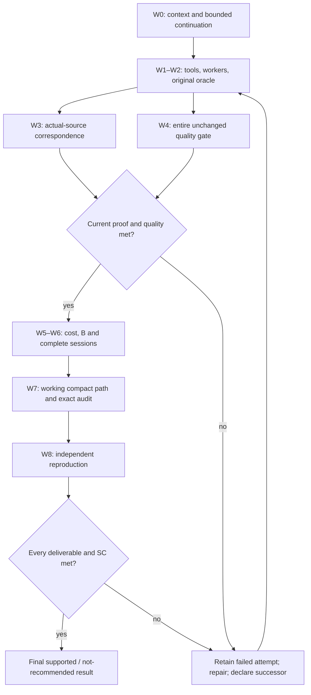

# Implementation Plan: Complete and Verify Exact Core Transitions

**Branch**: `research/034-ab-measurement-002` (actual Git branch) | **Feature selector**: `036-core-transition-feasibility` | **Date**: 2026-11-16 | **Specification**: [revision 2](spec.md)

**Input**: All 22 functional requirements, eight success criteria and eight required deliverables of specification revision 2. This replaces the active revision-1 design; its exact [archived planning context](specification-revisions/001/context-manifest.json), stopped attempts and reports remain unchanged.

## Summary

Finish the restricted implementation and then decide its correctness, complete cost, lifecycle economics and compact-evidence usefulness. Build reference R, verified reuse GV, one same-contract improvement B and a minimal canonical compact path C with exact original reconstruction. Complete actual-source correspondence, full quality, all required experiments and independent reproduction. A measured negative recommendation is a finished result; a missing proof, tool failure or stopped attempt is unfinished work.

Use one persistent work ledger and bounded successor attempts, not a fixed feature-lifetime deadline. Repair prerequisites and continue independent engineering. Correctness/quality gates control accepted measurements and claims, without an automatic edge from failure to final feature closure. Final completion is an executable all-requirements predicate, never a successful report-writing command.

This planning command produces documentation only. No new environment, code, tool installation, proof, quality pass, benchmark or implementation completion is asserted. The existing `tasks.md` describes revision 1 and must be regenerated with `speckit-tasks` before implementation.

## Technical Context

**Language/Version**: Native Rust/Cargo 1.98.1, edition 2024; Python 3.13.15 orchestration; original Lean 4.30.0 replay. Initial analysis tuple: Aeneas `1dc8ad31b1b062a77c50e29144a6c7bba955fa09`, Charon `454586e9b770231e66d2062993e632dfc06463e2`, Rust `nightly-2026-09-17`, Lean `v4.36.0-rc2`. Native stable and extraction nightly are separate subjects with an explicit compiler/configuration relation. Verification-tool revisions are allowed only as declared corrective subjects, preserving the semantic obligations and old records.

**Primary Dependencies**: Original Core `63a8c164523275e06ac1d7dc5330db4a899c9d99`, Safety `8c0849fb82343ddf5a4dd99b5070ee985f8ebff0`, 035 at `6296d5e358034b19e6322eed44d69fffa318c326`. Keep pinned dependency versions and exact lock inputs; no floating upgrade. Implement dependency refinements for actual JSON/maps/sets, trait dispatch, epochs, errors and observation construction rather than assuming extraction supports them. See [research](research.md) and [correctness](contracts/correctness.md).

**Storage**: Original memory-backed Store/Capture for legacy R/GV/B. C has a restricted experimental memory CAS, typed state/views and retained replay basis/deltas. Its head is a versioned recipe commitment with a proved mapping to reconstructed original state/history, not an implicitly equal legacy history ID. No new Merkle tree, cryptographic backend or durability contract.

**Testing**: Test-first strict parsers, continuation/resource controls, real native source/result mutants, ground/view/fault controls, full original eight-field comparison, proof expected-type/axiom/fresh-kernel checks, actual mechanism counters, complete interval reconciliation, whole unchanged canonical gate and scoped research checks, independent fresh rebuild/proof/replay. Every new accepting path needs observed red, green and actual negative controls; importing a module successfully is not a source-equivalence control.

**Target Platform**: x86_64 Linux/Nix, one active heavy process tree and one CPU. Locked/offline accepted native runs, one build job, no incremental compilation, debug information disabled, `RUSTFLAGS=-C target-cpu=x86-64`. Record uncontrolled OS cache state separately. Root-filesystem private builds avoid the observed /data space constraint.

**Project Type**: Standalone research CLI, fixed-role workers, proof/checking artifacts and bounded experiment controller. No production API changes or runtime AI.

**Performance Goals**: Complete 141 primary timing observations and 47 separate diagnostics, plus real controls and 26 fresh reproduction samples. Report observed medians/ranges, complete costs and directly timed payback. Compare with historical 50/100 ms certified/durable aspirations without equating the memory-backed endpoint or diagnostic triplets to those guarantees/quantiles. Freeze decision rules in [campaign](contracts/campaign.md) before comparisons.

**Constraints**: Prospective per-attempt wall/memory/storage bounds and 300-second closure reserve, recorded successors after corrections, full per-volume/shared-store accounting. Initial profile: 20 GiB cache, 4 GiB temporary, 4 GiB retained evidence, 8 GiB newly registered shared store; 36 GiB combined. Root/data free admission 48/8 GiB, live floors 8/4 GiB. These are planning allocations, not observed sufficiency or a lifetime budget. Numerical profiles, extensions and interruption semantics are in [campaign](contracts/campaign.md).

**Scale/Scope**: Proofs quantify over arbitrary finite representable states admitted by the real LD8 `finish` selector; measurement caps do not constrain the theorem. Diagnosis cells D1=(2,8), D2=(64,8), D3=(256,8), D4=(2,32), D5=(2,128). R/GV lifecycle: three families × lengths 1/8/32/128. B is required across all five diagnosis cells. C is required at two operation cells and two changing-session cells. Full language, new trust/finality, replay-free receiver claims, crypto backends and Q6 remain excluded.

## Constitution Check

Pre-research: **PASS for design**. Post-design: **PASS for design**. Runtime proof, quality and completion are **unestablished**. An implementation unable to satisfy these obligations remains unfinished; this plan requests no constitutional exception.

| Principle | Design before research | Design after research |
| --- | --- | --- |
| I. Deterministic authority | Original Core semantics remains authoritative. | Fixed roles, typed controls and deterministic completion evaluator; no AI decides transitions or pass status. |
| II. Validate inputs | Supplied flags/evidence are untrusted. | Strict v2 schemas, independently selected context, bounded references, duplicate/unknown-field rejection and explicit unavailable quantities. |
| III. Test first | Existing finite tests do not cover new work. | Task generation must place real parser/continuation/source/fault/control reds before accepting implementations; preserve development receipts. |
| IV. Reproduction | Bind exact semantics/source/tool/configuration. | Fresh independent build/kernel/replay, all-table recomputation, separate source subjects and fixed sample rules. |
| V. State/audit | Private authority and uncertainty remain explicit. | Confirmed-only child promotion; interrupted processes resume from raw verified inputs through fresh establishment, never serialized authority flags. |
| VI. Simplicity | Reuse existing mechanisms before format change. | One worker library and controller; B is a 64 KiB output buffer; C reuses original replay for reconstruction, without another hash-tree subsystem. |
| VII. Semantic soundness | Native-to-model equality cannot be assumed. | Actual call-closure/dependency refinements, full observation relation and source canaries; no opaque desired-result axiom or proof-only alternate implementation. |
| Engineering | Stable native Rust, typed errors, pinned locks, no new unsafe code. | Entire unchanged canonical script plus scoped checks; every accepted final subject must pass. |

## Project Structure

### Documentation

```text
specs/036-core-transition-feasibility/
├── spec.md / AMENDMENT.md
├── plan.md / research.md / data-model.md / quickstart.md
├── contracts/{campaign,correctness,compact-evidence,cli,reproduction}.md
├── specification-revisions/001/       # unchanged v1 documents and manifests
├── tasks.md                           # v1 history until regenerated next phase
├── inputs/v2/                         # future reviewed work/profile/subject inputs
├── evidence/v2/<work-id>/              # future attempts and independent reproduction
└── results/v2/<work-id>/               # future final report/assessment/closure
```

Existing root report/assessment and `evidence/campaign-001` remain historical v1 outputs. Do not overwrite them with v2 results.

### Source and owned working area

```text
experiments/transition-study036/
├── src/{ground,views,observation,reference,source_identity,protocol,session}.rs
├── src/{output,intervals,compact_record,compact_backend,retained_inputs,reconstruct}.rs
├── src/bin/{reference,reuse,buffered,compact}.rs
├── oracle/                            # independently built original semantics
├── proofs/{original035,extraction,Correspondence036}/
├── study.py / bootstrap.py / recorder.py / campaign.py
├── extract.py / check_proofs.py / assessment.py / validate.py
├── tests/ / schemas/ / profiles/
└── private/                           # v1 inputs; do not repurpose silently

/var/tmp/behavior-ir-core036-v2/<work-id>/
├── sources/<revision>/{core-original,core-reuse,worker,oracle}/
├── tools/ / cargo/ / targets/<purpose>/ / proof-builds/
├── tmp/ / locks/ / gcroots/
└── bootstrap/                         # bounded initial red before v2 controller
```

Selectively copy existing worker sources and exact Git-object Core exports into the new immutable source subject; generate build manifests with the new real patch paths before freezing. Regenerate standalone v2 locks if patch-location normalization requires it, checking unchanged dependency versions and one intended Core identity per worker. Independent oracle has unpatched original code and a separate build; do not accidentally route it through the candidate patch. No whole historical checkout or unbounded Git archive traversal.

**Structure decision**: Extend the existing research package, version its orchestration/protocol and introduce actual missing modules. Replace v1 hardcoded roots/clock and negative-only evaluator with v2 work/attempt/subject/completion state; do not simply flip a success boolean. No implementation files are created by this plan.

## Phase 0 — Research and decisions

[research.md](research.md) resolves the selected verification approach, dependency-refinement work, native environment repair, bounded continuation, exact comparison matrix, B output contract, C backend/replay design and independent reproduction. Three read-only research agents examined those boundaries against actual local code and primary upstream documentation. This resolves planning choices, not implementation proof feasibility or tool readiness.

## Phase 1 — Design artifacts

[Data model](data-model.md) defines work/attempt/subject/gate/authority/session/compact/assessment states. [Campaign](contracts/campaign.md) fixes resources, slots, endpoints and decision rules. [Correctness](contracts/correctness.md) defines B01–B10 and real controls. [Compact](contracts/compact-evidence.md) defines the canonical/retention/replay boundary. [CLI](contracts/cli.md) defines future command behavior. [Reproduction](contracts/reproduction.md) defines fresh independent checks and acyclic final closure. [Quickstart](quickstart.md) gives validation scenarios with implementation-status warnings.

### Implementation work packages for task generation

| Package | Actual work | Exit evidence / continuation |
| --- | --- | --- |
| W0 Context/controller | Bootstrap v2 red, strict schemas, spec-v1 mapping, append-only attempts, all-volume accounting and resumption. | Positive and hostile actual-controller tests; any stop creates a checkpoint and successor work, never final completion. |
| W1 Environment | Verify/root native and analysis closures; complete source/index/runtime fixtures; separate supported tool realization from unsafe shared repair. | Compiler/linker, Charon, Aeneas and both Lean kernel smoke checks; failed tuple repaired or explicitly revised. |
| W2 Workers/oracle | Build R/GV and independent original stream oracle, complete endpoint/session protocol and actual source identity. | Retained executed binaries, full original fixtures and deterministic streams. |
| W3 Correspondence | Real extraction/cfg canary, native ID/JSON/context relation, dependency refinements and B01–B10; library/tool fixes as required. | Actual generated subject, general theorems, expected types/axioms and fresh independent kernel checks. |
| W4 Whole quality | Correct fixture export, retained CLI, full unchanged gate and scoped checks for final subjects. | Whole terminal success, exit 0, closed tree and source binding. Independent of W3; failures repaired. |
| W5 Diagnosis/B | Full attribution/work harness, R/GV diagnosis, actual B implementation and proof/fault/activation checks, all five R/GV/B cells. | 45 timing +15 diagnostics, complete original equality, same-contract result and fixed comparison rules. |
| W6 Lifecycle | Fresh acquisition/resident/cold timing, three families, invalidation/recovery and resource growth. | 72 timing +24 diagnostics and separate recovery controls; directly observed payback/no payback. |
| W7 Compact | Freeze exact grammar/recipe, actual semantic/CAS seam, retained basis/deltas, original replay reconstruction, general proofs and availability/identity checks. | Checked current C gates and 24 timing +8 diagnostics over four paired cells. |
| W8 Reproduction/final | Fresh verifier-selected context, all proof/control/table checks, new builds, 26 representative replays and final all-deliverables decision. | Sealed attempts and independent reproduction; final completion only when all 22 FR/eight SC and all required slots pass. |

W0 precedes new heavy runs. W1/W2 prepare W3 and W4, which are separate claim gates. Harness/test/interface work without failed dependencies continues independently. Accepted W5 measurements require current W3+W4; accepted W6 requires its session logic covered; W7 canonical contract freezes after W5/W6 diagnosis. W8 may develop early but completes after all experiment evidence exists. Every relevant source/tool/backend/endpoint change invalidates affected gates and measurements through their explicit dependency DAG.



### Requirement coverage

| Requirements | Work packages and acceptance |
| --- | --- |
| FR-001 | W0/W1 immutable original sources, archived-v1 mapping and new baseline. |
| FR-002–FR-004 | W2/W3 B01–B10 and real native controls; SC-001. |
| FR-005 | W4 and all affected later revisions; SC-002. |
| FR-006 | W0 dependency-aware continuation; SC-008. |
| FR-007–FR-009 | W2/W5 endpoint/interval/work model; SC-003. |
| FR-010–FR-011 | W5 required B and full matrix; SC-003. |
| FR-012–FR-014 | W6 full sessions and faults; SC-004. |
| FR-015–FR-018 | W7 actual compact path, general reconstruction and direct audit costs; SC-005. |
| FR-019 | W0 and all attempt allocations/accounting/checkpoints; SC-008. |
| FR-020 | W8 independent full reproduction, raw-derived final decision; SC-006–SC-007. |
| FR-021 | Every package's unchanged scope/adoption boundary. |
| FR-022 | W8 machine-checked eight-deliverable completion predicate; SC-008. |

## Complexity Tracking

No constitutional deviation is proposed. Actual JSON/library refinement and source extraction are substantial required correctness work, not a claim that choosing a tool solves it. Canonical C requires a new experimental memory commit path because the existing path eagerly builds legacy records. B and reuse of original replay keep both changes as small as the specified obligations permit. If the selected verification path needs tooling extensions or real source refactoring, record the reason, prove the corresponding adapter/reference relation and continue under a new subject; do not narrow the declared domain or assume the desired result.
