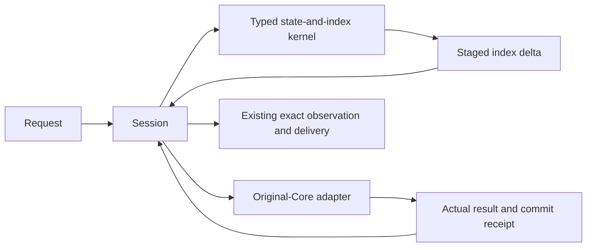

# Architecture and verification checkpoint

**Recommendation:** change the implementation/proof seam before resuming broad
036 implementation. Test a small typed state-and-index kernel with thin session
and original-Core adapters. Preserve exact semantics and all existing evidence.
The proposed simplification is a hypothesis to test, not an established result.

This is a decision memo, not a specification amendment, implementation pass or
new completion claim. Source reviewed: research commit
`d98dadf5d4880c648b6b872e54ef17b64c045558`. No new build or benchmark was needed
for this review. The reported estimate of 200 work hours has not been audited;
the architectural recommendation does not depend on that estimate.

## 1. What has become complicated

There are two separate questions: how much complexity a shipped Core needs,
and how much work this investigation requires to establish its claims. The
current evidence demonstrates substantial investigation complexity. It has
not demonstrated that the resulting product will be small or economical to
maintain.

The current research source inventory is:

| Scope | Files | Lines |
|---|---:|---:|
| Research Rust runtime, including inline tests | 35 | 6,406 |
| `ground.rs` and `views.rs`, including inline tests | 2 | 972 |
| Top-level research Python, including older tools | 216 | 55,523 |
| Dependency Lean files, including helper models and controls | 81 | 7,229 |
| Python controller tests | 149 | 21,978 |

These are scoped source counts, not complexity scores or production-code
totals. Historical tooling is included; it does not all run in a shipped Core.
Nevertheless, the supporting machinery now greatly exceeds the local reuse
implementation. New helper counts are a poor proxy for progress toward a
complete Core.

The active plan also combines several projects: actual Rust/model
correspondence, resource/evidence orchestration, reference/GV/buffering roles,
a separate compact implementation, lifecycle economics and independent
reproduction. It requires 141 timings, 47 diagnostics and 26 reproductions.
Those are investigation deliverables, not all runtime architecture. There are
still 88 open tasks; 65 of 153 are checked. Task counts do not estimate effort.

### Concrete sources of avoidable difficulty

- `Ground` combines authorization, selection, execution, invalidation,
  instrumentation, observation construction and recovery.
- `Views` stores a version map, typed parent/child maps, active-child sets and
  its own history/trust state alongside the Store and Ground. Some duplication
  is justified indexing; every maintained relation still needs an explicit
  invariant and one owner of updates.
- The proof effort traverses actual JSON, collection dictionaries, version
  representations and effects inside that combined path. A small row function
  therefore brings a much wider extraction context.
- Acceptance of the large benchmark campaign waits for full correspondence.
  Diagnostic pilots are already allowed, but they must remain separate from
  accepted measurements. We should use that distinction for early feedback.
- Tool repairs have become a substantial workstream. The latest twenty-root
  result required repairing fresh replay's implicit string-literal dependency
  ordering. That work is reusable evidence; it is not a Core product feature.

The [plan](../plan.md) says to repair tooling and continue, but provides no
explicit economic decision point for a verification method that keeps
expanding. Per-attempt resource limits do not answer that architectural question.

## 2. What complexity the guarantees actually require

The [correctness contract](../contracts/correctness.md) requires the same
complete observations as original Core. A small design must still account for:

1. Exactly which state, program, policy and history were checked.
2. Why unchanged checks remain valid, and why affected dependencies are complete.
3. The requested operation, its first errors and ordered commands.
4. Matching-parent commit, confirmation, uncertainty and invalidation.
5. Complete original output, identities and performed delivery errors.

These obligations survive any redesign. A safe final state alone is insufficient.
An interface, type name, hash or successful finite comparison does not discharge
them. Existing exclusions also remain: no new crypto backend, replay-free
receiver promise, whole-language expansion or Q6 durability claim.

## 3. Smallest architecture worth testing

Use three modules. Keep indexes private and avoid a new plugin framework.

### Typed state-and-index kernel

Its interface covers establishment from checked inputs, selection/staging of an
admitted change, and installation of a matching confirmed change. It owns the
relation between canonical records and derived indexes. Tests and proofs use
this same interface.

The proposed operations are `establish(snapshot, subject)`,
`stage(checked_state, invocation)` and
`confirm(checked_state, staged_delta, actual_receipt)`. Staging returns an
optimization plan or original fallback; it does not invent a refusal.
Confirmation returns the next checked state or a requirement to re-establish.
These describe the interface to validate, not a new implemented Rust interface.

Keep one semantic owner of the current snapshot and its derived data. This
does not mean one physical data structure: indexes are useful duplication.
Each index needs a derivation rule, an exact subject binding and an invalidation
rule. Avoid another independently mutable full state copy used only to argue
that two copies still agree. Whether the existing version copy can actually
be removed must be demonstrated against `Views::apply`, recovery and snapshots.

Represent semantic fields with explicit types inside the kernel. Retain the
complete original payload and metadata in canonical records; a typed view must
not discard other JSON fields or numeric representations. Keep diagnostic JSON,
file I/O, clocks and report assembly outside the kernel's semantic operations.

This milestone is the existing restricted LD8 `finish` fragment. It is not a
proposal to write a second general evaluator. Continue using the original
evaluator and commit implementation wherever the optimization does not change
them. Prove equality of their actual complete arguments and relevant effects.
The contract already permits this same-function congruence.

### Session

The session owns the private Store, current semantic subject and authorization
lifecycle. Callers do not coordinate Ground, Views and prepared-cache flags.
They invoke a session; the session handles selection, original fallback,
confirmation and invalidation.

Ground validity and index availability remain distinguishable. An absent index
can require reconstruction without implying that the underlying ground is
invalid. Both are managed by the same owner and tied to the exact relevant
subject; no external or deserialized checked flag creates authority.

The subject includes behavior/schema/policy identities, the complete history
identity, writer/epoch and relevant context. Equal contents at another event
are insufficient. The session owns the authoritative snapshot and private
index aggregate; kernel operations do not create another authoritative Store.

A staged delta is not an installed child. Only a matching actual acknowledgement
permits installation. Conflict, restart, changed subject or uncertain acceptance
prevents reuse until reconciliation/re-establishment. A confirmed backend change
followed by failed output remains a confirmed change with failed delivery.

### Original-Core adapter

Keep the real original invocation, commit, encoder and hash functions shared.
`observation::execute_original_with_metadata` already provides useful common
execution; preserve that investment. Keep full fallback inputs and outputs.

The adapter transports exact native data between the session, kernel and
original functions. Its parsing, data correspondence, argument equality and
error/effect behavior require actual source-bound proofs. Placing them behind
this interface does not make those obligations disappear. Generic primitives
cannot stand for the desired projection or complete Core result.

Existing output code retains the original serialization/newline/flush/sync
contract. Its physical work is still charged to the legacy endpoint. A smaller
kernel does not establish a faster complete operation or remove required bytes.

## 4. What to keep, consolidate and defer

**Keep:** original oracle and full-byte comparisons; 035 laws and the checked
twenty-root results; original fallback; confirmation/quarantine behavior; pinned
tools, source identities and bounded execution; genuine negative controls.

**Consolidate for the candidate:** move semantic/index operations behind one
kernel interface; centralize subject/authorization management in the session;
keep instrumentation observational; reuse the existing runner and audit path.
Do not create a second controller, new proof-export format, new map framework
or custom serializer for this checkpoint.

**Sequence later:** compact C, generalized language support and the full
comparison/reproduction campaigns. C and the campaigns remain mandatory for
036 completion under the current specification. Sequencing them after a
feasibility decision does not cancel them. Keep early pilots explicitly
diagnostic and unaccepted.

| Option | Assessment |
|---|---|
| Continue extending the current extraction path toward all remaining tasks | Preserves work, but leaves the observed integration-cost problem unanswered. |
| Use model proofs and finite Rust tests as the final assurance | Less work, but does not meet the current actual-code correctness requirement. |
| Test the smaller typed kernel/session/adapter seam with full actual-code obligations | Recommended; potential reduction in proof and maintenance scope remains to be demonstrated. |

## 5. Bounded feasibility decision

**Proposed cap: 16 additional active engineering hours, including at most four
hours of new tooling work.** These are investment limits, not delivery estimates
or an assertion that the work fits. Record cumulative active work, including
repairs, builds, proofs and cleanup; distinguish calendar waiting. No automatic
extension or reset after a failed attempt.

The checkpoint should produce one complete restricted path before further
expansion:

1. **Freeze the seam and obligations.** Map current B01–B10 to actual candidate
   functions. Identify every native dependency and explicit ordinary host
   assumption. Make the expected end-to-end theorem type fixed before checking.
   A smaller export must not hide omitted call nodes.
2. **Establish actual exactness.** Build the real candidate and prove the general
   source/model composition for admitted finite `finish` states, including
   actual fallback and the eight original observations. Reuse existing proofs.
   Require expected-type, axiom and fresh-kernel checks plus genuine wrong-source
   and wrong-result rejection. A model-only or single-fixture proof is not a pass.
3. **Exercise the complete lifecycle.** Compare original/candidate bytes for a
   state-changing finish and the following unchanged-content finish. Exercise
   missing/refused/unsupported input, stale subject, conflict, lost acknowledgement,
   restart and delivery failure. General proof and finite fault controls complement
   each other; neither replaces the other.
4. **Run bounded diagnostic pilots.** Use existing D1/D2/D3 and D5 cells: populations
   2/64/256 at H=8 and population 2 at H=128. Record three full-operation observations
   and separate diagnostics, fresh establishment and direct two-operation totals.
   Keep required bytes/materialization, memory, fallback and maintenance work
   visible. These pilots do not fill primary acceptance slots or establish p95.

The pilot asks whether semantic maintenance is local when dependencies permit
it and where the complete-operation cost remains. Predeclare its slot IDs and
resource allocations. Preserve the existing complete endpoint; report shared
serialization and other population-sized work honestly. There is no new numeric
performance pass threshold chosen after seeing results, and no millisecond
achievement is assumed.

**Continue** only when actual-code exactness and lifecycle controls pass within
the cap and the measured cost structure supports a clear next decision. A correct
but slow candidate can demonstrate architectural feasibility and poor performance;
it cannot support a speed claim. Require one written invariant per maintained
representation, one owner for each update and a complete list of residual costs.

**Reconsider the method** if source correspondence remains open, a new general
toolchain becomes necessary, the tooling allowance is exhausted or the total cap
is reached. Report that failed checkpoint with its evidence and request an explicit
new decision. Do not present it as completed 036 or as a mathematical refutation
of incremental validity. Do not continue accumulating helpers automatically.

## Decision and current status

The architecture checkpoint review is complete. The recommendation is to test
the smaller seam under an explicit cap before resuming broad implementation.
No candidate redesign, checkpoint experiment, specification amendment or budget
extension has been executed by this memo. The current specification, tasks,
historical records and scientific acceptance rules remain unchanged.

The most recent actual success is Native608's twenty helper roots, documented
in [the result](whole-typed-seed-and-kernel-replay-20261128.md). Overall status
remains 65/153 tasks and zero accepted 036 timing/diagnostic/reproduction slots.
This memo supplies an investment decision; it is not a claim that Core is done.
