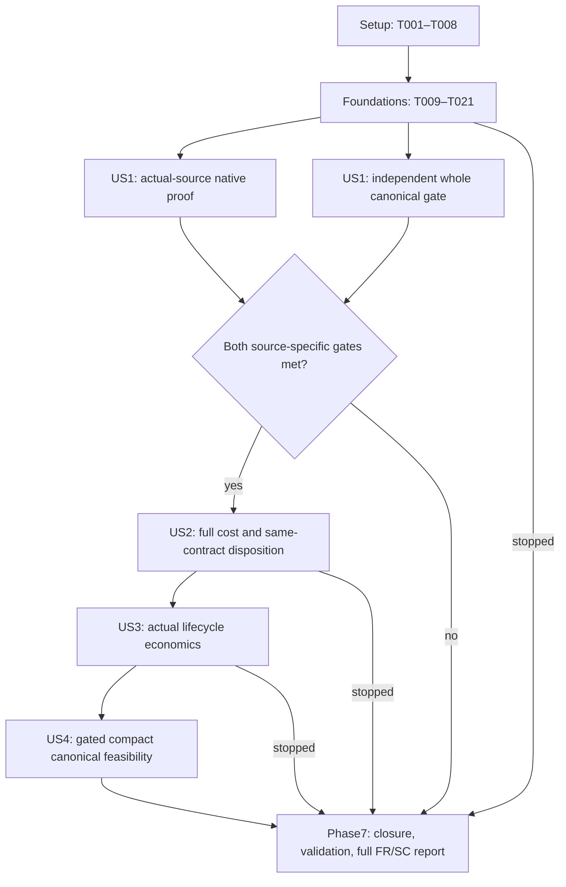

# Tasks: Establish Exact and Efficient Core Transitions

**Input**: Design documents in `specs/036-core-transition-feasibility/`: [specification](spec.md), [plan](plan.md), [research](research.md), [data model](data-model.md), [contracts](contracts/) and [validation guide](quickstart.md).

**Prerequisites**: Those reviewed artifacts and constitution 1.1.0. The logical feature selector is036; actual Git branch remains `research/034-ab-measurement-002`. This file creates tasks only; every checkbox starts unchecked and no experiment/proof/quality result is implied.

**Tests**: Required by the specification and constitution. Author tests first, run them under the inherited recorder and retain an actual expected red before implementing their target; then record green and genuine negative controls. A failing import may establish an absent API, but cannot replace the later actual-code mutant/fault controls.

**Organization**: Seven phases: setup, foundations, four prioritized user stories and final closure. Stories are independently assessable, but downstream accepted experiments deliberately require the preceding proof/quality/evidence gates from the specification.

## Format: `[ID] [P?] [Story] Description`

- Each task has a unique sequential ID, unchecked checkbox and exact repository-relative file/output paths.
- `[P]` marks independent file authoring after that phase's named prerequisites. It does not authorize concurrent heavy execution: all builds/tests/proofs/measurements remain serial under the one recorded CPU/process-group budget. No automatic delegation is required.
- `[US1]`–`[US4]` identify story-specific tasks. Setup, foundation and closure have no story label.
- Explicit prerequisites and the checkpoints below override mere numeric adjacency. A proof failure skips dependent tasks but still permits a safely prepared independent Q attempt and mandatory closure.

## Path Conventions

- New source: `experiments/transition-study036/`; new specification/evidence: `specs/036-core-transition-feasibility/`.
- `experiments/reuse-study035/` and all 035 archives are immutable read-only inputs. Do not create a full historical checkout or clean unrelated files.
- Runtime outputs are create-once declared paths; record actual inputs/outputs, failed attempts, time and bytes. Do not pre-create future digests or silently replace failed samples.
- Quoted validation/field constraints below are copied from `data-model.md`; they are requirements, not defaults left to implementation.

## Execution and completion rules

The first bootstrap execution starts the actual 21600 s clock before any new test/build/proof work. Every subsequent revision and stage inherits that origin and exact limits. Track each elapsed interval in one budget category; Q and proof rechecks consume their own cumulative allowances while global time continues. Stop non-closing work with 1800 s left.

A task requiring a proved bridge or completed run remains unchecked if that result is unmet. A task explicitly requiring an attempt/disposition can complete only after the actual attempt or truthful gate-linked unrun disposition is evidenced. Those markers never make the underlying success criterion pass. Do not mark downstream implementation/proof tasks complete because a blocker was recorded.

At any stop, preserve the last valid source-specific results, record exact dependent unrun slots and execute Phase 7. Q is independently attempted when native sources/tools/CLI are safely available even if the analysis tuple or S1 cannot close. A canonical pass does not substitute for native correspondence, and model proofs do not substitute for a canonical pass.

## Phase 1: Setup (Shared Infrastructure)

**Goal**: Prepare reviewed immutable inputs and start a bounded bootstrap before any new test/build/proof execution. No production changes.

**Independent Test**: The baseline, fixed profile and actual first bootstrap receipt are bound; the new controller cannot choose a new origin.

- [X] T001 Review the pinned 035 report, original observation contract, correspondence inventory, original source/gate inventory and selected prior preservation manifests; record exact immutable refs, Core/Safety revisions, the real 035 cache stop and metadata-only preservation of the two unrelated 033 files in `specs/036-core-transition-feasibility/inputs/baseline.json`; do not scan or copy the full historical archive.
- [X] T002 [P] After T001, author `experiments/transition-study036/profiles/diagnostic.json` with the frozen 21600 s clock, S0/S1/Q/S2/S3/S4/S5 caps 1200/5400/2400/1800/5400/3600/1800 s, 900 s ordinary child cap, 1800 s proof/canonical child exceptions, 1800 s closing reserve, one CPU/heavy group, 8 GiB/process, 6/2/1 GiB cache/evidence/temp and 8 GiB combined ceilings, 16 GiB launch/4 GiB stop floors, exact owned roots, warm tool/cache conditions and every required/conditional slot; no execution yet.
- [X] T003 [P] After T001, independently author exact finish/refusal/first-error/ordered-command/history facts and the five diagnosis plus three lifecycle family definitions in `experiments/transition-study036/expected/facts.json` and `specs/036-core-transition-feasibility/inputs/workloads.json`; preserve the original LD8 bytes/policies and state which outputs still require independent oracle execution.
- [X] T004 Write adoption/overwrite/wrong-boot/reset-clock/profile-binding/disk-root failing cases in `experiments/transition-study036/tests/test_bootstrap.py` against the planned bootstrap API; do not execute them until T005 starts the controlled clock.
- [X] T005 Use the unchanged reviewed `experiments/reuse-study035/recorder.py` with explicit 036 growth/disk callbacks and its stricter 900 s/2 GiB/2 GiB/4 GiB bootstrap limits to execute T004 and retain the actual red logs/first start/boot in `specs/036-core-transition-feasibility/evidence/development/bootstrap/receipt.json`; enforce the 036 4 GiB disk guard, retain the true `core035.bounded.v1` tool identity, and never use 035 default output roots or an old receipt.
- [X] T006 Implement tested bootstrap adoption/profile binding and preflight entry in `experiments/transition-study036/bootstrap.py` and `experiments/transition-study036/study.py`; make T004 green under the inherited clock, refusing overwrites/new origins and charging all bootstrap time to S0; retain actual red/green evidence under `specs/036-core-transition-feasibility/evidence/development/bootstrap-checks/`.
- [X] T007 [P] After T006, create standalone edition 2024 native/oracle manifests and exact locks at `experiments/transition-study036/Cargo.toml`, `experiments/transition-study036/Cargo.lock`, `experiments/transition-study036/oracle/Cargo.toml`, `experiments/transition-study036/oracle/Cargo.lock`; reuse pinned 035 dependency versions, stable Rust/Cargo 1.98.1 and Python 3.13.15; declare only initial R/GV bins and copy reviewed pinned lock inputs without a build; defer actual locked resolution to T020 after the selective source export exists. No buffered/compact implementation yet.
- [X] T008 [P] After T006, document registered source/tool/build/temp ownership, retained binaries, original-versus-experimental endpoints and no production adoption in `experiments/transition-study036/README.md` and `experiments/transition-study036/.gitignore`; keep 035 sources/evidence and unrelated files outside all cleanup roots.

**Checkpoint**: All actual attempts and accepted outputs in this phase are recorded under the existing clock; no future result is implied.

---

## Phase 2: Foundational (Blocking Prerequisites)

**Goal**: Build the small tested recorder, typed records, selective export and source-revision machinery needed to run any story safely.

**Independent Test**: Actual red/green receipts establish parsers, process/resource control and revision-sensitive prerequisites; S0 separately reports native readiness and analysis-tool availability.

- [ ] T009 [P] Write strict required-field, null/reason, enum, overflow/boundary and malformed-JSON tests in `experiments/transition-study036/tests/test_records.py`; cover every constraint of `data-model.md`, including duplicate keys, trailing content and unknown fields; author only, then observe red under the bootstrap before implementing the target.
- [ ] T010 [P] Write wrong-boot/clock-reset, cumulative-stage/global deadlines, closing reserve, fast-child final-growth check, detached descendants, disk/cache stop and cleanup-ownership tests in `experiments/transition-study036/tests/test_recorder.py`; author independently after Phase 1 and run serially under the inherited recorder before target implementation.
- [ ] T011 [P] Write missing/empty Git-index, missing canonical fixture, changed lock/tool/source, path/symlink escape and selective-preservation tests in `experiments/transition-study036/tests/test_sources.py`; include refusal to read executable/verifier paths from supplied evidence.
- [ ] T012 [P] Write native protocol tests in `experiments/transition-study036/tests/protocol.rs` for fixed roles, bounded requests, invalid versions/unknown fields and supplied checked flags; require an explicit failing run before `experiments/transition-study036/src/protocol.rs` implementation.
- [ ] T013 [P] Write CLI contract and source-sensitive gate tests in `experiments/transition-study036/tests/test_supervisor.py`: S1 failure still permits a safe independent Q attempt, unmet S1/Q blocks S2–S4, source changes invalidate dependencies, corrections inherit limits and failed slots cannot be replaced; exercise exit 0/1/2/3 separately.
- [ ] T014 After actual red for T009, implement `experiments/transition-study036/records.py` and `experiments/transition-study036/schemas/records.json` with the verbatim constraints "Each record has `format`, `campaign_id`, `revision_id`, `case_id`, `role`, `outcome`, `product_adoption: "unactivated"`, exact input references and, for unavailable/blocked work, `reason` and `blocking_ref`." and "unavailable measurements use `null` plus a nonempty reason." Enforce "UTF-8 IDs ≤ 256 bytes; relative paths ≤ 1024 bytes; ordinary control records ≤ 4 MiB; one full original/compact/reconstruction document ≤ 64 MiB; controller input/closure manifests ≤ 32 MiB with ≤ 20000 references." and "A request stream has ≤ 128 operations; supported diagnosis N ≤ 256 and initialH ≤ 128." Retain green evidence; do not turn experimental parser bounds into theorem bounds.
- [X] T015 After actual red for T011, implement create-once byte-bound refs in `experiments/transition-study036/artifact_io.py`: "An artifact reference is `{path, bytes, sha256}` relative to its independently chosen owned root." and "Reject absolute paths, `..`, symlink escapes, duplicate JSON keys, trailing content, unknown versions, unexpected fields, truncated records and missing/changed parents." Validate bytes before interpretation and stream verification; hashes grant no authority.
- [ ] T016 After actual red for T010, adapt the reviewed recorder into `experiments/transition-study036/recorder.py` with bootstrap-origin adoption, exact profile limits, once-per-second process/growth observations, unique-inode byte accounting, end-of-run cap checks, closed descendant trees and strictly owned post-closure cleanup; retain overshoot/unavailable aggregate-memory reasons and green receipts.
- [ ] T017 Implement tested selective Git-object export, complete nonempty private Git root/index, canonical input inventory, source/lock/tool binding and preservation checks in `experiments/transition-study036/sources.py` and `experiments/transition-study036/preservation.py`; start from all 1,634 source files from 035 including 19 extra gate files and explicitly include every 036 dependency, without modifying 035 or taking a whole checkout.
- [ ] T018 After red for T012, implement typed exact-version native records and errors in `experiments/transition-study036/src/protocol.rs` and `experiments/transition-study036/src/error.rs`; retain "mode (`timing` or `diagnostic`)" and fixed source-selected roles, all shared field bounds from T014, no checked-flag imports, typed errors and no unjustified unsafe/unwrap; declare `#![forbid(unsafe_code)]` in `experiments/transition-study036/src/lib.rs` and make the tests green.
- [ ] T019 After red for T013, implement `preflight/prepare/freeze/run/collect` dispatch and source-sensitive prerequisite checks in `experiments/transition-study036/study.py` and `experiments/transition-study036/campaign.py` per `contracts/cli.md`; preserve "Transitions: `declared → materialized → frozen → built`; failure is retained." and "Acceptance is `met`, `unmet` or `blocked`, separately from operational completion." Future collection may initially be a typed unimplemented operation, never false success; make foundation contract tests green.
- [X] T020 Execute bounded S0 source/native-tool preparation, actual source-ready locked/offline dependency resolution and the analysis host-tool availability attempt into `specs/036-core-transition-feasibility/evidence/campaign-001/roles/preparation/` and `experiments/transition-study036/toolchain.json`; bind Aeneas `1dc8ad31b1b062a77c50e29144a6c7bba955fa09`, Charon `454586e9b770231e66d2062993e632dfc06463e2`, extraction compiler `nightly-2026-09-17` and Lean `4.36.0-rc2` and their pinned build closure separately from native stable/Lean 4.30.0; prohibit hidden global cache growth and all-cross-target installation; retain unavailable/stopped outcomes.
- [ ] T021 Freeze actual existing baseline/profile/source/tool/control bytes in `specs/036-core-transition-feasibility/inputs/r001.json` and `specs/036-core-transition-feasibility/evidence/campaign-001/revisions/r001/input-manifest.json`; complete an S0 disposition in `specs/036-core-transition-feasibility/evidence/campaign-001/roles/preparation/result.json`, distinguishing safe native/Q readiness from unavailable analysis tools; no future output hash, invented build receipt or resetting the adopted origin.

**Checkpoint**: All actual attempts and accepted outputs in this phase are recorded under the existing clock; no future result is implied.

---

## Phase 3: User Story 1 — Know what the running implementation actually proves (Priority: P1) — MVP

**Goal**: Close actual restricted native correspondence if feasible and independently attempt the entire canonical quality gate. Deliver a source-specific rework decision if either requirement cannot be met.

**Independent Test**: A fresh source-bound B01–B10 proof/type/axiom check rejects real mutants; the unchanged full gate has its own actual closed receipt. A small extracted helper, model-only theorem or scoped test pass cannot satisfy either missing obligation.

**Entry gate**: Foundation readiness; Q needs safe native preparation, while proof work additionally needs the actual analysis tuple.

### Tests for User Story 1

Author these first; retain an actual red before implementing their targets, then green and real negative controls.

- [ ] T022 [P] [US1] Write actual-source/expected-type/transitive-axiom/unsupported-opaque/extraction-cfg canary tests in `experiments/transition-study036/tests/test_correspondence.py`; include a wrong projection, safe-but-wrong result, wrong encoder context, changed source and target-equivalence axiom controls C01/C02/C04/C09; record red before the proof driver accepts anything.
- [ ] T023 [P] [US1] Write original-comparison and private-ground tests C01–C08 in `experiments/transition-study036/tests/native_exactness.rs` covering exact selector, empty/new membership dependencies, first errors, duplicate commands, stale equal-content history, unsupported fallback, views and uncertain commits; require failures before native adapters are introduced.
- [ ] T024 [P] [US1] Write independent oracle/bootstrap and eight-field observation comparison tests in `experiments/transition-study036/tests/oracle_contract.rs`, using T003 rather than candidate-selected answers; distinguish direct original Safety reports from derived outcome provenance.
- [ ] T025 [P] [US1] Write canonical-gate contract tests in `experiments/transition-study036/tests/test_quality.py` for nonempty exact Git inventory, actual candidate CLI, empty initial gate target, unchanged full script/all labels/terminal success, partial/resource failure and source invalidation; keep Q independently runnable after an S1 failure.
### Implementation for User Story 1

- [X] T026 [US1] After T023 red, adapt exact 035 selected code into a new 036-owned working export (never edit an already frozen revision) and `experiments/transition-study036/src/ground.rs`, `experiments/transition-study036/src/observation.rs`, `experiments/transition-study036/src/bin/reference.rs`, `experiments/transition-study036/src/bin/reuse.rs`; preserve process-private constructors and the verbatim transitions "`unverified → established` only through actual original establishment under the declared authority contract." and "`pending → established(child)` only after confirmed matching acceptance and proved preservation." Quarantine uncertain/conflicting child states, use the same `Store<Capture>`, original error/command behavior and exact fallback; no new optimization.
- [ ] T027 [US1] After T024 red, implement unpatched original oracle preparation/replay in `experiments/transition-study036/oracle/src/main.rs` and exact original fixture loading in `experiments/transition-study036/src/fixtures.rs`; independently produce all eight expected fields for the frozen diagnosis/session streams without requiring a prepared manifest before it exists or importing candidate verification flags.
- [ ] T028 [US1] Inventory exact source functions/cfg/monomorphizations and call dependencies for B01–B10 in `specs/036-core-transition-feasibility/inputs/correspondence.json` and `specs/036-core-transition-feasibility/inputs/proof-contract.json`; bind expected statements, justified trusted compiler/backend/writer premises and actual projection/encoding/commit seams, with "Statuses: `proved_for_declared_subject`, `checked_conformance_only`, `explicit_external_premise`, `unestablished`, `refuted`, `not_run`." Initial gaps must remain unestablished; no equivalent-result assumption.
- [ ] T029 [US1] After T022 red, implement pinned exact-source extraction/proof/type/axiom checking in `experiments/transition-study036/extract.py` and `experiments/transition-study036/check_proofs.py`; bind generated files to the real source/cfg/tool tuple, audit all opaque declarations and reject edited generated functions, `sorryAx`, desired-equivalence axioms, unsupported dependencies or handwritten native substitutes; make positive/negative checker controls green.
- [X] T030 [US1] After T025 red, implement `experiments/transition-study036/quality.py` to run the entire unchanged private Core `scripts/gates.sh` with the actual retained `BEHAVIOR_BIN`, separate initially empty gate target and pinned environment; require exit 0, `gates: OK`, full logs and empty descendants, recording canonical and scoped research/proof results separately; no inherited035 exception.
- [ ] T031 [US1] Freeze the actual current native adapters/proof-contract inputs into a new inherited revision, build and retain R/GV, unpatched oracle and candidate CLI with source/tool/cfg/executable receipts in `specs/036-core-transition-feasibility/evidence/campaign-001/roles/build/`; implement `experiments/transition-study036/src/source_identity.rs`, verify one patched Core identity per worker and independent original oracle identity, and create the prepared manifest only from actual built/oracle outputs. Retain binaries before any owned cache cleanup.
- [ ] T032 [US1] Replay the unchanged twelve035 model roots from `experiments/transition-study036/proofs/original035/` under pinned Lean 4.30.0 into `specs/036-core-transition-feasibility/evidence/campaign-001/roles/original-proof-replay/`; check exact types/transitive axioms/fresh kernels and state explicitly that these are old model laws, not new native closure.
- [ ] T033 [US1] Run the≤1800 s actual-source extraction/projection-or-view probe and a genuine wrong-source canary into `specs/036-core-transition-feasibility/evidence/campaign-001/roles/correspondence/probe/` within S1; include real JSON/collection/dependency closure. If tool/source support or source/cfg binding fails, retain the exact blocker, leave dependent proof work unchecked, attempt safe Q via T042 and proceed to Phase 7 without performance/compact implementation.
- [ ] T034 [US1] Only after T033 feasibility, define and prove B01/B02 native-context/selector/projection relations against actual generated source in `experiments/transition-study036/proofs/Correspondence036/Relation.lean`; include original request/capture/metadata/history/row/version/error domains and "Any restrictions must be enforced by the real selector." Do not replace actual native code by a new model function.
- [ ] T035 [US1] After T034, prove B03/B04 establishment, exact-subject authorization, pending view updates and canonical reconstruction in `experiments/transition-study036/proofs/Correspondence036/GroundViews.lean`; cover stale/missing/changed dependencies and "Restart/transfer yields `unverified`; no serialized checked flag reactivates a ground."
- [ ] T036 [US1] After T034, prove B05/B06 actual prepared evaluation/fresh envelope exactness, first errors, refusals, commands and original Safety projection/preservation in `experiments/transition-study036/proofs/Correspondence036/EvaluationSafety.lean`; use source-bound native relations and justified premises, not an assumed safe or equal child.
- [ ] T037 [US1] Prove B07/B08 complete native observation construction and actual original output/error contract in `experiments/transition-study036/proofs/Correspondence036/Observation.lean`; use shared-function congruence only after proving identical native functions, equal complete arguments and equivalent effects/errors; cover every original field and canonical identity without assumed encoder fidelity.
- [ ] T038 [US1] Prove B09 exact-parent Store/Capture publication and confirmed-only child promotion, including conflict/precommit/lost-ack reconciliation, in `experiments/transition-study036/proofs/Correspondence036/Publication.lean`; state external writer/backend/compiler premises explicitly and retain the actual memory-only boundary.
- [ ] T039 [US1] Compose B01–B09 into the whole admitted native B10 observation theorem in `experiments/transition-study036/proofs/Correspondence036/Exact.lean`; cover arbitrary finite representable states and original fallback, with no fixed experimental N/H bound or required-equivalence axiom; update exact theorem/axiom/dependency inventory in `specs/036-core-transition-feasibility/inputs/proof-contract.json`.
- [ ] T040 [US1] Freeze the actual completed proof/source revision and run fresh extraction/type/transitive-axiom/kernel checks and real-code proof canaries into `specs/036-core-transition-feasibility/evidence/campaign-001/roles/correspondence/full/`; every B01–B10 has checked source-bound evidence or an explicit unmet gap. A successful probe or old twelve-root check must not mark SC-001 met.
- [ ] T041 [US1] Execute C01–C09 and native/oracle exactness tests against actual retained workers into `specs/036-core-transition-feasibility/evidence/campaign-001/roles/conformance/`; compare complete `invocation`, `bundle`, `commit_arguments`, `transition_record`, `before_history`, `after_history`, `post_state`, `original_property_outcomes`, actual commands/errors/identities and original Safety outcomes, with deterministic replay; finite equality remains distinct from proof.
- [ ] T042 [US1] Independently run full canonical and scoped quality via T030 against the actual current native candidate into `specs/036-core-transition-feasibility/evidence/campaign-001/roles/quality/`, even when T033 or T040 failed if native preparation remains safe; use all unchanged workspace, validation-work, determinism, boundary/surface/consumer/workflow/terms/shell gates. Record exact failed/unrun steps; only real full success satisfies SC-002.
- [X] T043 [US1] Emit source-specific native/quality verdicts and prerequisite refs in `specs/036-core-transition-feasibility/evidence/campaign-001/roles/assurance/result.json`; missing bridge or Q failure leaves downstream S2–S4 blocked and triggers Phase 7. Keep SC-001 and SC-002 separate; never mark a proof task complete merely because an explicit gap was recorded.

**Checkpoint**: If the probe/full bridge or Q is unmet, leave dependent proof/experiment work unchecked, retain both independent verdicts and jump to Phase 7. If both pass, only the exact covered source may advance.

---

## Phase 4: User Story 2 — Find where a complete ordinary transition spends its work (Priority: P1)

**Goal**: Explain actual complete cost and test the simplest justified same-contract improvement before changing the format.

**Independent Test**: Five equal-guarantee R/GV cells have complete original equality, reconciled same-operation intervals and work units. Any buffered candidate has its own proof, activation and full quality result, or an explicit unsupported/unjustified disposition.

**Entry gate**: US1 source-specific native correspondence, complete original conformance and canonical quality must be met.

### Tests for User Story 2

Author these first; retain an actual red before implementing their targets, then green and real negative controls.

- [ ] T044 [P] [US2] After met US1 prerequisites, write interval-tree and quantity tests C11 in `experiments/transition-study036/tests/intervals.rs` and `experiments/transition-study036/tests/test_costs.py`; reject overlap/out-of-parent spans, negative remainder, double-counted nested invoke/commit, median-subtraction phases and unavailable-as-zero quantities; author before implementation.
- [ ] T045 [P] [US2] Write create-new/collision, exact bytes/newline, short-write/write/flush/sync failure and uncertain-delivery tests C12 in `experiments/transition-study036/tests/output.rs`; test actual wrapper behavior and performed error contracts, not hypothetical failure counts of omitted syscalls.
- [ ] T046 [P] [US2] Write fixed-role/mode equality and C10 disabled/label-only mechanism tests in `experiments/transition-study036/tests/mechanisms.rs`; require actual call/work activation evidence beyond distinct executable hashes and no extra diagnostic serialization in accepted timing mode.
### Implementation for User Story 2

- [ ] T047 [US2] After actual T044 red, implement `experiments/transition-study036/src/intervals.rs` and `experiments/transition-study036/quantities.py`; enforce "Siblings in an exclusive attribution are disjoint and contained in the parent; repeated spans may share a phase label but not an ID." and "Invariant: complete duration equals exclusive classified work plus an explicit nonnegative remainder." Quantities have `value`, `unit`, `scope`, `method`, `reason_if_unavailable`; keep sampled/direct-child RSS and payload proxies distinct from allocation/aggregate peaks.
- [ ] T048 [US2] After T046 red, add reviewed source-bound diagnostic hooks in `experiments/transition-study036/src/observation.rs`, `experiments/transition-study036/src/ground.rs`, `experiments/transition-study036/src/output.rs` and `experiments/transition-study036/patches/phase-accounting.patch`; distinguish semantic/maintenance/materialization/observation/identity/copy/commit/encoding/write/sync/check work and true unclassified remainder. Count write-interface calls as calls, OS syscalls only with actual tracing; timing mode must avoid counter-only materialization.
- [ ] T049 [US2] Freeze the instrumented source revision, reclose affected B01–B10/S1 and fullQ, and execute mode/original-result/activation controls before accepted samples; retain all exact receipts in `specs/036-core-transition-feasibility/evidence/campaign-001/roles/diagnosis-gates/`. Missing budget or correctness blocks this revision rather than reusing old gates.
- [ ] T050 [US2] Run five R/GV diagnosis cells `(2,8),(64,8),(256,8),(2,32),(2,128)` into `specs/036-core-transition-feasibility/evidence/campaign-001/roles/diagnosis/`:30 timing+10separate diagnostic observations, each with actual fresh acquisition and primary/same-process continuation; use frozen rotated order and exact complete output/sync/endpoint checks, retaining direct enclosing totals and every failed slot.
- [ ] T051 [US2] Implement tested raw-derived accounting/median/min/max tables in `experiments/transition-study036/costs.py` and emit `specs/036-core-transition-feasibility/evidence/campaign-001/roles/diagnosis/tables.json`; reconcile each actual complete interval with exclusive spans/remainder and report copied/hashed/encoded/written bytes and actual methods/unknowns. Do not relabel triplets as latency quantiles or treat943,530 two-operation bytes as one-operation output.
- [ ] T052 [US2] Use measured write/encoding/synchronization and remaining complete costs to freeze a same-contract candidate disposition in `specs/036-core-transition-feasibility/inputs/buffer-decision.json`; select the 64 KiB buffered candidate only if justified, otherwise give an evidence-backed no-candidate reason and leave its implementation/run tasks explicitly conditional, not successful.
- [ ] T053 [US2] Only if T052 selectsB, author expected byte-stream/protocol theorem and wrong-wrapper/hidden-flush canaries in `experiments/transition-study036/proofs/Correspondence036/OutputBufferContract.lean` and `experiments/transition-study036/tests/test_buffer_correspondence.py`; observe intended red before implementingB and its proof; use T045 faults as actual code controls.
- [ ] T054 [US2] After T053 and T045 actual red, implement fixed 64 KiB buffering in `experiments/transition-study036/src/output.rs` and `experiments/transition-study036/src/bin/buffered.rs`; preserve the same serializer argument/bytes/newline, create-new, explicit successful flush before underlying `sync_all`, actual typed errors and quarantine/reconciliation after uncertain already-applied delivery. Keep all allocation/flush work in completion.
- [ ] T055 [US2] Prove actual-source B08 buffer protocol/byte/error relation and composed observation equivalence in `experiments/transition-study036/proofs/Correspondence036/OutputBuffer.lean`; bind the real wrapper and serializer/native arguments, freshly check the changed closure and canaries. Byte comparisons alone do not satisfy this proof task.
- [ ] T056 [US2] Freeze B's actual source/binary/proof revision, rerun affected S1/fullQ and C10/C12 activation/fault/mode/original comparisons into `specs/036-core-transition-feasibility/evidence/campaign-001/roles/buffer-gates/`; decline B timing if any prerequisite or Q cumulative budget is missing.
- [ ] T057 [US2] Freeze balanced B/R/GV comparison slots and exact revision/cache context before measurements in `specs/036-core-transition-feasibility/inputs/buffer-comparison.json`; execute B's five-cell15timing+5 diagnostic observations and explicitly named matched R/GV anchors into `specs/036-core-transition-feasibility/evidence/campaign-001/roles/buffer-comparison/` withinS 2, retaining original baseline slots and reporting extra anchor counts separately; no replacement or claim of a simultaneous035 factorial experiment.
- [ ] T058 [US2] Independently recompute interval/byte/mode/mechanism accounts from actual R/GV/eligibleB observations into `specs/036-core-transition-feasibility/evidence/campaign-001/roles/diagnosis/accounting-check.json`; reject missing mandatory output, moved acquisition/maintenance, double counting, unmeasured syscalls or a smaller component presented as complete-operation gain.
- [ ] T059 [US2] Emit separate remaining-cost causes, same-contract candidate correctness/complete-cost/retention outcomes and justified next-format question in `specs/036-core-transition-feasibility/evidence/campaign-001/roles/diagnosis/result.json`; give measured evidence or explicit gaps for FR-007–FR-011/SC-003 and no new numerical gain claim when cells are stopped or confounded.

**Checkpoint**: Direct complete-cost accounting and a justified same-contract disposition exist; optional B work is not fabricated if unjustified or blocked.

---

## Phase 5: User Story 3 — Know when retained verification pays for itself (Priority: P2)

**Goal**: Measure real session economics, memory/retention and authority loss/recovery, without synthetic break-even arithmetic.

**Independent Test**: R/GV have three direct observations at all four lengths for changing, explicitly unchanged-content and invalidated families, with acquisition/audit and actual recovery/retention accounts. Each family remains independently inspectable.

**Entry gate**: US1 gates plus the US2 complete-cost/same-contract disposition for the relevant source.

### Tests for User Story 3

Author these first; retain an actual red before implementing their targets, then green and real negative controls.

- [ ] T060 [P] [US3] Write session/stream tests in `experiments/transition-study036/tests/sessions.rs` for lengths 1/8/32/128,128distinct active children atN256, first-change/remaining-unchanged atN2, midpoint invalidation, genuine resident program authority and fresh independent grounds; cover request caps and cold/resident endpoint distinctions before runner implementation.
- [ ] T061 [P] [US3] Write stale/wrong-parent/context/policy/missing-view/refusal/precommit/conflict/lost-ack/restart tests in `experiments/transition-study036/tests/recovery.rs`, asserting actual head reconciliation before reuse, no unconfirmed child promotion and original-equivalent continuation; use genuine code faults C07/C08.
- [ ] T062 [P] [US3] Write direct-session/plus-audit/retention/payback aggregation tests in `experiments/transition-study036/tests/test_lifecycle_costs.py`; reject sums of independent medians, unobserved crossover claims, stopped-as-zero samples, no-ops called changes, and setup charged differently to R/GV.
### Implementation for User Story 3

- [ ] T063 [US3] After T060 red, implement session/workload records in `experiments/transition-study036/src/session.rs` and `experiments/transition-study036/schemas/sessions.json` with exact family/length, replicate/mode, worker/program-context receipt, fresh acquisition, ordered operation refs, invalidation/recovery, actual final head and direct endpoints; preserve "No state ground crosses independent sessions." and all common request/field bounds.
- [ ] T064 [US3] Implement the tested frozen stream runner in `experiments/transition-study036/src/session.rs`: each replicate actually checks its resident program context once, streams required per-operation output for fresh sessions, directly times cold worker/first-session and nested resident acquisition-through-end endpoints, and never imports a context flag or synthesizes cold totals; fix F-change/L=1 first and reversed R/GV launch order.
- [ ] T065 [US3] After T061 red, implement timed invalidation/quarantine/reconciliation/re-establishment in `experiments/transition-study036/src/recovery.rs`; apply the same frozen revoke boundary before `floor(L/2)+1` (operation 1 forL1), retain actual precommit/conflict/Applied-then-lost-ack outcomes and restart raw-data authority loss; do not infer disk crash recovery.
- [ ] T066 [US3] Implement bounded session memory/retention observations in `experiments/transition-study036/src/session.rs` and `experiments/transition-study036/session_resources.py`; account for state/views/history/result/recipe data at acquisition, declared boundaries and end, stream evidence rather than retain it all in RAM, and report unavailable allocator/shared-peak quantities as `null` plus reasons.
- [ ] T067 [US3] Prove repeated actual native session/ground advancement and invalidation/recovery composition against the existing checked per-step relation in `experiments/transition-study036/proofs/Correspondence036/Sessions.lean`; bind the real runner and request/context relation, preserve first errors/commands and do not assume verified authority after restart or uncertain acknowledgement.
- [ ] T068 [US3] Freeze current session/recovery sources and reclose affected native/proof/fullQ/mode/conformance gates into `specs/036-core-transition-feasibility/evidence/campaign-001/roles/lifecycle-gates/`; ensure actual session loop/endpoint logic is covered, not just the old single-step helper, before accepted lifecycle observations.
- [ ] T069 [US3] Run all 12family/length R/GV cells, 72 timing+24 diagnostic sessions, into `specs/036-core-transition-feasibility/evidence/campaign-001/roles/lifecycle/`; retain direct fresh acquisition-through-last-required-output and enclosing final-audit totals, cold-worker context cost, observed memory/retention and actual original endpoint comparisons, preserving stopped slots.
- [ ] T070 [US3] Execute the frozen recovery/fault families at a small supported cell and N=256/H=8 where cost is claimed into `specs/036-core-transition-feasibility/evidence/campaign-001/roles/recovery/`; measure actual recovery/reacquisition and continuing original equality, identify unavailable guarantees/costs, and keep these controls separate from uninterrupted session payback.
- [ ] T071 [US3] After T062 red, implement direct observed-session comparisons in `experiments/transition-study036/lifecycle_costs.py` and emit `specs/036-core-transition-feasibility/evidence/campaign-001/roles/lifecycle/tables.json`; report each family/endpoint's raw totals, medians/ranges, acquisition, maintenance, memory, retention and audit, and only actually observed payback at tested lengths.
- [ ] T072 [US3] Emit FR-012–FR-014/SC-004 coverage and uninterrupted/invalidated lifecycle conclusions into `specs/036-core-transition-feasibility/evidence/campaign-001/roles/lifecycle/result.json`; no observed saving is a valid result, unavailable cells leave criteria unmet, and the 035 four-operation estimate remains labelled unmeasured historical arithmetic.

**Checkpoint**: Each real session family/length has actual comparable totals or explicit missing cells; observed payback and cold/resident guarantees are separate.

---

## Phase 6: User Story 4 — Decide whether compact transition evidence is justified (Priority: P2)

**Goal**: After accepted prerequisite evidence, attempt only the minimal versioned compact canonical transition with actual exact reconstruction and explicit identity/availability boundaries.

**Independent Test**: The actual compact implementation and reconstruction have general checked source-bound theorems, complete original equality, negative availability/identity controls and direct transition-plus-audit costs. A transport-only wrapper does not establish canonical compaction.

**Entry gate**: US1 gates, completed US2/US3 assessment and a justified remaining compact question; the exact contract must freeze before prototype implementation.

### Contract entry for User Story 4

- [ ] T073 [US4] After met S1/Q and completed T059/T072, freeze the exact compact JSON schema/byte grammar/escaping/numeric domain, recipe, commitment preimages, identity mappings, retained-input lifetime and completion contract in `specs/036-core-transition-feasibility/inputs/compact-contract.json` and `specs/036-core-transition-feasibility/inputs/compact-proof-contract.json` before prototype implementation; use `core036.compact-transition.v1`/`core036.finish-recipe.v1`, with incidental source/tool/proof/cache/timing provenance outside canonical event/history identity.
### Tests for User Story 4

Author these first; retain an actual red before implementing their targets, then green and real negative controls.

- [ ] T074 [P] [US4] Write compact canonicalization/version/subject/parent/schema/DAG and unknown-field bound tests in `experiments/transition-study036/tests/compact_contract.rs`; compare exact independently authored preimages and preserve ordered duplicate commands; author before prototype record implementation.
- [ ] T075 [P] [US4] Write full eight-field reconstruction plus missing/corrupt/substituted input, wrong recipe/parent/context and forged-validator-provenance tests C13 in `experiments/transition-study036/tests/reconstruction.rs`; no data availability failure may return exact success or mint authority.
- [ ] T076 [P] [US4] Write actual compare-and-advance/precommit/conflict/lost-ack, early eviction/process-lifetime loss, identity alias/cache-dependent identity and hidden full-legacy-materialization controls C14 in `experiments/transition-study036/tests/compact_backend.rs`; distinguish transport-only wrappers from a canonical compact commit.
### Implementation for User Story 4

- [ ] T077 [US4] After T074 red, implement frozen canonical compact record/identity types in `experiments/transition-study036/src/compact_record.rs` and `experiments/transition-study036/schemas/compact.json`; bind exact program/semantic context, expected parent, original request/context/metadata, outcome/error/commands, state delta, state commitment, recipe/inputs/availability and experimental child; apply shared64MiB/input/ID bounds, acyclic self-excluding commitment equations and canonical-only identity.
- [ ] T078 [US4] After T075 and T076 red, implement `experiments/transition-study036/src/retained_inputs.rs` with the verbatim rules "References describe an acyclic dependency graph." and "A record cannot bind its own future hash; inputs must exist before the child completion that promises their availability." Bind exact immutable reconstruction basis/module/policy/context/metadata and lifetime; no unbound cache, early eviction or hidden per-step full original snapshots.
- [ ] T079 [US4] Implement the minimal restricted experimental memory compare-parent/apply/record/input-availability commit contract in `experiments/transition-study036/src/compact_backend.rs`; preserve semantic state/version/refusal/error behavior and confirmed-only advancement under an explicit proof relation, without modifying production Store. Calling full legacy commit underneath must be labelled transport-only and cannot satisfy avoided-materialization claims.
- [ ] T080 [US4] Implement gated fixed-role `experiments/transition-study036/src/bin/compact.rs` and `experiments/transition-study036/src/compact.rs` over the actual compact backend, binding exact parent/request/context/result/commands/delta and verified retained inputs; measure compact completion only after actual acknowledgement and required output delivery, with full provenance sidecars and no implicit legacy-ground cast.
- [ ] T081 [US4] Implement actual deterministic original-observation reconstruction in `experiments/transition-study036/src/reconstruct.rs` using only verified bound inputs and independently expected subject; preserve "`exact_success` requires complete verified inputs and all contract checks; `missing_input`, `corrupt_input`, `wrong_subject`, `unsupported_version` or `mismatch` never certifies success or creates authority." Produce honest original/derived provenance and applicable exact legacy bytes/identities.
- [ ] T082 [US4] Prove source-bound compact/native semantic-state, exact transition/error/command and confirmed commit/availability preservation in `experiments/transition-study036/proofs/Correspondence036/Compact.lean`; connect actual new code to the original reference relation for arbitrary admitted finite states, without assuming a safe/equal child or applying035's legacy-history theorem by identity cast.
- [ ] T083 [US4] Prove the general actual-code reconstruction theorem and semantic/state/event/history/transport identity equalities or explicit mappings in `experiments/transition-study036/proofs/Correspondence036/Reconstruction.lean` and `experiments/transition-study036/proofs/Correspondence036/Identity.lean`; bind all eight original fields/encoders/context and ordered commands, distinguish deferred legacy identity computation and freshly check the full closure, not finite examples alone.
- [ ] T084 [US4] Freeze the actual compact/reconstruction proof/source revision and execute expected-type/transitive-axiom/fresh-kernel checks, full independent original comparisons and C13/C14 actual-code controls into `specs/036-core-transition-feasibility/evidence/campaign-001/roles/compact-proof/`; unsupported bridges or missing reconstruction proof leave S4 unmet.
- [ ] T085 [US4] Execute actual missing/substituted data, attempted early eviction, conflict/precommit/lost-ack and memory/process-lifetime availability scenarios into `specs/036-core-transition-feasibility/evidence/campaign-001/roles/compact-availability/`; verify no false exact-success/child authority and record the memory-only crash boundary, never file-sync-as-durability.
- [ ] T086 [US4] Run current native/source/reconstruction/activation/mode gates and full canonical plus scopedQ against the actual compact candidate in `specs/036-core-transition-feasibility/evidence/campaign-001/roles/compact-gates/`; all counters must show the intended canonical path and retained dependency closure before accepted compact timing.
- [ ] T087 [US4] Use only prior S2/S3 evidence to freeze best eligible legacy role, numerical feasibility/selection thresholds, exact endpoints/guarantee differences, balanced comparison order and conditional case slots in `specs/036-core-transition-feasibility/inputs/compact-comparison.json`; no threshold or omitted audit chosen after seeingC results.
- [ ] T088 [US4] Run C versus the frozen eligible legacy role for D1/D3 and N=256/H=8 changing-session lengths 1/32, three timing plus one diagnostic observation per role/cell, into `specs/036-core-transition-feasibility/evidence/campaign-001/roles/compact-comparison/`; directly time compact completion and enclosing complete original reconstruction/audit, with exact reference outcomes, retention and actual avoided-materialization counters.
- [ ] T089 [US4] Independently account for initial basis, shared retained inputs, updates, commit/output, original identity reconstruction, audit and memory/storage growth in `experiments/transition-study036/compact_costs.py` and `specs/036-core-transition-feasibility/evidence/campaign-001/roles/compact-comparison/tables.json`; expose any full legacy records still built internally and prohibit like-for-like speedups across different guarantees.
- [ ] T090 [US4] Emit separate compact correctness/identity/availability/complete-cost/lifecycle verdicts and FR-015–FR-018/SC-005 evidence or gaps in `specs/036-core-transition-feasibility/evidence/campaign-001/roles/compact-comparison/result.json`; a smaller record alone or finite reconstruction comparison cannot pass the general proof/avoided-work criteria, and no product migration is authorized.

**Checkpoint**: Actual native/reconstruction/identity/availability and cost evidence supports the compact verdict, or the stage remains explicitly rejected/blocked.

---

## Phase 7: Polish & Cross-Cutting Concerns

**Goal**: Always close and independently assess the actual investigation, including early-stop cases, without laundering missing proofs or unrun work into success.

**Independent Test**: The closed report and independent checks identify actual source/proof/quality/cost/lifecycle/compact results, every failed/unrun dependency, all FR/SC dispositions and preservation limits. No runtime gate is inferred from document completion.

- [ ] T091 [P] Write collector/assessment tests in `experiments/transition-study036/tests/test_assessment.py` for full success, native proof gap, canonical resource stop, unavailable tools, optional B/C, missing samples and early-stop paths; require all 21 FR/7 SC dispositions and reject any positive status manufactured from missing evidence.
- [ ] T092 [P] Write independent archive/source/executable/proof/interval/budget/replay-context tampering tests in `experiments/transition-study036/tests/test_validate.py`; reject unclosed writers, hash/path changes, stale source/gates, report-selected verifier context, forged reproduction and integrity-only-as-native-proof before implementing validation.
- [X] T093 After T091 red, implement `experiments/transition-study036/assessment.py` and finish `collect` in `experiments/transition-study036/study.py`; preserve the verbatim separate dimensions "operational (`completed/failed/resource_stopped/not_run`); proof/correspondence; semantic (`equal/mismatch/not_evaluated`); cost (`measured/not_measured/not_comparable/confounded`); candidate (`supported_for_fragment/conditional/rejected/undetermined`); stage prerequisites; product adoption always unactivated." and "Every FR-001–FR-021 and SC-001–SC-007 has an evidence ref or exact gap/blocker." Completed negative collection may exit 0 without passing a missing gate.
- [ ] T094 After T092 red, implement independent expected-context checks, closed artifact/source/executable DAG verification, raw-derived tables, budget/interval accounting and fresh proof/original replay dispatch plus selected prior-input preservation checks before sealing in `experiments/transition-study036/validate.py`; use a separate output root and disclose exact reproduction scope; never change sealed campaign bytes or reuse candidate assertions as expected truth.
- [ ] T095 Run actual scoped fmt/Clippy/native/controller/proof/CLI determinism checks against the final relevant revision and reclose any affected fullQ prerequisite in `specs/036-core-transition-feasibility/evidence/campaign-001/roles/final-quality/`; charge Q/S1/S5 work exactly once, use remaining cumulative limits, and record blocked/stopped gates without repeating the entire campaign under a new clock.
- [X] T096 Close every 036 writer/process, retain actual binaries/logs/proof subjects and collect raw-derived assessment/report into `specs/036-core-transition-feasibility/evidence/campaign-001/assessment/` with sealed `specs/036-core-transition-feasibility/evidence/campaign-001/closed-artifacts.json`; explicitly mark unrun/blocked stage/case slots and preserve all attempted failures/corrective revisions; no future hashes or modified prior archives.
- [ ] T097 Execute bounded independent validation into `specs/036-core-transition-feasibility/evidence/validation-001/` with controller/reviewer-selected `specs/036-core-transition-feasibility/inputs/expected-validation-context.json`: recompute all tables/FR/SC/budgets, freshly check accepted proof roots/types/axioms, replay full original/mutation cases and rebuild/replay eligible R/GV D1/D3 plus changing-session boundaries in an owned fresh target; include the baseline-bound selected preservation check as `specs/036-core-transition-feasibility/evidence/validation-001/preservation.json` before sealing; publish the actual completed or missing full reproduction scope and seal the validation root.
- [X] T098 Recheck selected pinned prior manifests/source refs and unrelated 033-file preservation against T001 and the sealed T097 preservation result, without full archive rehashing or changes to the sealed validation root; write any final independent preservation/owned-cleanup review as a new `core036.gate.v1` record at `specs/036-core-transition-feasibility/evidence/preservation-review-001.json`, recording exact checked/unavailable scopes and process-closed cleanup.
- [X] T099 Emit `specs/036-core-transition-feasibility/report.md`, `specs/036-core-transition-feasibility/assessment.json` and `specs/036-core-transition-feasibility/reproduction.md` as new records bound to the sealed campaign/validation indexes; keep the frozen campaign assessment unchanged, give separate native/quality/cost/amortization/compact verdicts, identify source/tool premises and every FR/SC gap, compare honestly with 50/100 ms ambitions and recommend only the smallest justified next decision.
- [X] T100 Validate the implemented commands/flags and recorded end-to-end scenarios against `specs/036-core-transition-feasibility/quickstart.md`, update only that guide and task outcome notes in `specs/036-core-transition-feasibility/tasks.md`, and link actual closed evidence; do not rerun the whole campaign or reset time for documentation. Leave positive proof/build/run tasks unchecked when unmet and identify blockers; confirm no production adoption or new trust/finality/Q6 claim.

**Checkpoint**: All actual attempts and accepted outputs in this phase are recorded under the existing clock; no future result is implied.

---

## Dependencies & Execution Order

### Phase and story dependencies

Q/native branches are logically independent, with serial heavy execution. If T033 fails, execute T042 only when its own source/tool/CLI prerequisites from T030–T031 are available; then T043 and Phase 7. Do not require the failed proof tasks as an artificial prerequisite of Q.

### Fine-grained ordering

- Profile/roots/facts precede the first bootstrap. T005 provides the real origin; T006 adopts it. No full new controller is assumed to exist before its first red test.
- Each phase's authored tests must actually fail before its corresponding implementation; tests on separate files may be authored in parallel but are executed serially with retained receipts.
- The native worker/oracle subject is written and frozen before extraction; expected theorem types precede checking. Any later proof/source body addition is a new inherited frozen revision, not modification of a previously sealed subject.
- B01/B02 relations precede the independent B03/B04 and B05/B06 lemma families; B07/B08 and B09 then feed B10 composition. Do not claim full closure from one helper lemma.
- T050 precedes T052; optional T053–T057 require a justifiedB decision. If omitted, retain an evidence-backed disposition and leave prototype/run tasks unchecked.
- Every changed native/proof/tool/endpoint dependency requires its affected native proof and current fullQ before accepted timing. Rechecks at T049, T056, T068 and T086 share the original cumulative budgets; no extra gate allowance is implied.
- T069 and T070 provide direct inputs to T071; no medians are summed to invent lifecycle totals. Program authority is genuine and common; each session starts with a fresh state ground.
- T073 freezes required semantics before prototype code. T087 freezes only evidence-dependent comparison thresholds/roles before timing, not the meaning of an already measured result.
- Phase 7 is available on every stop path. T091–T094 produce only the minimal necessary tested reporting/validation behavior when most candidate stages are blocked; do not implement downstream native features just to fill reports.
- T097 includes the validator's preservation check before sealing its own root. T098 is a separate final recheck with a new external receipt; it cannot append to the sealed validation index. T099 binds the closed campaign, validation and final preservation-review references.

### Parallel opportunities and examples per story

`[P]` tasks concern authoring separate files after prerequisites; actual execution is serialized. These examples are scheduling options, not additional checklist tasks or an instruction to spawn agents.

| Story | Parallel authoring after its entry gate | Integration/independent test boundary |
| --- | --- | --- |
| US1 | T022 proof checker tests; T023 native exactness tests; T024 oracle tests; T025 canonical gate tests. | Actual red precedes each target; T040/T041/T042 retain distinct results. |
| US2 | T044 interval/cost tests; T045 I/O-fault tests; T046 mechanism tests. | Source-specific T049 before base timing and T056 before B timing. |
| US3 | T060 stream/session tests; T061 authority/recovery tests; T062 whole-session economics tests. | T068 before direct T069/T070 observations. |
| US4 | After frozen T073, T074 record tests; T075 exact reconstruction tests; T076 compact backend/identity tests. | Actual source-linked proof/availability and T086 precede T088. |

Setup T002/T003 are independent after T001; T007/T008 after T006. Foundation tests T009–T013 are separate-file authoring after Phase 1. Final T091/T092 may be authored together on any closure path.

## Implementation Strategy

### MVP first — User Story 1

Complete setup/foundations, the bounded exact-source feasibility attempt and independent full canonical gate. If the actual native bridge and full gate pass, this yields a trustworthy restricted implementation foundation. If not, the minimum useful deliverable is the exact blocking call/tool/proof scope, honest canonical outcome and closed report from Phase 7. No deployment is part of the MVP and no failure changes a positive acceptance criterion to success.

### Incremental delivery

1. US1 delivers the actual assurance/quality decision; stop dependent work if it fails.
2. US2 delivers an explanation of full cost and a measured same-contract decision; do not assume buffering wins.
3. US3 delivers observed real-session economics including invalidation, retention and audit; negative payback is a valid result.
4. US4 attempts the smallest justified canonical compact contract, with genuine native/reconstruction proofs and availability/identity accounting; transport-only reduction stays separately classified.
5. Phase 7 independently checks and reports exactly what happened, whether the positive path completed or stopped early. All 100 tasks are planned work, not permission to bypass the six-hour/byte/stage limits.

## Requirement and control coverage

| Spec obligations | Primary task groups |
| --- | --- |
| FR-001 | T001–T003, T017–T021, T028. |
| FR-002–FR-004; SC-001 | T022–T028, T029, T032–T041. |
| FR-005; SC-002 | T025, T030, T042 and source-specific rechecks. |
| FR-006 | T013/T019, T043, every story entry/stop checkpoint. |
| FR-007–FR-011; SC-003 | T044–T059. |
| FR-012–FR-014; SC-004 | T060–T072. |
| FR-015–FR-018; SC-005 | T073–T090. |
| FR-019 | T002, T004–T006, T010, T016, T017, T019, all actual run tasks. |
| FR-020; SC-006–SC-007 | T091–T100 and the four independent story verdicts. |
| FR-021 | T008, T073, T090, T099/T100; no production/new crypto/new-receiver/Q6 adoption task. |
| C01–C09 | T022–T025, T033, T040/T041, T070. |
| C10–C12 | T044–T046, T049, T056, T058. |
| C13–C14 | T074–T076, T084–T086. |

## Notes

- All task markers begin unchecked. Retained evidence, not a narrative claim, determines completion.
- Positive mathematical results require actual arbitrary-finite-domain checked source correspondence; native tests and old model laws have separate statuses.
- Candidate-specific optional work and blocked downstream tasks remain visible. Do not fabricate bins, accepted samples, proofs or a compact-format victory to complete the ledger.
- Preserve failure history and exact source-specific dependencies. No live-cache or historical-evidence cleanup, automatic retry, changed clock, unrecorded tool install or changed guarantee is allowed.
- Record actual red/green and meaningful negative controls. Commit logical reviewed groups if appropriate; this task list does not request a remote publication, merge or deployment.

### Execution note: initial revision

The r001 source list was invalidated before execution when native test targets were added. Its input/disposition is retained. The first source snapshot for subsequent native/Q execution is r002, with the same original clock and profile. T021's literal r001 freeze is therefore not claimed; the actual replacement freeze is r002. The full native verifier (T029/B01–B10) remains unimplemented/unestablished; the Python guard only refuses unsupported proof claims. Early record-fixture syntax error and the inherited per-child16GiB guard stop remain in development evidence. The initial reserve correction preserves the frozen limits and requires an actual matching bootstrap origin.

## Implementation outcome — 2026-11-16

**Early-stop Rework; implementation incomplete.** See [report](report.md), [machine assessment](assessment.json), [sealed campaign](evidence/campaign-001/closed-artifacts.json) and [limited validation](evidence/validation-001/result.json). A closed negative report is not completion of the positive proof/build/run tasks.

Markers were audited against each task's full wording. Several previously checked scaffold/test-authoring tasks were reopened because the implemented subset did not cover every required constraint or control. Existing code and passed finite tests remain evidence; unchecked does not mean no work was done.

| Tasks | Actual scope / remaining blocker |
| --- | --- |
| T001–T008 | Baseline/profile/facts/bootstrap/standalone locks/ownership delivered. One original clock; initial actual red retained. |
| T009–T014 | Parser/controller/protocol tests and implementations exist, but complete data-model constraints, all detached/disk/cumulative-stage/source/CLI-exit controls and common strict envelopes are incomplete. The initial records test had a syntax error; later actual reference-rejection red is separately retained. |
| T015 | Create-once, bounded root-relative byte references implemented and tested. Hashes grant no execution authority. |
| T016–T019 | Recorder/export/protocol/supervisor scaffolds work in the restricted runs. Complete stage integration, full canonical runtime inventory assurance, fixed-role stream API and all planned CLI/state transitions remain incomplete. The three originally omitted runtime fixtures were added at r003. |
| T020 | Actual source/native dependency preparation and analysis availability attempt retained. Aeneas package provenance was checked; Charon plain launch failed, and the usable nightly/analysis-Lean tuple was not established. S0/global-store accounting gaps remain explicit under FR-019. |
| T021 | r001 was declared and invalidated before execution. Actual inherited r002/r003/r004 snapshots exist; no r001 snapshot or complete S0 accounting is claimed. |
| T022–T025 | Limited refusal/gate tests and inherited native/original-observation tests exist. They do not implement every actual-source/type/axiom/cfg/mutant/oracle/bootstrap control specified here. |
| T026 | Restricted 035 source adapted into the new crate; private ground and original behavior preserved in finite conformance. The new session CLI is separate unfinished work. |
| T027–T029 | Original helper oracle exists, but no complete new session-stream oracle/replay. B01–B10 inventory has source paths/hashes and open gaps; exact generated theorem types, full call/cfg/premise inventory, extraction and kernel pipeline are not complete. The proof checker is a refusal guard only. |
| T030 | Actual unchanged whole-Q driver implemented; full success is independently unmet. |
| T031 | Candidate CLI and three native test executables retained, but fixed-role R/GV and unpatched session oracle builds/prepared manifest/source-identity work are incomplete. |
| T032 | Old unchanged model checker attempted; Nix rejected the pinned Lean package before any fresh kernel roots. Historical twelve-law results are not a new pass. |
| T033–T040 | No actual extraction probe/wrong-source canary or native bridge proofs. Tool availability and missing implementation block these tasks. |
| T041–T042 | 35 finite tests at r002 passed and two whole-Q attempts ran. Full retained-worker/mutation/oracle/scoped quality requirements remain incomplete; Q1 failed on omitted export fixtures and Q2 on a Nix reference. No whole canonical pass. |
| T043 | Separate source-specific assurance verdict emitted; S1/Q unmet and S2–S4 blocked. |
| T044–T090 | No accepted implementation or execution of cost/lifecycle/compact work. All five diagnosis and twelve family/length cells have 136 explicit R/GV timing/diagnostic blocked slots; B/C/recovery are also blocked. |
| T091–T092 | Negative-closure and archive/clock/stream/path/process tamper tests exist. Complete full-success/proof/executable/interval/budget/replay test coverage is not implemented. |
| T093 | Negative-result collector implemented and run: all 21 FR/7 SC dispositions, raw canonical outcomes and explicit blocked cases. No future positive-proof support is implied. |
| T094–T095 | Limited validator and final scoped checks exist. 38 Python tests, research Rust format, closing Python format/lint and three post-format protocol tests passed. Final Clippy, full native/proof/current whole-Q checks and complete budget/replay dispatch remain incomplete. Initial scoped lint/format/linker failures and corrections are retained. |
| T096 | Existing writers closed; actual logs/test and CLI binaries/proof input subjects retained; campaign and development sealed. |
| T097 | Separate bounded integrity/negative-result validation passed for 415 campaign and 68 development files. Full budget, theorem, worker/session/mutation rebuild/replay and independent reviewer reproduction are missing. Partial validation is not this task's full completion. |
| T098 | Selected baseline refs and unrelated033 metadata rechecked after sealed validation; new preservation review written outside sealed roots. No historical cleanup. |
| T099 | Top-level report/assessment/reproduction record emitted, bound to sealed indexes; separate verdicts and millisecond-goal limits stated. |
| T100 | Quickstart reflects actual flags and missing interfaces. Recorded CLI scenarios confirm missing S1 extraction returns 3, blocked S2 returns 3, and duplicate r004 freeze returns 2 without modifying the sealed archive. |

Source progression: r002 retains pre-format finite-conformance subject and Q1; r003 adds exactly three original runtime fixtures and Q2; r004 binds final negative collection/validation and formatting-only research Rust changes. No sealed revision was modified. All stages inherit the original bootstrap clock and unchanged ceilings. General cumulative stage accounting is incomplete; this is not a fully resource-compliant campaign.

Actual records: [final scoped quality](evidence/campaign-001/roles/final-quality/result.json), [assurance](evidence/campaign-001/roles/assurance/result.json), [blocked slots](evidence/campaign-001/assessment/blocked-slots.json), [reproduction limits](reproduction.md), [post-seal CLI guards](evidence/cli-scenarios-001/result.json), [preservation](evidence/preservation-review-001.json). No production adoption or trust/finality/Q6 change.
