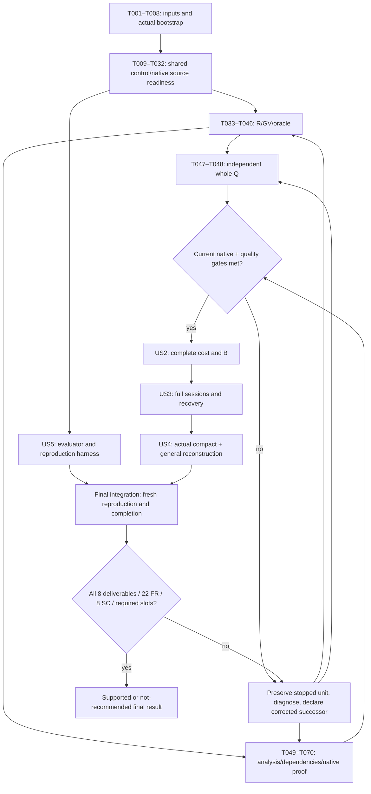

# Tasks: Complete and Verify Exact Core Transitions — revision 2

**Input**: [Specification revision 2](spec.md), [implementation plan](plan.md), [research](research.md), [data model](data-model.md), all five [contracts](contracts/) and [validation guide](quickstart.md). Constitution 1.1.0 applies.

**Status**: Revision-2 implementation in progress. The initial unchecked task list is preserved in `inputs/v2/initial-tasks.md`; checked markers require actual task evidence. No native proof, quality pass or performance result is implied by setup. The actual branch remains `research/034-ab-measurement-002`; feature selection is independent.

**Historical boundary**: The exact previous task list is [archived](specification-revisions/001/context/tasks.md), with its [hash manifest](specification-revisions/001/context-manifest.json). Old checkmarks/evidence are not automatically completion of stronger v2 obligations. Keep old root reports, source snapshots and sealed attempts unchanged. New scientific outputs belong under `evidence/v2/w001/` and `results/v2/w001/`.

## Format and execution rules

- Every task uses `- [ ] TNNN [P?] [US?] Description with path`. Story labels apply only in their story phase; Setup/Foundation/Polish have no story label.
- `[P]` means independent file authoring after stated prerequisites. It does not authorize simultaneous heavy execution: builds, tests, proofs, source/tool acquisition and measurements remain serial under the one-CPU/process-tree controller. Shared Cargo/module/index edits belong to the serial integration owner.
- Paths in tasks are repository-relative unless explicitly absolute. Private source/tool/build/tmp roots are registered on root filesystem, and v2 evidence has separately controlled storage; no whole-history copy or historical/unrelated cleanup.
- Tests are required by FR-005, the plan and constitution. Author first; retain actual expected red before implementation; then positive and genuine fault/source-mutant controls. Reuse valid existing code/tests without manufacturing a red by damaging working code; a missing-module red alone does not prove the later actual-code controls.
- Explicit dependencies override numeric adjacency. Shared control/source/native readiness is foundational; the separate analysis tuple is a US1 proof capability, so its failure must not block eligible native/Q/harness engineering. Q and formal proof are independent branches.
- A failed child halts that execution unit, preserves all records and creates diagnosed corrective work/a prospectively declared successor. Other eligible work continues. Resource exhaustion, blocked slots, gap reports and Rework never satisfy feature completion. No blind retry, old-clock reset, hidden limit increase or partial-session stitching.
- Mark a task complete only after its full described artifact/result exists with current source-bound evidence. Recording an unmet obligation does not complete a proof/build/run task. Working task markers are mutable progress metadata; freeze initial intent and append work events without making checkbox changes canonical semantics.
- The first integration milestone is US1 after Setup/Foundation; validate it and continue. It is neither the final feature nor production adoption. Required B, all lifecycle families, working C and full independent reproduction cannot be omitted.
- New source/tool/model/configuration/backend/endpoint changes invalidate affected gates and samples. Reconcile and rerun invalidated work at final integration; retain old failed/superseded rows rather than silently replacing them with faster results.

## Phase 1: Setup

**Goal**: Bind revision 2, preserve the historical attempt, declare bounded resources and observe the first real v2 red before implementing the new controller.

**Independent Test**: Pinned inputs and actual initial bootstrap origin are retained; no v1 artifact is edited or promoted to v2 success.

- [X] T001 Review the revised spec/plan/constitution and actual unfinished code; write selected original Core/Safety/035/v1 refs and intentional old-path→archived-byte mappings into `specs/036-core-transition-feasibility/inputs/v2/baseline.json` and `specs/036-core-transition-feasibility/inputs/v2/historical-map.json`, preserving `specs/036-core-transition-feasibility/inputs/baseline.json`, all sealed roots and the two unrelated033 files; verify the archived old tasks before replacing any execution context. Snapshot the initial v2 task list before mutable progress markers; checkbox-only updates are execution metadata, not a change to the semantic/proof subject.
- [X] T002 [P] After T001, author prospective profiles at `experiments/transition-study036/profiles/v2/{work,env,native,q,diag,sessions,compact,reproduction,final}.json` for ENV 7200 s, NATIVE 14400 s, Q 7200 s, DIAG 7200 s, SESSIONS 21600 s, COMPACT/REPRO 14400 s and FINAL 3600 s, 300 s closure reserve and contract child exceptions; fix 20/4/4/8 GiB cache/tmp/evidence/new-shared-store and 36 GiB total, root/data initial48/8 and live8/4 GiB floors, one tree/CPU, AS8 GiB, ordinary Lean4 GiB, observed RSS8 GiB/host-free4 GiB; register `/var/tmp/behavior-ir-core036-v2/w001` and new v2 evidence roots without creating tool/build success.
- [X] T003 [P] After T001, author independent semantic facts and every required slot in `specs/036-core-transition-feasibility/inputs/v2/workloads.json`, `experiments/transition-study036/expected/v2/facts.json` and `specs/036-core-transition-feasibility/inputs/v2/decision-rules.json`: D1–D5, required R/GV/B, three lifecycle families×1/8/32/128, four C/L* cells, 141 timings+47 diagnostics, fixed order, strict1.0 ratio/range rules, GV tie-break and required26 fresh verification samples; expected full outputs remain pending actual oracle execution.
- [X] T004 [P] After T002, write absent-v2 bootstrap/profile/adoption tests in `experiments/transition-study036/tests/v2/test_bootstrap.py` for wrong spec/root/boot, rewritten origin, missing receipt, overwrite and initial-versus-live free floors; author only before T005.
- [X] T005 After T004 and T003, execute the actual first red using the unchanged reviewed recorder with explicit v2 private-root callbacks and ≤60 s/one tree/CPU/stricter old output/cache limits; retain actual source/profile/declaration/log/receipt bytes under `/var/tmp/behavior-ir-core036-v2/w001/bootstrap/` and `specs/036-core-transition-feasibility/inputs/v2/bootstrap-input.json`; do not use v1 default paths, reset an old clock, install tools or claim a missing-module error is a native proof control.
- [X] T006 After T005, implement v2 profile/adoption validation in `experiments/transition-study036/bootstrap.py`; make T004 green under another explicitly recorded bounded bootstrap execution, importing exact first receipt bytes and actual start into new work history without relabelling the old recorder or fabricating future output hashes.
- [X] T007 [P] After T001, prepare standalone v2 native/oracle manifest templates and pinned lock inputs under `experiments/transition-study036/build-inputs/v2/`; keep Rust/Cargo1.98.1, edition2024 and original dependency versions, explicit separate original/candidate Core paths and only currently implementable role targets; source-location normalization and any regenerated lock must be checked after actual exports exist, never through floating dependency updates.
- [X] T008 [P] After T002, update `experiments/transition-study036/README.md` and verify its `.gitignore` plus repository ignore coverage for registered v2 private/cache/tmp/build outputs; document reference/full-output versus compact/audit endpoints, owned-only post-closure cleanup, historical read-only roots and no production/trust/finality/Q6 adoption.

**Checkpoint**: Verify this phase's actual exit evidence. Unmet work remains open and drives correction/continuation; it is never a shortcut to final feature closure.

---

## Phase 2: Foundational prerequisites

**Goal**: Build and test v2 records, process/resource control, persistent continuation, source/environment preparation and typed input handling before story execution.

**Independent Test**: A real positive v2 work/attempt run and actual hostile/fault controls pass with complete accounting; interruption preserves a resumable unfinished feature.

### Required tests — author first and observe real red

- [X] T009 [P] Write strict v2 record/schema tests in `experiments/transition-study036/tests/v2/test_records.py`; quote and test "All v2 control records contain exact `format`, `work_id`, `record_id`, `specification_ref`, `source_subject_ref` where applicable, typed `outcome`, `product_adoption: "unactivated"`, `inputs` and a nonempty `reason`/`blocking_ref` for unfinished work." Cover version separation, every bound, required/unknown fields, invalid enums, null/reason and original-payload numeric domains.
- [X] T010 [P] Write real child/process and injected-volume/accounting controls in `experiments/transition-study036/tests/v2/test_recorder.py`: detached descendants, signals, fast-child final growth, per-volume admission/live floors, shared inode/tmp de-duplication, source/control growth outside private, actual-clock deadlines, closure reserve, sampled-versus-hard memory and closed-only cleanup; no actual global disk-filling or unsafe shared repair.
- [X] T011 [P] Write work/attempt/checkpoint/gate/CLI tests in `experiments/transition-study036/tests/v2/test_campaign.py`: "Feature states: `declared → in_progress ↔ checkpointed → completed`." and "Attempt transitions: `declared → running → succeeded | failed | resource_stopped | interrupted → closed`." Reject fabricated predecessors/origins, unchanged blind retries, cross-boot subtraction, stale gates and checked-flag restart authority; require independently runnable engineering despite blocked claims.
- [X] T012 [P] Write source/environment contract tests in `experiments/transition-study036/tests/v2/test_sources.py` for complete nonempty Git index/runtime fixture inventory, old logical-path/archive mapping, changed lock/tool/cfg/closure, wrong oracle patch, absent compiler/linker/kernel, untracked daemon builders, bad GC roots and unsafe global repair; an executable SHA alone is not tool readiness.
- [X] T013 [P] Write create-once root/reference/DAG/stream-tamper tests in `experiments/transition-study036/tests/v2/test_artifact_io.py`; enforce "An `ArtifactRef` is `{root_id,path,bytes,sha256}`." and "`root_id` selects a controller/verifier-owned registered root, not a candidate-provided executable or filesystem root." Include missing/changed parents, path/symlink escape and forbidden future/self hashes.
- [X] T014 [P] Write fixed-role/control-input tests in `experiments/transition-study036/tests/v2_protocol.rs` before new native record bodies: exact versions/modes, untrusted flags, shared bounds, wrong source/endpoint/subject, streams over128 and original-schema numeric payloads; no imported validation or ground authority.
- [X] T015 After all preceding foundation test authoring and T006, record actual Python/controller reds serially through the reviewed stricter bootstrap launcher in `specs/036-core-transition-feasibility/evidence/v2/w001/development/`; identify expected absent APIs versus fixture/syntax failures and repair malformed tests before counting red; native protocol red is deferred until source/tool preparation.
### Implementation and actual validation

- [X] T016 After T015, implement `experiments/transition-study036/records.py` and `experiments/transition-study036/schemas/v2/records.json` with all T009 constraints and the exact bounds "UTF-8 IDs ≤256 bytes, reference paths ≤1024 bytes, control record ≤4 MiB, closure/input manifest ≤32 MiB and ≤20,000 refs, original/compact/reconstruction artifact ≤64 MiB, nesting ≤128, request stream ≤128 operations, measurement N≤256/H≤128." Also enforce "Control counts/durations/offsets are exact nonnegative u64 values." and "These research transport bounds are not theorem bounds." Original payload schemas/numeric domains remain authoritative. Enforce "Record formats use `core036.<kind>.v2`; canonical experimental formats keep the separately frozen `core036.compact-transition.v1` and `core036.finish-recipe.v1` names. Never reinterpret a v1 document as v2."
- [X] T017 After T015, implement v2 root-registered immutable refs, bounded strict reading/writing, streamed digest verification and acyclic sealing in `experiments/transition-study036/artifact_io.py`; reject "duplicate keys, trailing content, nonfinite values, unknown versions/fields, invalid UTF-8, overflows, absolute/escaping paths, symlink escapes, missing parents and changed referenced bytes" before interpreting untrusted metadata; never grant semantic authority from hashes.
- [X] T018 After T016 and T017, replace v1 hardcoded `/data`/campaign roots and launch provenance in `experiments/transition-study036/recorder.py` with declared per-attempt roots/profiles, hard child limits, one CPU/tree, actual descendant closure and sampled per-volume/memory accounting; keep "Temporary files are excluded from cache totals when counted separately." and "Unknown aggregate/shared memory is `null` with scope/reason, not zero." Test enforced versus observed limits and final overshoot honestly. Register "resolved path, ownership, filesystem device, role, lifetime, mutable/read-only status and cap" for each root.
- [X] T019 After T016 and T017, implement persistent v2 work/attempt/events/checkpoints and historical mapping in `experiments/transition-study036/campaign.py`; bind eight deliverables/22 FR/eight SC and only existing refs, record actual boot/start/UTC and exclusive stage/controller/cleanup intervals, sum closed durations across boots, keep calendar gaps separate, and require corrective prospective successors rather than a feature-lifetime deadline. Enforce "Do not subtract clocks from different boots." and "After restart, serialized facts are unverified until actual original establishment; a checkpoint does not serialize executable authority."
- [X] T020 After T019, implement source-sensitive claim gates and runnable independent-work selection in `experiments/transition-study036/gates.py`; enforce "`met | unmet | blocked`", explicit dependency invalidation and proof/source/backend/endpoint scopes; reject old proof/tool/source/cache-name shortcuts while allowing unaffected engineering to proceed.
- [X] T021 After T017 and T018, implement exact selective original/candidate exports and archived-context preservation in `experiments/transition-study036/sources.py` and `experiments/transition-study036/preservation.py`; include the corrected1637-file original inventory plus every real later runtime consumer, actual private Git index and all selected patch/lock/source bytes, with no whole-history checkout or cleanup of v1/035/033.
- [X] T022 After T021 and T019, implement bounded source/tool materialization and readiness checks in `experiments/transition-study036/prepare.py` and `experiments/transition-study036/environment.py`; verify loader/compiler/linker/metadata/transitive closure/GC roots and actual smoke behavior; admit monitored/enforced daemon builds only after capability testing, otherwise choose supported supervised realization; no silent default download, cross-target flood or deadline-killed critical shared repair.
- [X] T023 After T020, T022 and T018, implement v2 `init/freeze/declare/run/resume/status` in `experiments/transition-study036/study.py` per contracts/cli.md; fixed source-selected executors, typed exits0/1/2/3, immutable prospective declarations, reserved closure time and unfinished checkpoint on stop; retain v1 sources as historical input rather than silently continuing its expired origin.
- [X] T024 After T018 and T017, implement owned-root, retained-binary/proof-first, closed-process-only disposable cleanup in `experiments/transition-study036/owned_cleanup.py`; make actual path, symlink, live-target and historical-root controls pass and account packing/cleanup costs without altering delivered-byte endpoints.
- [X] T025 After T023, adopt the real bootstrap and declare actual v2 work/ENV attempt in `specs/036-core-transition-feasibility/evidence/v2/w001/context.json` using existing reviewed controller/profile/baseline inputs; test duplicate init/freeze/out-of-root refusal and retain actual new clock/predecessor links rather than resetting v1 or inventing built-worker refs.
- [X] T026 After T025, perform actual source/native runtime realization and compiler/linker/Cargo/Python smoke checks under declared ENV attempts; retain closure/GC-root/readiness refs in `specs/036-core-transition-feasibility/evidence/v2/w001/attempts/` and `experiments/transition-study036/toolchain-v2.json`, using native1.98.1/Python3.13.15 and exact original dependency sources; fix native environment causes through successors. Declare the separate proof/analysis tuple as pending until T049; a missing analysis tool must not block eligible worker/Q/harness engineering. Include all runtime consumers from the pinned shell/gates, including Z3/git/shell utilities/JSON-schema runtime where used, in the actual monitored native closure rather than relying on an untracked ambient PATH.
- [X] T027 After actual exports/locked tools from T026, generate checked-path v2 manifests/locks from T007, verify one intended Core identity and unchanged dependency versions, then retain the genuine expected native protocol red in `specs/036-core-transition-feasibility/evidence/v2/w001/development/protocol-red/`; no new code body or false build success before that red.
- [X] T028 After T027, implement strict v2 native requests/errors in `experiments/transition-study036/src/protocol.rs` and `experiments/transition-study036/src/error.rs`, enforcing all shared T016 bounds plus mode `timing`/`diagnostic`, fixed source roles, ≤128 operations and no supplied checked flags; declare `#![forbid(unsafe_code)]` and preserve original semantic payload domains.
- [X] T029 After T023/T024/T028, execute real continuation/deadline/detached/final-growth/volume/cleanup/exit0–3 controls and a corrected successor through `experiments/transition-study036/tests/v2/test_campaign_integration.py`; retain each actual receipt in `specs/036-core-transition-feasibility/evidence/v2/w001/development/`, including red, green and faults; no old negative-only or unconditional-success checker may substitute.
- [X] T030 After T029, run all v2 foundation/native-protocol green and hostile-input checks under actual declared attempts, with scope-labelled formatting/lint, closed process groups and complete stage/root accounting in `specs/036-core-transition-feasibility/evidence/v2/w001/attempts/`; correct any failure through linked successors without changing old receipts.
- [X] T031 After T030 and T026, freeze the actual prepared source/tool/lock/controller/model-contract inputs as the initial worker subject via `specs/036-core-transition-feasibility/inputs/v2/revisions/r0001.json`; retain immutable copies and ENV readiness refs in v2 work; worker executables, oracle outputs and native theorem roots remain unbuilt/unproved until their tasks.
- [X] T032 Verify the completed foundation state and exact pending native/quality/experiment tasks through `experiments/transition-study036/study.py status`; retain a derived checkpoint in `specs/036-core-transition-feasibility/evidence/v2/w001/checkpoints/` that remains unfinished, with no feature-level final-report route or accidental old21600-second whole-project ceiling.

**Checkpoint**: Verify this phase's actual exit evidence. Unmet work remains open and drives correction/continuation; it is never a shortcut to final feature closure.

---

## Phase 3: User Story 1 — Finish justified native execution (P1, first integration milestone)

**Goal**: Deliver working R/GV/original-oracle roles, actual source-to-model correspondence and a whole current quality pass.

**Independent Test**: Fresh B01–B10 type/axiom/kernel and real source/result/authority/encoding controls establish general exactness; independent original replay and the entire unchanged canonical gate pass for the matched subject.

### Required tests — author first and observe real red

- [X] T033 [P] [US1] Write actual selector/projection/fallback/evaluation/observation controls C01/C02/C04/C05/C06 in `experiments/transition-study036/tests/v2_native_exactness.rs`; compare all eight fields, canonical identities, first errors and ordered duplicate commands, including empty/new membership, unchanged content and safe-but-wrong outcomes; author before new adapters.
- [X] T034 [P] [US1] Write private-ground/view/publication controls C03/C07/C08 in `experiments/transition-study036/tests/v2_ground_lifecycle.rs`; cover wrong history with equal contents, wrong subject/writer/epoch, missing/corrupt views, precommit conflict, lost ack and restart with no unjustified child promotion.
- [X] T035 [P] [US1] Write oracle preparation/replay and original-schema boundary tests in `experiments/transition-study036/tests/v2_oracle_contract.rs`; independently authored raw streams must work before any prepared manifest exists, and candidate-selected subjects/validation flags must not establish expected outcomes.
- [X] T036 [P] [US1] Write real extraction/source/cfg/expected-type/axiom/generated-body controls in `experiments/transition-study036/tests/v2/test_correspondence.py`; require accepting declared positive subjects and rejecting stale/wrong source, model-only closure, equivalence axioms, omitted dependency nodes and extraction-only alternate algorithms; no always-false substitute.
- [X] T037 [P] [US1] Write entire-script/source/CLI/index/target contract controls in `experiments/transition-study036/tests/v2/test_quality.py`; require actual full labels/terminal success, complete runtime fixtures, real CLI binding and closed descendants, and reject partial/narrowed/warm-mislabelled or resource-stopped passes.
- [X] T038 [P] [US1] Write exact native/oracle compiled dependency/configuration/role identity tests in `experiments/transition-study036/tests/v2_source_identity.rs`; catch original oracle routed through research patches, multiple unintended Core identities and bin-label-only role separation.
- [X] T039 [US1] Execute and retain actual reds for these targets under declared NATIVE/Q development allocations in `specs/036-core-transition-feasibility/evidence/v2/w001/development/`; distinguish valid absent-API/fault reds from malformed tests and preserve all failures before implementation.
### Implementation and actual validation

- [X] T040 [US1] After T039, adapt exact selected reference/reuse sources into `experiments/transition-study036/src/reference.rs`, `experiments/transition-study036/src/eligibility.rs` and `experiments/transition-study036/src/observation.rs`; preserve original selection/fallback, complete native request/context/metadata and all original observation fields, without adding a new semantic optimization.
- [X] T041 [US1] After T039, implement actual authority/view state in `experiments/transition-study036/src/ground.rs` and `experiments/transition-study036/src/views.rs`: "States: `unverified → checking → established`; operation staging creates `pending`; only confirmed matching acceptance creates `established(child)`." Quarantine uncertainty/stale context/restart, keep constructors process-private and prevent any compact-to-legacy history cast.
- [X] T042 [US1] After T035 actual red, implement independent unpatched original `prepare/replay` in `experiments/transition-study036/oracle/src/main.rs` and exact fixture/stream handling in `experiments/transition-study036/src/fixtures.rs`; generate complete original expectations from raw frozen workloads/facts, not candidate outputs or a future prepared manifest.
- [X] T043 [US1] After T040/T041, implement fixed-role operation/batch entrypoints in `experiments/transition-study036/src/bin/reference.rs`, `experiments/transition-study036/src/bin/reuse.rs` and `experiments/transition-study036/src/run.rs`; genuinely establish resident immutable program context, acquire fresh state/history per independent case, bind exact endpoints and retain actual output/error/provenance; future session loops remain a separate US3 task.
- [X] T044 [US1] After T038 red, implement `experiments/transition-study036/src/source_identity.rs` plus native/oracle build receipts; bind exact original/candidate code, cfg/features/target/locks/tool closure and actual compiled Core identity, keeping original oracle and patched worker builds independent.
- [X] T045 [US1] Freeze existing actual adapter/oracle/source inputs as a new v2 subject, then build and retain R/GV, unpatched oracle and actual candidate CLI under `specs/036-core-transition-feasibility/evidence/v2/w001/attempts/`; emit source/tool/executable refs and prepared manifests only after those real outputs exist; retain binaries before owned-cache cleanup.
- [X] T046 [US1] Run actual T033/T034/T035/T038 and deterministic full original replay against retained workers, recording outcomes in `specs/036-core-transition-feasibility/evidence/v2/w001/attempts/`; fix any mismatch, label finite conformance separately and do not infer arbitrary-state proof.
- [X] T047 [US1] After T037 red and T045, implement v2 `experiments/transition-study036/quality.py`: complete indexed export, actual retained BEHAVIOR_BIN, exact tools, initially empty declared gate target, every unchanged `scripts/gates.sh` step plus scoped research checks; no old Q clock/ceiling reuse or partial-success inference.
- [X] T048 [US1] Independently of unfinished proof tasks, run the complete actual current canonical/scoped quality through T047 under Q attempts in `specs/036-core-transition-feasibility/evidence/v2/w001/attempts/`; repair fixture/environment/code/resource causes and declare successors until genuine terminal `gates: OK`, exit0 and closed trees pass; preserve v1 stops and all new failures.
- [X] T049 [US1] Under separately declared ENV/NATIVE preparation attempts, realize and check the exact analysis/runtime closures in `experiments/transition-study036/environment.py` and `experiments/transition-study036/toolchain-v2.json`: Aeneas1dc8ad31b1b062a77c50e29144a6c7bba955fa09, Charon454586e9b770231e66d2062993e632dfc06463e2, nightly2026-09-17, analysisLean4.36.0-rc2 and separate originalLean4.30. Verify actual loader/extractor/compiler/kernel/GC roots and transitive metadata, diagnose/repair or prospectively revise supported realization until ready, and keep independent native/Q/harness work runnable meanwhile.
- [X] T050 [US1] Inventory exact real function/cfg/monomorphization/call closure and B01–B10 source/premise contracts in `specs/036-core-transition-feasibility/inputs/v2/correspondence.json` and `specs/036-core-transition-feasibility/inputs/v2/proof-contract.json`; include JSON/maps/sets/strings/iterators, dynamic EvaluationFacts, Arc epoch equality, errors, I/O and full context; state initial native roots as unestablished, never invented proofs.
- [X] T051 [US1] After T036 red and T050/T049, implement actual pinned Charon/Aeneas extraction in `experiments/transition-study036/extract.py`; retain LLBC/generated Lean/all external declarations and bind real stable/extraction source/cfg/tool differences, rejecting edited generated functions, omitted call nodes and proof-only cfg implementations.
- [ ] T052 [US1] After the actual unsupported call inventory from T051, implement required source-bound frontend/model support or real extraction-compatible shared Rust refactors under `experiments/transition-study036/patches/v2/` and `experiments/transition-study036/proofs/Correspondence036/Dependencies/`; retain generated source/cfg/tool bindings and every external node, bind measured workers to the same real functions and register mandatory JSON/collection/runtime/adapter refinements for T053/T054/T055/T064/T069. This task delivers representable source/tool integration, not proof closure; no unsupported node, proof-only alternate implementation or narrowed claimed domain is silently accepted.
- [ ] T053 [US1] Complete native JSON/value/numeric/error/string/metadata dependency refinement in `experiments/transition-study036/proofs/Correspondence036/Dependencies/Json.lean` with actual extracted-source bindings; cover original admitted domains rather than only Nat/fixture values, justify generic primitives explicitly and reject an opaque desired projection/encoding-equivalence assumption.
- [ ] T054 [US1] Complete actual finite-map/set/sequence/iterator refinement and membership/absence/update lemmas in `experiments/transition-study036/proofs/Correspondence036/Dependencies/Collections.lean`; prove linkage to used native implementations or declared legitimate generic primitives, with actual source/negative controls rather than model templates or finite examples alone.
- [ ] T055 [US1] Complete dynamic-facts dispatch, Arc/epoch identity, panic/checked arithmetic and performed-error/effect boundaries in `experiments/transition-study036/proofs/Correspondence036/Dependencies/Runtime.lean`; do not claim Charon monomorphization supports dynamic traits or treat parent/epoch equivalence as an unproved premise.
- [ ] T056 [US1] Run a real selected-source projection/view probe and genuine wrong-source extraction canary with full JSON/collection dependency closure in `specs/036-core-transition-feasibility/evidence/v2/w001/attempts/`; diagnose and correct loader/language/library/source-binding failures until the probe and rejection actually work; a helper result neither closes B10 nor ends the feature.
- [X] T057 [US1] Replay unchanged twelve035 model roots and full proof closure under pinned Lean4.30 in `experiments/transition-study036/proofs/original035/`, retaining fresh actual receipts; separately port any required extension to analysis Lean in `experiments/transition-study036/proofs/Correspondence036/Model/` with checked statements/axioms; old model replay never marks native correspondence met.
- [ ] T058 [US1] After actual generated dependencies and T057, define/check the native finite-ID/row bijection and full JSON/context/history/error relation in `experiments/transition-study036/proofs/Correspondence036/Relation.lean`; quantify arbitrary admitted finite representable states, not N≤256/H≤128 or generated child IDs, and bind exact expected native theorem types before checking them.
- [ ] T059 [US1] After T036 red, implement fresh expected-type/generated-source/transitive-axiom/kernel checking in `experiments/transition-study036/check_proofs.py`; enforce obligation statuses "`unestablished`, `in_progress`, `proved_for_declared_subject`, `checked_conformance_only`, `explicit_external_premise`, `refuted`" and actual source/cfg/body matching; only complete expected native closure can establish proof, not supplied flags or toggling the v1 constant false. Enforce "A helper proof cannot set the composed status."
- [ ] T060 [US1] Prove B01 exact actual selector/context/fallback relation in `experiments/transition-study036/proofs/Correspondence036/Selector.lean`; all restrictions are enforced by real source and unsupported inputs use original fallback on equal complete arguments.
- [ ] T061 [US1] Prove B02 native state/version/absence/owner/Safety projection in `experiments/transition-study036/proofs/Correspondence036/Projection.lean` over T058 and actual Store/version loading, including arbitrary native keys and full original domain/context.
- [ ] T062 [US1] Prove B03 original establishment, exact subject/head/writer/epoch authorization, pending/quarantine and restart invalidation in `experiments/transition-study036/proofs/Correspondence036/Authority.lean`; no serialized flag, equal-content history or unconfirmed child grants authority.
- [ ] T063 [US1] Prove B04 actual checked views, staging, apply/materialize and dependency completeness in `experiments/transition-study036/proofs/Correspondence036/Views.lean`; include empty/new members, version updates and equality to canonical reconstruction before/after matching confirmation.
- [ ] T064 [US1] Prove B05 actual prepared/original evaluator and fresh envelope equality in `experiments/transition-study036/proofs/Correspondence036/Evaluation.lean`; cover exact requested effects, definedness/intermediate overflow, first errors, refusals, unchanged content and ordered commands without assuming the result.
- [ ] T065 [US1] Prove B06 actual native Safety outcome/projection and inherited-validity preservation in `experiments/transition-study036/proofs/Correspondence036/Safety.lean` using checked model laws and actual source relations; do not assume global initial validity, a safe child or missing normative validation outcomes.
- [ ] T066 [US1] Prove B07 complete original observation/encoder/hash argument relation in `experiments/transition-study036/proofs/Correspondence036/Observation.lean`; preserve all eight fields/identities/current metadata and use shared original-function congruence only after equal complete native arguments and matching errors/effects are proved.
- [ ] T067 [US1] Prove B08 actual original serialization/newline/create/write/sync/error completion in `experiments/transition-study036/proofs/Correspondence036/Output.lean`; partial or failed delivery never becomes full success, and acknowledged backend application is not falsely reported rolled back.
- [ ] T068 [US1] Prove B09 actual Store/Capture expected-parent commit, confirmation, conflicting/precommit/applied-lost-ack behavior and ground advancement in `experiments/transition-study036/proofs/Correspondence036/Publication.lean`; keep memory acknowledgement and durability separate.
- [ ] T069 [US1] Compose B01–B09 for actual R/GV entrypoints and original fallback in `experiments/transition-study036/proofs/Correspondence036/Exact.lean`; freeze exact root types/axiom/dependency inventory and discharge every mandatory bridge without domain restriction or desired-result assumptions.
- [ ] T070 [US1] Freeze the completed actual proof/source subject and execute fresh extraction/type/axiom/kernel checks through T059, plus genuine C09 source/cfg/generated-body/equivalence-axiom mutations, in `specs/036-core-transition-feasibility/evidence/v2/w001/attempts/`; correct failures and recheck until full native closure and real rejection controls pass.
- [ ] T071 [US1] Run current retained-worker full original comparisons, C01–C09, actual checked root bindings and determinism again after proof/source repairs, and reclose every invalidated whole-Q/scoped dependency in `specs/036-core-transition-feasibility/evidence/v2/w001/attempts/`; matching finite outcomes remain distinct from the general proof.
- [ ] T072 [US1] Emit actual separate native/quality/conformance/source prerequisites from raw records into `specs/036-core-transition-feasibility/evidence/v2/w001/subjects/`; require genuine current SC-001/SC-002 evidence for completion of this milestone and accepted later measurements; any missing item leaves work pending and drives corrective successors, not final feature closure.

**Checkpoint**: Verify this phase's actual exit evidence. Unmet work remains open and drives correction/continuation; it is never a shortcut to final feature closure.

---

## Phase 4: User Story 2 — Explain complete cost and test B (P1)

**Goal**: Implement truthful complete-operation attribution and a real same-contract improvement, then finish the full R/GV/B comparison matrix.

**Independent Test**: All five cells ×R/GV/B have three completed timings plus one separate diagnostic, complete original equality, reconciled intervals/work and checked actual B activation/correctness.

### Required tests — author first and observe real red

- [X] T073 [P] [US2] Write interval/unit/unavailable-work controls C11 in `experiments/transition-study036/tests/v2/test_intervals.py` and `experiments/transition-study036/tests/v2_intervals.rs`: "Exclusive siblings must be disjoint and contained." and "Complete duration equals summed exclusive classified work plus a nonnegative explicit remainder." Reject median subtraction, double counted nested commit, bogus allocated-byte proxies and zero for unavailable values.
- [X] T074 [P] [US2] Write actual create/short-write/write/flush/sync fault and exact original bytes/newline tests C12 in `experiments/transition-study036/tests/v2_output.rs`; B must explicitly flush/extract before the same underlying synchronization and must not claim rollback of a confirmed backend commit when delivery fails.
- [X] T075 [P] [US2] Write C10/C11 timing-versus-diagnostic equality and treatment controls in `experiments/transition-study036/tests/v2_mechanisms.rs`; label-only/disabled buffer, wrong mode, changed endpoint, supplied counter flags and inconsistent source/role identity must fail actual activation, not just edited summaries.
- [X] T076 [P] [US2] Write exact expected sample/median/range/ratio/selector/missing-sample tests in `experiments/transition-study036/tests/v2/test_costs.py`; require all45 timing+15 diagnostic slots, proper deterministic role order, primary/continuation/direct cycle separation, raw-derived totals and no production-quantile inference.
- [X] T077 [US2] Run actual reds for these new targets under declared DIAG development attempts in `specs/036-core-transition-feasibility/evidence/v2/w001/development/`, preserving all wrong-clock/interval/partial-output controls before accepting implementation.
### Implementation and actual validation

- [ ] T078 [US2] After T077, implement actual operation-relative spans and reconciliation in `experiments/transition-study036/src/intervals.rs` and `experiments/transition-study036/intervals.py`; cover semantic work, ground/views, materialization, observation/encoding, identities/hashes, copies, commit/ack, output/sync and endpoint checking with explicit overhead/remainder, without charging nested durations twice. Preserve "`IntervalTree` spans have unique IDs, parent ID, monotonic start/end offsets and execution scope."
- [ ] T079 [US2] After T077, implement work/byte/resource scope records in `experiments/transition-study036/src/quantities.rs` and `experiments/transition-study036/schemas/v2/operation.json`; preserve "`Quantity` has `value`, `unit`, `scope`, `method`, `reason_if_unavailable`." and "Payload size is not allocated bytes; Write calls are not syscall counts." Native visits/materializations/copy/hash/write observations must reflect actual hooks; unavailable allocator/shared-peak quantities retain null and reason.
- [ ] T080 [US2] Implement measured full primary/continuation/cycle endpoints and diagnostic instrumentation in `experiments/transition-study036/src/operation.rs` plus source-bound research hooks under `experiments/transition-study036/patches/v2/`; keep fresh acquisition and resident/cold authority explicit, include all mandatory delivered bytes/errors, and preserve exact results in timing and diagnostic modes.
- [ ] T081 [US2] Connect the actual instrumentation/wrapper paths to the native relation in `experiments/transition-study036/proofs/Correspondence036/Instrumentation.lean`; prove observation-preserving mode erasure and charged endpoint/error behavior, freeze new subjects and reclose affected B01–B10/full-Q/conformance controls before accepted comparisons.
- [ ] T082 [US2] Execute separately declared D1/D3 R/GV diagnostic/capacity pilots through `experiments/transition-study036/costs.py` under v2 attempts to locate actual write grouping/materialization/identity work and estimate resource feasibility; freeze their non-primary slot IDs before running, retain costs, and never use pilots as missing timing samples or choose a fastest run.
- [ ] T083 [US2] After T074 red and actual diagnosis, implement fixed64 KiB same-serializer buffering in `experiments/transition-study036/src/output.rs` and `experiments/transition-study036/src/bin/buffered.rs`; preserve create-new, original JSON/newline, explicit handled flush/extraction and underlying File synchronization before success, with actual source-selected B role and byte/Write-call diagnostics.
- [ ] T084 [US2] Prove the actual B successful-byte-stream and performed-I/O-error wrapper relation in `experiments/transition-study036/proofs/Correspondence036/BufferedOutput.lean`, extending B08/B10/source bindings rather than treating a byte comparison as general proof; all pending/confirmed backend states remain honestly distinguished from delivery completion.
- [ ] T085 [US2] Build/retain actual B, run positive and fault/disabled-mechanism controls C10–C12, frozen-source proof closure, scoped quality and whole unchanged canonical gate in `specs/036-core-transition-feasibility/evidence/v2/w001/attempts/`; require real lower underlying Write calls at D3 and matching full bytes, repairing defects or explicitly revising a justified same-contract candidate instead of omitting required B work.
- [ ] T086 [US2] After actual current R/GV/B gates, freeze all comparison source/executable/endpoint/oracle/order/sample/decision inputs in `specs/036-core-transition-feasibility/inputs/v2/operation-comparison.json`; verify matrix D1–D5 and45+15 counts, matching authority/cache declarations and exact current source dependencies, with no post-result threshold choice.
- [ ] T087 [US2] Execute all15 role/cell operation cases with three complete timing observations and one separate diagnostic each, including direct primary+continuation+cycle, through `experiments/transition-study036/costs.py`; retain all45+15 raw samples/full original comparisons/failed successors under `specs/036-core-transition-feasibility/evidence/v2/w001/attempts/`, following the predeclared Latin role order.
- [ ] T088 [US2] After T087, derive raw-exclusive-phase/work/byte/acquisition/overhead/remainder tables in `experiments/transition-study036/costs.py`; reconcile each actual total and quantities, report resource/endpoint/guarantee context and ranges, and do not invent semantic residuals by subtracting medians.
- [ ] T089 [US2] Emit completed SC-003/FR-007–FR-011 source-bound diagnosis/B outcomes through `specs/036-core-transition-feasibility/evidence/v2/w001/assessments/`; use the frozen1.0 ratio/range rules, keep slower B/no demonstrated advantage as valid measured outcomes, and leave the feature unfinished for later required work.
- [ ] T090 [US2] Verify current complete original equality, actual treatment counters, full45+15 slots and instrumentation/proof/full-Q dependencies using `experiments/transition-study036/study.py status`; any stale source/executable/endpoint reopens affected slots and schedules recorded reruns rather than reusing unrelated fast rows.

**Checkpoint**: Verify this phase's actual exit evidence. Unmet work remains open and drives correction/continuation; it is never a shortcut to final feature closure.

---

## Phase 5: User Story 3 — Complete lifecycle economics (P1)

**Goal**: Measure fresh establishment, continued work, invalidation/recovery, retention and audit over all real session families/lengths.

**Independent Test**: All three families ×four lengths ×R/GV have three complete timings plus separate diagnostics, original-equivalent continuation and directly observed payback/no-payback with recovery/retention costs.

### Required tests — author first and observe real red

- [ ] T091 [P] [US3] Write actual fresh-ground/resident/cold/state-changing/no-op/session endpoint tests in `experiments/transition-study036/tests/v2_sessions.rs`; ensure no ground crosses independent sessions and acquisition/required final output are inside direct totals for lengths1/8/32/128.
- [ ] T092 [P] [US3] Write actual stale/wrong-history/context/view/conflict/precommit/refusal/applied-lost-ack/restart and continuing-equality controls in `experiments/transition-study036/tests/v2_recovery.rs`; wrong-content/equal-history shortcuts, serialized authority and unconfirmed child promotion must fail, with actual recovery not a fabricated cost.
- [X] T093 [P] [US3] Write lifecycle/retention/payback/partial-session/cold-total controls in `experiments/transition-study036/tests/v2/test_lifecycle_costs.py`; reject summed independent medians, stitched timings, dropped reacquisition/audit work and unobserved break-even; require72 timings+24 diagnostics and honest null/reason quantities.
- [ ] T094 [US3] Retain actual expected reds for these targets under declared SESSIONS development attempts in `specs/036-core-transition-feasibility/evidence/v2/w001/development/` before new loop/recovery/summary bodies.
### Implementation and actual validation

- [ ] T095 [US3] After T094, implement actual session/batch execution in `experiments/transition-study036/src/session.rs`; "No ground crosses independent sessions." Genuinely establish immutable program context, start each session before fresh state/history/view acquisition, stream every mandatory result, record direct cold-worker/first-cold-session and enclosing required-audit totals without adding medians.
- [ ] T096 [US3] Implement controlled invalidation/recovery and resumed original comparison in `experiments/transition-study036/src/recovery.rs`; enforce "Invalidation occurs before operation `floor(L/2)+1`; for L1 this precedes operation1." Charge actual invalidation, reconciliation/reacquisition and mandatory cleanup; process restart only re-establishes from checked raw inputs, never a saved ground flag.
- [ ] T097 [US3] Implement bounded streamed memory/retention observations at session acquisition/boundaries/end in `experiments/transition-study036/session_resources.py` and `experiments/transition-study036/src/session.rs`; include views/state/history/results and required cleanup, distinguish sampled process RSS from exact allocation/shared peaks and keep unavailable values with explicit method/scope/reason.
- [ ] T098 [US3] Prove actual native session-loop, authority advancement, invalidation, acknowledgement uncertainty and recovery composition in `experiments/transition-study036/proofs/Correspondence036/Sessions.lean`; bind the real runner/context and all repeated original outcomes/first errors/commands, rather than assuming a per-step model theorem covers the native loop.
- [ ] T099 [US3] Freeze actual session/recovery sources and all12 family/length R/GV cells in `specs/036-core-transition-feasibility/inputs/v2/session-comparison.json`; N256/H8 changing cases finish distinct c0000…c0127, N2/H8 unchanged family changes once, invalidated family reacquires mid-session, and all endpoint/order/fault rules remain predeclared.
- [ ] T100 [US3] Freshly check session/recovery proof bindings, all actual loop/fault/mode/original tests and current full canonical/scoped quality in `specs/036-core-transition-feasibility/evidence/v2/w001/attempts/`; repair mismatches or resource causes with successors before accepted sessions.
- [ ] T101 [US3] Run all24 R/GV role/family/length cases with three complete direct session timings plus one separate diagnostic each through `experiments/transition-study036/lifecycle_costs.py`, retaining72+24 actual observations, stream-by-stream original comparisons, cold/resident context, final audit/resource totals and every stopped successor in v2 attempts.
- [ ] T102 [US3] Freeze and execute each declared T092 fault family at N2/H8 and N256/H8 in `specs/036-core-transition-feasibility/inputs/v2/recovery-cases.json` and v2 attempts; directly measure required recovery/reacquisition and continuing exact outcomes, distinguish these control observations from uninterrupted session samples and claim no disk durability.
- [ ] T103 [US3] Derive all family/endpoint raw totals, medians/ranges, initial acquisition, ordinary maintenance, recovery, retention and audit tables in `experiments/transition-study036/lifecycle_costs.py`; state payback only at directly observed tested lengths, including no payback and invalidated sessions, with no separate-median arithmetic or hidden missing cells.
- [ ] T104 [US3] Emit completed FR-012–FR-014/SC-004 and current source/gate/slot evidence into `specs/036-core-transition-feasibility/evidence/v2/w001/assessments/`; all72+24 and required faults must exist, while final feature completion still awaits working compact and full reproduction.

**Checkpoint**: Verify this phase's actual exit evidence. Unmet work remains open and drives correction/continuation; it is never a shortcut to final feature closure.

---

## Phase 6: User Story 5 — Build continuation, reproduction and completion machinery (P1)

**Goal**: Implement the positive-capable raw-evidence evaluator, independent reproduction runner and final completion rule; final story acceptance follows US4 and the final integration phase.

**Independent Test**: Real interrupted/corrected work resumes without false completion; actual source/proof/table/context tampering is rejected. The full positive end-to-end test runs after required C evidence exists, not against manufactured completeness flags.

This P1 phase builds/test-checks the reproduction/completion machinery before P2 compact integration. Full US5 acceptance deliberately depends on the final integration phase after actual US4 evidence. Passing a test fixture or rejecting an unfinished candidate does not finish the story.

### Required tests — author first and observe real red

- [ ] T105 [P] [US5] Write collector/final-completion tests in `experiments/transition-study036/tests/v2/test_assessment.py` for all22 FR/eight SC/eight deliverables, measured negative usefulness with complete correctness, every mandatory missing proof/component/sample/control/reproduction, unknown/null flags and independent successors; missing work must stay unfinished even when a report was successfully written.
- [ ] T106 [P] [US5] Write independent expected-context/source/config/tool/executable/generated-proof/clock/stream/interval/budget/table/closed-writer tamper controls in `experiments/transition-study036/tests/v2/test_validate.py`; archive integrity and candidate-selected verifiers/contexts must never certify native proof or full reproduction.
- [ ] T107 [P] [US5] Write actual correction-to-success, source-invalidation and acyclic-final-seal controls in `experiments/transition-study036/tests/v2/test_completion_flow.py`; reject fake positive statuses, forever-negative guards, unfinished C treated as rejection, finalization before all required work, self/future hashes, checkpoint-imported authority and reopened sealed output.
- [ ] T108 [US5] Retain actual reds for these targets under declared FINAL/REPRO development allocations in `specs/036-core-transition-feasibility/evidence/v2/w001/development/`; positive unit fixtures are test-scope only, while the real all-deliverable positive integration is deferred to final actual reproduction after US4.
### Implementation and actual validation

- [ ] T109 [US5] After T108, implement source-bound raw collection and separate operational/proof/semantic/cost/usefulness/feature-completion dimensions in `experiments/transition-study036/assessment.py`; remove v1 negative-only/hardcoded flags, preserve all failed attempts and require actual evidence for every criterion. Intermediate gap reports remain valid checkpoints, never met completion.
- [ ] T110 [US5] After T106 red, implement independent fixed expected-context checking, archived-v1 mapping, source/executable/proof DAG and actual fresh proof/replay dispatch in `experiments/transition-study036/validate.py`; only verifier-owned source/tool/profile roots select executors, and positive verification must arise from actual checks rather than report-supplied success flags.
- [ ] T111 [US5] Implement fresh independently owned oracle/R/GV/B/C rebuild and full unchanged-Q/proof closure runner in `experiments/transition-study036/reproduction.py`; preserve explicit warm dependency versus fresh emitted-target conditions, actual compiler/cfg/Core identities and controlled process/volume accounting; unavailable future C remains pending rather than skipped.
- [ ] T112 [US5] Implement the exact26 fresh semantic verification slots and real C01–C14/controller mutation dispatch in `experiments/transition-study036/reproduction.py` and `specs/036-core-transition-feasibility/inputs/v2/reproduction-slots.json`: six R/GV/B D1/D3, twelve R/GV family L1/L128 boundaries and eight C/L* compact cells, each with actual independent original stream execution; these are not primary timing triplets.
- [ ] T113 [US5] Implement independent rederivation of all operation/session/compact tables, units/exclusive totals, observed payback, L* selection, ratio/range decisions and all required-slot/FR/SC statuses in `experiments/transition-study036/rederive.py`; reject missing/stale or post-hoc-selected rows, mismatched endpoints and reported rather than recomputed values.
- [ ] T114 [US5] Implement typed all-eight-deliverable/all22-FR/eight-SC/current-gate/slot/reproduction predicate in `experiments/transition-study036/completion.py`; unknown, blocked, unsupported, not-run or unestablished never coerces to met, and a fully measured not-recommended cost result can complete only when correctness/quality/reproduction really pass. Enforce "Missing required sample/proof/quality/reproduction keeps `feature_complete=false`."
- [ ] T115 [US5] After T114 and T110, implement `collect --kind checkpoint|candidate` and `finalize` in `experiments/transition-study036/study.py`; finalization exits3 and retains exact pending work until all requirements pass, then writes only new `specs/036-core-transition-feasibility/results/v2/w001/` outputs bound to existing candidate/reproduction seals, without rewriting old root reports or creating hash cycles.
- [ ] T116 [US5] Execute actual controller budget/interruption/correction/source-invalidation/false-completion controls through `experiments/transition-study036/tests/v2/test_completion_flow.py`; link known v1 fixture/tool failures to their actual corrected new environment/full-Q checks where applicable, retain all actual receipts, and show that independent eligible work continues while other claims remain blocked.
- [ ] T117 [US5] Freeze these real evaluator/reproduction/controller sources, run current parser/source/closure/fault/format/lint/determinism gates under v2 attempts and verify zero silent omissions through `experiments/transition-study036/study.py status`; all full-reproduction/final-completion slots remain explicitly pending until actual US4 and final integration execution.

**Checkpoint**: Harness controls work; mandatory real C/full-reproduction/final-result slots remain pending until the final phase.

---

## Phase 7: User Story 4 — Build and evaluate compact canonical evidence (P2, required)

**Goal**: Implement a real pre-eager-evidence compact path, exact original replay reconstruction, general actual-code proof and full operation/audit comparisons.

**Independent Test**: C preserves the admitted original semantics through proven deltas/identity mappings, rejects missing/corrupt data and false authority, avoids new eager legacy construction at compact completion, and completes all24 timing+8 diagnostic C/L* samples with direct audit totals.

### Contract entry — completed baseline diagnosis and lifecycle required

- [ ] T118 [US4] After completed T089 and T104, freeze exact compact/control schemas, deterministic delta/reference order, Unicode/number byte grammar, framed domain-tagged preimages, recipe/basis, authority/availability and endpoints in `specs/036-core-transition-feasibility/inputs/v2/compact-contract.json` and `specs/036-core-transition-feasibility/inputs/v2/compact-proof-contract.json`; use `core036.compact-transition.v1`/`core036.finish-recipe.v1`, never inherit legacy identities by assumption.
### Required tests — author first and observe real red

- [ ] T119 [P] [US4] After T118, write independent exact preimage/canonicalization/content-reference/ID-domain/bounds/order tests in `experiments/transition-study036/tests/v2_compact_contract.rs`; preserve command duplicates and reject own-future-hash cycles, path/tool/cache/proof/PID-dependent canonical identity and narrowed original payload numeric domains.
- [ ] T120 [P] [US4] Write actual full-eight-field original replay reconstruction and input/subject/recipe/provenance controls C13 in `experiments/transition-study036/tests/v2_reconstruction.rs`; missing/corrupt/substituted refs, wrong parent/context/module/version and fake direct-validator provenance cannot return exact success or private authority.
- [ ] T121 [P] [US4] Write actual compact delta/CAS/precommit/conflict/lost-ack/early-eviction/process-loss/legacy-fallback and hidden-materialization controls C10/C14 in `experiments/transition-study036/tests/v2_compact_backend.rs`; a transport wrapper around original eager commit is not C, and no compact head may be cast to legacy history.
- [ ] T122 [P] [US4] Write direct compact completion/full-delivery/session/audit/retention/selector/current-source sample tests in `experiments/transition-study036/tests/v2/test_compact_costs.py`; require24 timing+8 diagnostic samples, same-operation reconstruction before continuation and all deferred work, with no summed unmeasured compact-only session or cross-guarantee speedup.
- [ ] T123 [US4] Execute and retain actual reds for these targets under COMPACT attempts in `specs/036-core-transition-feasibility/evidence/v2/w001/development/`, fixing malformed tests before counting expected mechanism/correctness rejection.
### Implementation and actual validation

- [ ] T124 [US4] After T123, isolate a real shared restricted semantic result before `observation::execute_original`/legacy Store commit/full materialization in `experiments/transition-study036/src/transition_kernel.rs` and actual owned Core/source patches under `experiments/transition-study036/patches/v2/`; preserve exact outcome/first error/ordered commands/deltas and prove adapters to the original evaluator, rather than introducing an unconnected handwritten model.
- [ ] T125 [US4] Implement actual frozen compact record/canonical encoder/recipe commitment in `experiments/transition-study036/src/compact_record.rs` and `experiments/transition-study036/schemas/v2/compact.json`; "Canonical content refs contain kind/version/length/digest only; physical root/path/owner resolution lives in a separately bound transport manifest." Keep incidental source/tool/proof/cache/timing/work data outside canonical identity and bind semantic inputs through real content bytes.
- [ ] T126 [US4] Implement immutable basis/request/context/metadata/delta retention and transport resolution in `experiments/transition-study036/src/retained_inputs.rs`; enforce "References form an acyclic DAG; a record cannot hash its own future identifier." and "Retain all required input through declared final audit and sealed export." Charge one verified initial basis and actual per-event inputs, prohibit hidden full per-step original snapshots and capture deterministic metadata before audit.
- [ ] T127 [US4] Implement actual typed-state/view exact-parent memory CAS and confirmed-only promotion in `experiments/transition-study036/src/compact_backend.rs`; retain staged inputs before acknowledged availability, quarantine uncertain application, reject stale parents/conflicts and reconcile actual head. Unsupported requests reconstruct/check original basis and use labelled legacy fallback, invalidating compact authority until fresh establishment.
- [ ] T128 [US4] Implement fixed-role C execution/delivery/mode counters in `experiments/transition-study036/src/compact.rs` and `experiments/transition-study036/src/bin/compact.rs` over the actual new backend; require zero new full legacy observation/transition-record construction before each selected compact completion, actual acknowledged delta/record/input availability and honest memory-only scope; audit state must not secretly compute for the writer.
- [ ] T129 [US4] Implement verified-input original replay in `experiments/transition-study036/src/reconstruct.rs`; verify independent expected subject/parent/versions/DAG, replay every bound request/context/metadata in order, check actual delta/outcome/state relation and deliver all eight original fields/identities. Provenance says `original_replay_at_audit`; never substitute a current clock, claim original calls ran at compact commit, or import producer authority. Enforce "Missing/corrupt/substituted input, wrong version/parent or mismatch is never exact success."
- [ ] T130 [US4] Extract/bind the real kernel, compact record/backend/fallback and worker paths and prove their source-bound original semantic-state/outcome/error/command/confirmed-CAS preservation in `experiments/transition-study036/proofs/Correspondence036/Compact.lean`; extend necessary native dependency/B01–B10 relations without assuming safe/equal children or casting history domains.
- [ ] T131 [US4] Prove the actual replay input-binding/composition and full original reconstruction theorem in `experiments/transition-study036/proofs/Correspondence036/Reconstruction.lean` for arbitrary admitted finite states; cover availability failure, first errors/refusals, original numeric/context domain and all original field encoders, not only finite replay examples.
- [ ] T132 [US4] Prove actual canonicalization/recipe commitments and deterministic semantic-state/original event-history mappings in `experiments/transition-study036/proofs/Correspondence036/Identity.lean`; recipe head is its own history-sensitive domain, not an uncomputed state-content hash; identical semantic inputs have identities independent of provenance/cache/timing/filesystem placement.
- [ ] T133 [US4] Integrate primary C comparison delivery in `experiments/transition-study036/src/compact_session.rs` and `experiments/transition-study036/src/session.rs`: measure each compact completion, then directly enclosing exact original reconstruction/delivery before continuation; charge replay-consumer acquisition/cursor/state/retention and direct session/final-audit totals, without inventing pure compact-only lifecycle timing by summing intervals.
- [ ] T134 [US4] Execute actual missing/substituted input, wrong version/subject/parent, attempted early eviction, process-lifetime loss, conflict/precommit/applied-lost-ack, fallback, identity-alias and hidden-full-materialization controls in v2 attempts via `experiments/transition-study036/tests/v2_compact_backend.rs` and `experiments/transition-study036/tests/v2_reconstruction.rs`; correct any false success/authority and assert no durability.
- [ ] T135 [US4] Freeze actual C/reconstruction/kernel/identity/session source and proof roots, execute fresh expected-type/axiom/generated-body/kernel checks and genuine native canaries through `experiments/transition-study036/check_proofs.py`; require complete general obligations and original conformance, not old model roots, a compressed wrapper or finite reconstruction only.
- [ ] T136 [US4] Build/retain C and current matched legacy executables, run actual activation/availability/mode/observation/scoped quality plus whole unchanged canonical quality through `experiments/transition-study036/quality.py`; repair causes through successor attempts until current C and its affected shared dependencies genuinely pass.
- [ ] T137 [US4] Reconcile final current source/executable/gate dependencies against all completed operation/lifecycle rows using `experiments/transition-study036/gates.py`; rerun every invalidated R/GV/B/session row and derive their current tables before comparator selection, retaining superseded samples and explicit compatibility for unaffected subjects.
- [ ] T138 [US4] Freeze current checked L* from lowest GV/B D3 primary median (exact tie→GV), fresh paired role order, all four C/L* cells, endpoint/guarantee differences and unchanged decision rules in `specs/036-core-transition-feasibility/inputs/v2/compact-comparison.json`; do not select comparator or thresholds after C timings.
- [ ] T139 [US4] Run C/L* at O-D1/O-D3 primary+continuation and changing S1/S32, three complete timings plus one separate diagnostic per role/cell, through `experiments/transition-study036/compact_costs.py`; retain all24+8 real samples, immediate required original reconstruction/delivery, final audit, exact comparisons/counters and resource/retention growth under v2 attempts.
- [ ] T140 [US4] Derive actual compact-completion and required full-delivery/session/audit/retention tables in `experiments/transition-study036/compact_costs.py`; explicitly charge deferred original identity/replay work and prior audited-record retention, show observed ranges/guarantee differences, and apply lower-completion/no-total-audit-regression rules without fabricating a pure compact-only session.
- [ ] T141 [US4] Emit completed compact semantic/reconstruction/identity/availability/cost/lifecycle verdicts for FR-015–FR-018/SC-005 into `specs/036-core-transition-feasibility/evidence/v2/w001/assessments/`; a correct slower/unattractive result is allowed, but missing proof/implementation or an unrun24+8 slot remains unfinished and must be completed before final acceptance.

**Checkpoint**: Verify this phase's actual exit evidence. Unmet work remains open and drives correction/continuation; it is never a shortcut to final feature closure.

---

## Phase 8: Polish and final cross-story integration

**Goal**: Reconcile the final subjects, execute full independent reproduction and finish only from complete working evidence.

**Independent Test**: Every required component, general proof, gate, primary/control/reproduction slot and final consistency check is satisfied; a measured negative cost decision can finish, an unfinished prerequisite cannot.

- [ ] T142 Reconcile final actual source/tool/model/configuration/backend/endpoint/role subjects through `experiments/transition-study036/gates.py` and freeze the accepted subject set under `specs/036-core-transition-feasibility/inputs/v2/final-subjects.json`; demonstrate explicit compatibility for retained unaffected subjects and invalidate every changed dependent proof/quality/measurement claim.
- [ ] T143 Verify final R/GV/B/C/oracle/controller/proof/determinism quality receipts match T142 and execute any missing/invalidated whole-Q/scoped checks under declared attempts via `experiments/transition-study036/quality.py`; reuse only genuinely unchanged valid scope, retain all actual outcomes and repair failures without repeating an unrelated full campaign or omitting required checks.
- [ ] T144 Verify every current required141 timing+47 diagnostic slot, exact full original comparison, actual mode/mechanism and non-overlapping cost/resource endpoint through `experiments/transition-study036/rederive.py`; complete any invalidated/missing observations using named successors, rederive current L* and all cost/payback/audit tables, and retain every superseded failure rather than selecting fast retries.
- [ ] T145 Close actual experiment children/writers, retain final binaries/generated proof subjects/full outputs, seal completed attempts and create a frozen raw-derived candidate assessment under `specs/036-core-transition-feasibility/evidence/v2/w001/candidate/`; it references only existing closed results and explicitly awaits actual independent reproduction, with outer launch receipts outside any inner seal.
- [ ] T146 Independently choose and bind exact original/spec-v2/source/model/proof/endpoint/profile/control/sample/decision context into `specs/036-core-transition-feasibility/inputs/v2/expected-reproduction-context.json`; verify archived-v1 mappings and declare fresh REPRO roots/targets/allocations before execution, never accepting a candidate-selected verifier or future output hash.
- [ ] T147 Execute actual fresh independent extraction/expected-type/axiom/kernel checks for every accepted root, separate original035 replay, all-role/unpatched-oracle rebuilds, every genuine C01–C14/controller control and the entire unchanged canonical plus scoped/determinism gate through `experiments/transition-study036/reproduction.py`; preserve per-attempt resources and continue corrective successors until all required checks pass.
- [ ] T148 Execute the actual26 fresh verifier-context role/cell replays from T112 under REPRO attempts and independent original streams, retaining full values/canonical bytes/identities/current-source comparisons and timing variation in `specs/036-core-transition-feasibility/evidence/v2/w001/reproduction/`; these cannot replace primary triplets or be claimed from instructions alone.
- [ ] T149 Recompute every final table, clock/resource interval, subject/quality/proof binding, sample count, L* selection, ratio/range/payback/availability decision and all22 FR/eight SC/eight-deliverable outcomes through the independent `experiments/transition-study036/validate.py` and `experiments/transition-study036/rederive.py`; correct any disagreement, leave unfinished criteria unmet until actually resolved and label timing variability honestly.
- [ ] T150 Before sealing independent output, execute the selected original/archived-v1/unrelated033 preservation check and close all reproduction writers/supervisors; retain actual successful full-scope reproduction and seal it under `specs/036-core-transition-feasibility/evidence/v2/w001/reproduction/`, with any enclosing launch receipt in a separately closed root and no append to sealed bytes.
- [ ] T151 Run the actual final all-deliverable predicate through `experiments/transition-study036/study.py finalize` only after T150; emit new source-bound final report/assessment/completion under `specs/036-core-transition-feasibility/results/v2/w001/`, separate correctness/quality/cost/payback/compact judgments, measured50/100-ms gap and guarantee limits. Require true completion/exit0; a correct not-recommended result is allowed, missing implementation/proof/quality/reproduction is not.
- [ ] T152 Recheck selected original artifacts, intentionally archived historical paths, unrelated033 metadata and every accepted candidate/reproduction/result seal in a new external final-review record under `specs/036-core-transition-feasibility/results/v2/w001/`; verify no historical cleanup or semantic/trust/finality/Q6 expansion, and never modify a sealed result to add its own future hash.
- [ ] T153 Validate actual implemented help/flags and complete recorded quickstart scenarios against `specs/036-core-transition-feasibility/quickstart.md`, update that guide and task outcome/checkbox notes in `specs/036-core-transition-feasibility/tasks.md` from actual evidence only, and link the new final results; do not reset work clocks, rerun an unchanged campaign, overwrite old root reports or mark unfinished tasks complete.

**Checkpoint**: Verify this phase's actual exit evidence. Unmet work remains open and drives correction/continuation; it is never a shortcut to final feature closure.

---

## Dependencies and execution order

### Fine-grained prerequisites

- T002/T003/T004 precede T005; T005 precedes T006. No controller is presumed to exist for its first red, and no new heavy preparation runs outside an actual admitted attempt.
- Foundation test targets are authored before T015. Actual records/refs/process/ledger/source/supervisor implementations make those tests green. Native protocol red T027 follows real source/native tool readiness and precedes T028.
- T047–T048 depend on actual exported source/index/native CLI, not completed formal proof. T049–T070 do not depend on Q success. Run an independently ready branch even when the other has unfinished corrective work.
- T050–T058 establish actual dependency/model/statement context before the B01–B10 proof chain; T059 has real accepting/checking behavior and expected rejection controls. T070/T071 require all mandatory native roots, not a helper or old model-only laws.
- US2/US3/US5 test/harness authoring can proceed after shared foundations where it does not depend on unfinished semantics. Accepted US2 timings require T072; actual diagnostics precede B implementation, and the full R/GV/B primary matrix runs only after all three roles are current and ready.
- T082 pilots are explicitly non-primary. Do not run accepted R/GV rows in an order that prevents the fixed R/GV/B rotation. T087 includes all five cells for all roles.
- US3 accepted sessions require T098/T100; T101 and T102 provide direct inputs to T103. Each session has fresh authority, and L128 uses actual distinct changes where declared.
- US5 phase ordering reflects P1 priority for reusable evaluators, source checks and negative-completion controls. T117 is a development milestone; full positive acceptance requires T147–T151 after US4. No fictional C evidence may unblock it.
- T118 follows complete US2/US3 diagnosis; its exact grammar/identity/availability contract precedes any compact prototype bodies. T135/T136 precede accepted C timing.
- T137 revalidates affected R/GV/B/session source/gates/samples before T138 fixes L* and before C comparisons. Any later relevant change repeats this dependency-aware repair, preserving prior observations.
- T142–T145 reconcile all current sources/gates/141+47 primary observations before independent context selection. T147/T148 are actual fresh executions, not reused candidate claims. T150 precedes T151; final external review never mutates a seal.

### Story independence and acceptance

| Story | Can develop after | Accepted evidence requires | Completion criterion |
| --- | --- | --- | --- |
| US1 | Shared foundations; Q/proof branches independent | Actual environment/source/worker/oracle identities | Full native B01–B10 and original conformance plus whole current Q. |
| US2 | Foundations for tests/interval harness | Current US1 and each B/instrumentation gate | All45 timing+15 diagnostics, exact originals, real mechanism and direct cost account. |
| US3 | Foundations for loop/resource/fault tests | Current native session/recovery proof/quality and endpoint gates | All72+24 sessions plus required actual faults and observed payback/no-payback. |
| US5 | Foundations for evaluator/reproduction machinery | Full candidate subjects and actual US4 for final positive integration | Fresh full reproduction/all tables/criteria, actual repair continuation and final predicate. |
| US4 | Contract freezes after completed US2/US3 | Current native/C/reconstruction/identity/availability/quality gates | Working compact path and all24+8 comparisons with honest original reconstruction. |

## Parallel execution examples

These examples permit independent **authoring** after the named common prerequisites. Actual builds/tests/proofs/benchmarks stay serial, and shared manifest/module integration is serial.

| Story | Independent files / tasks | Common prerequisite |
| --- | --- | --- |
| US1 | T033 native exactness; T034 ground faults; T035 oracle; T036 proof checker; T037 gate; T038 identity | Shared foundations; no test execution before its declared red allocation. |
| US2 | T073, T074, T075, T076 | Shared foundations and published endpoint/model contracts. |
| US3 | T091, T092, T093 | Shared foundations and frozen session/fault requirements. |
| US5 | T105, T106, T107 | Shared v2 source/record/attempt model; positive integration awaits actual full evidence. |
| US4 | T119, T120, T121, T122 | T118 contract already frozen from actual baseline results. |

Setup examples: after T001, T002/T003/T007 author distinct files; T004/T008 additionally require T002. Foundation test files T009–T014 are separate authoring opportunities after Setup. No automatic agent delegation or simultaneous heavy jobs is implied.

## Requirements and result traceability

| Requirements / criteria | Tasks establishing evidence |
| --- | --- |
| FR-001 | T001, T021, T031, T146, T152. |
| FR-002–FR-004 / SC-001 | T050–T072; session and compact native extensions T098, T130–T132. |
| FR-005 / SC-002 | T037, T047–T048, current revision gates T085/T100/T136/T143, fresh T147. |
| FR-006 | T019–T020, T023, T029, T116; independent branch policy above. |
| FR-007–FR-009 | T003, T073–T081, T088, T095–T097. |
| FR-010–FR-011 / SC-003 | T082–T089, T144; B cannot be omitted. |
| FR-012–FR-014 / SC-004 | T091–T104, current-source sample reconciliation T137/T144. |
| FR-015–FR-018 / SC-005 | T118–T141; real pre-eager CAS/replay/general proof, no transport-only substitution. |
| FR-019 | T002, T010–T032, T116, every actual declared attempt and T149. |
| FR-020 / SC-006 | T105–T117, T146–T150; instructions/integrity alone are insufficient. |
| FR-021 | T008, T068, T134, T151–T153; no production/crypto/trust/finality/Q6 expansion. |
| FR-022 / SC-008 | T114–T116, T142–T153; actual all-deliverable positive integration required. |
| SC-007 | T003, T089, T104, T140–T141, T151; clear measured endpoint trade-offs and50/100-ms gap without quantile/SLA claims. |

## Required workload and reproduction totals

| Group | Timing samples | Separate diagnostics | Required details |
| --- | ---: | ---: | --- |
| R/GV/B operation matrix | 45 | 15 | Five N/H cells; each sample has primary, same-process continuation and directly timed cycle. |
| R/GV lifecycle matrix | 72 | 24 | Three families ×four lengths, fresh acquisition, recovery/retention and final audit. |
| C/L* compact matrix | 24 | 8 | O-D1/O-D3/S1/S32; reconstruction/original delivery before continuation, no invented compact-only session. |
| **Primary total** | **141** | **47** | Failed partials, pilots and fault controls are separately retained/accounted. |
| Independent reproduction | **26 fresh verification samples** | Not primary triplets | Plus all roots/types/axioms, real C01–C14/controller controls, fresh builds and whole Q. |

## Implementation strategy

1. Finish Setup and shared foundations with actual first red, real resource/continuation controls and native/source readiness.
2. Deliver the first integration milestone: US1 R/GV/oracle, full actual-code correspondence and unchanged quality. Repair independent proof/Q branches without abandoning the feature.
3. Complete required diagnosis/B and lifecycle work. Tests/harness development may overlap independent branches; accepted scientific runs follow their current prerequisites.
4. Build US5 reproduction/completion machinery early at P1, then complete the required P2 compact path, proof, availability and comparisons. Its full positive integration follows actual C evidence.
5. Reconcile final subjects, rerun only missing/invalidated affected work, execute the entire independent reproduction contract and derive final completion from all22 FR/eight SC/eight deliverables.
6. Report supported/not-recommended approaches from complete measured evidence. Poor cost/no payback is allowed; unbuilt code, missing proof, resource stops and gap reports leave the feature unfinished. No production deployment milestone is part of this task list.

## Task generation summary

| Phase | Tasks | Range | Independent authoring markers |
| --- | ---: | --- | ---: |
| Phase 1: Setup | 8 | T001–T008 | 5 |
| Phase 2: Foundational prerequisites | 24 | T009–T032 | 6 |
| Phase 3: User Story 1 — Finish justified native execution (P1, first integration milestone) | 40 | T033–T072 | 6 |
| Phase 4: User Story 2 — Explain complete cost and test B (P1) | 18 | T073–T090 | 4 |
| Phase 5: User Story 3 — Complete lifecycle economics (P1) | 14 | T091–T104 | 3 |
| Phase 6: User Story 5 — Build continuation, reproduction and completion machinery (P1) | 13 | T105–T117 | 3 |
| Phase 7: User Story 4 — Build and evaluate compact canonical evidence (P2, required) | 24 | T118–T141 | 4 |
| Phase 8: Polish and final cross-story integration | 12 | T142–T153 | 0 |

**Total**: 153 tasks, all unchecked; 31 independent authoring opportunities. Tests are required and source-bound; no execution is claimed by generating this list. Follow the specification's completion rule and the [full reproduction contract](contracts/reproduction.md).
